<script>
function toggleLecture(id) {
  var body = document.getElementById(id + '-body');
  var arrow = document.getElementById(id + '-arrow');
  var toggle = document.getElementById(id + '-toggle');
  var isOpen = body.classList.contains('open');
  body.classList.toggle('open', !isOpen);
  arrow.classList.toggle('open', !isOpen);
  toggle.setAttribute('aria-expanded', String(!isOpen));
}
</script>

**Statistics 110: Probability**, taught by Joe Blitzstein at Harvard University, introduces probability as a language for understanding uncertainty, randomness, and statistical reasoning. The course develops both intuition and mathematical problem-solving skills, beginning with counting and sample spaces before moving to conditional probability, Bayes’ rule, random variables, probability distributions, expectation, limit theorems, and Markov chains.

Follow the [course video lectures on YouTube](https://www.youtube.com/playlist?list=PL2SOU6wwxB0uwwH80KTQ6ht66KWxbzTIo), or visit the [official course website](https://stat110.hsites.harvard.edu/) for supporting materials and practice problems.


## Lecture 1 - Probability and Counting

<div class="chapter-block">
  <button type="button" class="chapter-toggle" id="lecture-1-toggle" onclick="toggleLecture('lecture-1')" aria-expanded="true" aria-controls="lecture-1-body">
    <span class="chapter-toggle-left">
      <span class="chapter-badge">Lecture 1</span>
      <span>
        <span class="chapter-title">Lecture 1 - Probability and Counting</span>
        <span class="chapter-subtitle">Sample spaces, equally likely outcomes, counting rules, combinations, and sampling</span>
      </span>
    </span>
    <span class="chapter-arrow open" id="lecture-1-arrow" aria-hidden="true">▼</span>
  </button>
  <div class="chapter-body open" id="lecture-1-body" markdown="1">

<div class="note-abstract" markdown="1">

Probability begins with a precise description of possible outcomes. For finite, equally likely outcomes, probability reduces to counting. The multiplication rule and combinations provide the tools to count poker hands and distinguish the four basic sampling cases.

</div>

### Notation at a Glance

<div class="notation-panel" markdown="1">

| Symbol | Meaning |
|---|---|
| $$S$$ | Sample space: all possible outcomes |
| $$A\subseteq S$$ | Event: a subset of the sample space |
| $$P(A)$$ | Probability of event $$A$$ |
| $$\lvert S\rvert$$, $$\lvert A\rvert$$ | Number of outcomes in the sample space and the event |
| $$n!$$ | Factorial; $$0!=1$$ |
| $$\binom nk$$ | Number of unordered selections of $$k$$ distinct objects from $$n$$ |
| $$n$$ and $$k$$ | Number of available objects or types, and sample size |
| $$A\cup B$$, $$A\cap B$$, $$A^c$$ | Union, intersection, and complement |

</div>

### Learning objectives

After studying these notes, you should be able to:

- Define an experiment, an outcome, a sample space, and an event.
- Explain when probability can be calculated by counting outcomes.
- Apply the multiplication rule for counting.
- Distinguish ordered selections from unordered selections.
- Distinguish sampling with replacement from sampling without replacement.
- Derive the combination formula and calculate the probability of a full house.
- Explain your reasoning in words, including the assumptions behind your calculations.

### Part 1 — Why probability matters

Probability provides a mathematical way to describe uncertainty. Applications of probability and statistics include physics, genetics, economics, game theory, finance, history, government, and everyday reasoning.

#### Historical example: Who wrote the disputed Federalist Papers?

Frederick Mosteller and David Wallace investigated whether Alexander Hamilton or James Madison wrote 12 disputed Federalist essays. They compared word frequencies in texts with known authorship, focusing on common words whose use is relatively stable across topics. These writing habits provided evidence for comparing the two possible authors using statistical methods, including Bayesian inference. Their analysis supported Madison as the author of all 12 disputed essays.

**Core idea:** Uncertainty can concern a fixed historical fact. The author does not change, but our assessment of who it was can change as we examine evidence. Probability provides a way to quantify that uncertainty and update it.

#### Historical example: Dividing the prize in an unfinished game

Games involving dice, coins, and cards have clearly defined outcomes, making them useful for developing probability models. In their 1654 correspondence, Pierre de Fermat and Blaise Pascal explored games of chance, including how to divide a prize fairly when a contest stops before either player wins. Their letters helped establish the foundations of modern probability.

**Supplementary illustration:** For a simplified example, suppose Alice and Bob have equal chances of winning each independent round. The first to win three rounds receives a $100 prize, but play stops with Alice leading two wins to one. Alice needs one more win; Bob needs two.

Imagine two further rounds, including an unused round if Alice wins immediately. The four equally likely sequences of round winners are:

| Next two round winners | Winner of the contest |
|---|---|
| Alice, Alice | Alice |
| Alice, Bob | Alice |
| Bob, Alice | Alice |
| Bob, Bob | Bob |

Alice wins the contest in three of the four sequences, so her chance of winning is $$3/4$$; Bob's is $$1/4$$. Dividing the prize in proportion to these chances gives Alice $$75$$ and Bob $$25$$.

**Core idea:** A fair division reflects each player's chance of winning from the current position. Counting equally likely future sequences turns that idea into a precise calculation. The imagined unused round keeps all sequences the same length without changing the contest's winner.

**Main lesson:** Intuition can be unreliable in probability. Precise definitions and explicit reasoning help us check it.

### Part 2 — Experiments, sample spaces, and events

#### Experiment

<div class="example-block" markdown="1">

<div class="ex-title">Experiment <span class="ex-pill pill-defn">Definition</span></div>

An **experiment** is any process with possible outcomes whose result is not known in advance. It need not be a laboratory experiment.

Examples include tossing a coin twice, rolling two dice, or selecting five cards.

</div>

#### Outcome and sample space

An **outcome** is one possible result. The **sample space**, written as $$S$$, is the set of all possible outcomes.

For two coin tosses:

$$
S=\{HH,HT,TH,TT\}.
$$

The positions represent the first and second tosses, so $$HT$$ and $$TH$$ are different outcomes.

For two distinguishable six-sided dice:

$$
S=\{(i,j):i,j\in\{1,2,3,4,5,6\}\},
\qquad \lvert S\rvert=6\times6=36.
$$

Here, $$\lvert S\rvert$$ means the number of elements in $$S$$. You can distinguish the dice by color, or distinguish the first roll from the second.

#### Event

<div class="example-block" markdown="1">

<div class="ex-title">Event <span class="ex-pill pill-defn">Definition</span></div>

An **event** is a subset of the sample space:

$$
A\subseteq S.
$$

An event occurs when the observed outcome belongs to that subset.

For two coin tosses:

| Event | Subset of the sample space |
|---|---|
| Both tosses are tails | $$\{TT\}$$ |
| Exactly one head | $$\{HT,TH\}$$ |
| At least one head | $$\{HH,HT,TH\}$$ |

</div>

#### Set notation refresher — supplementary

Unions, intersections, and complements translate statements about events into precise set notation:

| Notation | Meaning |
|---|---|
| $$A\cup B$$ | $$A$$ or $$B$$ occurs, including the possibility that both occur |
| $$A\cap B$$ | Both $$A$$ and $$B$$ occur |
| $$A^c$$ | $$A$$ does not occur; the outcomes in $$S$$ outside $$A$$ |
| $$\varnothing$$ | The empty event |
| $$A\subseteq B$$ | Every outcome in $$A$$ also belongs to $$B$$ |

### Part 3 — The naive definition of probability

<div class="result-box" markdown="1">

For a finite sample space whose outcomes are equally likely:

$$
\boxed{P(A)=\frac{\lvert A\rvert}{\lvert S\rvert}
=\frac{\text{number of favorable outcomes}}{\text{number of possible outcomes}}.}
$$

“Favorable” means that the outcome satisfies event $$A$$, whether or not that outcome is desirable.

</div>

#### The two essential conditions

<div class="warning-box" markdown="1">

1. **The sample space is finite.**
2. **Its individual outcomes are equally likely.**

Without these conditions, simply counting favorable and possible outcomes does not establish the probability.

</div>

#### Example: Two tails

If $$HH,HT,TH,TT$$ are equally likely, then:

$$
P(\text{two tails})=\frac{1}{4}.
$$

Only one of the four outcomes belongs to the event.

#### Fairness alone is not enough for a sequence

Equal chances of heads and tails on an individual toss do not, by themselves, guarantee that the four two-toss sequences are equally likely. Dependence between tosses can change their probabilities.

**Supplementary illustration:** Suppose the first toss is fair, but the second result always repeats the first. Each position individually has a 50% chance of heads, yet:

$$
P(HH)=P(TT)=\frac12,\qquad P(HT)=P(TH)=0.
$$

Independent fair tosses would make all four sequences equally likely. Independence is a concept developed more fully later in probability.

#### Two possibilities do not imply a 50–50 chance

<div class="misconception-block" markdown="1">

Consider the claim: “There either is life on Neptune or there is not, so the probability of life is 1/2.” This argument is invalid because listing two possibilities does not establish that they are equally likely.

**Key distinction:** Not knowing the probability is different from knowing that outcomes are equally likely.

Intelligent life is a more restrictive condition than life of any kind. If $$I$$ is the event of intelligent life and $$L$$ is the event of any life, then:

$$
I\subseteq L\quad\Longrightarrow\quad P(I)\le P(L).
$$

Strict inequality requires positive probability for life without intelligent life; it does not follow from subset inclusion alone.

</div>

#### Another common trap — supplementary

For two fair, independent dice, the 36 ordered pairs are equally likely. The possible sums $$2,3,\ldots,12$$ are not equally likely.

There is one pair giving sum 2, but six pairs giving sum 7. Therefore:

$$
P(\text{sum}=2)=\frac1{36},\qquad
P(\text{sum}=7)=\frac6{36}.
$$

### Part 4 — The multiplication rule for counting

Suppose a process has $$r$$ stages. There are $$n_1$$ choices at stage 1, $$n_2$$ choices at stage 2 for each possible first choice, and so on. If stage $$i$$ always has $$n_i$$ choices after any allowed preceding history, then:

$$
\boxed{\text{Number of complete outcomes}=n_1n_2\cdots n_r.}
$$

#### Example: Ice cream

<div class="example-block" markdown="1">

<div class="ex-title">Ice cream choices <span class="ex-pill pill-ex">Example</span></div>

There are two cone types and three flavors available with either cone:

```text
Choose a cone
├── Cake
│   ├── Chocolate
│   ├── Vanilla
│   └── Strawberry
└── Waffle
    ├── Chocolate
    ├── Vanilla
    └── Strawberry
```

Each complete path represents a different cone–flavor pair. There are:

$$
2\times3=6
$$

possible pairs. Choosing the flavor before the cone gives the same count: $$3\times2=6$$.

</div>

#### Why counting rules are useful

Ten stages with two choices each produce:

$$
2^{10}=1024
$$

outcomes. Listing every outcome quickly becomes impractical.

#### Clarifications — supplementary

- This is a **counting rule**, not a claim about multiplying probabilities of independent events. Counting does not require a probability model.
- The identities of available choices may change between branches, as long as the required number of choices at that stage stays the same.
- If branches have different numbers of continuations, count the separate branches and add. For example, three flavors for cake cones and two for waffle cones give $$3+2=5$$ possibilities.

### Part 5 — Factorials, ordered selections, and combinations

#### Factorial notation

For a positive integer $$n$$:

$$
n!=n(n-1)(n-2)\cdots2\cdot1
$$

For example, $$4!=24$$. The convention is $$0!=1$$.

#### Ordered selection without replacement

Select $$k$$ distinct objects from $$n$$, keeping track of selection order.

- The first selection has $$n$$ possibilities.
- The second has $$n-1$$ possibilities.
- The third has $$n-2$$ possibilities.
- The $$k$$th has $$n-k+1$$ possibilities.

The multiplication rule gives:

$$
n(n-1)\cdots(n-k+1)=\frac{n!}{(n-k)!}.
$$

#### Unordered selection without replacement

If order does not matter, the ordered count counts each group repeatedly. Every group of $$k$$ distinct objects has exactly $$k!$$ orderings.

Divide by that common overcounting factor:

$$
\boxed{\binom nk=\frac{n!}{k!(n-k)!}.}
$$

This is a **binomial coefficient**, read as “$$n$$ choose $$k$$.” It counts subsets of size $$k$$ from $$n$$ distinct objects.

For $$0\le k\le n$$, use the formula above. For nonnegative integers with $$k>n$$, the count is zero because the selection is impossible.

#### Small example — supplementary

Choose two people from $$A,B,C$$.

Ordered selections:

```text
AB, BA, AC, CA, BC, CB
```

Unordered groups:

```text
{A,B}, {A,C}, {B,C}
```

Thus:

$$
\binom32=\frac{3\times2}{2!}=3.
$$

**Important:** Division by $$k!$$ works here because every selected object is distinct and every group was counted exactly $$k!$$ times.

<div class="example-block" markdown="1">

<div class="ex-title">Counting full houses <span class="ex-pill pill-ex">Worked example</span></div>

### Part 6 — Worked example: A full house in poker

#### Set up the model

A standard deck has 52 distinct cards: 13 ranks, each with four suits. A five-card hand is an unordered selection without replacement.

Assume every five-card hand is equally likely.

A **full house** contains exactly three cards of one rank and two cards of a different rank, such as three 7s and two 10s.

#### Step 1: Count all hands

$$
\lvert S\rvert=\binom{52}{5}=2,598,960.
$$

#### Step 2: Count full houses

| Choice | Number of possibilities | Explanation |
|---|---:|---|
| Rank of the three-card group | $$13$$ | Any rank is possible |
| Three suits for that rank | $$\binom43=4$$ | Choose three of its four cards |
| Rank of the two-card group | $$12$$ | It must differ from the first rank |
| Two suits for that rank | $$\binom42=6$$ | Choose two of its four cards |

By the multiplication rule:

$$
\lvert A\rvert=13\binom43\cdot12\binom42
=13\cdot4\cdot12\cdot6
=3744.
$$

Each full house has a unique triple rank, pair rank, and selection of suits. The procedure therefore counts every full house exactly once.

#### Step 3: Divide

$$
\boxed{
P(\text{full house})=
\frac{13\binom43\cdot12\binom42}{\binom{52}{5}}
=\frac{3744}{2,598,960}
\approx0.001440576.
}
$$

That is approximately **0.1441%**, or about one in 694 uniformly random five-card hands.

#### Common mistakes

- **Using 13 choices for the pair rank:** Only 12 remain after choosing the triple rank.
- **Dividing the numerator by $$2!$$:** The two ranks have different roles, so swapping them changes the hand's rank multiplicities.
- **Using only $$\binom{13}{2}$$ for the ranks:** After choosing two ranks, you must also choose which supplies the triple. An equivalent rank count is $$\binom{13}{2}\times2=13\times12$$.
- **Mixing an ordered denominator with an unordered numerator:** Both counts must describe outcomes using the same convention.
- **Forgetting suits:** Choosing ranks alone does not specify the actual five cards.

</div>

### Part 7 — The sampling table

Two questions determine the basic counting method:

1. **Does order matter?** Would selecting $$A$$ then $$B$$ differ from selecting $$B$$ then $$A$$?
2. **Is replacement allowed?** Can the same object be selected again?

For $$n$$ distinct available objects or types and a sample of size $$k$$:

| Sampling | Order matters | Order does not matter |
|---|---|---|
| With replacement | $$n^k$$ | $$\binom{n+k-1}{k}$$ |
| Without replacement | $$\frac{n!}{(n-k)!}$$ | $$\binom nk$$ |

Assume $$n\ge1$$ and $$k\ge0$$. Without replacement, the displayed factorial expressions apply when $$k\le n$$; the count is zero if $$k>n$$.

#### With replacement, ordered

Each of the $$k$$ positions has $$n$$ choices:

$$
n\times\cdots\times n=n^k.
$$

**Supplementary example:** A four-digit code, allowing leading zeros and repeated digits, has $$10^4=10,000$$ possibilities.

#### Without replacement, ordered

Each selection removes an object:

$$
n(n-1)\cdots(n-k+1)
$$

**Supplementary example:** Awarding gold, silver, and bronze to three of eight people, with no ties, gives $$8\times7\times6=336$$ possibilities.

#### Without replacement, unordered

Select a group, ignoring order:

$$
\binom nk.
$$

**Supplementary example:** A three-person committee from eight people can be chosen in $$\binom83=56$$ ways.

#### With replacement, unordered

Repetitions are allowed, but order is ignored. Such a selection is called a **multiset**.

The number of such selections is:

$$
\binom{n+k-1}{k}.
$$

A small case helps illustrate what the formula counts:

**Supplementary small-case check:** Choose two items from $$A,B,C$$, allowing repetition and ignoring order:

```text
AA, AB, AC, BB, BC, CC
```

There are six possibilities, agreeing with $$\binom{3+2-1}{2}=\binom42=6$$.

<div class="misconception-block" markdown="1">

**Why you cannot simply divide $$n^k$$ by $$k!$$ — supplementary**

With repetition, different unordered selections can have different numbers of ordered versions. For example, $$AB$$ corresponds to $$AB$$ and $$BA$$, but $$AA$$ has only one ordering.

There is no uniform $$k!$$ overcounting factor.

</div>

<div class="warning-box" markdown="1">

#### A probability warning — supplementary

The sampling table counts possibilities; it does not automatically make them equally likely.

For two independent uniform draws from $$A,B,C$$, there are nine equally likely ordered sequences. After ignoring order:

$$
P(AA)=\frac19,\qquad P(\{A,B\})=\frac29.
$$

Although there are six multisets, they are not equally likely under this sampling process. Consequently, dividing by six would give incorrect probabilities for this experiment.

</div>

### Part 8 — Original practice questions

Try these before reading the answers.

1. Two independent fair coins are tossed. Write the sample space and find the probability of exactly one head.
2. A cafe offers four drinks and three pastries, with every pairing available. How many drink–pastry pairs can you choose?
3. How many five-character strings can be formed from $$A,B,C,D$$ if repetition is allowed?
4. How many ways can a president and secretary be selected from seven people if one person cannot hold both roles?
5. How many three-person committees can be selected from seven people?
6. A bag contains five distinct red balls and three distinct blue balls. Two balls are selected uniformly without replacement. What is the probability that both are red?
7. How many unordered selections of three items can be made from four types if repetition is allowed?
8. Explain why “it happens or it does not happen” does not establish a probability of $$1/2$$.
9. In the full-house calculation, explain why the two rank factors are 13 and 12, and why there is no division by 2.

### Part 9 — Practice answers

#### 1. Exactly one head

$$
S=\{HH,HT,TH,TT\},\qquad A=\{HT,TH\}.
$$

The four sequences are equally likely, so $$P(A)=2/4=1/2$$.

#### 2. Cafe pairs

Each drink can be paired with any of three pastries, giving $$4\times3=12$$ pairs.

#### 3. Strings with repetition

There are four choices for each of five positions, giving $$4^5=1024$$ strings.

#### 4. Distinct officer roles

There are seven choices for president and six remaining choices for secretary, giving $$7\times6=42$$ assignments. The roles matter.

#### 5. Committee

Order does not matter, so the count is:

$$
\binom73=\frac{7\cdot6\cdot5}{3\cdot2\cdot1}=35.
$$

#### 6. Two red balls

All unordered pairs of distinct balls are equally likely under the stated sampling process. There are $$\binom82$$ total pairs and $$\binom52$$ red pairs:

$$
P(\text{both red})=\frac{\binom52}{\binom82}
=\frac{10}{28}=\frac5{14}.
$$

#### 7. Unordered selection with repetition

Use the formula for unordered selections with replacement:

$$
\binom{4+3-1}{3}=\binom63=20.
$$

This is a count, not a claim that those selections are equally likely under every drawing process.

#### 8. Two possibilities

The possibilities must also be equally likely before favorable-outcome counting gives $$1/2$$. The number of labels alone supplies no evidence of equal likelihood.

#### 9. Full-house ranks

Any of 13 ranks can supply the triple. The pair must use one of the other 12 ranks. There is no division by 2 because the triple and pair roles distinguish the two ranks; each full house is already counted once.

### Part 10 — Quick revision sheet

| Concept | Essential fact |
|---|---|
| Sample space | Set of possible outcomes, $$S$$ |
| Event | Subset $$A\subseteq S$$ |
| Naive probability | $$P(A)=\lvert A\rvert/\lvert S\rvert$$ for finite, equally likely outcomes |
| Multiplication rule | Multiply stage counts when each stage has the stated number of choices after every allowed history |
| Ordered, with replacement | $$n^k$$ |
| Ordered, without replacement | $$n!/(n-k)!$$ |
| Unordered, without replacement | $$\binom nk$$ |
| Unordered, with replacement | $$\binom{n+k-1}{k}$$ |
| Full house | $$13\binom43\cdot12\binom42/\binom{52}{5}\approx0.1441\%$$ |


### Term Glossary

<div class="glossary-entry" markdown="1">
<div class="gterm">Sample space <span class="gcat cat-defn">Definition</span></div>

The set of all possible outcomes of the experiment.

</div>

<div class="glossary-entry" markdown="1">
<div class="gterm">Event <span class="gcat cat-defn">Definition</span></div>

A subset of the sample space; it occurs when the observed outcome belongs to that subset.

</div>

<div class="glossary-entry" markdown="1">
<div class="gterm">Equally likely outcomes <span class="gcat cat-defn">Definition</span></div>

Outcomes assigned the same probability by the model. This assumption must be justified before applying the counting ratio.

</div>

<div class="glossary-entry" markdown="1">
<div class="gterm">Multiplication rule <span class="gcat cat-defn">Definition</span></div>

A counting principle that multiplies the numbers of choices at successive stages, provided each stage has the stated count after every allowed preceding history.

</div>

<div class="glossary-entry" markdown="1">
<div class="gterm">Combination <span class="gcat cat-defn">Definition</span></div>

An unordered selection of distinct objects, counted by a binomial coefficient.

</div>

<div class="glossary-entry" markdown="1">
<div class="gterm">Replacement <span class="gcat cat-defn">Definition</span></div>

Returning a selected object to the available pool so that it can be selected again.

</div>

<div class="glossary-entry" markdown="1">
<div class="gterm">Multiset <span class="gcat cat-defn">Definition</span></div>

An unordered selection that permits repeated objects or types.

</div>

<div class="glossary-entry" markdown="1">
<div class="gterm">Full house <span class="gcat cat-defn">Definition</span></div>

A five-card hand with three cards of one rank and two cards of a different rank.

</div>

<div class="ref-tags">
  <span class="ref-tag">Statistics 110</span>
  <span class="ref-tag">Lecture 1</span>
  <span class="ref-tag">Probability</span>
  <span class="ref-tag">Counting</span>
  <span class="ref-tag">Combinations</span>
</div>

  </div>
</div>


## Lecture 2 - Story Proofs and Axioms of Probability

<div class="chapter-block">
  <button type="button" class="chapter-toggle" id="lecture-2-toggle" onclick="toggleLecture('lecture-2')" aria-expanded="true" aria-controls="lecture-2-body">
    <span class="chapter-toggle-left">
      <span class="chapter-badge">Lecture 2</span>
      <span>
        <span class="chapter-title">Lecture 2 - Story Proofs and Axioms of Probability</span>
        <span class="chapter-subtitle">Labeling, stars and bars, combinatorial identities, and probability spaces</span>
      </span>
    </span>
    <span class="chapter-arrow open" id="lecture-2-arrow" aria-hidden="true">▼</span>
  </button>
  <div class="chapter-body open" id="lecture-2-body" markdown="1">

<div class="note-abstract" markdown="1">

Counting becomes easier when a problem is represented in a useful way. Labeling clarifies which outcomes are distinct; stars and bars turns repeated selections into arrangements of symbols; story proofs establish identities by counting the same collection in two ways. Probability axioms then extend the framework to unequal probabilities and infinite sample spaces.

</div>

### Notation at a Glance

<div class="notation-panel" markdown="1">

| Symbol | Meaning |
|---|---|
| $$n$$ | Number of available types or labeled boxes in a stars-and-bars problem |
| $$k$$ | Number of selections or identical objects to distribute |
| $$x_i$$ | Number of selections of type $$i$$, or occupancy of box $$i$$ |
| $$\binom{n+k-1}{k}$$ | Number of unordered selections with replacement |
| $$m,n$$ | Sizes of two disjoint groups in Vandermonde's identity |
| $$j$$ | Number selected from the first group |
| $$S$$ | Sample space |
| $$P(A)$$ | Probability assigned to event $$A$$ |
| $$\varnothing$$ | Empty event |
| $$A_i\cap A_j=\varnothing$$ | Events $$A_i$$ and $$A_j$$ are disjoint |
| $$\bigcup_{j=1}^{\infty}A_j$$ | Event that at least one of the events $$A_1,A_2,\ldots$$ occurs |

</div>

### Learning objectives

After studying these notes, you should be able to:

- Distinguish labeled objects from unordered summaries of those objects.
- Explain when dividing by an overcounting factor is justified.
- Derive the stars-and-bars formula using a reversible encoding.
- Recognize equivalent problems involving repeated selections, box occupancies, and integer solutions.
- Prove three binomial identities by interpreting both sides as counts.
- Explain why a count of possible configurations does not specify their probabilities.
- State the probability axioms and apply additivity to disjoint events.

### Part 1 — Labeling and correcting overcounting

#### Objects can look identical and still represent different outcomes

Suppose a jar contains three red balls and one green ball, and each physical ball is equally likely to be drawn. Label them $$R_1,R_2,R_3,G_1$$. The sample space for one draw has four equally likely outcomes, so:

$$
P(\text{red})=\frac34.
$$

The color labels “red” and “green” describe only two possible observations, but those observations are not equally likely. Red combines three underlying outcomes, whereas green corresponds to one.

**Core idea:** Labels make the elementary outcomes explicit. Ignoring a distinction in the final observation does not erase its effect on probability.

#### Example: Splitting ten people into teams of four and six

Choose the four-person team. Everyone else belongs to the six-person team:

$$
\binom{10}{4}=210.
$$

Choosing the six-person team first gives the same partition, so:

$$
\binom{10}{4}=\binom{10}{6}.
$$

There is no division by two: each partition has exactly one four-person team, so choosing that team counts each partition once.

<div class="example-block" markdown="1">
<div class="ex-title">Two unnamed teams of five <span class="ex-pill pill-ex">Worked example</span></div>

Now split ten people into two five-person teams with no labels or different roles assigned to the teams.

Choosing five people gives $$\binom{10}{5}$$ possibilities, but it counts each partition twice. Selecting one team first or selecting its complement first produces the same pair of teams.

Therefore:

$$
\boxed{\text{Number of partitions}=\frac12\binom{10}{5}=126.}
$$

If the teams instead have distinct labels, such as Team A and Team B, assigning a group to Team A differs from assigning that group to Team B. The count is then $$\binom{10}{5}=252$$.

<div class="ex-lesson"><strong>Core idea:</strong> Decide what makes two completed results different before correcting for overcounting. Equal-sized, unnamed teams can be exchanged without changing a partition; labeled teams cannot.</div>
</div>

<div class="warning-box" markdown="1">

**When can you divide?** Divide by a number $$c$$ only after showing that every desired outcome was counted exactly $$c$$ times. A correction that varies from outcome to outcome cannot be applied as one common divisor.

</div>

### Part 2 — Unordered sampling with replacement

Choose $$k$$ times from $$n$$ available types, allowing repetition and ignoring selection order. Assume $$n\ge1$$ and $$k\ge0$$.

Instead of recording a sequence, record how often each type was chosen:

$$
(x_1,x_2,\ldots,x_n),\qquad x_i\ge0,\qquad x_1+\cdots+x_n=k.
$$

The entries are nonnegative integers. For example, choosing types $$A,A,C$$ gives counts $$(2,0,1)$$ for types $$A,B,C$$. Sequences $$AAC$$, $$ACA$$, and $$CAA$$ all give the same count vector.

<div class="example-block" markdown="1">
<div class="ex-title">Three equivalent counting problems <span class="ex-pill pill-defn">Interpretation</span></div>

The following descriptions refer to the same collection of possibilities:

| Description | What one outcome records |
|---|---|
| Unordered sampling with replacement | How many times each type was selected |
| Identical objects in labeled boxes | How many objects occupy each box |
| Nonnegative integer solutions | A vector $$(x_1,\ldots,x_n)$$ whose entries sum to $$k$$ |

Each type corresponds to a box, and each selection adds one identical tally mark to that box. The boxes remain distinct because they represent different types; the tally marks do not need identities because order is ignored.

</div>

#### Check simple cases

| Case | Direct reasoning | Formula check |
|---|---|---|
| $$k=0$$ | One empty selection | $$\binom{n-1}{0}=1$$ |
| $$k=1$$ | Choose any one of the $$n$$ types | $$\binom n1=n$$ |
| $$n=1$$ | Every selection is of the only type | $$\binom kk=1$$ |
| $$n=2$$ | The first count can be $$0,1,\ldots,k$$; the second is determined | $$\binom{k+1}{k}=k+1$$ |

These checks help interpret the formula. They do not replace a proof for arbitrary $$n$$ and $$k$$.

### Part 3 — Stars and bars: deriving the formula

<div class="example-block" markdown="1">
<div class="ex-title">Stars-and-bars formula <span class="ex-pill pill-thm">Theorem</span></div>

The number of ways to distribute $$k$$ identical objects among $$n$$ labeled boxes, allowing empty boxes, is:

$$
\boxed{\binom{n+k-1}{k}=\binom{n+k-1}{n-1}.}
$$

Equivalently, this counts nonnegative integer solutions of $$x_1+\cdots+x_n=k$$ and unordered selections of size $$k$$ with replacement from $$n$$ types.

</div>

#### Step 1: Encode the box counts

Use a star `*` for each object and a bar `|` between neighboring boxes.

For four boxes containing $$(3,0,2,1)$$ objects, the encoding is:

```text
Box 1   Box 2   Box 3   Box 4
  ***   |      |  **   |  *

Compact encoding: ***||**|*
```

There are six stars and three bars. The adjacent bars indicate an empty second box. A leading bar would indicate an empty first box, and a trailing bar would indicate an empty last box.

#### Visual example: From boxes to a symbol string

<figure>
  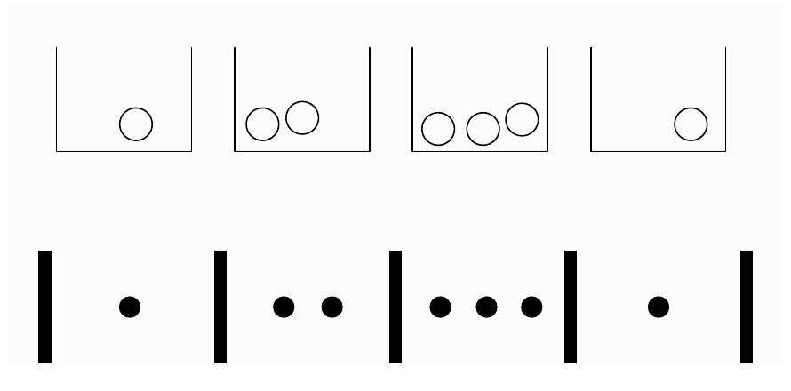
  <figcaption>Boxes and their symbol encoding. Reproduced from Joseph K. Blitzstein and Jessica Hwang, <em>Introduction to Probability</em>, Figure 1.5, p. 18.</figcaption>
</figure>

The four boxes contain $$(1,2,3,1)$$ particles, so $$n=4$$ and $$k=7$$. Reading from left to right, each dot becomes a star and each boundary between boxes becomes a bar:

```text
*|**|***|*
```

The lower row also shows an outer wall at each end. Those two walls are fixed; they are not extra separators to arrange. Removing them leaves seven stars and three internal bars, or ten positions. Thus all configurations of seven identical objects in four labeled boxes are counted by:

$$
\binom{10}{7}=\binom{10}{3}=120.
$$

**Core idea:** The box boundaries preserve the order of the labeled boxes, while the dots record only occupancies. The diagram uses seven particles; the earlier $$(3,0,2,1)$$ example uses six and shows how an empty box is encoded.

#### Step 2: Show that the encoding is reversible

Every occupancy vector produces exactly one string. Conversely, count the stars before the first bar, between successive bars, and after the last bar to recover every box count.

This is a **bijection**: a one-to-one correspondence between the two collections. Nothing is omitted and nothing is counted twice.

#### Step 3: Choose the star positions

A valid string contains:

- $$k$$ stars;
- $$n-1$$ bars;
- $$n+k-1$$ positions altogether.

Choose which $$k$$ positions contain stars. All remaining positions contain bars:

$$
\text{Number of strings}=\binom{n+k-1}{k}.
$$

Choosing the $$n-1$$ bar positions instead gives $$\binom{n+k-1}{n-1}$$. Both descriptions specify the same strings.

**For the example:** Six objects among four boxes give $$\binom96=\binom93=84$$ possible occupancy vectors.

<div class="misconception-block" markdown="1">

**Why not choose gaps only between the stars?** That would rule out adjacent bars and bars at the ends, excluding empty boxes. Stars and bars allows those arrangements because a type may be selected zero times.

**Why not divide $$n^k$$ by $$k!$$?** Different count vectors have different numbers of ordered versions. For example, $$AAA$$ has one ordering, while $$AAB$$ has three. There is no common $$k!$$ overcounting factor.

</div>

#### Supplementary example: Each box must be nonempty

Distribute seven identical objects into three labeled boxes, with at least one in each box.

First place one object in each box. Four objects remain, and they may be distributed with empty boxes allowed. Thus:

$$
\binom{3+4-1}{4}=\binom64=15.
$$

More generally, for $$k\ge n\ge1$$, positive integer solutions of $$x_1+\cdots+x_n=k$$ are counted by:

$$
\binom{k-1}{n-1}.
$$

If $$k<n$$, no such solution exists. The change of variables $$y_i=x_i-1$$ explains the result: the $$y_i$$ are nonnegative and sum to $$k-n$$.

### Part 4 — A count is not a probability model

The stars-and-bars count is also called the **Bose–Einstein value**, reflecting its connection to counting occupation configurations of indistinguishable particles. For ordinary sampling problems, however, counting configurations does not establish that those configurations are equally likely.

#### Example: Two independent fair coin tosses

The four equally likely ordered outcomes are:

$$
HH,\quad HT,\quad TH,\quad TT.
$$

Ignoring order leaves three head–tail count configurations:

| Configuration | Ordered outcomes represented | Probability |
|---|---|---|
| Two heads | $$HH$$ | $$1/4$$ |
| One head and one tail | $$HT,TH$$ | $$1/2$$ |
| Two tails | $$TT$$ | $$1/4$$ |

Stars and bars correctly counts the three configurations:

$$
\binom{2+2-1}{2}=3.
$$

It does **not** imply that each has probability $$1/3$$. A model assigning equal probabilities to the three configurations would describe a different random experiment.

**Core idea:** Whether we can visually distinguish objects is separate from how the experiment assigns probabilities. Identical-looking coins still have a first and second toss, or can be labeled coin 1 and coin 2.

<div class="warning-box" markdown="1">

**The physics connection has limits.** Bose–Einstein counting concerns indistinguishable particles and their occupation configurations. It does not make ordinary coin-toss configurations uniformly distributed, nor does the counting formula alone determine a physical system's probabilities.

</div>

#### Supplementary formula: Probability of a count vector

For $$k$$ independent draws, each uniformly choosing one of $$n$$ types, every ordered sequence has probability $$1/n^k$$.

A count vector $$(x_1,\ldots,x_n)$$ represents:

$$
\frac{k!}{x_1!x_2!\cdots x_n!}
$$

ordered sequences. To see why, arrange the $$k$$ selections and divide out the permutations within each repeated type. Therefore:

$$
P(\text{counts }(x_1,\ldots,x_n))
=\frac{k!}{x_1!\cdots x_n!}\frac1{n^k}.
$$

This explains precisely why different occupancy vectors generally receive different probabilities.

### Part 5 — Story proofs: counting the same collection twice

<div class="example-block" markdown="1">
<div class="ex-title">Story proof <span class="ex-pill pill-defn">Definition</span></div>

A **story proof** establishes a mathematical result through an interpretation. For a counting identity, interpret both sides as the number of objects in the same collection, then justify each count.

A story proof is a general argument. Verifying a few numerical examples provides checks, but does not prove an identity for all admissible values.

</div>

#### Identity 1: Choosing a group or its complement

For integers $$0\le k\le n$$:

$$
\boxed{\binom nk=\binom n{n-k}.}
$$

Choose a committee of $$k$$ people from $$n$$ people. Specifying the members uniquely determines the $$n-k$$ nonmembers, and specifying the nonmembers uniquely determines the members.

The two sides count the same committees through complementary descriptions.

**Core idea:** Choosing what to include is equivalent to choosing what to exclude.

#### Identity 2: A committee with a president

For integers $$1\le k\le n$$:

$$
\boxed{n\binom{n-1}{k-1}=k\binom nk.}
$$

Count committees of size $$k$$ with one committee member designated as president.

| Method | First choice | Second choice | Total |
|---|---|---|---|
| President first | One of $$n$$ people | Remaining $$k-1$$ members from the other $$n-1$$ | $$n\binom{n-1}{k-1}$$ |
| Committee first | A $$k$$-person committee from $$n$$ | President from its $$k$$ members | $$\binom nk\,k$$ |

Every committee–president pair is counted exactly once by each method, proving the identity.

For example, selecting a three-person committee with a president from five people gives:

$$
5\binom42=30=3\binom53.
$$

**Core idea:** Changing the order in which we specify a complete outcome can produce a useful identity without changing the outcomes being counted.

### Part 6 — Vandermonde's identity

<div class="example-block" markdown="1">
<div class="ex-title">Vandermonde's identity <span class="ex-pill pill-thm">Theorem</span></div>

For nonnegative integers $$m,n,k$$ with $$k\le m+n$$:

$$
\boxed{\binom{m+n}{k}
=\sum_{j=0}^{k}\binom mj\binom n{k-j}.}
$$

A binomial coefficient is zero when its lower argument exceeds its nonnegative upper argument. Impossible selections therefore contribute zero to the sum.

</div>

#### The story: Choose a committee from two groups

There are two disjoint groups: the first has $$m$$ people, and the second has $$n$$ people. Choose a committee of size $$k$$.

**Count directly:** Choose any $$k$$ of the total $$m+n$$ people:

$$
\binom{m+n}{k}.
$$

**Count by composition:** Suppose exactly $$j$$ committee members come from the first group. Then $$k-j$$ must come from the second group. For this fixed $$j$$, the multiplication rule gives:

$$
\binom mj\binom n{k-j}.
$$

Add over all possible $$j$$. The cases are disjoint because a committee has exactly one value of $$j$$, and they cover all committees. This proves the identity.

The feasible values are:

$$
\max(0,k-n)\le j\le\min(k,m).
$$

Using $$j=0,\ldots,k$$ is convenient because the infeasible terms are already zero.

#### Worked numerical example

Choose three people from a group of three and a separate group of four:

| Number from the first group, $$j$$ | Number from the second group | Number of committees |
|---|---:|---|
| 0 | 3 | $$\binom30\binom43=4$$ |
| 1 | 2 | $$\binom31\binom42=18$$ |
| 2 | 1 | $$\binom32\binom41=12$$ |
| 3 | 0 | $$\binom33\binom40=1$$ |

Hence:

$$
4+18+12+1=35=\binom73.
$$

**Core idea:** Multiply choices within a fixed case; add counts across disjoint cases.

#### Supplementary probability connection

If every $$k$$-person committee is equally likely, then:

$$
P(\text{exactly }j\text{ from the first group})
=\frac{\binom mj\binom n{k-j}}{\binom{m+n}{k}}.
$$

Vandermonde's identity guarantees that these probabilities sum to 1. It connects a combinatorial identity to the requirement that all possible cases account for the whole experiment.

### Part 7 — The general definition of probability

The formula $$P(A)=\lvert A\rvert/\lvert S\rvert$$ requires a finite sample space with equally likely outcomes. To handle unequal probabilities or infinitely many outcomes, assign probabilities to events through a function $$P$$.

<div class="example-block" markdown="1">
<div class="ex-title">Probability space <span class="ex-pill pill-defn">Definition</span></div>

At this introductory level, a **probability space** consists of:

- A sample space $$S$$ describing possible outcomes.
- A probability function $$P$$ that maps each event $$A$$ to a real number $$P(A)$$ in $$[0,1]$$ and satisfies the axioms below.

The input to $$P$$ is an event, which is a set of outcomes. Its output is a number.

</div>

#### Visual interpretation: Events are sets; probabilities are masses

<figure>
  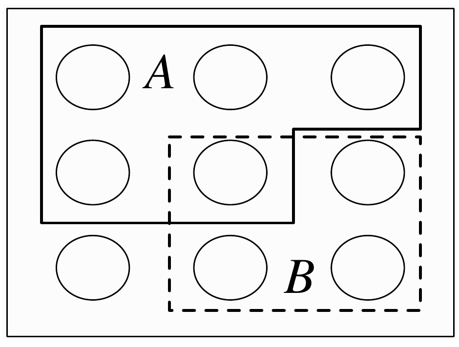
  <figcaption>Pebble World: each pebble is an outcome, and each outlined region is an event. Reproduced from Joseph K. Blitzstein and Jessica Hwang, <em>Introduction to Probability</em>, Figure 1.1, p. 3; the mass interpretation is developed in Section 1.6.</figcaption>
</figure>

The outer rectangle is $$S$$. Event $$A$$ contains five of the nine outcomes; event $$B$$ contains four. One outcome belongs to both, so $$A$$ and $$B$$ are not disjoint.

If all nine outcomes are equally likely, each has probability $$1/9$$. Then:

$$
P(A)=\frac59,\qquad P(B)=\frac49,\qquad
P(A\cap B)=\frac19,\qquad P(A\cup B)=\frac89.
$$

Adding $$5/9$$ and $$4/9$$ counts the shared pebble twice. Their union contains eight distinct pebbles, so direct addition is invalid here.

For a general finite model, imagine giving the pebbles nonnegative masses totaling 1. The probability of an event is the sum of the masses inside it. Equal masses recover counting; unequal masses require adding the assigned probabilities instead. The picture specifies which outcomes belong to each event, but the size or number of drawn circles alone does not specify their probabilities.

**Core idea:** Combining disjoint events adds separate masses. When events overlap, their common outcomes must be accounted for only once.

#### Axiom 1: The empty event and the whole space

$$
\boxed{P(\varnothing)=0,\qquad P(S)=1.}
$$

The empty event contains no outcome, so it cannot occur. The full sample space contains every possible outcome, so it must occur.

#### Axiom 2: Countable additivity

If $$A_1,A_2,\ldots$$ are pairwise disjoint events, then:

$$
\boxed{P\left(\bigcup_{j=1}^{\infty}A_j\right)
=\sum_{j=1}^{\infty}P(A_j).}
$$

“Pairwise disjoint” means:

$$
A_i\cap A_j=\varnothing\qquad\text{whenever }i\ne j.
$$

No outcome belongs to two of the events. Their union therefore combines non-overlapping probability contributions.

Countable additivity also gives finite additivity: set all events after the last one to $$\varnothing$$. In particular, if $$A\cap B=\varnothing$$, then:

$$
P(A\cup B)=P(A)+P(B).
$$

<div class="misconception-block" markdown="1">

**Disjointness is essential.** For two independent fair coin tosses, let $$A$$ mean the first toss is heads and $$B$$ mean the second toss is heads. The outcome $$HH$$ belongs to both events. Adding $$P(A)+P(B)=1$$ counts it twice, whereas $$P(A\cup B)=3/4$$.

Independent events are not necessarily disjoint. Independence describes how probabilities relate; disjointness means that the events cannot occur together.

</div>

#### Supplementary example: Unequal masses on a finite sample space

Let $$S=\{a,b,c\}$$, with individual probabilities $$0.2,0.3,0.5$$. For any event, add the probabilities of its outcomes. Then:

$$
P(\{a,c\})=0.2+0.5=0.7.
$$

The empty set has total probability 0, the full space has total probability 1, and disjoint sets add without double counting. This is a valid probability model, although counting two favorable outcomes out of three would give the wrong answer.

Equal masses of $$1/N$$ on a finite sample space of size $$N$$ recover the naive formula. Thus the counting definition is a special case of the general framework.

#### Supplementary example: A countably infinite sample space

Let $$S=\{1,2,3,\ldots\}$$ and assign:

$$
P(\{j\})=2^{-j},\qquad j=1,2,\ldots.
$$

The total probability is the geometric series:

$$
\sum_{j=1}^{\infty}2^{-j}=1.
$$

For example, the probability of an even result is:

$$
P(\{2,4,6,\ldots\})=\sum_{r=1}^{\infty}4^{-r}=\frac13.
$$

The outcomes are not equally likely, but the model has a well-defined total probability. No division by an infinite number of outcomes is needed.

<div class="warning-box" markdown="1">

**Technical clarification for infinite spaces:** In a fully general treatment, probabilities are assigned to a specified collection of measurable events, and a probability space is written $$(S,\mathcal F,P)$$. For finite or countable spaces, we can take all subsets as events. For uncountable spaces, such as a continuous interval, additional care is needed; not every subset must be assigned a probability.

**Probability zero is not always impossibility.** The empty event always has probability zero, but in continuous models a particular point can also have probability zero. The reverse implication is not generally valid.

</div>

### Part 8 — Original practice questions

Try these before reading the answers.

1. How many ways can eight people be split into an unnamed team of three and a team of five? What changes for two unnamed teams of four? What if the two four-person teams are labeled A and B?
2. Encode $$(2,0,1,2)$$ using stars and bars. How many possible occupancy vectors are there for five identical objects in four labeled boxes?
3. How many nonnegative integer solutions satisfy $$x_1+x_2+x_3=6$$? How many satisfy the same equation with all entries positive?
4. Three independent draws select uniformly from types $$A$$ and $$B$$. How many unordered count configurations are possible? Find the probability of each configuration and explain why they are not uniform.
5. Prove $$6\binom52=3\binom63$$ by describing a committee and a president.
6. Choose three people from disjoint groups of four and five people. Use Vandermonde's identity to verify the total count. If all committees are equally likely, what is the probability that exactly two members come from the first group?
7. Suppose $$S=\{a,b,c\}$$ has individual probabilities $$0.1,0.4,0.5$$. Let $$A=\{a,b\}$$ and $$B=\{b,c\}$$. Find $$P(A)$$, $$P(B)$$, and $$P(A\cup B)$$. Why is direct addition invalid?
8. In the model $$P(\{j\})=2^{-j}$$ for positive integers $$j$$, find the probability of a result at least 3.

### Part 9 — Practice answers

#### 1. Splitting teams

For teams of three and five, choose the three-person team:

$$
\binom83=56.
$$

For two unnamed teams of four, each partition is counted twice by selecting a four-person team:

$$
\frac12\binom84=35.
$$

For labeled teams A and B, choosing Team A uniquely determines Team B, giving $$\binom84=70$$ assignments.

#### 2. Stars-and-bars encoding

The string is:

```text
**||*|**
```

There are five stars and three bars, so:

$$
\binom{4+5-1}{5}=\binom85=56.
$$

#### 3. Integer solutions

For nonnegative entries:

$$
\binom{3+6-1}{6}=\binom82=28.
$$

For positive entries, subtract one from each variable. The new nonnegative entries sum to 3, giving:

$$
\binom{3+3-1}{3}=\binom52=10.
$$

#### 4. Counts versus probabilities

There are $$\binom{2+3-1}{3}=4$$ configurations. The eight ordered sequences are equally likely:

| Counts $$(x_A,x_B)$$ | Number of ordered sequences | Probability |
|---|---:|---|
| $$(3,0)$$ | 1 | $$1/8$$ |
| $$(2,1)$$ | 3 | $$3/8$$ |
| $$(1,2)$$ | 3 | $$3/8$$ |
| $$(0,3)$$ | 1 | $$1/8$$ |

The configurations are not uniform because they represent different numbers of equally likely ordered outcomes.

#### 5. Committee and president

Choose the president from six people, then two other members from the remaining five: $$6\binom52$$.

Alternatively, choose three members from six, then select one of the three as president: $$3\binom63$$.

Both count the same committee–president pairs, and both equal 60.

#### 6. Vandermonde and a committee probability

Count by the number selected from the first group:

$$
\binom40\binom53+\binom41\binom52+
\binom42\binom51+\binom43\binom50
=10+40+30+4=84=\binom93.
$$

Exactly two from the first group gives $$\binom42\binom51=30$$ committees, so:

$$
P(\text{exactly two})=\frac{30}{84}=\frac5{14}.
$$

#### 7. Overlapping events

$$
P(A)=0.1+0.4=0.5,\qquad P(B)=0.4+0.5=0.9.
$$

Their union is $$S$$, so $$P(A\cup B)=1$$. Adding 0.5 and 0.9 counts outcome $$b$$ twice. Additivity in its direct form requires disjoint events.

#### 8. An infinite tail

By countable additivity:

$$
P(\{3,4,5,\ldots\})=\sum_{j=3}^{\infty}2^{-j}
=\frac{1/8}{1-1/2}=\frac14.
$$

### Part 10 — Quick revision sheet

| Concept | Essential fact |
|---|---|
| Labels | Identify elementary outcomes before grouping them into observations |
| Overcounting correction | Divide by $$c$$ only when every desired outcome is counted exactly $$c$$ times |
| Stars and bars | $$k$$ identical objects, $$n$$ labeled boxes, empty boxes allowed: $$\binom{n+k-1}{k}$$ |
| Positive occupancies | For $$k\ge n\ge1$$: $$\binom{k-1}{n-1}$$ |
| Complement identity | $$\binom nk=\binom n{n-k}$$ |
| Committee–president identity | $$n\binom{n-1}{k-1}=k\binom nk$$ |
| Vandermonde's identity | $$\binom{m+n}{k}=\sum_{j=0}^k\binom mj\binom n{k-j}$$ |
| Story proof | Justify two counts of the same collection |
| Probability function | Maps events to numbers in $$[0,1]$$ |
| Normalization | $$P(\varnothing)=0$$ and $$P(S)=1$$ |
| Countable additivity | For pairwise disjoint events, probability of the union equals the sum of probabilities |
| Main modeling warning | Equally likely sequences can produce unequally likely count configurations |

### Term Glossary

<div class="glossary-entry" markdown="1">
<div class="gterm">Occupancy vector <span class="gcat cat-notn">Notation</span></div>

A vector $$(x_1,\ldots,x_n)$$ recording the number of objects in each labeled box. For unordered repeated selections, it records how many times each type was chosen.

</div>

<div class="glossary-entry" markdown="1">
<div class="gterm">Bijection <span class="gcat cat-defn">Definition</span></div>

A one-to-one correspondence between two collections. Every element of either collection has exactly one partner in the other, so finite collections related by a bijection have the same size.

</div>

<div class="glossary-entry" markdown="1">
<div class="gterm">Stars and bars <span class="gcat cat-prop">Counting method</span></div>

An encoding of identical objects as stars and boundaries between labeled boxes as bars. Choosing the star or bar positions gives the number of nonnegative occupancy vectors.

</div>

<div class="glossary-entry" markdown="1">
<div class="gterm">Story proof <span class="gcat cat-defn">Definition</span></div>

A proof by interpretation. In combinatorics, it often establishes an identity by counting the same collection in two justified ways.

</div>

<div class="glossary-entry" markdown="1">
<div class="gterm">Vandermonde's identity <span class="gcat cat-thm">Identity</span></div>

An equality between choosing a committee from two combined groups and summing over all possible ways to split its membership between those groups.

</div>

<div class="glossary-entry" markdown="1">
<div class="gterm">Probability space <span class="gcat cat-defn">Definition</span></div>

A sample space together with a probability function on its events. In the fully general formulation, the collection of measurable events is also specified.

</div>

<div class="glossary-entry" markdown="1">
<div class="gterm">Pairwise disjoint events <span class="gcat cat-defn">Definition</span></div>

Events for which every pair of distinct events has empty intersection. At most one of them can occur in a single outcome.

</div>

<div class="glossary-entry" markdown="1">
<div class="gterm">Countable additivity <span class="gcat cat-prop">Axiom</span></div>

The probability of a union of countably many pairwise disjoint events equals the sum of their individual probabilities.

</div>

<div class="ref-tags">
  <span class="ref-tag">Statistics 110</span>
  <span class="ref-tag">Lecture 2</span>
  <span class="ref-tag">Stars and bars</span>
  <span class="ref-tag">Story proofs</span>
  <span class="ref-tag">Probability axioms</span>
</div>

  </div>
</div>


## Lecture 3 - Birthday Problem and Properties of Probability

<div class="chapter-block">
  <button type="button" class="chapter-toggle" id="lecture-3-toggle" onclick="toggleLecture('lecture-3')" aria-expanded="true" aria-controls="lecture-3-body">
    <span class="chapter-toggle-left">
      <span class="chapter-badge">Lecture 3</span>
      <span>
        <span class="chapter-title">Lecture 3 - Birthday Problem and Properties of Probability</span>
        <span class="chapter-subtitle">Complements, probability axioms, inclusion–exclusion, and de Montmort's matching problem</span>
      </span>
    </span>
    <span class="chapter-arrow open" id="lecture-3-arrow" aria-hidden="true">▼</span>
  </button>
  <div class="chapter-body open" id="lecture-3-body" markdown="1">

<div class="note-abstract" markdown="1">

A coincidence can become likely when there are many opportunities for it to occur. The birthday problem illustrates this through counting the complement. Probability axioms give general rules for complements, containment, and overlapping events. Inclusion–exclusion then handles the overlaps in a shuffled deck, giving a surprisingly stable probability of at least one matching card.

</div>

### Notation at a Glance

<div class="notation-panel" markdown="1">

| Symbol | Meaning |
|---|---|
| $$k$$ | Number of people in the birthday problem |
| $$M$$, $$M^c$$ | At least one birthday match, and no birthday matches |
| $$\prod_{j=0}^{k-1}(1-j/365)$$ | Product of the $$k$$ factors for distinct birthdays |
| $$A^c$$ | Complement of event $$A$$ within $$S$$ |
| $$B\cap A^c$$ | Outcomes in $$B$$ but outside $$A$$ |
| $$A\subseteq B$$ | Every outcome in $$A$$ belongs to $$B$$ |
| $$\bigcup_{i=1}^n A_i$$ | At least one of the events $$A_1,\ldots,A_n$$ occurs |
| $$\bigcap_{i\in I}A_i$$ | All events whose indices belong to $$I$$ occur |
| $$n$$ | Number of distinct cards in the matching problem |
| $$\pi(i)$$ | Label on the card in position $$i$$ of a shuffled deck |
| $$A_i=\{\pi(i)=i\}$$ | Card $$i$$ matches its position |
| $$D_n$$ | Number of permutations of $$n$$ objects with no fixed points |
| $$e$$ | Base of the natural logarithm; $$e\approx2.71828$$ |

</div>

### Learning objectives

After studying these notes, you should be able to:

- State the birthday model's assumptions and identify its equally likely outcomes.
- Derive the probability of at least one birthday match by counting the complement.
- Distinguish any matching pair from a match with one specified person's birthday.
- Prove the complement rule, monotonicity, and the two-event addition rule from the probability axioms.
- Explain the alternating signs in inclusion–exclusion.
- Calculate intersection probabilities for specified matching positions in a permutation.
- Derive the matching probability and explain its limit of $$1-e^{-1}$$.

### Part 1 — The birthday problem: defining the model

Suppose $$k$$ people are in a room. What is the probability that **at least two** have the same birthday?

Use the following idealized model:

- There are 365 possible birthdays; February 29 is excluded.
- Each person's birthday is equally likely to be any of those days.
- People's birthdays are mutually independent.
- People are distinguishable: person 1's birthday and person 2's birthday occupy different positions in an outcome.

An outcome is an ordered list of $$k$$ birthdays. Each position has 365 possibilities, so:

$$
\lvert S\rvert=365^k.
$$

The uniformity and independence assumptions make every such list equally likely, with probability $$365^{-k}$$.

Let $$M$$ be the event of at least one match. A match may involve one pair, several pairs, or three or more people on one day. All of these belong to $$M$$.

<div class="warning-box" markdown="1">

**Modeling clarification:** Real birthdays need not be uniformly distributed or independent. The formula below is exact for the stated model; it is not an exact description of every real group. Labeling people does not establish independence—it specifies which outcomes we are counting.

</div>

#### Boundary cases

With zero or one person, a match is impossible. With more than 365 people, a match is certain by the **pigeonhole principle**: assigning more than 365 people to 365 days forces some day to receive at least two people.

With exactly 365 people, a match is extremely likely but not certain: an assignment with one person on each day is still possible.

### Part 2 — Count no matches, then take the complement

Directly counting all possible kinds of matches is difficult because the cases overlap. The complement $$M^c$$ has a simple description: all birthdays are different.

For $$1\le k\le365$$:

| Person | Allowed birthdays if all birthdays must differ |
|---|---:|
| First | 365 |
| Second | 364 |
| Third | 363 |
| $$k$$th | $$365-k+1$$ |

Thus:

$$
\lvert M^c\rvert=365\cdot364\cdots(365-k+1).
$$

Divide by the number of equally likely birthday lists:

$$
P(M^c)=\frac{365\cdot364\cdots(365-k+1)}{365^k}
=\prod_{j=0}^{k-1}\left(1-\frac j{365}\right).
$$

<div class="result-box" markdown="1">

$$
\boxed{P(M)=1-\prod_{j=0}^{k-1}\left(1-\frac j{365}\right),\qquad1\le k\le365.}
$$

For $$k=0$$, the empty product is 1, giving probability 0. For $$k>365$$, use $$P(M)=1$$ rather than extending the product to negative factors.

</div>

**Core idea:** The experiment allows repeated birthdays, so the denominator counts sampling with replacement. The no-match event restricts birthdays to distinct days, so its numerator counts assignments without replacement. Both counts still describe ordered lists for the same labeled people.

#### Worked example: Why 23 people are enough

For 23 people:

$$
P(M)=1-\frac{365\cdot364\cdots343}{365^{23}}
\approx0.507297.
$$

The no-match probability is approximately $$0.492703$$. For 22 people, the match probability is approximately $$0.475695$$, so 23 is the smallest group size with a match probability above 50%.

| People, $$k$$ | Probability of at least one match |
|---:|---:|
| 2 | $$0.002740$$ |
| 10 | $$0.116948$$ |
| 22 | $$0.475695$$ |
| 23 | $$0.507297$$ |
| 30 | $$0.706316$$ |
| 50 | $$0.970374$$ |
| 57 | $$0.990122$$ |
| 100 | $$0.999999693$$ |

<figure>
  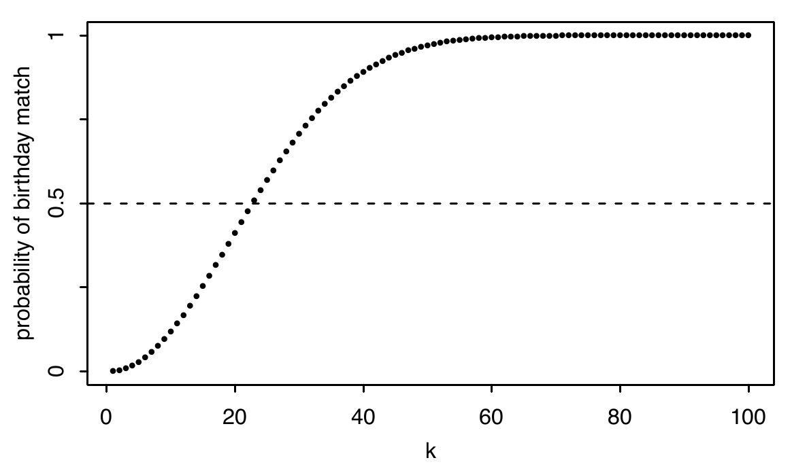
  <figcaption>Birthday-match probability under the independent, uniform 365-day model. Reproduced from Joseph K. Blitzstein and Jessica Hwang, <em>Introduction to Probability</em>, Figure 1.4, p. 12.</figcaption>
</figure>

#### Why the result is less surprising after counting pairs

A group of 23 people contains:

$$
\binom{23}{2}=253
$$

pairs. The event concerns any of these pairs, not just the 22 comparisons involving one particular person. The number of pairs grows quadratically with group size.

<div class="misconception-block" markdown="1">

**Incorrect:** There are 253 pairs, each matching with probability $$1/365$$, so the probability of a match is $$253/365$$.

**Correction:** Pair-match events overlap. If three people share a birthday, all three pairs among them match. Adding their probabilities counts that outcome repeatedly. The ratio $$253/365\approx0.693151$$ is not the probability of at least one match.

</div>

#### Supplementary comparison: Someone shares your birthday

Fix your birthday and consider 22 other people under the same independent, uniform model. Each avoids your birthday with probability $$364/365$$. Therefore:

$$
P(\text{at least one shares your birthday})
=1-\left(\frac{364}{365}\right)^{22}
\approx0.058571.
$$

This is about 5.86%, compared with 50.73% for any match among all 23 people. The first event asks for a match with one specified birthday; the second allows any pair to match.

### Part 3 — Probability axioms and the complement rule

A probability function assigns every event a number in $$[0,1]$$. The axioms are:

$$
P(\varnothing)=0,\qquad P(S)=1,
$$

and, for pairwise disjoint events:

$$
P\left(\bigcup_{i=1}^{\infty}A_i\right)
=\sum_{i=1}^{\infty}P(A_i).
$$

These rules apply beyond finite, equally likely sample spaces. The following properties are consequences of the axioms, rather than additional assumptions.

#### Derive the complement rule

The events $$A$$ and $$A^c$$ are disjoint, and their union is $$S$$. By additivity:

$$
1=P(S)=P(A\cup A^c)=P(A)+P(A^c).
$$

Rearranging gives:

$$
\boxed{P(A^c)=1-P(A).}
$$

This justifies the final step in the birthday calculation. It also applies when individual outcomes have unequal probabilities or when the sample space is infinite.

**Core idea:** An event and its complement divide the entire experiment into two mutually exclusive possibilities, whose probabilities sum to 1.

### Part 4 — Monotonicity: a larger event cannot be less likely

<div class="example-block" markdown="1">
<div class="ex-title">Monotonicity <span class="ex-pill pill-thm">Theorem</span></div>

If $$A\subseteq B$$, then:

$$
\boxed{P(A)\le P(B).}
$$

</div>

#### Proof by disjoint decomposition

Separate $$B$$ into the outcomes in $$A$$ and the outcomes outside $$A$$:

$$
B=A\cup(B\cap A^c).
$$

These two pieces are disjoint. Hence:

$$
P(B)=P(A)+P(B\cap A^c)\ge P(A),
$$

because probabilities are nonnegative.

<figure>
  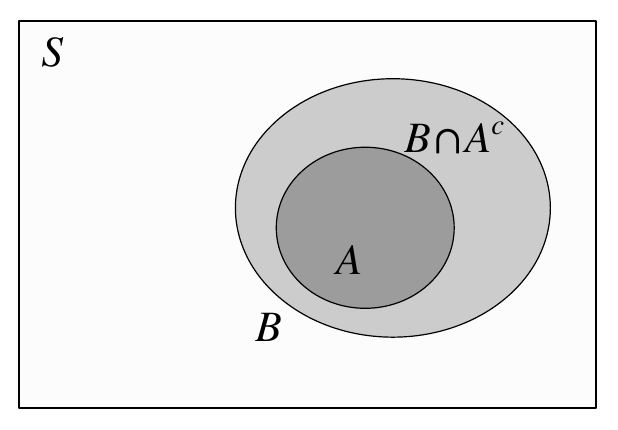
  <figcaption>Decomposing a containing event into disjoint pieces. Reproduced from Blitzstein and Hwang, <em>Introduction to Probability</em>, diagram in the proof of Theorem 1.6.2, p. 22.</figcaption>
</figure>

#### Supplementary example: Nested dice events

Roll a fair six-sided die. Let $$A=\{6\}$$ and $$B=\{4,5,6\}$$. Since $$A\subseteq B$$:

$$
P(A)=\frac16\le\frac36=P(B).
$$

The extra outcomes $$B\cap A^c=\{4,5\}$$ contribute probability $$2/6$$.

<div class="warning-box" markdown="1">

**Containment need not give strict inequality.** Even if $$A$$ is a proper subset of $$B$$, it is possible that $$P(A)=P(B)$$. Strict inequality holds exactly when $$P(B\cap A^c)>0$$. A nonempty event need not have positive probability in every model.

</div>

### Part 5 — Two overlapping events: the addition rule

<div class="result-box" markdown="1">

For any two events $$A$$ and $$B$$:

$$
\boxed{P(A\cup B)=P(A)+P(B)-P(A\cap B).}
$$

</div>

The sum $$P(A)+P(B)$$ counts outcomes in the intersection twice. Subtracting $$P(A\cap B)$$ leaves each outcome in the union counted once.

<figure>
  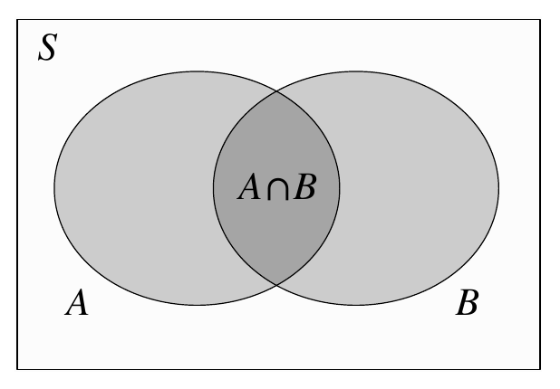
  <figcaption>The intersection is included in both event probabilities. Reproduced from Blitzstein and Hwang, <em>Introduction to Probability</em>, diagram in the proof of Theorem 1.6.2, p. 22.</figcaption>
</figure>

#### Proof using the axioms

Write the union as two disjoint pieces:

$$
A\cup B=A\cup(B\cap A^c).
$$

Therefore:

$$
P(A\cup B)=P(A)+P(B\cap A^c).
$$

Also, $$B=(A\cap B)\cup(B\cap A^c)$$ is a disjoint union, so:

$$
P(B\cap A^c)=P(B)-P(A\cap B).
$$

Substitution gives the addition rule. No independence assumption is needed. For disjoint events, the intersection has probability zero and the rule reduces to direct addition.

#### Supplementary worked example: An even result or a result above 3

For a fair die, let $$A=\{2,4,6\}$$ and $$B=\{4,5,6\}$$. Their intersection is $$\{4,6\}$$. Hence:

$$
P(A\cup B)=\frac36+\frac36-\frac26=\frac46=\frac23.
$$

The union is $$\{2,4,5,6\}$$, confirming the result by direct counting.

**Core idea:** “Or” includes outcomes where both events occur, but each such outcome contributes only once to the union.

### Part 6 — Inclusion–exclusion for three or more events

#### Three events

$$
\boxed{\begin{aligned}
P(A\cup B\cup C)
={}&P(A)+P(B)+P(C)\\
&-P(A\cap B)-P(A\cap C)-P(B\cap C)\\
&+P(A\cap B\cap C).
\end{aligned}}
$$

<figure>
  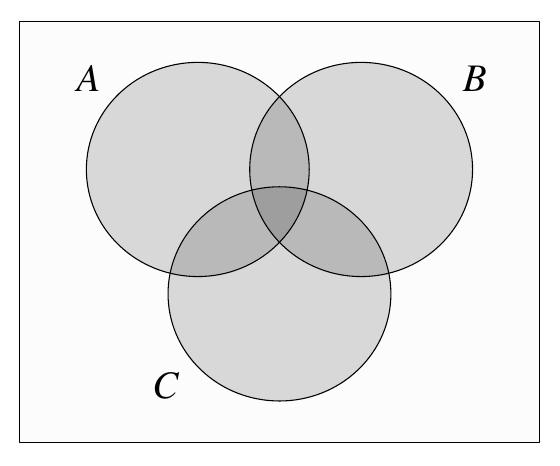
  <figcaption>Pairwise corrections remove the central overlap too many times, so the triple intersection is added back. Reproduced from Blitzstein and Hwang, <em>Introduction to Probability</em>, Section 1.6, p. 23.</figcaption>
</figure>

Track how often a particular outcome contributes:

| Events containing the outcome | Single-event additions | Pairwise subtractions | Triple addition | Net count |
|---|---:|---:|---:|---:|
| Exactly one | 1 | 0 | 0 | 1 |
| Exactly two | 2 | 1 | 0 | 1 |
| All three | 3 | 3 | 1 | 1 |

The pairwise intersections include the triple intersection. Subtracting all three pairwise terms removes a central outcome three times after adding it three times, leaving zero. The final addition restores its contribution to one.

#### General formula

For events $$A_1,\ldots,A_n$$:

$$
\boxed{
P\left(\bigcup_{i=1}^{n}A_i\right)
=\sum_{r=1}^{n}(-1)^{r+1}
\sum_{1\le i_1<\cdots<i_r\le n}
P(A_{i_1}\cap\cdots\cap A_{i_r}).
}
$$

Add single-event probabilities, subtract two-event intersections, add three-event intersections, and continue with alternating signs. Each unordered group of indices appears once; the condition $$i_1<\cdots<i_r$$ prevents repeated listings of the same intersection.

**Core idea:** Inclusion–exclusion corrects overlap systematically. Symmetry makes it especially useful when all intersections involving the same number of specified events have the same probability.

<div class="misconception-block" markdown="1">

**Incorrect:** For three events, subtracting the three pairwise intersections is enough.

**Correction:** The triple intersection must be added back. Pairwise intersections mean that both named events occur, whether or not a third event also occurs; they do not mean “exactly those two.”

</div>

### Part 7 — de Montmort's matching problem

Shuffle $$n\ge1$$ distinct cards labeled $$1,2,\ldots,n$$, with all $$n!$$ permutations equally likely. Reveal them in order while counting $$1,2,\ldots,n$$. Win if at least one revealed card matches the number called out.

A match is a **fixed point** of the permutation. If the deck is $$(3,2,1,4)$$, positions 2 and 4 match; positions 1 and 3 do not.

Let:

$$
A_i=\{\pi(i)=i\}.
$$

The event of winning is $$A_1\cup\cdots\cup A_n$$. The events overlap because several positions can match at once.

#### Step 1: One specified position matches

Fix card $$i$$ in position $$i$$. The remaining $$n-1$$ cards may be arranged freely, giving $$(n-1)!$$ favorable permutations:

$$
P(A_i)=\frac{(n-1)!}{n!}=\frac1n.
$$

#### Step 2: Several specified positions match

For distinct positions $$i_1,\ldots,i_r$$, fixing their cards leaves $$(n-r)!$$ arrangements:

$$
P(A_{i_1}\cap\cdots\cap A_{i_r})=\frac{(n-r)!}{n!}.
$$

For example:

$$
P(A_i\cap A_j)=\frac1{n(n-1)},\qquad
P(A_i\cap A_j\cap A_\ell)=\frac1{n(n-1)(n-2)}.
$$

Fixing the specified positions does **not** forbid additional matches among the remaining positions. That is exactly what an intersection requires: all named events occur, possibly along with others.

#### Step 3: Group the inclusion–exclusion terms

There are $$\binom nr$$ ways to choose the $$r$$ specified matching positions. Each intersection has the same probability, so the total at order $$r$$ is:

$$
\binom nr\frac{(n-r)!}{n!}
=\frac{n!}{r!(n-r)!}\frac{(n-r)!}{n!}
=\frac1{r!}.
$$

Therefore:

<div class="result-box" markdown="1">

$$
\boxed{P(\text{at least one match})
=\sum_{r=1}^{n}\frac{(-1)^{r+1}}{r!}
=1-\frac1{2!}+\frac1{3!}-\cdots+\frac{(-1)^{n+1}}{n!}.}
$$

</div>

**Core idea:** A complicated union becomes manageable because intersection probabilities depend only on how many positions are specified. The binomial coefficient counts the choices of positions; the factorial ratio counts decks satisfying those choices.

#### Worked example: Three cards

For $$n=3$$:

$$
P(\text{win})=1-\frac12+\frac16=\frac23.
$$

All six decks can be listed:

| Deck order | Matching positions | Result |
|---|---|---|
| $$(1,2,3)$$ | 1, 2, 3 | Win |
| $$(1,3,2)$$ | 1 | Win |
| $$(2,1,3)$$ | 3 | Win |
| $$(2,3,1)$$ | None | Lose |
| $$(3,1,2)$$ | None | Lose |
| $$(3,2,1)$$ | 2 | Win |

Four of six permutations win. No permutation has exactly two matching positions: if two cards are fixed, the remaining card is forced into its own position.

<div class="misconception-block" markdown="1">

**Incorrect:** Each position matches with probability $$1/n$$, so the probability of winning is $$n(1/n)=1$$.

**Correction:** The events are not disjoint. The fully ordered deck belongs to every $$A_i$$ and is counted $$n$$ times in that sum. Inclusion–exclusion corrects those repeated contributions.

**Another trap:** The match events are not independent. For $$n\ge2$$, $$P(A_i\cap A_j)=1/[n(n-1)]$$, whereas $$P(A_i)P(A_j)=1/n^2$$.

</div>

### Part 8 — Derangements and the large-deck limit

A **derangement** is a permutation with no fixed points. It is a losing deck in the matching game.

Taking the complement of the winning probability gives:

$$
P(\text{no matches})=\sum_{r=0}^{n}\frac{(-1)^r}{r!}.
$$

Multiply by the total number of permutations:

$$
\boxed{D_n=n!\sum_{r=0}^{n}\frac{(-1)^r}{r!}.}
$$

For example, $$D_3=6(1-1+1/2-1/6)=2$$, agreeing with the two losing decks above.

#### The limiting probability

The exponential series gives:

$$
e^{-1}=\sum_{r=0}^{\infty}\frac{(-1)^r}{r!}.
$$

Consequently:

$$
\boxed{P(\text{no matches})\longrightarrow e^{-1}\approx0.367879,}
$$

$$
\boxed{P(\text{at least one match})\longrightarrow1-e^{-1}\approx0.632121.}
$$

| Cards, $$n$$ | Exact winning probability | Decimal |
|---:|---|---:|
| 1 | $$1$$ | $$1.000000$$ |
| 2 | $$1-1/2!$$ | $$0.500000$$ |
| 3 | $$1-1/2!+1/3!$$ | $$0.666667$$ |
| 4 | $$1-1/2!+1/3!-1/4!$$ | $$0.625000$$ |
| 5 | $$1-1/2!+1/3!-1/4!+1/5!$$ | $$0.633333$$ |
| 6 | $$1-1/2!+1/3!-1/4!+1/5!-1/6!$$ | $$0.631944$$ |

The finite probabilities alternate around the limit; they do not increase monotonically with deck size. A larger deck provides more candidate matching positions, but each specified position matches with smaller probability $$1/n$$.

#### Supplementary clarification: Accuracy of the limit

The alternating-series remainder bounds the error by the first omitted term:

$$
\left|P(\text{win})-(1-e^{-1})\right|\le\frac1{(n+1)!}.
$$

For six cards, the error is at most $$1/7!\approx0.000198413$$. For 52 distinct numbered cards, the limiting value is an extraordinarily accurate approximation, although the finite alternating sum remains the exact probability.

### Part 9 — Original practice questions

Try these before reading the answers.

1. Under the birthday model, find the probability of at least one match among three people. Explain why there are two different counting rules in the calculation.
2. What is the smallest group size that guarantees a birthday match? Why does a group of 365 people not guarantee one?
3. Fix your birthday. Find the probability that at least one of ten other people shares it, under the independent, uniform model. Is this the same event as any birthday match among all eleven people?
4. Suppose $$A\subseteq B$$, $$P(A)=0.25$$, and $$P(B)=0.60$$. Find $$P(B\cap A^c)$$ and $$P(B^c)$$.
5. Suppose $$P(A)=0.60$$, $$P(B)=0.50$$, and $$P(A\cap B)=0.20$$. Find the probabilities of the union, neither event, and exactly one event.
6. Three events each have probability $$0.40$$. Each pairwise intersection has probability $$0.15$$, and the triple intersection has probability $$0.05$$. Find the probability of their union. What answer would omitting the triple correction give?
7. Shuffle five distinct numbered cards uniformly. Find the probability that positions 1 and 3 both match. How many permutations satisfy this condition? Does the condition forbid other matches?
8. For four distinct numbered cards, find the probability of winning the matching game and the number of derangements.
9. In a deck of four distinct numbered cards, explain why the probability that positions 1 and 2 both match is not $$1/16$$.

### Part 10 — Practice answers

#### 1. Three birthdays

The denominator counts all birthday assignments with repetition allowed. The no-match numerator counts only assignments of distinct birthdays:

$$
P(M)=1-\frac{365\cdot364\cdot363}{365^3}
=\frac{1093}{133225}\approx0.008204.
$$

The probability is about 0.8204%. Taking the complement includes every possible kind of match without counting overlapping match cases separately.

#### 2. A guaranteed match

The smallest size is 366. With 365 people, assigning exactly one person to each day produces no match. With 366 people, there are more people than available days, so at least two must share a day.

#### 3. A specified birthday

All ten people avoid your birthday with probability $$(364/365)^{10}$$, so:

$$
P(\text{at least one shares yours})
=1-\left(\frac{364}{365}\right)^{10}
\approx0.027062.
$$

This is about 2.7062%. Any match among eleven people also includes pairs among the other ten, so it is a different, larger event.

#### 4. Containment and complement

The disjoint decomposition of $$B$$ gives:

$$
P(B\cap A^c)=P(B)-P(A)=0.60-0.25=0.35.
$$

The complement rule gives $$P(B^c)=1-0.60=0.40$$.

#### 5. Union, neither, and exactly one

$$
P(A\cup B)=0.60+0.50-0.20=0.90.
$$

Neither event is the complement of the union, so its probability is $$0.10$$.

Exactly one consists of the disjoint events $$A\cap B^c$$ and $$B\cap A^c$$:

$$
P(\text{exactly one})=(0.60-0.20)+(0.50-0.20)=0.70.
$$

The union includes the both-events case; exactly one excludes it.

#### 6. Three-event correction

$$
P(A\cup B\cup C)=3(0.40)-3(0.15)+0.05=0.80.
$$

Omitting the triple correction gives $$0.75$$, undercounting the union by the probability $$0.05$$ of the triple intersection.

#### 7. Two specified matching positions

Fix cards 1 and 3 in positions 1 and 3. Arrange the remaining three cards in $$3!=6$$ ways. Thus:

$$
P(A_1\cap A_3)=\frac{3!}{5!}=\frac1{20}.
$$

Other positions may also match. The intersection requires at least the two specified matches, not exactly two matches.

#### 8. Four-card game

$$
P(\text{win})=1-\frac1{2!}+\frac1{3!}-\frac1{4!}
=\frac{15}{24}=\frac58.
$$

The no-match probability is $$3/8$$, so:

$$
D_4=4!\cdot\frac38=9.
$$

#### 9. Dependence between matching positions

Each specified position matches with probability $$1/4$$. But fixing two specified cards leaves $$2!$$ favorable permutations out of $$4!$$:

$$
P(A_1\cap A_2)=\frac{2!}{4!}=\frac1{12}.
$$

Multiplying $$1/4$$ by $$1/4$$ would require independence, which does not hold for these events.

### Part 11 — Quick revision sheet

| Concept | Essential fact |
|---|---|
| Birthday sample space | $$365^k$$ equally likely ordered assignments under uniformity and mutual independence |
| No birthday match | $$\prod_{j=0}^{k-1}(1-j/365)$$ for $$1\le k\le365$$ |
| At least one birthday match | One minus the no-match probability; exceeds 50% first at $$k=23$$ |
| Guaranteed birthday match | $$k>365$$ |
| Complement | $$P(A^c)=1-P(A)$$ |
| Monotonicity | $$A\subseteq B\Rightarrow P(A)\le P(B)$$ |
| Two-event addition | $$P(A\cup B)=P(A)+P(B)-P(A\cap B)$$ |
| Inclusion–exclusion | Add singles, subtract pairs, add triples, and continue alternating |
| $$r$$ specified card matches | $$(n-r)!/n!$$ |
| Total order-$$r$$ contribution | $$\binom nr(n-r)!/n!=1/r!$$ |
| Matching-game win | $$\sum_{r=1}^n(-1)^{r+1}/r!$$ |
| Derangements | $$D_n=n!\sum_{r=0}^n(-1)^r/r!$$ |
| Large-deck win probability | $$1-e^{-1}\approx0.632121$$ |

### Term Glossary

<div class="glossary-entry" markdown="1">
<div class="gterm">Birthday match <span class="gcat cat-defn">Definition</span></div>

An event in which at least two people share a birthday. It includes several pairs or larger groups sharing a day, not only exactly one matching pair.

</div>

<div class="glossary-entry" markdown="1">
<div class="gterm">Pigeonhole principle <span class="gcat cat-prop">Counting principle</span></div>

Placing more objects than boxes into boxes forces at least one box to contain two or more objects.

</div>

<div class="glossary-entry" markdown="1">
<div class="gterm">Complement rule <span class="gcat cat-thm">Theorem</span></div>

The probability that an event does not occur is one minus the probability that it occurs.

</div>

<div class="glossary-entry" markdown="1">
<div class="gterm">Monotonicity <span class="gcat cat-thm">Theorem</span></div>

If one event is contained in another, its probability cannot exceed that of the containing event.

</div>

<div class="glossary-entry" markdown="1">
<div class="gterm">Inclusion–exclusion <span class="gcat cat-thm">Theorem</span></div>

A formula for the probability of a union that corrects repeated contributions from overlapping events using alternating sums of intersection probabilities.

</div>

<div class="glossary-entry" markdown="1">
<div class="gterm">Permutation <span class="gcat cat-defn">Definition</span></div>

An ordering of distinct objects. There are $$n!$$ permutations of $$n$$ distinct objects.

</div>

<div class="glossary-entry" markdown="1">
<div class="gterm">Fixed point <span class="gcat cat-defn">Definition</span></div>

A position $$i$$ at which a permutation leaves the label unchanged: $$\pi(i)=i$$. In the matching game, it is a card whose label equals its position.

</div>

<div class="glossary-entry" markdown="1">
<div class="gterm">Derangement <span class="gcat cat-defn">Definition</span></div>

A permutation with no fixed points. In the matching game, it corresponds to a deck with no matching positions.

</div>

<div class="ref-tags">
  <span class="ref-tag">Statistics 110</span>
  <span class="ref-tag">Lecture 3</span>
  <span class="ref-tag">Birthday problem</span>
  <span class="ref-tag">Probability properties</span>
  <span class="ref-tag">Inclusion–exclusion</span>
  <span class="ref-tag">Matching problem</span>
</div>

  </div>
</div>


## Lecture 4 - Conditional Probability

<div class="chapter-block">
  <button type="button" class="chapter-toggle" id="lecture-4-toggle" onclick="toggleLecture('lecture-4')" aria-expanded="true" aria-controls="lecture-4-body">
    <span class="chapter-toggle-left">
      <span class="chapter-badge">Lecture 4</span>
      <span>
        <span class="chapter-title">Lecture 4 - Conditional Probability</span>
        <span class="chapter-subtitle">Independence, the Newton–Pepys problem, conditioning, and Bayes’ rule</span>
      </span>
    </span>
    <span class="chapter-arrow open" id="lecture-4-arrow" aria-hidden="true">▼</span>
  </button>
  <div class="chapter-body open" id="lecture-4-body" markdown="1">

<div class="note-abstract" markdown="1">

Independence specifies when intersection probabilities can be multiplied. The Newton–Pepys problem combines independence, counting, and complements to compare three dice games. Conditional probability updates a probability when evidence is known: restrict attention to outcomes consistent with that evidence, then renormalize. Bayes’ rule relates the two directions of conditioning through the same joint probability.

</div>

### Notation at a Glance

<div class="notation-panel" markdown="1">

| Symbol | Meaning |
|---|---|
| $$A\cap B$$ | Both events $$A$$ and $$B$$ occur |
| $$P(A\mid B)$$ | Probability of $$A$$ given that $$B$$ occurred; requires $$P(B)>0$$ |
| $$P(A\cap B)=P(A)P(B)$$ | Definition of independence of two events |
| $$A^c$$ | Event that $$A$$ does not occur |
| $$n$$, $$r$$ | Number of dice and number of sixes in a dice calculation |
| $$\binom nr$$ | Number of choices of the $$r$$ dice that show six |
| $$H$$ | A hypothesis whose probability is being updated |
| $$E$$ | Observed evidence |
| $$P(H)$$ | Prior probability of the hypothesis |
| $$P(E\mid H)$$ | Likelihood: probability of the evidence if the hypothesis holds |
| $$P(H\mid E)$$ | Posterior probability after conditioning on the evidence |

</div>

### Learning objectives

After studying these notes, you should be able to:

- Use the mathematical definition of independence and distinguish it from disjointness.
- Explain why independence also holds when either or both events are complemented.
- Distinguish pairwise independence from mutual independence.
- Count outcomes with exactly a specified number of sixes and solve the Newton–Pepys problem.
- Interpret conditional probability as restriction and renormalization, and as a long-run frequency among repetitions where the evidence occurred.
- Apply the chain rule to the intersection of $$n$$ events in a convenient order.
- Calculate conditional probabilities with the correct conditioning event in the denominator.
- Derive the multiplication rule for probabilities and Bayes’ rule.
- Distinguish a likelihood from a posterior probability and explain why reversing the conditioning bar generally changes the answer.

### Part 1 — Independence of two events

<div class="example-block" markdown="1">
<div class="ex-title">Independent events <span class="ex-pill pill-defn">Definition</span></div>

Two events $$A$$ and $$B$$ are **independent** if:

$$
\boxed{P(A\cap B)=P(A)P(B).}
$$

The definition is symmetric: interchanging $$A$$ and $$B$$ changes neither side. It also makes sense when either event has probability zero.

</div>

Independence means that information about one event does not change the probability of the other, whenever the relevant conditional probability is defined. It is a property of events under a probability model, not something established merely by giving the events different names.

#### Supplementary example: Two independent fair coin tosses

Let $$A$$ be the event that the first toss is heads and $$B$$ the event that the second toss is heads. The four sequences $$HH,HT,TH,TT$$ are equally likely. Thus:

$$
P(A)=P(B)=\frac12,\qquad P(A\cap B)=P(\{HH\})=\frac14.
$$

Since $$1/4=(1/2)(1/2)$$, the events are independent. They can occur together: $$HH$$ belongs to both.

#### Independence is different from disjointness

Disjointness is the set statement $$A\cap B=\varnothing$$: the events cannot occur together. Independence is the probability statement $$P(A\cap B)=P(A)P(B)$$.

If disjoint events both have positive probability, then:

$$
P(A\cap B)=0<P(A)P(B),
$$

so they are dependent. Learning that one occurred rules out the other.

For example, on one fair die, “roll a 1” and “roll a 2” are disjoint, but $$0\ne(1/6)(1/6)$$. By contrast, the two heads events above are independent and overlap.

<div class="misconception-block" markdown="1">

**Incorrect:** Independent events have nothing in common, so they cannot occur together.

**Correction:** Independent events may occur together. Their joint probability equals the product of their individual probabilities. Disjoint events can be independent only if at least one has probability zero.

</div>

### Part 2 — Complements and independence of several events

#### Complementing independent events

If $$A$$ and $$B$$ are independent, then $$A$$ and $$B^c$$ are independent. To prove this, split $$A$$ into two disjoint pieces:

$$
A=(A\cap B)\cup(A\cap B^c).
$$

Therefore:

$$
\begin{aligned}
P(A\cap B^c)
&=P(A)-P(A\cap B)\\
&=P(A)-P(A)P(B)\\
&=P(A)(1-P(B))\\
&=P(A)P(B^c).
\end{aligned}
$$

Interchanging the roles of the events also proves that $$A^c$$ and $$B$$ are independent. Applying the same result again shows that $$A^c$$ and $$B^c$$ are independent.

**Core idea:** Knowing whether $$B$$ occurs gives the same information as knowing whether $$B^c$$ occurs. If that information does not affect $$A$$, changing the description to a complement does not create dependence.

#### Pairwise and mutual independence

For three events $$A,B,C$$, **mutual independence** requires all four conditions:

$$
\begin{aligned}
P(A\cap B)&=P(A)P(B),\\
P(A\cap C)&=P(A)P(C),\\
P(B\cap C)&=P(B)P(C),\\
P(A\cap B\cap C)&=P(A)P(B)P(C).
\end{aligned}
$$

If only the first three hold, the events are **pairwise independent**. Checking each pair is not enough to establish mutual independence.

For $$n$$ events, mutual independence requires the product rule for every subset of two or more events:

$$
P\left(\bigcap_{i\in I}A_i\right)=\prod_{i\in I}P(A_i),
\qquad I\subseteq\{1,\ldots,n\},\quad\lvert I\rvert\ge2.
$$

#### Supplementary worked example: Every pair is independent, but the triple is not

Toss two fair, independent coins. Let:

- $$A$$ mean the first toss is heads: $$\{HH,HT\}$$.
- $$B$$ mean the second toss is heads: $$\{HH,TH\}$$.
- $$C$$ mean the tosses agree: $$\{HH,TT\}$$.

Each event has probability $$1/2$$, and each pairwise intersection is $$\{HH\}$$, with probability $$1/4$$. Every pair therefore satisfies the independence equation.

But:

$$
P(A\cap B\cap C)=\frac14\ne\frac18=P(A)P(B)P(C).
$$

Knowing either toss alone does not determine whether the tosses agree. Knowing both tosses determines agreement completely.

**Core idea:** Information from several events together may be useful even when information from each event separately is not.

### Part 3 — The Newton–Pepys dice problem

Compare three games, using fair six-sided dice with mutually independent results:

| Game | Number of dice | Winning event |
|---|---:|---|
| $$A$$ | 6 | At least one six |
| $$B$$ | 12 | At least two sixes |
| $$C$$ | 18 | At least three sixes |

Which game is most likely to win?

More dice give more opportunities for sixes, but the winning threshold also increases. These events belong to different experiments; no containment argument orders their probabilities.

#### Count exactly $$r$$ sixes among $$n$$ dice

An outcome is an ordered list of $$n$$ die results. There are $$6^n$$ equally likely lists.

To obtain exactly $$r$$ sixes:

1. Choose the $$r$$ positions occupied by sixes: $$\binom nr$$ choices.
2. Each remaining position may contain any of $$1,2,3,4,5$$: $$5^{n-r}$$ choices.

The number of favorable outcomes is $$\binom nr5^{n-r}$$, so:

$$
\boxed{P(\text{exactly }r\text{ sixes})
=\frac{\binom nr5^{n-r}}{6^n}
=\binom nr\left(\frac16\right)^r\left(\frac56\right)^{n-r}.}
$$

This calculation uses counting and independence directly. The same expression will later appear as a Binomial probability.

#### Game A: At least one six in six rolls

The complement has no sixes. Each die then has five allowed results:

$$
P(A)=1-\frac{5^6}{6^6}
=1-\left(\frac56\right)^6
\approx0.665102.
$$

#### Game B: At least two sixes in twelve rolls

The complement has either zero sixes or exactly one six. These cases are disjoint:

$$
\begin{aligned}
P(B)
&=1-\frac{5^{12}+\binom{12}{1}5^{11}}{6^{12}}\\
&=1-\left(\frac56\right)^{12}
-12\left(\frac16\right)\left(\frac56\right)^{11}\\
&\approx0.618667.
\end{aligned}
$$

The factor 12 chooses which die shows the single six. The other eleven dice must all avoid six.

#### Game C: At least three sixes in eighteen rolls

The complement has zero, one, or two sixes:

$$
\begin{aligned}
P(C)
&=1-\frac{5^{18}+\binom{18}{1}5^{17}+\binom{18}{2}5^{16}}{6^{18}}\\
&\approx0.597346.
\end{aligned}
$$

For exactly two sixes, $$\binom{18}{2}$$ chooses their positions. Each of the other sixteen dice has five possible non-six results.

<div class="result-box" markdown="1">

$$
\boxed{P(A)>P(B)>P(C).}
$$

The six-dice game has the largest winning probability, about 66.51%, compared with 61.87% and 59.73%.

</div>

**Core idea:** Count the few losing cases rather than all the winning cases. Independence determines the probability of each ordered outcome; combinations account for where the sixes appear.

<div class="misconception-block" markdown="1">

**Incorrect:** Group twelve dice into two groups of six. At least two sixes means each group must contain a six, so the winning probability is $$P(A)^2$$.

**Correction:** Both sixes may lie in the same group. Requiring one in each group describes a smaller event and misses valid wins. Splitting eighteen dice into three groups produces the same problem.

</div>

#### History: Pepys, Newton, and a wrong intuition

In 1693 the diarist Samuel Pepys asked Isaac Newton this question. Pepys strongly believed that game $$C$$ was the most likely, but could not support it with mathematics. Newton's calculation showed that game $$A$$ is the most likely. Newton computed the probabilities correctly, but the intuitive explanation he offered alongside the calculation was wrong.

The statistician Stephen Stigler gave a neat way to see that Newton's intuitive argument had to be wrong, even without following it in detail. Nothing in Newton's argument used the fact that the dice are fair. An argument that never uses the probability of a six would give the same ranking for any die. But the ranking does depend on that probability.

Suppose rolls remain independent but each has probability $$p$$ of showing six. The exactly-$$r$$ formula becomes:

$$
\binom nr p^r(1-p)^{n-r}.
$$

For $$p=1/2$$, the winning probabilities are approximately $$0.984375$$, $$0.996826$$, and $$0.999344$$ for the three games. Their ordering reverses: now $$C$$ is the most likely. Thus an argument claiming the fair-dice ordering without using the value $$p=1/6$$ cannot establish the result.

**Core idea:** Even Newton's intuition failed on this problem, while the calculation succeeded. A check that an argument actually uses every assumption the answer depends on can expose a flawed intuition.

### Part 4 — Conditional probability: restrict and renormalize

Suppose we learn that event $$B$$ occurred. Outcomes outside $$B$$ are no longer compatible with the evidence. Among outcomes inside $$B$$, the ones where $$A$$ also occurs form $$A\cap B$$.

<div class="example-block" markdown="1">
<div class="ex-title">Conditional probability <span class="ex-pill pill-defn">Definition</span></div>

For $$P(B)>0$$:

$$
\boxed{P(A\mid B)=\frac{P(A\cap B)}{P(B)}.}
$$

Read this as “the probability of $$A$$ given $$B$$.” The event after the conditioning bar is the information being treated as known.

</div>

The numerator retains the probability mass consistent with both events. Dividing by $$P(B)$$ rescales the total probability mass inside $$B$$ to 1.

<figure>
  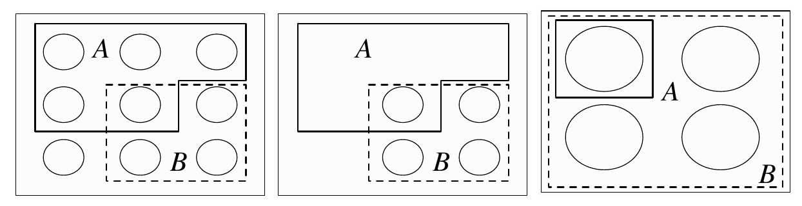
  <figcaption>Conditioning removes outcomes incompatible with the evidence and renormalizes the remaining masses. Reproduced from Joseph K. Blitzstein and Jessica Hwang, <em>Introduction to Probability</em>, Figure 2.1, p. 44.</figcaption>
</figure>

In the equal-mass version of the diagram, $$B$$ contains four of the nine pebbles and $$A\cap B$$ contains one. Before conditioning, $$P(A\cap B)=1/9$$ and $$P(B)=4/9$$. After conditioning:

$$
P(A\mid B)=\frac{1/9}{4/9}=\frac14.
$$

With unequal outcome probabilities, sum the masses instead of simply counting pebbles. Conditioning preserves the relative probabilities of the surviving outcomes.

#### A second intuition: long-run frequencies

Instead of performing the experiment once, imagine repeating it many times under the same conditions. In this frequentist view, a probability is the long-run fraction of repetitions in which an event occurs. For example, if a coin lands heads 612 times in 1000 tosses, $$P(\text{Heads})$$ is about $$612/1000$$.

To find $$P(A\mid B)$$ from this point of view:

1. List the outcomes of many repetitions.
2. Circle the repetitions in which $$B$$ occurred, and ignore the rest.
3. Among the circled repetitions, find the fraction in which $$A$$ also occurred.

That fraction is approximately

$$
\frac{\#\{\text{repetitions with }A\text{ and }B\}}{\#\{\text{repetitions with }B\}}
=\frac{\#(A\cap B)/\#\text{total}}{\#B/\#\text{total}}
\approx\frac{P(A\cap B)}{P(B)}.
$$

Restricting attention to the repetitions where $$B$$ happened plays the role of removing pebbles outside $$B$$. Dividing by the number of circled repetitions plays the role of renormalizing.

#### Supplementary example: A die result known to be even

Roll a fair die. Let $$A=\{4,5,6\}$$ and $$B=\{2,4,6\}$$. Then:

$$
P(A\mid B)=\frac{P(\{4,6\})}{P(\{2,4,6\})}
=\frac{2/6}{3/6}=\frac23.
$$

Originally, $$P(A)=1/2$$. The evidence changes the relevant possibilities to $$2,4,6$$, of which two satisfy $$A$$.

**Core idea:** Conditional probability changes the denominator to the probability of the evidence, not to the probability of the event being investigated.

<div class="warning-box" markdown="1">

**The condition $$P(B)>0$$ is essential.** The elementary ratio does not define $$P(A\mid B)$$ when $$P(B)=0$$. Conditioning on probability-zero information requires additional machinery beyond this definition.

**The conditioning bar is not a set operation.** $$P(A\mid B)$$ is a probability under specified information; it does not refer to an event called “$$A\mid B$$.”

</div>

### Part 5 — Properties of conditional probability

For fixed $$B$$ with $$P(B)>0$$, define $$Q(A)=P(A\mid B)$$. This is itself a probability function:

$$
Q(S)=\frac{P(S\cap B)}{P(B)}=1,\qquad Q(\varnothing)=0.
$$

If $$A_1,A_2,\ldots$$ are disjoint, their intersections with $$B$$ are disjoint, so:

$$
Q\left(\bigcup_i A_i\right)
=\frac{\sum_i P(A_i\cap B)}{P(B)}
=\sum_i Q(A_i).
$$

Consequently, ordinary probability rules apply while keeping the evidence fixed. In particular:

$$
P(A^c\mid B)=1-P(A\mid B),
$$

$$
P(A\cup C\mid B)=P(A\mid B)+P(C\mid B)-P(A\cap C\mid B).
$$

Also, $$P(B\mid B)=1$$, and $$P(A\mid B)=1$$ whenever $$B\subseteq A$$.

#### Independence as “no update”

For $$P(B)>0$$:

$$
A\text{ and }B\text{ independent}
\quad\Longleftrightarrow\quad
P(A\mid B)=P(A).
$$

Indeed, substituting $$P(A\cap B)=P(A)P(B)$$ into the definition cancels $$P(B)$$. Conversely, multiply the no-update equation by $$P(B)$$ to recover independence.

If $$P(A)>0$$ as well, independence also gives $$P(B\mid A)=P(B)$$. The product definition remains valid even when a conditional ratio would be undefined.

### Part 6 — The multiplication rule for probabilities

Rearranging the conditional-probability definition gives:

$$
\boxed{P(A\cap B)=P(B)P(A\mid B),\qquad P(B)>0.}
$$

If $$P(A)>0$$, we can also write:

$$
P(A\cap B)=P(A)P(B\mid A).
$$

These are general multiplication rules. Independence allows the conditional factor to be replaced by its unconditional probability; without independence, the conditional factor must remain.

#### Supplementary worked example: Two hearts without replacement

Draw two cards in order from a uniformly shuffled standard deck. Let $$H_1$$ and $$H_2$$ denote a heart on the first and second draws.

The first draw is a heart with probability $$13/52$$. Given a first heart, twelve hearts remain among 51 cards:

$$
P(H_1\cap H_2)=P(H_1)P(H_2\mid H_1)
=\frac{13}{52}\frac{12}{51}=\frac1{17}.
$$

The unconditional probability of a heart on the second draw is still $$13/52=1/4$$ by symmetry. But $$12/51\ne1/4$$, so the two heart events are dependent.

With replacement and independent draws, the second factor would be $$13/52$$, giving $$1/16$$ instead.

**Core idea:** The first result changes the composition of the remaining deck. The multiplication rule accounts for that change through a conditional probability.

#### The chain rule for $$n$$ events

Applying the two-event rule repeatedly gives the probability that all of $$A_1,\ldots,A_n$$ occur:

<div class="result-box" markdown="1">

$$
\boxed{P(A_1\cap\cdots\cap A_n)
=P(A_1)\,P(A_2\mid A_1)\,P(A_3\mid A_1,A_2)\cdots P(A_n\mid A_1,\ldots,A_{n-1}),}
$$

provided $$P(A_1\cap\cdots\cap A_{n-1})>0$$.

</div>

Each new factor conditions on all the events already included. For example, with three events:

$$
P(A\cap B\cap C)=P(A)P(B\mid A)P(C\mid A\cap B).
$$

The events can be introduced in any order, since the intersection does not depend on the order. There are $$n!$$ orders, so this is really $$n!$$ versions of the theorem. The left side stays the same, but the conditioning events on the right change with the order chosen. For some problems one order gives easy factors while another gives hard ones, so it is worth choosing the order deliberately.

If the events are independent, every conditional factor equals the unconditional probability, and the rule reduces to $$P(A_1)P(A_2)\cdots P(A_n)$$.

### Part 7 — Bayes’ rule: reversing the direction of conditioning

When $$P(A)>0$$ and $$P(B)>0$$, the two multiplication rules describe the same intersection:

$$
P(A\mid B)P(B)=P(A\cap B)=P(B\mid A)P(A).
$$

Divide by $$P(B)$$:

<div class="result-box" markdown="1">

$$
\boxed{P(A\mid B)=\frac{P(B\mid A)P(A)}{P(B)}.}
$$

</div>

Bayes’ rule is useful when the conditional probability in one direction is easier to calculate than the one in the other direction.

For a hypothesis $$H$$ and evidence $$E$$:

$$
P(H\mid E)=\frac{P(E\mid H)P(H)}{P(E)}.
$$

| Quantity | Interpretation |
|---|---|
| Prior, $$P(H)$$ | Probability assigned before incorporating evidence $$E$$ |
| Likelihood, $$P(E\mid H)$$ | Probability of observing the evidence if $$H$$ holds |
| Evidence probability, $$P(E)$$ | Overall probability of observing $$E$$ |
| Posterior, $$P(H\mid E)$$ | Updated probability after incorporating $$E$$ |

A high likelihood does not by itself imply a high posterior. The prior and the overall probability of the evidence also matter.

<div class="misconception-block" markdown="1">

**Incorrect:** $$P(A\mid B)=P(B\mid A)$$ because both concern $$A$$ and $$B$$ occurring.

**Correction:** Both use the same numerator $$P(A\cap B)$$, but divide by different probabilities. In general:

$$
P(A\mid B)=\frac{P(A\cap B)}{P(B)},\qquad
P(B\mid A)=\frac{P(A\cap B)}{P(A)}.
$$

</div>

#### Supplementary worked example: A heart first, given a red card second

Draw two cards without replacement. Let $$A$$ mean the first card is a heart, and $$B$$ mean the second card is red.

**Find the easier direction:** Given a first heart, 25 red cards remain among 51 cards:

$$
P(B\mid A)=\frac{25}{51}.
$$

**Find the unconditional probabilities:** The first card is a heart with probability $$1/4$$. Before either draw is observed, the second card is equally likely to be any of the 52 cards, so $$P(B)=1/2$$.

**Reverse the conditioning:**

$$
P(A\mid B)=\frac{(25/51)(1/4)}{1/2}=\frac{25}{102}.
$$

The two directions differ: $$25/102$$ versus $$25/51$$. As a check, their common intersection probability is:

$$
P(A\cap B)=\frac14\frac{25}{51}=\frac{25}{204}.
$$

**Core idea:** Information about the second draw can update the probability of the first. Conditioning concerns information, not a causal influence traveling backward in time.

### Part 8 — Supplementary example: The exact evidence matters

Consider a family with two children. Use an idealized model in which each child is independently a girl or a boy with equal probability. List the elder child first, so the four equally likely outcomes are:

$$
S=\{GG,GB,BG,BB\}.
$$

Let $$F$$ be the event that both children are girls.

#### Evidence 1: At least one child is a girl

Let $$E=\{GG,GB,BG\}$$. Then $$F\cap E=F$$, and:

$$
P(F\mid E)=\frac{1/4}{3/4}=\frac13.
$$

The surviving family types are three equally likely outcomes, one of which is $$GG$$.

#### Evidence 2: The elder child is a girl

Let $$E_1=\{GG,GB\}$$. Then:

$$
P(F\mid E_1)=\frac{1/4}{1/2}=\frac12.
$$

Here the evidence designates a particular child, leaving two equally likely possibilities for the younger child.

**Core idea:** Both descriptions guarantee a girl, but they define different events. Conditional probabilities depend on the precise information and how it was obtained. Observing a randomly selected child is another experiment; it should not automatically be treated as conditioning on “at least one girl.”

### Part 9 — Original practice questions

Try these before reading the answers.

1. Roll a fair die. Let $$A=\{1,2\}$$ and $$B=\{3,4\}$$. Are the events disjoint? Are they independent?
2. Suppose $$A$$ and $$B$$ are independent, with $$P(A)=0.30$$ and $$P(B)=0.40$$. Find $$P(A\cap B^c)$$, $$P(A^c\cap B^c)$$, and $$P(A\cup B)$$.
3. In the two-coin example with $$A$$ meaning first heads, $$B$$ second heads, and $$C$$ agreement, verify pairwise independence and explain the failure of mutual independence.
4. Roll four independent fair dice. Find the probability of exactly two sixes and the probability of at least two sixes.
5. In the Newton–Pepys twelve-dice game, explain why the complement includes exactly one six and why its count is $$12\cdot5^{11}$$.
6. Suppose $$P(A)=0.40$$, $$P(B)=0.50$$, and $$P(A\cap B)=0.10$$. Find $$P(A\mid B)$$, $$P(B\mid A)$$, and $$P(A^c\mid B)$$. Are the events independent?
7. Draw two cards without replacement. Find the probability of two aces. Compare with independent draws with replacement.
8. Suppose $$P(H)=0.20$$, $$P(E\mid H)=0.60$$, and $$P(E)=0.30$$. Find $$P(H\mid E)$$ and $$P(H\cap E)$$.
9. Under the idealized two-child model, compare the probability of two boys given at least one boy with the probability of two boys given that the younger child is a boy.

### Part 10 — Practice answers

#### 1. Disjoint die events

Their intersection is empty, so they are disjoint. But:

$$
P(A\cap B)=0\ne\frac26\frac26=\frac19.
$$

They are not independent. Learning that $$A$$ occurred rules out $$B$$.

#### 2. Independent events and complements

Independence also holds for complements:

$$
P(A\cap B^c)=0.30(0.60)=0.18,
$$

$$
P(A^c\cap B^c)=0.70(0.60)=0.42.
$$

The union probability is:

$$
P(A\cup B)=0.30+0.40-0.30(0.40)=0.58.
$$

It also equals $$1-0.42$$, by taking the complement of neither event occurring.

#### 3. Pairwise but not mutual independence

All three events have probability $$1/2$$. Each pairwise intersection is $$\{HH\}$$, so its probability is $$1/4=(1/2)(1/2)$$.

The triple intersection is also $$\{HH\}$$, with probability $$1/4$$, rather than $$1/8$$. Thus the pairwise checks pass but the triple condition fails.

#### 4. Four dice

Exactly two sixes:

$$
P(\text{exactly two})=\frac{\binom42 5^2}{6^4}
=\frac{150}{1296}=\frac{25}{216}\approx0.115741.
$$

For at least two, subtract the disjoint zero-six and one-six cases:

$$
P(\text{at least two})=1-\frac{5^4+4\cdot5^3}{6^4}
=\frac{171}{1296}=\frac{19}{144}\approx0.131944.
$$

#### 5. The twelve-dice complement

Failing to obtain at least two sixes means obtaining either zero or one. For exactly one, choose its position in twelve ways. Each of the other eleven dice has five allowed non-six results, giving $$12\cdot5^{11}$$ outcomes. The two complement cases are disjoint, so their counts add.

#### 6. Conditional probabilities

$$
P(A\mid B)=\frac{0.10}{0.50}=0.20,\qquad
P(B\mid A)=\frac{0.10}{0.40}=0.25.
$$

Keeping the evidence $$B$$ fixed:

$$
P(A^c\mid B)=1-0.20=0.80.
$$

The events are dependent, since $$P(A)P(B)=0.20\ne0.10=P(A\cap B)$$.

#### 7. Two aces

Without replacement:

$$
P(\text{two aces})=\frac4{52}\frac3{51}=\frac1{221}\approx0.004525.
$$

With replacement and independent draws:

$$
P(\text{two aces})=\left(\frac4{52}\right)^2=\frac1{169}\approx0.005917.
$$

Removing a first ace decreases the proportion of aces available for the second draw.

#### 8. Bayesian update

$$
P(H\mid E)=\frac{P(E\mid H)P(H)}{P(E)}
=\frac{0.60(0.20)}{0.30}=0.40.
$$

The joint probability is $$P(H\cap E)=0.20(0.60)=0.12$$. The likelihood $$0.60$$ and the posterior $$0.40$$ answer different questions.

#### 9. Two kinds of evidence

Given at least one boy, the surviving outcomes are $$BB,BG,GB$$, each equally likely. Thus the probability of two boys is $$1/3$$.

Given that the younger child is a boy, only $$BB,GB$$ remain. The probability of two boys is $$1/2$$. The difference comes from conditioning on different events.

### Part 11 — Quick revision sheet

| Concept | Essential fact |
|---|---|
| Independence | $$P(A\cap B)=P(A)P(B)$$ |
| Disjointness | $$A\cap B=\varnothing$$; disjoint positive-probability events are dependent |
| Complements of independent events | Complementing either or both preserves independence |
| Mutual independence | The intersection product rule must hold for every subset of events |
| Exactly $$r$$ sixes in $$n$$ fair independent rolls | $$\binom nr5^{n-r}/6^n$$ |
| Newton–Pepys ranking | One six in six rolls is more likely than two in twelve or three in eighteen |
| Stigler's check | Newton's intuition ignored fairness, but with $$p=1/2$$ the ranking reverses |
| Conditional probability | $$P(A\mid B)=P(A\cap B)/P(B)$$, with $$P(B)>0$$ |
| Conditioning intuition | Remove outcomes outside the evidence, then renormalize |
| Frequentist intuition | Among many repetitions where $$B$$ occurred, the fraction where $$A$$ occurred |
| Conditional complement | $$P(A^c\mid B)=1-P(A\mid B)$$ |
| Independence as no update | For $$P(B)>0$$, $$P(A\mid B)=P(A)$$ |
| Multiplication rule | $$P(A\cap B)=P(B)P(A\mid B)$$ |
| Chain rule | $$P(A_1\cdots A_n)=P(A_1)P(A_2\mid A_1)\cdots P(A_n\mid A_1,\ldots,A_{n-1})$$, in any of $$n!$$ orders |
| Bayes’ rule | $$P(A\mid B)=P(B\mid A)P(A)/P(B)$$ |
| Direction of conditioning | $$P(A\mid B)$$ and $$P(B\mid A)$$ generally differ |

### Term Glossary

<div class="glossary-entry" markdown="1">
<div class="gterm">Independent events <span class="gcat cat-defn">Definition</span></div>

Events whose intersection probability equals the product of their individual probabilities. For positive-probability evidence, conditioning on one leaves the probability of the other unchanged.

</div>

<div class="glossary-entry" markdown="1">
<div class="gterm">Pairwise independence <span class="gcat cat-defn">Definition</span></div>

Independence of every pair in a collection of events. This does not guarantee independence of the collection as a whole.

</div>

<div class="glossary-entry" markdown="1">
<div class="gterm">Mutual independence <span class="gcat cat-defn">Definition</span></div>

The intersection product rule holding for every subset of two or more events in a collection.

</div>

<div class="glossary-entry" markdown="1">
<div class="gterm">Conditional probability <span class="gcat cat-defn">Definition</span></div>

A probability calculated with specified evidence treated as known, using the mass of the intersection divided by the mass of the evidence.

</div>

<div class="glossary-entry" markdown="1">
<div class="gterm">Renormalization <span class="gcat cat-defn">Definition</span></div>

Rescaling surviving probability masses so they total 1. When conditioning on $$B$$, each surviving mass is divided by $$P(B)$$.

</div>

<div class="glossary-entry" markdown="1">
<div class="gterm">Prior probability <span class="gcat cat-defn">Definition</span></div>

The probability of a hypothesis before incorporating the specified new evidence. It can already reflect other background information.

</div>

<div class="glossary-entry" markdown="1">
<div class="gterm">Likelihood <span class="gcat cat-defn">Definition</span></div>

The probability of the observed evidence given a hypothesis, $$P(E\mid H)$$. It is not the probability of the hypothesis given the evidence.

</div>

<div class="glossary-entry" markdown="1">
<div class="gterm">Posterior probability <span class="gcat cat-defn">Definition</span></div>

The updated probability of a hypothesis after conditioning on evidence, $$P(H\mid E)$$.

</div>

<div class="glossary-entry" markdown="1">
<div class="gterm">Bayes’ rule <span class="gcat cat-thm">Theorem</span></div>

A relation between the two directions of conditioning, obtained by writing the same intersection probability in two ways.

</div>

<div class="ref-tags">
  <span class="ref-tag">Statistics 110</span>
  <span class="ref-tag">Lecture 4</span>
  <span class="ref-tag">Independence</span>
  <span class="ref-tag">Newton–Pepys</span>
  <span class="ref-tag">Conditional probability</span>
  <span class="ref-tag">Bayes’ rule</span>
</div>

  </div>
</div>


## Lecture 5 - Conditioning Continued and the Law of Total Probability

<div class="chapter-block">
  <button type="button" class="chapter-toggle" id="lecture-5-toggle" onclick="toggleLecture('lecture-5')" aria-expanded="true" aria-controls="lecture-5-body">
    <span class="chapter-toggle-left">
      <span class="chapter-badge">Lecture 5</span>
      <span>
        <span class="chapter-title">Lecture 5 - Conditioning Continued and the Law of Total Probability</span>
        <span class="chapter-subtitle">Precise evidence, partitions, Bayesian updates, and conditional independence</span>
      </span>
    </span>
    <span class="chapter-arrow open" id="lecture-5-arrow" aria-hidden="true">▼</span>
  </button>
  <div class="chapter-body open" id="lecture-5-body" markdown="1">

<div class="note-abstract" markdown="1">

Conditional probabilities depend on the exact evidence being used. The law of total probability combines simpler conditional calculations across disjoint cases, supplying the denominator needed in Bayes’ rule. Conditional independence allows multiplication within a specified context, but mixing contexts or selecting outcomes can create dependence that was absent within the original model.

</div>

### Notation at a Glance

<div class="notation-panel" markdown="1">

| Symbol | Meaning |
|---|---|
| $$P(A\mid B)$$ | Probability of $$A$$ given $$B$$, with $$P(B)>0$$ |
| $$A_1,\ldots,A_n$$ | A partition of $$S$$: disjoint cases covering the whole sample space |
| $$P(B\mid A_i)P(A_i)$$ | Joint probability $$P(B\cap A_i)$$ |
| $$\sum_i P(B\mid A_i)P(A_i)$$ | Law of total probability for $$P(B)$$ |
| $$H_i$$ | One of several mutually exclusive, exhaustive hypotheses |
| $$E$$ | Evidence being conditioned on |
| $$P(A\mid B,E)$$ | Probability of $$A$$ given both $$B$$ and $$E$$; commas mean intersections |
| $$D$$, $$T$$ | Disease and positive test result in a hypothetical test model |
| $$P(T\mid D)$$ | Sensitivity: true-positive rate |
| $$P(T^c\mid D^c)$$ | Specificity: true-negative rate |
| $$P(A\cap B\mid E)=P(A\mid E)P(B\mid E)$$ | Conditional independence of $$A$$ and $$B$$ given $$E$$ |

</div>

### Learning objectives

After studying these notes, you should be able to:

- Distinguish “at least one ace,” “the ace of spades,” and “the first card is an ace” as different evidence.
- Define a partition and derive the law of total probability from disjoint additivity.
- Combine Bayes’ rule with a partition to calculate posterior probabilities.
- Explain why a test's sensitivity is different from the probability of a condition given a positive result.
- Identify the prosecutor's fallacy and the prior–posterior confusion, using the Sally Clark case.
- Keep background conditioning consistent throughout a calculation, and explain why sequential Bayesian updating is coherent.
- Define conditional independence and distinguish it from unconditional independence.
- Explain how an unknown shared factor or selected evidence can make two outcomes dependent, including explaining away.

### Part 1 — Conditional examples: the exact evidence matters

Draw two cards without replacement from a uniformly shuffled standard deck. Let $$F$$ be the event that both cards are aces.

Because these questions concern the two-card hand rather than its draw order, use unordered hands as outcomes. There are:

$$
\binom{52}{2}=1326
$$

equally likely hands, of which $$\binom42=6$$ contain two aces.

#### Case 1: At least one card is an ace

Let $$E$$ be the event that the hand contains at least one ace. Count it using two disjoint cases:

| Case | Count | Reason |
|---|---:|---|
| Exactly one ace | $$4\cdot48=192$$ | Choose one ace and one non-ace |
| Two aces | $$\binom42=6$$ | Choose two of the four aces |

Thus $$\lvert E\rvert=198$$. Since $$F\subseteq E$$:

$$
\boxed{P(F\mid E)=\frac{6/1326}{198/1326}=\frac6{198}=\frac1{33}.}
$$

An equivalent denominator is $$\binom{52}{2}-\binom{48}{2}$$, subtracting hands with no aces.

#### Case 2: The hand contains the ace of spades

Let $$E_s$$ mean that the ace of spades is one of the two cards. Fix that card and choose its companion from the other 51 cards. There are 51 such hands, and three have another ace:

$$
\boxed{P(F\mid E_s)=\frac3{51}=\frac1{17}.}
$$

The evidence identifies a particular card. The remaining card is uniformly distributed among the 51 other cards.

#### Supplementary case: The first card drawn is an ace

This evidence refers to draw order, so now use ordered outcomes. Given that the first card is an ace, three aces remain among 51 cards:

$$
P(\text{two aces}\mid\text{first card is an ace})=\frac3{51}=\frac1{17}.
$$

Cases 2 and 3 happen to give the same answer, but they are different conditioning events. Neither is equivalent to merely knowing that at least one card is an ace.

<div class="misconception-block" markdown="1">

**Incorrect:** Knowing that there is an ace lets us remove it and treat the other card as uniform among 51 cards, giving $$1/17$$ in every case.

**Correction:** “At least one ace” does not designate which card was identified. Among its 198 compatible hands, only six contain two aces. The particular-card evidence and the at-least-one evidence select different collections of hands.

</div>

**Core idea:** A more specific conditioning event can change the probability of another event. The difference comes from the outcomes compatible with the evidence, not from the words “an ace” alone.

### Part 2 — Partitions and the law of total probability

<div class="example-block" markdown="1">
<div class="ex-title">Partition <span class="ex-pill pill-defn">Definition</span></div>

Events $$A_1,\ldots,A_n$$ form a **partition** of $$S$$ if:

$$
A_i\cap A_j=\varnothing\quad(i\ne j),\qquad
\bigcup_{i=1}^{n}A_i=S.
$$

Each outcome belongs to exactly one case. To use conditional probabilities $$P(B\mid A_i)$$, assume each case has positive probability.

</div>

For any event $$B$$, the pieces $$B\cap A_i$$ are disjoint and together cover $$B$$:

$$
B=\bigcup_{i=1}^{n}(B\cap A_i).
$$

By additivity and the multiplication rule:

$$
P(B)=\sum_{i=1}^{n}P(B\cap A_i)
=\sum_{i=1}^{n}P(B\mid A_i)P(A_i).
$$

<div class="result-box" markdown="1">

$$
\boxed{P(B)=\sum_{i=1}^{n}P(B\mid A_i)P(A_i).}
$$

This is the **law of total probability**, abbreviated LOTP.

</div>

<figure>
  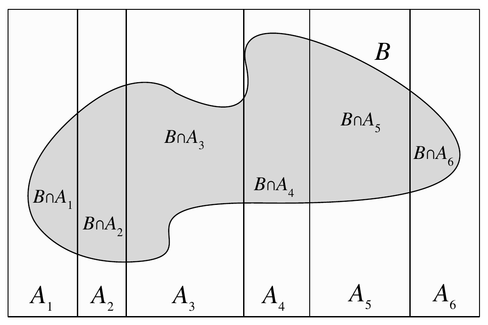
  <figcaption>A partition divides an event into disjoint contributions. Reproduced from Joseph K. Blitzstein and Jessica Hwang, <em>Introduction to Probability</em>, Figure 2.3, p. 50.</figcaption>
</figure>

The weight $$P(A_i)$$ is the chance of being in case $$i$$; $$P(B\mid A_i)$$ is the chance of $$B$$ within that case. Their product is the contribution of that case to the overall probability.

**Core idea:** The unconditional probability is a weighted average of conditional probabilities. The weights sum to 1; they need not be equal.

#### Two complementary cases

For $$0<P(A)<1$$, the cases $$A$$ and $$A^c$$ form a partition:

$$
\boxed{P(B)=P(B\mid A)P(A)+P(B\mid A^c)P(A^c).}
$$

<div class="warning-box" markdown="1">

**Disjoint and exhaustive are both required.** Overlapping cases double-count some outcomes; cases that do not cover $$S$$ omit others. Adding $$P(B\mid A_i)$$ without multiplying by $$P(A_i)$$ also gives the wrong weighting.

If a case has probability zero, its joint contribution is zero. Omit it rather than treating an undefined conditional probability as a number to multiply by zero.

</div>

### Part 3 — Bayes’ rule with a partition

Let $$H_1,\ldots,H_n$$ be a partition with positive prior probabilities, and suppose $$P(E)>0$$. Bayes’ rule gives:

$$
P(H_j\mid E)=\frac{P(E\mid H_j)P(H_j)}{P(E)}.
$$

Use LOTP to calculate the denominator:

$$
\boxed{P(H_j\mid E)=
\frac{P(E\mid H_j)P(H_j)}
{\sum_{i=1}^{n}P(E\mid H_i)P(H_i)}.}
$$

The numerator is the probability of hypothesis $$j$$ together with the evidence. The denominator is the total probability of that evidence across every possible hypothesis. Dividing assigns the fraction of the evidence probability attributable to hypothesis $$j$$.

#### Supplementary worked example: A randomly chosen coin

Choose once between a fair coin and a biased coin, each with probability $$1/2$$. The biased coin lands heads with probability $$3/4$$. Toss the selected coin three times, independently given which coin was selected, and observe $$HHH$$.

Let $$F$$ mean the coin is fair and $$E$$ mean three heads. The likelihoods are:

$$
P(E\mid F)=\left(\frac12\right)^3=\frac18,
\qquad
P(E\mid F^c)=\left(\frac34\right)^3=\frac{27}{64}.
$$

The total evidence probability is:

$$
P(E)=\frac18\frac12+\frac{27}{64}\frac12
=\frac8{128}+\frac{27}{128}=\frac{35}{128}.
$$

Hence:

$$
\boxed{P(F\mid E)=\frac{(1/8)(1/2)}{35/128}
=\frac8{35}\approx0.228571.}
$$

The biased coin has posterior probability $$27/35$$. Three heads are possible under either coin, but are more likely under the biased coin, so the observation shifts probability toward that coin.

**Core idea:** Multiply within each hypothesis, add across the mutually exclusive hypotheses, and normalize to update their probabilities.

<div class="misconception-block" markdown="1">

**Incorrect:** We observed $$E$$, so substitute $$P(E)=1$$ into Bayes’ rule.

**Correction:** Observing $$E$$ makes $$P(E\mid E)=1$$. The denominator $$P(E)$$ in Bayes’ rule is the probability of the evidence under the original model, before conditioning on it.

</div>

### Part 4 — A test result: sensitivity, specificity, and the base rate

Consider a hypothetical test model. Let $$D$$ be the event that a person has a condition and $$T$$ the event of a positive result. Assume the person is drawn from a population with condition prevalence $$p=P(D)$$.

“95% accurate” is ambiguous unless the relevant conditional probabilities are stated. In this model, take:

$$
P(T\mid D)=0.95,\qquad P(T^c\mid D^c)=0.95.
$$

Thus the false-positive rate is $$P(T\mid D^c)=0.05$$. These are assumptions for an illustrative probability problem.

The desired probability after a positive result is $$P(D\mid T)$$, not $$P(T\mid D)$$. By Bayes’ rule and LOTP:

$$
\boxed{P(D\mid T)=
\frac{0.95p}{0.95p+0.05(1-p)}.}
$$

The denominator includes both ways of getting a positive result: a true positive and a false positive.

#### Worked example: Prevalence of 1%

Suppose 1% of patients similar to this one have the condition, so $$p=0.01$$:

$$
P(T)=0.95(0.01)+0.05(0.99)=0.0095+0.0495=0.059,
$$

$$
P(D\mid T)=\frac{0.0095}{0.059}
=\frac{19}{118}\approx0.161017.
$$

The probability rises from 1% before the result to about 16.10% afterward. The result is informative even though the posterior is much lower than the sensitivity.

<figure>
  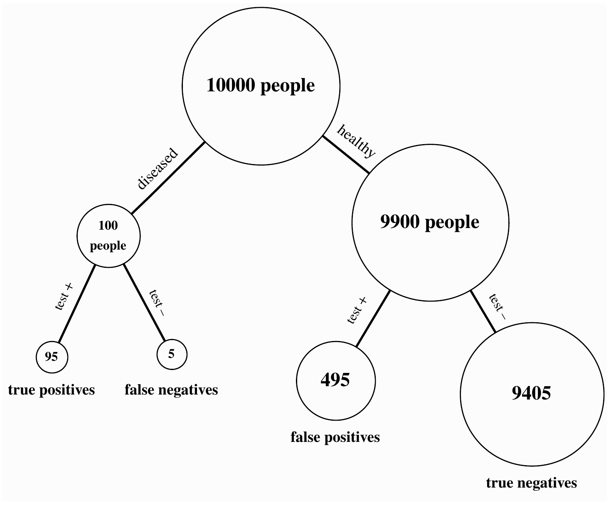
  <figcaption>Expected counts in the hypothetical 1%-prevalence model, with 95% sensitivity and specificity. Reproduced from Blitzstein and Hwang, <em>Introduction to Probability</em>, Figure 2.4, p. 52. Bubble sizes are not to scale.</figcaption>
</figure>

For 10,000 people under these proportions:

| Group | Expected positive results | Expected negative results | Total |
|---|---:|---:|---:|
| Condition present | 95 | 5 | 100 |
| Condition absent | 495 | 9405 | 9900 |
| Total | 590 | 9410 | 10,000 |

Among positive results, the expected fraction with the condition is $$95/590=19/118$$. A small false-positive rate applied to a large condition-free group can produce more positives than a high true-positive rate applied to a small group.

**A rough frequency check.** Imagine 1000 such patients. About 10 have the condition, and nearly all of them test positive. About 990 do not, and 5% of those, roughly 50, also test positive. So about 10 of roughly 60 positive results come from patients with the condition, a ratio near $$1/6\approx0.16$$. The rarity of the condition competes with the rarity of a test error; intuition that focuses only on the 95% ignores the 1%.

If the patient already has symptoms, the starting probability is no longer 1%. The method is unchanged: start from the probability that reflects the evidence already available, and update it with Bayes’ rule.

#### Supplementary comparison: A rarer condition

Keeping the same test assumptions but changing the prevalence to $$1/1000$$ gives:

$$
P(D\mid T)=\frac{0.95/1000}{0.95/1000+0.05(999/1000)}
=\frac{19}{1018}\approx0.018664.
$$

The sensitivity and specificity are unchanged, but the posterior is now about 1.87%. The prior prevalence affects the relative contributions of true and false positives.

**Core idea:** A conditional probability about how evidence is generated cannot be read directly as a probability about its underlying cause. The base rate supplies essential information.

#### The same reversal error in reasoning about evidence

A small probability of evidence given innocence, $$P(E\mid I)$$, does not equal a small probability of innocence given the evidence, $$P(I\mid E)$$. Bayes’ rule also requires the prior probabilities and the probability of the evidence under alternatives. Confusing these directions is called the **prosecutor's fallacy**. The name is unfair to prosecutors: defense attorneys, doctors, and everyone else make the same error.

<div class="example-block" markdown="1">
<div class="ex-title">The Sally Clark case <span class="ex-pill pill-ex">Worked example</span></div>

Sally Clark, a British woman, lost two infants to sudden, unexplained deaths and was convicted of murdering them. The central statistical testimony claimed that, for an innocent family, the chance of one such death is about $$1/8500$$. Multiplying for two deaths gave

$$
\left(\frac1{8500}\right)^2\approx\frac1{72{,}000{,}000},
$$

reported as about 1 in 73 million. The argument contains two separate errors.

1. **Unjustified independence.** Squaring assumes the two deaths are independent. A shared genetic or environmental factor could make a second death far more likely after a first, so multiplication has no justification here.
2. **The prosecutor's fallacy.** Even granting the number, it is $$P(\text{evidence}\mid\text{innocence})$$. The court needed $$P(\text{innocence}\mid\text{evidence})$$. By Bayes’ rule,

$$
P(I\mid E)=\frac{P(E\mid I)P(I)}{P(E)}.
$$

The prior $$P(I)$$ is extremely close to 1, because the vast majority of mothers do not murder their children. The denominator must also account for the probability of two deaths under the alternative explanation, which is itself extremely small. Treating $$1/73$$ million as the probability of innocence ignores both.

The conviction was later overturned, but only after she had spent years in prison.

<div class="ex-lesson">A tiny probability of the evidence under one hypothesis is not the probability of that hypothesis. Bayes’ rule weighs it against the prior and against how probable the evidence is under the alternatives.</div>
</div>

#### Prior versus posterior

The probability $$P(A)$$ before observing evidence is the **prior** probability of $$A$$. After observing $$B$$, the updated probability $$P(A\mid B)$$ is the **posterior** probability.

<div class="misconception-block" markdown="1">

**Incorrect:** The problem says that $$A$$ occurred, so write $$P(A)=1$$.

**Correction:** What is true is $$P(A\mid A)=1$$. The symbol $$P(A)$$ still means the probability of $$A$$ before that information. Put observed evidence to the right of the conditioning bar, and keep $$P(A)$$ for the prior.

</div>

### Part 5 — Keeping background conditioning consistent

For a fixed event $$E$$ with $$P(E)>0$$, the function $$Q(B)=P(B\mid E)$$ obeys the probability axioms. Consequently, LOTP and Bayes’ rule can be applied inside that conditional model.

#### Supplementary formula: LOTP with extra conditioning

For a partition $$A_1,\ldots,A_n$$, retaining positive-probability cases within $$E$$:

$$
\boxed{P(B\mid E)=\sum_{i=1}^{n}
P(B\mid A_i,E)P(A_i\mid E).}
$$

The weights are now $$P(A_i\mid E)$$, not the original $$P(A_i)$$. The evidence can change the distribution of the cases themselves.

#### Supplementary formula: Bayes’ rule with extra conditioning

When $$P(A\cap E)>0$$ and $$P(B\cap E)>0$$:

$$
\boxed{P(A\mid B,E)=
\frac{P(B\mid A,E)P(A\mid E)}{P(B\mid E)}.}
$$

The same background evidence $$E$$ appears in every probability. Commas to the right of the bar denote joint evidence, so $$P(B\mid A,E)=P(B\mid A\cap E)$$.

#### Updating one piece of evidence at a time

Bayes’ rule is **coherent**: updating on two pieces of evidence at once gives the same answer as updating on one, then using that posterior as the new prior and updating on the other.

Suppose clues $$B_1$$ and $$B_2$$ arrive with $$P(B_1\cap B_2)>0$$. After the first clue, the current probability function is $$Q(\cdot)=P(\cdot\mid B_1)$$. Updating $$Q$$ on the second clue gives:

$$
Q(A\mid B_2)=\frac{Q(A\cap B_2)}{Q(B_2)}
=\frac{P(A\cap B_1\cap B_2)/P(B_1)}{P(B_1\cap B_2)/P(B_1)}
=P(A\mid B_1\cap B_2).
$$

This is exactly the all-at-once update. Since $$B_1\cap B_2=B_2\cap B_1$$, the order of the clues does not matter either. Whether the evidence comes all at once, one piece at a time, or in any order, the result is the probability of $$A$$ given all the evidence.

**Core idea:** Once a calculation is conditional on a context, both the case probabilities and within-case probabilities must use that context. Sequential updating is the same principle applied repeatedly.

### Part 6 — Conditional independence

<div class="example-block" markdown="1">
<div class="ex-title">Conditional independence <span class="ex-pill pill-defn">Definition</span></div>

For $$P(E)>0$$, events $$A$$ and $$B$$ are **conditionally independent given $$E$$** if:

$$
\boxed{P(A\cap B\mid E)=P(A\mid E)P(B\mid E).}
$$

If also $$P(B\cap E)>0$$, this is equivalent to:

$$
P(A\mid B,E)=P(A\mid E).
$$

</div>

Given the context $$E$$, learning $$B$$ supplies no further information that changes the probability of $$A$$. This statement is about the probability model after conditioning, not necessarily about the original model.

Independence does not imply conditional independence. Conditional independence does not imply independence. Independence given $$E$$ also need not imply independence given $$E^c$$.

#### Supplementary example: An unknown shared coin creates dependence

Return to choosing once between the fair coin and the $$3/4$$-heads coin. Let $$A$$ and $$B$$ be heads on the first and second tosses.

Given the fair coin:

$$
P(A\cap B\mid F)=\frac14=P(A\mid F)P(B\mid F).
$$

Given the biased coin:

$$
P(A\cap B\mid F^c)=\frac9{16}=P(A\mid F^c)P(B\mid F^c).
$$

Thus the tosses are independent within each coin type. Without knowing the type:

$$
P(A)=P(B)=\frac12\frac12+\frac34\frac12=\frac58,
$$

$$
P(A\cap B)=\frac14\frac12+\frac9{16}\frac12=\frac{13}{32}.
$$

But:

$$
\frac{13}{32}=\frac{26}{64}\ne\frac{25}{64}
=\left(\frac58\right)^2.
$$

Indeed:

$$
P(B\mid A)=\frac{13/32}{5/8}=\frac{13}{20}=0.65>\frac58.
$$

A first head supplies evidence that the selected coin is biased, which in turn raises the probability of a second head.

**Core idea:** Multiplying within each known case is valid; averaging over an unknown shared case can introduce dependence. Choosing a fresh coin independently before every toss would describe a different experiment.

#### Example: Games against an opponent of unknown strength

Suppose repeated game results are independent once an opponent's strength is known. If the opponent's strength is unknown, an observed loss can make a strong opponent more plausible, changing the probability of losing the next game. Conditional independence within each strength category does not imply independence after those categories are mixed.

This is the same structure as the shared-coin example: one unknown factor affects several outcomes, and observing one outcome supplies information about that factor.

### Part 7 — Conditioning can also create dependence

Independent events need not be conditionally independent. This is common whenever one outcome has several possible causes.

<div class="example-block" markdown="1">
<div class="ex-title">Fire alarm and popcorn <span class="ex-pill pill-ex">Worked example</span></div>

Suppose a fire alarm sounds exactly when there is a fire or someone is making popcorn, and nothing else sets it off. Let $$F$$ mean there is a fire, $$C$$ mean someone is making popcorn, and $$A=F\cup C$$ mean the alarm sounds. Assume $$F$$ and $$C$$ are independent, with positive probabilities less than 1.

Given that the alarm sounds and no one is making popcorn, the only remaining explanation is a fire:

$$
P(F\mid A,C^c)=1.
$$

Given only that the alarm sounds, a fire is not certain, because popcorn could explain it:

$$
P(F\mid A)=\frac{P(F)}{P(F\cup C)}<1.
$$

So, given $$A$$, learning whether $$C$$ occurred changes the probability of $$F$$. The events $$F$$ and $$C$$ are independent, but not conditionally independent given $$A$$.

For illustration, take $$P(F)=0.1$$ and $$P(C)=0.3$$. Then $$P(A)=1-(0.9)(0.7)=0.37$$ and:

| Information | Probability of fire |
|---|---:|
| None | $$0.1$$ |
| Alarm sounds | $$0.1/0.37\approx0.270$$ |
| Alarm sounds and popcorn is being made | $$0.1$$ |
| Alarm sounds and no popcorn | $$1$$ |

Learning that popcorn is being made “explains away” the alarm: it accounts for the alarm, so the probability of fire falls back to 0.1. Learning that there is no popcorn removes the other explanation, so fire becomes certain.

<div class="ex-lesson">When an observed event has several independent causes, conditioning on it makes the causes dependent: ruling out one cause makes the others more likely.</div>
</div>

#### Supplementary worked example: At least one head

Toss two independent fair coins. Let $$A$$ mean first heads, $$B$$ mean second heads, and $$E=A\cup B$$ mean at least one head.

Before conditioning, $$A$$ and $$B$$ are independent. Given $$E$$, the three equally likely surviving outcomes are:

$$
HH,\quad HT,\quad TH.
$$

Therefore:

$$
P(A\mid E)=P(B\mid E)=\frac23,
$$

but:

$$
P(A\cap B\mid E)=\frac13\ne\frac49
=P(A\mid E)P(B\mid E).
$$

Once at least one head is known, learning that the first toss is tails forces the second to be heads:

$$
P(B\mid A^c,E)=1.
$$

The independent events have become dependent under the selected evidence.

<div class="misconception-block" markdown="1">

**Incorrect:** Independence is a permanent property, so conditioning cannot change it.

**Correction:** Independence refers to a particular probability function. Conditioning changes that function. Always specify the context in which multiplication is justified.

</div>

**Core idea:** Restricting the sample space can remove combinations that originally made independence possible. Conditional independence must be checked using probabilities with the same evidence throughout.

### Part 8 — Original practice questions

Try these before reading the answers.

1. Draw two cards without replacement. Find the probability of two kings given at least one king, and given that the king of hearts is in the hand.
2. Boxes A and B are chosen with probabilities $$0.30$$ and $$0.70$$. A draw is red with probability $$0.80$$ from A and $$0.20$$ from B. Find the overall red probability and the probability that a red draw came from A.
3. Explain why using “contains an ace” and “contains a heart” as the only two cases is not a valid partition of two-card hands.
4. Choose once between a fair coin and a $$3/4$$-heads coin, with equal probabilities, and observe two heads. Find the posterior probability that the coin is fair.
5. In a hypothetical population with prevalence $$0.02$$, a test has sensitivity $$0.90$$ and specificity $$0.95$$. Find the probability of a positive result and the posterior probability of the condition given a positive result.
6. For the preceding test model, find the probability of the condition given a negative result.
7. Suppose $$P(A\mid E)=0.40$$ and $$P(B\mid E)=0.50$$, with conditional independence given $$E$$. Find $$P(A\cap B\mid E)$$ and $$P(A\cup B\mid E)$$. Can you infer unconditional independence?
8. For the shared-coin example, compute $$P(B\mid A)$$ and compare it with $$P(B)$$. Explain what information the first head provides.
9. Toss two independent fair coins and condition on at least one head. Find the probability of second heads given first heads and the same evidence. Compare with the probability of second heads given only the at-least-one-head evidence.
10. A lawn is wet exactly when it rained or the sprinkler ran. Rain and the sprinkler are independent, with probabilities $$0.2$$ and $$0.5$$. Find the probability of rain given a wet lawn, and given a wet lawn and that the sprinkler ran.

### Part 9 — Practice answers

#### 1. Two kinds of king evidence

There are $$4\cdot48+\binom42=198$$ hands containing at least one king, of which six have two kings:

$$
P(\text{two kings}\mid\text{at least one king})=\frac6{198}=\frac1{33}.
$$

Given the king of hearts, its companion is one of 51 other cards, of which three are kings. The probability is $$3/51=1/17$$.

#### 2. Mixture of boxes

By LOTP:

$$
P(R)=0.80(0.30)+0.20(0.70)=0.38.
$$

By Bayes’ rule:

$$
P(A\mid R)=\frac{0.80(0.30)}{0.38}=\frac{12}{19}\approx0.631579.
$$

The more red-heavy box becomes more likely after observing red.

#### 3. Invalid cases

The events overlap: a hand may contain both an ace and a heart. They also fail to cover the sample space: a hand may contain neither. A valid partition could instead use the four combinations of containing or not containing an ace and containing or not containing a heart.

#### 4. Two heads and coin identity

The likelihoods are $$1/4$$ and $$9/16$$. With equal priors:

$$
P(F\mid HH)=\frac{(1/4)(1/2)}{(1/4)(1/2)+(9/16)(1/2)}
=\frac4{13}\approx0.307692.
$$

#### 5. A positive test

The false-positive rate is $$1-0.95=0.05$$. Thus:

$$
P(T)=0.90(0.02)+0.05(0.98)=0.067,
$$

$$
P(D\mid T)=\frac{0.018}{0.067}=\frac{18}{67}\approx0.268657.
$$

The posterior is about 26.87%, rather than the 90% sensitivity.

#### 6. A negative test

The false-negative rate is $$0.10$$. Therefore:

$$
P(T^c)=0.10(0.02)+0.95(0.98)=0.933,
$$

$$
P(D\mid T^c)=\frac{0.10(0.02)}{0.933}
=\frac2{933}\approx0.002144.
$$

This is about 0.2144%. The positive and negative evidence probabilities sum to 1, but their corresponding condition posteriors do not have to do so: they condition on different events.

#### 7. Conditional independence

$$
P(A\cap B\mid E)=0.40(0.50)=0.20,
$$

$$
P(A\cup B\mid E)=0.40+0.50-0.20=0.70.
$$

These calculations apply within $$E$$. They do not determine whether $$A$$ and $$B$$ are independent without conditioning.

#### 8. A shared unknown coin

$$
P(B\mid A)=\frac{13/32}{5/8}=\frac{13}{20}=0.65,
\qquad P(B)=\frac58=0.625.
$$

The first head favors the biased coin, increasing the probability of heads on the second toss. The tosses are independent given coin type, but not after mixing the two types.

#### 9. Selected coin outcomes

Given $$A$$ and $$E$$, only $$HH$$ and $$HT$$ survive, with equal probabilities, so:

$$
P(B\mid A,E)=\frac12.
$$

Given only $$E$$, the three outcomes $$HH,HT,TH$$ survive, giving $$P(B\mid E)=2/3$$. The difference shows that $$A$$ and $$B$$ are not conditionally independent given $$E$$.

#### 10. Explaining away

Let $$R$$ be rain, $$S$$ the sprinkler, and $$W=R\cup S$$ a wet lawn. Then $$P(W)=1-(0.8)(0.5)=0.6$$, and since $$R\subseteq W$$:

$$
P(R\mid W)=\frac{0.2}{0.6}=\frac13.
$$

Given $$W$$ and $$S$$, the lawn is wet regardless of rain, so the wet lawn adds nothing: $$P(R\mid W,S)=P(R\mid S)=P(R)=0.2$$. Learning that the sprinkler ran lowers the probability of rain from $$1/3$$ to $$0.2$$, so $$R$$ and $$S$$ are dependent given $$W$$.

### Part 10 — Quick revision sheet

| Concept | Essential fact |
|---|---|
| Exact evidence | At least one ace gives $$1/33$$ for two aces; a specified ace gives $$1/17$$ |
| Partition | Pairwise disjoint cases whose union is $$S$$ |
| LOTP | $$P(B)=\sum_i P(B\mid A_i)P(A_i)$$ |
| Two-case LOTP | Split into $$A$$ and $$A^c$$, with both conditional probabilities defined |
| Partition form of Bayes | Posterior equals one likelihood-times-prior contribution divided by their total |
| Sensitivity | $$P(T\mid D)$$ |
| Specificity | $$P(T^c\mid D^c)$$ |
| False-positive rate | $$P(T\mid D^c)=1-\text{specificity}$$ |
| Positive-result posterior | $$P(D\mid T)$$ depends on prevalence as well as test rates |
| 1% prevalence, 95% accurate test | $$P(D\mid T)\approx0.16$$: about 10 true positives against 50 false ones per 1000 |
| Prosecutor's fallacy | $$P(E\mid I)$$ is not $$P(I\mid E)$$; Sally Clark also assumed unjustified independence |
| Prior and posterior | $$P(A)$$ before evidence, $$P(A\mid B)$$ after; observing $$A$$ gives $$P(A\mid A)=1$$, not $$P(A)=1$$ |
| Coherence of Bayes | Updating all at once or one clue at a time, in any order, gives $$P(A\mid B_1,B_2)$$ |
| Background evidence | Keep the same context to the right of the bar throughout a calculation |
| Conditional independence | $$P(A\cap B\mid E)=P(A\mid E)P(B\mid E)$$ |
| Unknown shared factor | Independence within each case can become dependence after mixing cases |
| Selected evidence | Unconditional independence can disappear after conditioning |
| Explaining away | Independent causes $$F,C$$ of an alarm become dependent given the alarm |

### Term Glossary

<div class="glossary-entry" markdown="1">
<div class="gterm">Partition <span class="gcat cat-defn">Definition</span></div>

Disjoint events covering the whole sample space, so every outcome belongs to exactly one case.

</div>

<div class="glossary-entry" markdown="1">
<div class="gterm">Law of total probability <span class="gcat cat-thm">Theorem</span></div>

A formula combining within-case conditional probabilities with the probabilities of the cases to recover an overall probability.

</div>

<div class="glossary-entry" markdown="1">
<div class="gterm">Base rate <span class="gcat cat-defn">Definition</span></div>

The prior frequency or probability of a category before incorporating the specified new evidence. In the test model, it is condition prevalence.

</div>

<div class="glossary-entry" markdown="1">
<div class="gterm">Sensitivity <span class="gcat cat-meas">Measure</span></div>

The probability of a positive test result given that the condition is present, $$P(T\mid D)$$.

</div>

<div class="glossary-entry" markdown="1">
<div class="gterm">Specificity <span class="gcat cat-meas">Measure</span></div>

The probability of a negative test result given that the condition is absent, $$P(T^c\mid D^c)$$.

</div>

<div class="glossary-entry" markdown="1">
<div class="gterm">Prosecutor's fallacy <span class="gcat cat-defn">Misconception</span></div>

Confusing the probability of evidence under innocence with the probability of innocence given that evidence.

</div>

<div class="glossary-entry" markdown="1">
<div class="gterm">Prior and posterior <span class="gcat cat-defn">Definition</span></div>

The probability of an event before observing specified evidence, $$P(A)$$, and after observing it, $$P(A\mid B)$$.

</div>

<div class="glossary-entry" markdown="1">
<div class="gterm">Explaining away <span class="gcat cat-defn">Definition</span></div>

The dependence created between independent causes when conditioning on an effect they can each produce: ruling out one cause raises the probability of the others.

</div>

<div class="glossary-entry" markdown="1">
<div class="gterm">Conditional independence <span class="gcat cat-defn">Definition</span></div>

Independence under a specified conditional probability model. It does not establish independence outside that context.

</div>

<div class="glossary-entry" markdown="1">
<div class="gterm">Mixture <span class="gcat cat-defn">Definition</span></div>

A probability model formed by combining different case-specific models with weights given by their case probabilities.

</div>

<div class="ref-tags">
  <span class="ref-tag">Statistics 110</span>
  <span class="ref-tag">Lecture 5</span>
  <span class="ref-tag">Law of total probability</span>
  <span class="ref-tag">Bayesian updates</span>
  <span class="ref-tag">Conditional independence</span>
</div>

  </div>
</div>


## Lecture 6 - Monty Hall and Simpson’s Paradox

<div class="chapter-block">
  <button type="button" class="chapter-toggle" id="lecture-6-toggle" onclick="toggleLecture('lecture-6')" aria-expanded="true" aria-controls="lecture-6-body">
    <span class="chapter-toggle-left">
      <span class="chapter-badge">Lecture 6</span>
      <span>
        <span class="chapter-title">Lecture 6 - Monty Hall and Simpson’s Paradox</span>
        <span class="chapter-subtitle">Host information, Bayesian conditioning, aggregation, and weighted averages</span>
      </span>
    </span>
    <span class="chapter-arrow open" id="lecture-6-arrow" aria-hidden="true">▼</span>
  </button>
  <div class="chapter-body open" id="lecture-6-body" markdown="1">

<div class="note-abstract" markdown="1">

Information depends on how it is generated. In Monty Hall, a knowledgeable host's deliberate goat reveal differs from opening a door at random. In Simpson’s paradox, comparisons within every subgroup can reverse after aggregation because the groups receive different weights. Both problems become clear when the conditioning events and the probabilities of the cases are written explicitly.

</div>

### Notation at a Glance

<div class="notation-panel" markdown="1">

| Symbol | Meaning |
|---|---|
| $$C_i$$ | Car is behind door $$i$$ |
| $$M_j$$ | Monty opens door $$j$$ under the specified host protocol |
| $$W$$ | The contestant wins by following the switching strategy |
| $$P(M_j\mid C_i)$$ | Probability of the host's action given the car location |
| $$N$$ | Number of doors in a supplementary generalized game |
| $$S$$ | Successful procedure in the Simpson example |
| $$H$$, $$H^c$$ | Heart procedure and Band-Aid removal |
| $$D_H$$, $$D_N$$ | Procedure performed by Dr. Hibbert and Dr. Nick |
| $$P(S\mid D_H,H)$$ | Success rate for Dr. Hibbert within heart procedures |
| $$P(H\mid D_H)$$ | Fraction of Dr. Hibbert's procedures that are heart procedures |
| $$w$$ | A common weight assigned to heart procedures in a standardized comparison |

</div>

### Learning objectives

After studying these notes, you should be able to:

- State the host assumptions in the standard Monty Hall problem.
- Calculate switching success by conditioning on the car location.
- Use Bayes’ rule to incorporate the identity of the door opened.
- Explain why two remaining doors need not be equally likely.
- Distinguish a deliberate goat reveal from a random reveal that happens to show a goat.
- Calculate subgroup and overall rates in a Simpson reversal.
- Express overall rates as conditional weighted averages using LOTP, and identify the confounder.
- Recognize the same reversal in batting averages, admissions data, and combined jars.
- Explain why comparing groups under common weights prevents this reversal when one group has the higher rate in every stratum.

### Part 1 — Monty Hall: specify the experiment

Three closed doors hide one car and two goats. The contestant chooses a door. Monty opens one of the other doors, revealing a goat, and offers the contestant the chance to switch to the remaining closed door.

Use the standard model:

- The car is equally likely to be behind each door.
- The contestant's initial choice supplies no information about the car location.
- Monty knows where the car is.
- Monty always opens an unchosen door containing a goat.
- Monty always offers the switch.
- If both unchosen doors contain goats, Monty chooses between them with equal probability.

Label the contestant's initial choice door 1. Let $$C_i$$ mean that the car is behind door $$i$$. Then:

$$
P(C_1)=P(C_2)=P(C_3)=\frac13.
$$

Should the contestant stay with door 1 or switch?

<div class="warning-box" markdown="1">

**The host protocol is part of the probability model.** Knowing only that a door opened and a goat appeared does not specify how that evidence was generated. The host's knowledge, choice rule, and decision to offer a switch affect the relevant probabilities.

</div>

### Part 2 — Switching wins exactly when the first choice is wrong

Condition on the car location:

| Car location | Initial door 1 | Door Monty can open | Outcome if switching |
|---|---|---|---|
| Door 1 | Car | Door 2 or door 3 | Lose |
| Door 2 | Goat | Door 3 only | Win |
| Door 3 | Goat | Door 2 only | Win |

The initial choice is correct with probability $$1/3$$. If it is wrong, Monty must reveal the other goat, leaving the car behind the remaining unchosen door.

By LOTP:

$$
\begin{aligned}
P(W)
&=P(W\mid C_1)P(C_1)+P(W\mid C_2)P(C_2)+P(W\mid C_3)P(C_3)\\
&=0\cdot\frac13+1\cdot\frac13+1\cdot\frac13\\
&=\frac23.
\end{aligned}
$$

<div class="result-box" markdown="1">

$$
\boxed{P(\text{win by switching})=\frac23,\qquad
P(\text{win by staying})=\frac13.}
$$

</div>

<figure>
  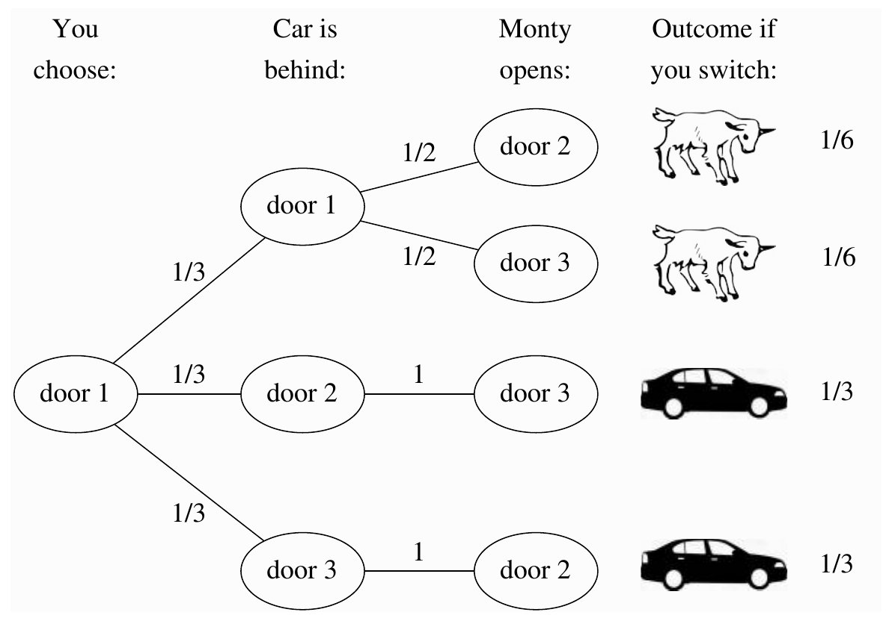
  <figcaption>Multiply probabilities along each branch and add the winning branches. Reproduced from Joseph K. Blitzstein and Jessica Hwang, <em>Introduction to Probability</em>, Figure 2.5, p. 62.</figcaption>
</figure>

The two losing paths each have probability $$(1/3)(1/2)=1/6$$. The two winning paths each have probability $$(1/3)(1)=1/3$$. These four probabilities sum to 1.

**Core idea:** Switching exchanges the event “the original choice is correct” for its complement. Monty's guaranteed goat reveal makes that exchange possible.

#### Why a random initial choice does not need to be reconsidered

The overall $$2/3$$ success rate does not depend on how Monty breaks a tie between two goats. If the original choice is wrong, he has no choice; if it is right, either goat reveal makes switching lose. Tie-breaking matters when conditioning on **which particular door** he opened, as the next calculation shows.

### Part 3 — Condition on the door actually opened

Suppose Monty opens door 2. The evidence is $$M_2$$. Under the equal tie-breaking rule:

| Car location | $$P(C_i)$$ | $$P(M_2\mid C_i)$$ | $$P(C_i\cap M_2)$$ |
|---|---|---|---|
| Door 1 | $$1/3$$ | $$1/2$$ | $$1/6$$ |
| Door 2 | $$1/3$$ | $$0$$ | $$0$$ |
| Door 3 | $$1/3$$ | $$1$$ | $$1/3$$ |

By LOTP:

$$
P(M_2)=\frac12\frac13+0\frac13+1\frac13=\frac12.
$$

Bayes’ rule gives:

$$
P(C_1\mid M_2)=\frac{(1/2)(1/3)}{1/2}=\frac13,
$$

$$
P(C_3\mid M_2)=\frac{1\cdot(1/3)}{1/2}=\frac23.
$$

Thus switching to door 3 wins with conditional probability $$2/3$$. If Monty instead opens door 3, symmetry gives the same advantage for switching to door 2.

<div class="misconception-block" markdown="1">

**Incorrect:** There are two closed doors and one car, so each door has probability $$1/2$$.

**Correction:** Counting two possibilities does not establish equal probabilities. Monty's action is more likely when the car is behind door 3 than when it is behind the originally chosen door 1. Bayes’ rule retains this difference in the posterior probabilities.

</div>

**Core idea:** Monty is not eliminating an arbitrary possibility. His choice is constrained by the hidden car location, so the reveal carries information.

#### An extreme case: a million doors

Checking an extreme case helps. Suppose there are a million doors, you pick one, and Monty, who knows where the car is, opens 999,998 of the others, all goats, leaving one closed door besides yours. Almost no one would stay. Your first pick was almost certainly wrong, and Monty had to avoid the car when choosing which door to leave closed.

Yet the “two closed doors, so 50–50” argument applies just as well here as with three doors. Since it is clearly wrong for a million doors, it is wrong for three.

**Supplementary generalization.** With $$N\ge3$$ doors, a uniformly placed car, and a host who always reveals $$N-2$$ unchosen goats, the contestant's first pick is a goat with probability $$(N-1)/N$$, and in every such case the surviving alternative holds the car:

$$
P(\text{win by switching})=\frac{N-1}{N},\qquad
P(\text{win by staying})=\frac1N.
$$

For a million doors, switching wins with probability $$999999/1000000$$.

### Part 4 — Supplementary variations: changing the protocol

#### A host who prefers opening door 2

Suppose that, when the car is behind door 1, Monty opens door 2 with probability $$q$$ and door 3 with probability $$1-q$$. In other cases he still must reveal the only unchosen goat, and he always offers a switch.

After he opens door 2:

$$
P(M_2)=q\frac13+1\frac13=\frac{1+q}{3},
$$

$$
P(C_3\mid M_2)=\frac{1/3}{(1+q)/3}=\frac1{1+q},
\qquad
P(C_1\mid M_2)=\frac q{1+q}.
$$

For $$q=1/2$$, these are $$2/3$$ and $$1/3$$. For $$q=1$$, this particular reveal leaves a $$1/2$$–$$1/2$$ comparison. Yet the overall probability of winning by always switching is still $$2/3$$.

For example, with $$q=1$$, Monty opens door 3 only when the car is behind door 2. That reveal makes switching certain to win. The conditional rates average to:

$$
P(W)=\frac12\frac23+1\frac13=\frac23.
$$

#### A host who opens an unchosen door blindly

Now suppose the host does not know where the car is and chooses randomly between doors 2 and 3. Condition on the observation that he opened door 2 and it contained a goat. Call this evidence $$E_2$$.

The likelihoods are:

$$
P(E_2\mid C_1)=\frac12,\qquad
P(E_2\mid C_2)=0,\qquad
P(E_2\mid C_3)=\frac12.
$$

Unlike the knowledgeable host, the blind host is equally likely to generate this evidence under $$C_1$$ and $$C_3$$. Consequently:

$$
P(E_2)=\frac13,
\qquad
P(C_1\mid E_2)=P(C_3\mid E_2)=\frac12.
$$

Switching and staying are equally likely to win under this conditional experiment.

**Core idea:** The visible outcome may look identical—a goat behind an opened door—but different selection mechanisms give different likelihoods and posteriors.

### Part 5 — Simpson’s paradox: better in every subgroup, worse overall

A comparison can reverse when data from different subgroups are combined. This phenomenon is called **Simpson’s paradox**.

#### Worked example: Two doctors and two procedure types

Is it possible for one doctor to have a higher success rate than another for every type of surgery, yet a lower success rate overall? Consider Dr. Hibbert and Dr. Nick, the two doctors from *The Simpsons*, with made-up records of 100 procedures each. Heart procedures are harder than Band-Aid removals. The numbers are an illustration of aggregation, not evidence about actual clinical practice.

| Procedure | Dr. Hibbert: successes / total | Dr. Hibbert: success rate | Dr. Nick: successes / total | Dr. Nick: success rate |
|---|---|---|---|---|
| Heart | $$70/90$$ | $$7/9\approx77.78\%$$ | $$2/10$$ | $$20\%$$ |
| Band-Aid removal | $$10/10$$ | $$100\%$$ | $$81/90$$ | $$90\%$$ |
| All procedures | $$80/100$$ | $$80\%$$ | $$83/100$$ | $$83\%$$ |

Dr. Hibbert has the higher success rate in **both** procedure types, but Dr. Nick has the higher overall success rate.

<figure>
  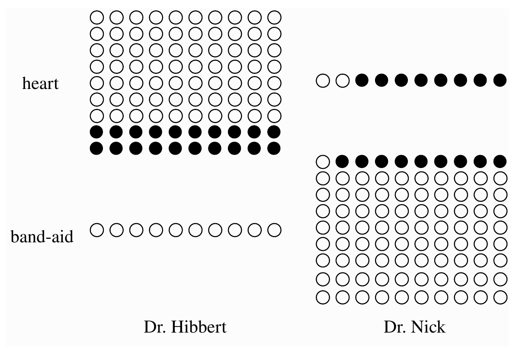
  <figcaption>Different procedure mixes reverse the aggregate comparison. Reproduced from Blitzstein and Hwang, <em>Introduction to Probability</em>, Figure 2.6, p. 68. White dots indicate successes; black dots indicate failures.</figcaption>
</figure>

Dr. Hibbert performs mostly difficult procedures. Dr. Nick performs mostly easy procedures. Their overall rates average over very different case mixes.

**Core idea:** An aggregate rate combines performance within groups and the proportions of cases belonging to those groups. A higher aggregate rate need not imply a higher rate within a comparable group.

### Part 6 — Explain the reversal with LOTP

Let $$S$$ mean success and $$H$$ mean a heart procedure. Let $$D_H$$ mean Dr. Hibbert performed the procedure and $$D_N$$ mean Dr. Nick performed it.

Keeping doctor identity as background evidence, LOTP gives:

$$
\begin{aligned}
P(S\mid D_H)
={}&P(S\mid D_H,H)P(H\mid D_H)\\
&+P(S\mid D_H,H^c)P(H^c\mid D_H).
\end{aligned}
$$

For Dr. Hibbert:

$$
P(S\mid D_H)=\frac79\frac9{10}+1\frac1{10}
=\frac7{10}+\frac1{10}=0.80.
$$

For Dr. Nick:

$$
P(S\mid D_N)=\frac15\frac1{10}+\frac9{10}\frac9{10}
=\frac2{100}+\frac{81}{100}=0.83.
$$

The weights differ:

$$
P(H\mid D_H)=0.90,\qquad P(H\mid D_N)=0.10.
$$

Dr. Hibbert's lower within-doctor rate—the heart rate—receives much more weight than Dr. Nick's heart rate. Dr. Nick's easier-procedure rate receives most of his weight.

#### General probability form

For an outcome $$A$$, a group indicator $$B$$, and a subgroup indicator $$C$$, a reversal can have the form:

$$
P(A\mid B,C)>P(A\mid B^c,C),
$$

$$
P(A\mid B,C^c)>P(A\mid B^c,C^c),
$$

but:

$$
P(A\mid B)<P(A\mid B^c).
$$

All conditioning events must have positive probability. The reversal is possible because the overall probabilities use different subgroup weights, $$P(C\mid B)$$ and $$P(C\mid B^c)$$.

The variable $$C$$ is called a **confounder**: a variable related to both the group and the outcome, which should be controlled for. In the doctor example, $$A$$ is success, $$B$$ is treatment by Dr. Nick, and $$C$$ is a heart procedure. Without conditioning on $$C$$, learning that Dr. Nick operated tells us the procedure was probably an easy one, and that information, not his skill, raises his aggregate rate. Here the more relevant comparison is the one that conditions on the procedure type.

#### Why aggregation can flip: adding fractions

Aggregating records adds the successes and adds the totals. That is the “wrong” way to add fractions:

$$
\frac13+\frac25\ne\frac{1+2}{3+5}=\frac38.
$$

The combined rate $$(a+c)/(b+d)$$ is not determined by $$a/b$$ and $$c/d$$ alone:

$$
\frac{a+c}{b+d}=\frac{b}{b+d}\cdot\frac ab+\frac{d}{b+d}\cdot\frac cd,
$$

a weighted average whose weights depend on the group sizes $$b$$ and $$d$$. Two doctors with different case mixes are averaged with different weights, so being better within every group does not guarantee being better after aggregation.

#### More examples of the same structure

<div class="example-block" markdown="1">
<div class="ex-title">Batting averages <span class="ex-pill pill-num">Worked example</span></div>

A batting average is the fraction of at-bats that produce a hit. With illustrative numbers:

| Player | First half | Second half | Whole season |
|---|---:|---:|---:|
| A | $$4/10=0.400$$ | $$25/100=0.250$$ | $$29/110\approx0.264$$ |
| B | $$35/100=0.350$$ | $$2/10=0.200$$ | $$37/110\approx0.336$$ |

Player A has the higher average in each half, but Player B has the higher average for the season. Most of A's at-bats fall in the weaker second half, and most of B's fall in the stronger first half.

<div class="ex-lesson">The half-season plays the role of the confounder: it is associated with both the player's number of at-bats and the hit rate.</div>
</div>

**Graduate admissions.** A lawsuit against UC Berkeley alleged discrimination against women in graduate admissions, because the overall admission rate was higher for men. Within individual departments, there was no clear evidence of discrimination against women. Women applied more often to departments that were harder to get into, so aggregating across departments produced the apparent gap. The department is the confounder.

<div class="example-block" markdown="1">
<div class="ex-title">Jelly-bean jars <span class="ex-pill pill-num">Worked example</span></div>

Each of four jars holds jelly beans of a liked flavor and a disliked flavor, and you draw one at random from a jar of your choice. With illustrative counts of liked beans out of total beans:

| Jar | Liked / total | Rate |
|---|---:|---:|
| $$A_1$$ | $$2/3$$ | $$0.667$$ |
| $$B_1$$ | $$6/10$$ | $$0.600$$ |
| $$A_2$$ | $$1/10$$ | $$0.100$$ |
| $$B_2$$ | $$0/3$$ | $$0$$ |

Jar $$A_1$$ beats $$B_1$$, and $$A_2$$ beats $$B_2$$. Now pour $$A_1$$ and $$A_2$$ into one big jar $$A$$, and $$B_1$$ and $$B_2$$ into jar $$B$$:

$$
A:\ \frac{3}{13}\approx0.231,\qquad B:\ \frac{6}{13}\approx0.462.
$$

Combining the two better jars produces the worse jar.

<div class="ex-lesson">Try making up your own numbers. A reversal needs the jars being combined to have very different sizes, so the two combined rates are weighted toward different jars.</div>
</div>

<div class="misconception-block" markdown="1">

**Incorrect:** If one doctor has the higher success rate in each type, adding the records must preserve that advantage.

**Correction:** Adding counts forms a weighted average of rates. The weights are each doctor's own procedure proportions. Different weights can reverse the comparison, even though every within-type comparison points the other way.

</div>

### Part 7 — Supplementary clarification: Compare using common weights

Suppose both doctors are evaluated using the same fraction $$w$$ of heart procedures and $$1-w$$ of Band-Aid removals. Define standardized rates:

$$
R_H(w)=w\frac79+(1-w)\cdot1,
$$

$$
R_N(w)=w\frac15+(1-w)\frac9{10}.
$$

Their difference is:

$$
R_H(w)-R_N(w)
=w\left(\frac79-\frac15\right)+(1-w)\left(1-\frac9{10}\right)
=\frac{26}{45}w+\frac1{10}(1-w)>0
$$

for every $$0\le w\le1$$. With common weights, the higher rate in both subgroups produces a higher weighted rate.

For an equal mix, $$w=1/2$$:

$$
R_H(1/2)=\frac89\approx88.89\%,\qquad
R_N(1/2)=\frac{11}{20}=55\%.
$$

These are comparisons for a specified common mix, not the observed overall success rates. Reweighting changes the question being answered.

#### Aggregation and causal interpretation

The observed data establish subgroup rates and an aggregate reversal. They do not, by themselves, establish what would happen if the same person were assigned to either doctor. Patient selection, procedure difficulty, and other differences may matter.

Likewise, finding a reversal does not automatically mean that conditioning on every available variable gives the right comparison. The relevant conditioning depends on the question and how the data were generated.

**Core idea:** Identify whether the desired quantity concerns the observed mix, a common comparison mix, or a causal intervention. Those quantities need not agree.

### Part 8 — Original practice questions

Try these before reading the answers.

1. In standard Monty Hall, the contestant chooses door 1. State the outcome of switching for each possible car location and derive the overall winning probability.
2. Suppose standard Monty opens door 3. Find $$P(C_1\mid M_3)$$ and $$P(C_2\mid M_3)$$ using the likelihoods of that action.
3. Monty always reveals a goat and offers a switch, but when the car is behind door 1 he opens door 2 with probability $$3/4$$. Given that he opens door 2, find the switching success probability. Does always switching still win $$2/3$$ of the time overall?
4. In the blind-host version, condition on door 2 being opened and showing a goat. Find the probability that the car is behind door 3 and explain the difference from standard Monty Hall.
5. In a ten-door game, a knowledgeable host always opens eight unchosen goat doors. Find the success rates of staying and switching.
6. Using the hypothetical doctors' records, verify each within-type rate and each overall rate. Identify the weights causing the reversal.
7. Evaluate both doctors with a common mix of 25% heart procedures and 75% Band-Aid removals. Which standardized rate is higher?
8. Can an aggregate reversal occur if one group has a strictly higher success rate in every subgroup and both groups use identical subgroup weights? Explain algebraically.
9. Player A hits $$3/10$$ in April and $$20/100$$ in May; Player B hits $$28/100$$ in April and $$1/10$$ in May. Who is better in each month, and who is better over both months combined?

### Part 9 — Practice answers

#### 1. Standard switching

Switching loses if $$C_1$$ occurs and wins if $$C_2$$ or $$C_3$$ occurs. The equally likely car locations give:

$$
P(W)=0\frac13+1\frac13+1\frac13=\frac23.
$$

The host's tie-breaking does not affect this overall result because the initial choice is wrong in exactly two of the three cases.

#### 2. Monty opens door 3

The likelihoods are $$P(M_3\mid C_1)=1/2$$, $$P(M_3\mid C_2)=1$$, and $$P(M_3\mid C_3)=0$$. Hence $$P(M_3)=1/2$$ and:

$$
P(C_1\mid M_3)=\frac{(1/2)(1/3)}{1/2}=\frac13,
$$

$$
P(C_2\mid M_3)=\frac{1(1/3)}{1/2}=\frac23.
$$

Switching to door 2 is preferable.

#### 3. Unequal tie-breaking

Here $$q=3/4$$, so:

$$
P(C_3\mid M_2)=\frac1{1+3/4}=\frac47.
$$

The probability of staying successfully after this reveal is $$3/7$$. Overall, switching still succeeds whenever the first choice is wrong, so its unconditional winning probability remains $$2/3$$.

#### 4. A blind goat reveal

The likelihood of opening door 2 and finding a goat is $$1/2$$ under $$C_1$$, zero under $$C_2$$, and $$1/2$$ under $$C_3$$. The two compatible car locations have equal prior probabilities and equal likelihoods. Thus:

$$
P(C_3\mid E_2)=\frac12.
$$

Standard Monty is forced to open door 2 when the car is behind door 3; the blind host is not. That difference changes the likelihood of the evidence.

#### 5. Ten doors

Staying wins only when the initial choice is correct, with probability $$1/10$$. Switching wins whenever that choice is wrong, with probability $$9/10$$.

#### 6. Procedure mix and reversal

Heart success rates are $$70/90=7/9$$ and $$2/10=1/5$$. Band-Aid success rates are $$10/10=1$$ and $$81/90=9/10$$. Dr. Hibbert is higher in both.

Overall rates are $$(70+10)/100=0.80$$ and $$(2+81)/100=0.83$$. Heart procedures carry weights $$0.90$$ for Dr. Hibbert and $$0.10$$ for Dr. Nick, reversing the aggregate comparison.

#### 7. Common 25% heart mix

For Dr. Hibbert:

$$
R_H(1/4)=\frac14\frac79+\frac34
=\frac{17}{18}\approx94.44\%.
$$

For Dr. Nick:

$$
R_N(1/4)=\frac14\frac15+\frac34\frac9{10}
=\frac{29}{40}=72.5\%.
$$

Dr. Hibbert has the higher standardized rate.

#### 8. Identical weights

Let subgroup rates be $$a_i>b_i$$, with common weights $$w_i\ge0$$ summing to 1. Then:

$$
\sum_i w_i a_i-\sum_i w_i b_i
=\sum_i w_i(a_i-b_i)>0.
$$

At least one weight is positive, and every positively weighted difference is positive. The common weighted average preserves the ordering, so a reversal cannot occur under these assumptions.

#### 9. A batting reversal

April: $$0.300>0.280$$. May: $$0.200>0.100$$. Player A is better in both months. Combined, A has $$23/110\approx0.209$$ and B has $$29/110\approx0.264$$, so B is better overall. Most of A's at-bats came in A's weaker month, and most of B's in B's stronger month.

### Part 10 — Quick revision sheet

| Concept | Essential fact |
|---|---|
| Standard Monty protocol | Host knows the car location, always reveals an unchosen goat, and always offers a switch |
| Stay | Wins exactly when the initial choice is correct: $$1/3$$ |
| Switch | Wins exactly when the initial choice is wrong: $$2/3$$ |
| Particular reveal | Equal tie-breaking gives $$1/3$$ for the original door and $$2/3$$ for the alternative |
| Unequal tie-breaking | Changes reveal-specific posteriors; overall always-switch success remains $$2/3$$ |
| Blind reveal | A randomly opened door that happens to show a goat can yield $$1/2$$–$$1/2$$ |
| Million doors | Extreme case that exposes the 50–50 argument; switching wins $$(N-1)/N$$ in general |
| Simpson reversal | Within-subgroup comparisons and aggregate comparison point in opposite directions |
| Confounder | Variable $$C$$ tied to both group and outcome; here the procedure type |
| Aggregate rate | Weighted average of subgroup rates, using each group's own case mix: $$\frac{a+c}{b+d}$$, not $$\frac ab+\frac cd$$ |
| Other reversals | Batting averages by half-season, Berkeley admissions by department, mixed jelly-bean jars |
| Common-weight comparison | Preserves an advantage present in every positively weighted subgroup |
| Interpretation | Observed rates, standardized rates, and causal effects answer different questions |

### Term Glossary

<div class="glossary-entry" markdown="1">
<div class="gterm">Host protocol <span class="gcat cat-defn">Definition</span></div>

The rules governing which door is opened and whether a switch is offered. These rules determine the likelihoods of the observed evidence.

</div>

<div class="glossary-entry" markdown="1">
<div class="gterm">Switching strategy <span class="gcat cat-defn">Definition</span></div>

Choosing the sole remaining unchosen door after a standard Monty Hall goat reveal.

</div>

<div class="glossary-entry" markdown="1">
<div class="gterm">Simpson’s paradox <span class="gcat cat-defn">Definition</span></div>

A reversal of a comparison after subgroup data are aggregated, despite the subgroup comparisons consistently pointing in the other direction.

</div>

<div class="glossary-entry" markdown="1">
<div class="gterm">Stratum <span class="gcat cat-defn">Definition</span></div>

A subgroup defined by a conditioning variable, such as procedure type. Comparing within strata keeps that variable fixed.

</div>

<div class="glossary-entry" markdown="1">
<div class="gterm">Confounder <span class="gcat cat-defn">Definition</span></div>

A variable associated with both the group being compared and the outcome, such as procedure type for the two doctors. Failing to condition on it can produce a misleading or reversed comparison.

</div>

<div class="glossary-entry" markdown="1">
<div class="gterm">Case mix <span class="gcat cat-defn">Definition</span></div>

The proportions of cases belonging to different subgroups. These proportions serve as the weights in an aggregate rate.

</div>

<div class="glossary-entry" markdown="1">
<div class="gterm">Standardized rate <span class="gcat cat-meas">Measure</span></div>

A weighted average calculated using a specified reference case mix, allowing groups to be compared under common weights.

</div>

<div class="ref-tags">
  <span class="ref-tag">Statistics 110</span>
  <span class="ref-tag">Lecture 6</span>
  <span class="ref-tag">Monty Hall</span>
  <span class="ref-tag">Simpson’s paradox</span>
  <span class="ref-tag">Conditioning</span>
  <span class="ref-tag">Weighted averages</span>
</div>

  </div>
</div>

## Lecture 7 - Gambler’s Ruin and Random Variables

<div class="chapter-block">
  <button type="button" class="chapter-toggle" id="lecture-7-toggle" onclick="toggleLecture('lecture-7')" aria-expanded="true" aria-controls="lecture-7-body">
    <span class="chapter-toggle-left">
      <span class="chapter-badge">Lecture 7</span>
      <span>
        <span class="chapter-title">Lecture 7 - Gambler’s Ruin and Random Variables</span>
        <span class="chapter-subtitle">First-step analysis, difference equations, Bernoulli trials, and success counts</span>
      </span>
    </span>
    <span class="chapter-arrow open" id="lecture-7-arrow" aria-hidden="true">▼</span>
  </button>
  <div class="chapter-body open" id="lecture-7-body" markdown="1">

<div class="note-abstract" markdown="1">

A repeated game can be understood by conditioning on its first round: the remaining problem has the same structure, with a different starting fortune. This produces a difference equation for the probability of winning the entire game. Random variables then provide a concise way to describe numerical features of an experiment. A single success indicator is Bernoulli; a count of successes in a fixed number of independent, equally likely trials is Binomial.

</div>

### Notation at a Glance

<div class="notation-panel" markdown="1">

| Symbol | Meaning |
|---|---|
| $$N$$ | Fixed total fortune shared by two gamblers |
| $$i$$ | Gambler A’s initial fortune; B starts with $$N-i$$ |
| $$p$$, $$q=1-p$$ | Probabilities that A wins or loses one round |
| $$u_i$$ | Probability A reaches $$N$$ before 0, starting at $$i$$ |
| $$d_i=u_i-u_{i-1}$$ | Difference between neighboring winning probabilities |
| $$S$$, $$s\in S$$ | Sample space and an individual outcome |
| $$X:S\to\mathbb R$$ | Random variable assigning a number to each outcome |
| $$X(s)$$ | Value of the random variable at outcome $$s$$ |
| $$\{X=x\}$$ | Event consisting of outcomes mapped to $$x$$ |
| $$I_A$$ | Indicator of event $$A$$: 1 when it occurs, 0 otherwise |
| $$X\sim\operatorname{Bern}(p)$$ | Bernoulli distribution with success probability $$p$$ |
| $$X\sim\operatorname{Bin}(n,p)$$ | Binomial distribution: successes in $$n$$ independent trials |

</div>

### Learning objectives

After studying these notes, you should be able to:

- Translate gambler’s ruin into a random walk with absorbing boundaries.
- Derive a recurrence by conditioning on the first round.
- Solve the fair and biased cases using neighboring differences, or by guessing a power, together with boundary conditions.
- Explain why winning one round and winning the whole game have different probabilities, and why a slight per-round edge ruins the gambler.
- Show that the game ends with probability 1.
- Define a random variable as a function and interpret events such as $$X=x$$.
- Distinguish a random variable, its observed value, and its distribution.
- Recognize Bernoulli indicators and the assumptions of a Binomial count.
- Derive the Binomial probability formula by counting success positions, and add independent Binomials with a common $$p$$ by a story proof.

### Part 1 — Gambler’s ruin as a random walk

Two gamblers, A and B, repeatedly make $1 bets. A begins with $$i$$ dollars and B with $$N-i$$ dollars. Every round transfers one dollar between them, so the total remains $$N$$. The rounds are independent, and A wins each round with the same probability $$p$$; B wins with probability $$q=1-p$$.

The game ends when one gambler has all the money. A’s fortune moves:

$$
i\longrightarrow
\begin{cases}
i+1,&\text{with probability }p,\\
i-1,&\text{with probability }q.
\end{cases}
$$

The states 0 and $$N$$ are **absorbing**: once reached, the game is over. The question is the probability of reaching $$N$$ before 0, rather than the probability of winning the next round.

Define:

$$
u_i=P(\text{A reaches }N\text{ before }0\mid\text{A starts at }i).
$$

At the boundaries:

$$
u_0=0,\qquad u_N=1.
$$

**Core idea:** The current fortune summarizes the information needed for future winning probabilities. Past wins and losses do not change future independent round probabilities.

### Part 2 — First-step analysis: condition on one round

For $$1\le i\le N-1$$, the first round either raises A’s fortune to $$i+1$$ or lowers it to $$i-1$$. After either outcome, the remaining game has exactly the original rules with a new starting fortune.

By the law of total probability:

$$
\begin{aligned}
u_i
&=P(\text{eventual win}\mid\text{first round won})p
 +P(\text{eventual win}\mid\text{first round lost})q\\
&=pu_{i+1}+qu_{i-1}.
\end{aligned}
$$

The starting state $$i$$ is understood as fixed throughout this calculation.

<div class="result-box" markdown="1">

$$
\boxed{u_i=pu_{i+1}+qu_{i-1},\quad 1\le i\le N-1;\qquad u_0=0,\quad u_N=1.}
$$

</div>

This is a **difference equation**: it relates a sequence at neighboring integer indices. The boundary conditions select the solution describing this particular game.

<div class="misconception-block" markdown="1">

**Incorrect:** A wins the game with probability $$p$$ because that is A’s chance of winning a bet.

**Correction:** $$p$$ concerns one round. $$u_i$$ concerns an entire path until absorption and depends on the starting fortune and total fortune as well as $$p$$.

</div>

### Part 3 — Solve the fair game

When $$p=q=1/2$$:

$$
2u_i=u_{i+1}+u_{i-1}.
$$

Rearrange:

$$
u_{i+1}-u_i=u_i-u_{i-1}.
$$

Every neighboring difference is the same. Therefore $$u_i=a+bi$$. The boundary $$u_0=0$$ gives $$a=0$$, and $$u_N=1$$ gives $$b=1/N$$.

<div class="result-box" markdown="1">

$$
\boxed{u_i=\frac{i}{N}\qquad\text{when }p=\frac12.}
$$

</div>

<div class="example-block" markdown="1">
<div class="ex-title">A fair game with unequal fortunes <span class="ex-pill pill-num">Worked example</span></div>

A starts with $3 and B with $7, so $$N=10$$. Each round is fair, but:

$$
P(\text{A wins the whole game})=u_3=\frac3{10},\qquad
P(\text{B wins})=\frac7{10}.
$$

A has fewer dollars available to absorb losses before bankruptcy. Fair individual bets do not make the two eventual winning probabilities equal when the initial fortunes differ.

<div class="ex-lesson">The winning probability equals the initial share of the total fortune in the fair game.</div>
</div>

### Part 4 — Solve the biased game

Assume $$0<p<1$$ and set $$r=q/p$$. Because $$p+q=1$$, the recurrence can be rewritten as:

$$
p(u_{i+1}-u_i)=q(u_i-u_{i-1}).
$$

With $$d_i=u_i-u_{i-1}$$, this becomes:

$$
d_{i+1}=rd_i,\qquad d_i=d_1r^{i-1}.
$$

Starting from $$u_0=0$$, add the differences:

$$
u_i=d_1(1+r+\cdots+r^{i-1}).
$$

The other boundary condition gives:

$$
1=u_N=d_1(1+r+\cdots+r^{N-1}).
$$

Divide these equations. For $$r\ne1$$, evaluate the geometric sums:

$$
u_i=\frac{1+r+\cdots+r^{i-1}}{1+r+\cdots+r^{N-1}}
=\frac{1-r^i}{1-r^N}.
$$

<div class="result-box" markdown="1">

$$
\boxed{
u_i=
\begin{cases}
\displaystyle\frac{1-(q/p)^i}{1-(q/p)^N},&p\ne\frac12,\quad 0<p<1,\\[6pt]
\displaystyle\frac{i}{N},&p=\frac12.
\end{cases}}
$$

</div>

For an interior starting state, $$p=0$$ gives $$u_i=0$$ and $$p=1$$ gives $$u_i=1$$ directly. The boundaries remain $$u_0=0$$ and $$u_N=1$$ in every case.

#### Check the transition to a fair game

The geometric-sum form stays meaningful as $$r\to1$$: its numerator approaches $$i$$ and denominator approaches $$N$$. Thus the biased formula approaches $$i/N$$. The apparent $$0/0$$ in the power formula at $$p=1/2$$ reflects its algebraic form, not an undefined winning probability.

#### Alternative method: guess a power

A standard way to solve a linear difference equation with constant coefficients is to guess a power and see what it requires. Try $$u_i=x^i$$ with $$x\ne0$$:

$$
x^i=px^{i+1}+qx^{i-1}
\quad\Longrightarrow\quad
px^2-x+q=0.
$$

The quadratic formula gives $$x=\dfrac{1\pm\sqrt{1-4pq}}{2p}$$. This simplifies nicely, because $$q=1-p$$ gives

$$
1-4pq=1-4p+4p^2=(2p-1)^2.
$$

So the two roots are

$$
x=\frac{1+(2p-1)}{2p}=1,\qquad x=\frac{1-(2p-1)}{2p}=\frac qp.
$$

When $$p\ne q$$ the roots are distinct, and the general solution is a linear combination of their powers:

$$
u_i=a\cdot1^i+b\left(\frac qp\right)^i=a+b\,r^i.
$$

The boundary conditions fix the constants. From $$u_0=0$$, $$b=-a$$. From $$u_N=1$$, $$a(1-r^N)=1$$. Hence

$$
u_i=\frac{1-r^i}{1-r^N},
$$

agreeing with the result above. When $$p=q$$, the root 1 is repeated and the guess alone does not give a second solution. Instead, let $$x=q/p\to1$$ and use L'Hôpital's rule:

$$
\lim_{x\to1}\frac{1-x^i}{1-x^N}=\lim_{x\to1}\frac{ix^{i-1}}{Nx^{N-1}}=\frac iN.
$$

Substituting $$u_i=i/N$$ back into $$2u_i=u_{i+1}+u_{i-1}$$ confirms that it satisfies the fair-game equation.

**Core idea:** Guessing $$x^i$$ turns a difference equation into a polynomial equation. With distinct roots, the general solution is a combination of root powers, and the boundary conditions pick the particular solution.

<div class="example-block" markdown="1">
<div class="ex-title">A slightly unfair game <span class="ex-pill pill-num">Worked example</span></div>

Let A and B start with equal fortunes, $$i=N/2$$, and let each round be only slightly unfavorable to A: $$p=0.49$$. Then $$r=0.51/0.49\approx1.0408$$, and

$$
u_{N/2}=\frac{1-r^{N/2}}{1-r^N}=\frac1{1+r^{N/2}}.
$$

| Total fortune $$N$$ | Each player starts with | $$P(\text{A wins the game})$$ |
|---:|---:|---:|
| 20 | 10 | $$\approx0.401$$ |
| 100 | 50 | $$\approx0.119$$ |
| 200 | 100 | $$\approx0.018$$ |

A disadvantage of only 0.01 per round becomes overwhelming over a long game. With 100 dollars each, B ends up with all the money about 98% of the time.

A casino is in an even stronger position than B. Its games range from slightly to very unfavorable to the gambler, and it nearly always has far more money than the gambler. This is why the problem is called gambler's ruin.

<div class="ex-lesson">A small per-round edge, repeated over many rounds, turns into a large advantage in the eventual outcome.</div>
</div>

<div class="example-block" markdown="1">
<div class="ex-title">Supplementary: Equal starting fortunes with biased rounds <span class="ex-pill pill-num">Worked example</span></div>

Let $$N=4$$ and $$i=2$$. If $$p=2/3$$, then $$q=1/3$$ and $$r=1/2$$. Hence:

$$
u_2=\frac{1-(1/2)^2}{1-(1/2)^4}
=\frac{3/4}{15/16}=\frac45.
$$

A’s probability of winning one round is $$2/3$$, while A’s probability of winning the whole game is $$4/5$$. If instead $$p=1/3$$, then $$r=2$$ and:

$$
u_2=\frac{1-2^2}{1-2^4}=\frac{-3}{-15}=\frac15.
$$

The negative numerator and denominator cancel; the probability is positive.

<div class="ex-lesson">Repeated opportunities and absorbing boundaries transform a per-round advantage into a different eventual winning probability.</div>
</div>

### Part 5 — Why the game ends

Nothing in the rules prevents the game from going on forever. The probability of that is zero, and the formulas already show it.

The probability that **B** wins comes from the same calculation with the roles exchanged. B wins each round with probability $$q$$ and starts with $$N-i$$, so swap $$p$$ with $$q$$ and $$i$$ with $$N-i$$.

**Fair game.** B wins with probability $$(N-i)/N$$, so

$$
P(\text{A wins})+P(\text{B wins})=\frac iN+\frac{N-i}N=1.
$$

**Biased game.** With $$r=q/p$$, B's ratio is $$p/q=1/r$$:

$$
P(\text{B wins})=\frac{1-r^{-(N-i)}}{1-r^{-N}}
=\frac{r^N-r^i}{r^N-1}
=\frac{r^i-r^N}{1-r^N},
$$

after multiplying numerator and denominator by $$r^N$$. Adding A's probability:

$$
\frac{1-r^i}{1-r^N}+\frac{r^i-r^N}{1-r^N}=1.
$$

In both cases the two ways for the game to end already have total probability 1, leaving no probability for endless play.

<div class="result-box" markdown="1">

$$
\boxed{P(\text{A wins})+P(\text{B wins})=1,\qquad P(\text{the game never ends})=0.}
$$

</div>

#### Supplementary: a direct argument

For $$0<p<1$$, from any interior state, $$N$$ consecutive wins would force absorption at $$N$$ within those rounds. The probability of that run of potential round outcomes is $$p^N>0$$. Thus, conditional on any history that has not yet ended, the probability of surviving the next $$N$$ rounds is at most $$1-p^N$$.

After $$m$$ such blocks:

$$
P(\text{not absorbed after }mN\text{ rounds})\le(1-p^N)^m\longrightarrow0.
$$

At $$p=0$$ or $$p=1$$, absorption occurs deterministically within $$N$$ rounds. This argument establishes eventual absorption without solving for the winning probabilities; it does not calculate the expected duration.

### Part 6 — A random variable is a numerical function

A **random variable** is a function assigning a real number to every outcome in the sample space:

$$
X:S\longrightarrow\mathbb R.
$$

The experiment selects a random outcome $$s$$ according to the probability model. The rule $$X$$ is fixed; its realized value is $$X(s)$$. An outcome need not be a number: it may be a sequence of coin tosses, a path of fortunes, or another experimental record.

<figure>
  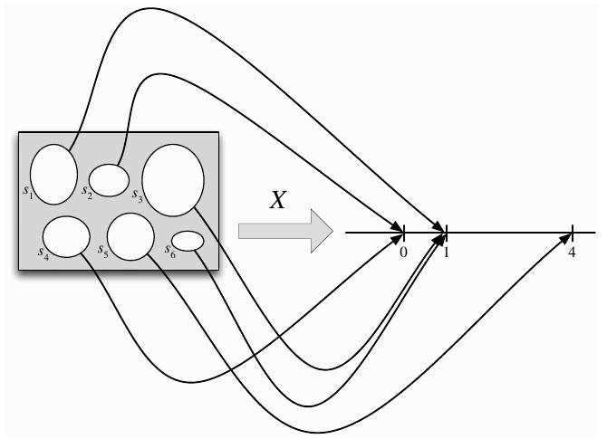
  <figcaption>The randomness comes from selecting an outcome; the numerical assignment is fixed. Reproduced from Joseph K. Blitzstein and Jessica Hwang, <em>Introduction to Probability</em>, Figure 3.1, p. 92.</figcaption>
</figure>

#### Worked example: Two fair coin tosses

Assume independent tosses. The four outcomes $$HH,HT,TH,TT$$ each have probability $$1/4$$. Define $$X$$ as the number of Heads, $$Y$$ as the number of Tails, and $$I$$ as the indicator that the first toss is Heads.

| Outcome $$s$$ | $$X(s)$$ | $$Y(s)$$ | $$I(s)$$ |
|---|---|---|---|
| $$HH$$ | 2 | 0 | 1 |
| $$HT$$ | 1 | 1 | 1 |
| $$TH$$ | 1 | 1 | 0 |
| $$TT$$ | 0 | 2 | 0 |

The relationship $$Y=2-X$$ holds outcome by outcome. The statement $$X=1$$ describes the event $$\{HT,TH\}$$, so:

$$
P(X=1)=P(\{HT,TH\})=\frac12.
$$

In general:

$$
\{X=x\}=\{s\in S:X(s)=x\}.
$$

**Core idea:** A numerical value can summarize several distinct outcomes. Its probability is the combined probability of all outcomes mapped to it.

<div class="misconception-block" markdown="1">

**Incorrect:** The three possible Head counts, 0, 1, and 2, are equally likely.

**Correction:** They collect different numbers of equally likely outcomes. Their probabilities are $$1/4,1/2,1/4$$, respectively. Equal likelihood of sample outcomes does not automatically transfer to numerical summaries.

</div>

#### Random variable versus distribution

A distribution specifies the probabilities associated with a random variable’s possible values. In this example, $$X$$ and $$Y$$ have the same distribution: each has probabilities $$1/4,1/2,1/4$$ at 0, 1, and 2. They are different functions, since $$X(HH)=2$$ but $$Y(HH)=0$$.

Knowing a distribution does not identify the outcome-by-outcome function or the dependence between two random variables. Here $$X+Y=2$$ always, so the counts are dependent despite having identical distributions.

#### Return to the gambling game

Let $$X_t$$ be A’s fortune after $$t$$ rounds, keeping the fortune fixed after absorption. Then B’s fortune is $$N-X_t$$, and the fortune difference is $$2X_t-N$$. These are numerical functions of the same game path. Random-variable notation expresses their relationship directly.

### Part 7 — Bernoulli: encode whether an event occurs

For an event $$A$$, its **indicator** is:

$$
I_A(s)=
\begin{cases}
1,&s\in A,\\
0,&s\notin A.
\end{cases}
$$

If $$P(A)=p$$, then:

$$
P(I_A=1)=p,\qquad P(I_A=0)=1-p.
$$

We write $$I_A\sim\operatorname{Bern}(p)$$. The symbol $$\sim$$ means “is distributed as”; it does not mean equality of functions.

“Success” is simply the outcome labeled 1. It could represent Heads, a correct answer, or the occurrence of a defect. A Bernoulli model describes one binary indicator even if the underlying experiment has many possible outcomes.

For example, let $$J$$ indicate that A wins the entire gambling game starting from $$i$$. Then $$J\sim\operatorname{Bern}(u_i)$$. The indicator of winning one round has parameter $$p$$ instead. Both are Bernoulli, but they summarize different events.

The usual nondegenerate case has $$0<p<1$$. Allowing $$p=0$$ or $$p=1$$ gives a constant random variable.

### Part 8 — Binomial: count independent successes

Suppose there are:

1. A fixed number $$n$$ of trials.
2. A success/failure outcome for each trial.
3. Independent trials.
4. The same success probability $$p$$ in every trial.

If $$I_j$$ indicates success on trial $$j$$, then:

$$
X=I_1+\cdots+I_n
$$

counts successes, and $$X\sim\operatorname{Bin}(n,p)$$. One trial is the special case $$\operatorname{Bin}(1,p)=\operatorname{Bern}(p)$$ in distribution.

#### Derive the probability of exactly $$k$$ successes

One specified sequence containing $$k$$ successes and $$n-k$$ failures has probability:

$$
p^k(1-p)^{n-k}.
$$

There are $$\binom nk$$ sequences of this kind: choose the $$k$$ positions occupied by successes. The sequences are disjoint, so their probabilities add:

<div class="result-box" markdown="1">

$$
\boxed{P(X=k)=\binom nk p^k(1-p)^{n-k},\qquad k=0,1,\ldots,n.}
$$

</div>

The probability is zero outside these integer values. This function is called the **probability mass function (PMF)**. For $$0<p<1$$, all integers from 0 through $$n$$ are possible with positive probability. At the endpoints, $$p=0$$ concentrates at 0 and $$p=1$$ concentrates at $$n$$.

The binomial theorem verifies that the probabilities sum to 1:

$$
\sum_{k=0}^n\binom nk p^k(1-p)^{n-k}
=(p+(1-p))^n=1.
$$

This is the probability formula needed for the Binomial story; a broader treatment of PMFs and CDFs follows in the next lecture.

#### Adding independent Binomials with the same $$p$$

<div class="result-box" markdown="1">

If $$X\sim\operatorname{Bin}(n,p)$$ and $$Y\sim\operatorname{Bin}(m,p)$$ are independent, then

$$
\boxed{X+Y\sim\operatorname{Bin}(n+m,p).}
$$

</div>

**Story proof.** Let $$X$$ count successes in $$n$$ independent Bernoulli($$p$$) trials, and let $$Y$$ count successes in $$m$$ further trials, independent of the first $$n$$. Together these are $$n+m$$ independent trials, each with success probability $$p$$. The total number of successes is $$X+Y$$, which by definition is $$\operatorname{Bin}(n+m,p)$$. No equations are needed.

The same $$p$$ is essential. If $$X\sim\operatorname{Bin}(n,1/2)$$ and $$Y\sim\operatorname{Bin}(m,1/3)$$, the combined trials do not share one success probability, and $$X+Y$$ is not Binomial in general. Algebraic proofs follow in the next lecture.

<div class="example-block" markdown="1">
<div class="ex-title">Supplementary numerical example: Four independent attempts <span class="ex-pill pill-num">Worked example</span></div>

Suppose four attempts are independent and each succeeds with probability $$1/3$$. Let $$X$$ count successes. Then $$X\sim\operatorname{Bin}(4,1/3)$$, and:

$$
P(X=2)=\binom42\left(\frac13\right)^2\left(\frac23\right)^2
=6\frac19\frac49=\frac8{27}.
$$

The sequence success, success, failure, failure is only one of six arrangements with two successes. Its probability is $$4/81$$, while the event $$X=2$$ combines all six.

For at least one success, use the complement:

$$
P(X\ge1)=1-P(X=0)=1-\left(\frac23\right)^4=\frac{65}{81}.
$$

<div class="ex-lesson">The powers describe a specified success/failure pattern; the binomial coefficient counts how many patterns give the requested count.</div>
</div>

### Part 9 — Misconceptions about success counts

<div class="misconception-block" markdown="1">

**Incorrect:** Any count of successes in $$n$$ trials is Binomial.

**Correction:** Independence and a common success probability are part of the model. If trials have different success probabilities, or one trial’s outcome changes the others, the Binomial formula is not automatically valid.

</div>

#### Supplementary counterexample: Identical probabilities without independence

Toss one fair coin and copy its result into two trial records. Each record individually has success probability $$1/2$$, but the records are perfectly dependent. The total success count is 0 or 2, each with probability $$1/2$$, and never 1.

A $$\operatorname{Bin}(2,1/2)$$ count would instead assign probability $$1/2$$ to 1. Identical Bernoulli marginal distributions do not establish independent trials.

#### A fixed number of rounds versus an absorbing game

If independent potential gambling rounds are generated for a fixed $$n$$, their win count is $$\operatorname{Bin}(n,p)$$. The actual gambler’s ruin game stops at a random time determined by its outcomes. The number of wins before bankruptcy or total victory is therefore not justified as a fixed-$$n$$ Binomial count.

**Core idea:** Identify what is counted and when observation stops. The distribution story depends on the experiment’s rules.

### Part 10 — Original practice questions

Try these before reading the answers.

1. Derive the first-step recurrence and boundary conditions for gambler’s ruin. Which assumption lets you reuse $$u_{i+1}$$ and $$u_{i-1}$$ after the first round?
2. In a fair game, A starts with $4 and B with $6. Find both eventual winning probabilities.
3. Let $$N=3$$, $$i=1$$, and $$p=2/3$$. Calculate A’s winning probability and compare it with the per-round probability.
4. For $$N=4$$ and $$p=1/3$$, calculate $$u_1,u_2,u_3$$ and verify the recurrence at $$i=2$$.
5. In two independent fair coin tosses, let $$X$$ count Heads and $$I$$ indicate that the first toss is Heads. Identify the outcomes in $$\{X=1,I=1\}$$ and calculate its probability.
6. Define the indicator of getting at least one Head in two independent fair tosses. Give its Bernoulli parameter.
7. For $$X\sim\operatorname{Bin}(5,1/2)$$, find $$P(X=2)$$ and $$P(X\ge1)$$. Explain the counting factor in the first calculation.
8. Two records copy the same fair coin toss. Is their success count $$\operatorname{Bin}(2,1/2)$$? Give its actual distribution.
9. A game ends when a player goes broke. Explain why the number of rounds won before the game ends does not automatically follow a fixed-$$n$$ Binomial distribution.
10. Solve $$u_i=\frac23u_{i+1}+\frac13u_{i-1}$$ with $$u_0=0$$ and $$u_3=1$$ by guessing $$u_i=x^i$$. Then verify that A's and B's winning probabilities from $$i=1$$ sum to 1.

### Part 11 — Practice answers

#### 1. Recurrence and boundaries

Conditioning on the first-round outcome gives $$u_i=pu_{i+1}+qu_{i-1}$$ for interior states. Independence and the unchanged round probability make the remaining game equivalent to a fresh game at the new fortune. A has already lost at 0 and already won at $$N$$, giving $$u_0=0$$ and $$u_N=1$$.

#### 2. Fair fortunes

Here $$N=10$$. A wins with probability $$u_4=4/10=2/5$$. Since the finite game ends with probability 1, B wins with probability $$1-2/5=3/5$$.

#### 3. Biased game from one dollar

With $$r=q/p=1/2$$:

$$
u_1=\frac{1-1/2}{1-(1/2)^3}=\frac{1/2}{7/8}=\frac47.
$$

This is less than $$2/3$$. A has a favorable per-round probability but only one dollar of starting fortune; eventual victory requires reaching $3 before losing that dollar.

#### 4. Check a biased recurrence

Here $$r=2$$ and $$1-r^4=-15$$. Therefore:

$$
u_1=\frac1{15},\qquad u_2=\frac3{15}=\frac15,\qquad u_3=\frac7{15}.
$$

At $$i=2$$:

$$
pu_3+qu_1=\frac13\frac7{15}+\frac23\frac1{15}
=\frac9{45}=\frac15=u_2.
$$

#### 5. Intersect numerical events

Exactly one Head with the first toss Heads occurs only for $$HT$$. Hence $$\{X=1,I=1\}=\{HT\}$$ and its probability is $$1/4$$.

#### 6. Bernoulli indicator

Let $$J=1$$ for $$HH,HT,TH$$ and 0 for $$TT$$. Then $$P(J=1)=3/4$$, so $$J\sim\operatorname{Bern}(3/4)$$. A two-toss experiment can still yield a Bernoulli random variable when the summary is binary.

#### 7. Binomial probabilities

$$
P(X=2)=\binom52\left(\frac12\right)^5=\frac{10}{32}=\frac5{16}.
$$

The factor 10 counts the choices of two success positions among five trials. Also:

$$
P(X\ge1)=1-P(X=0)=1-\frac1{32}=\frac{31}{32}.
$$

#### 8. Copied records

The records are dependent. Their count has probabilities $$P(X=0)=1/2$$, $$P(X=2)=1/2$$, and $$P(X=1)=0$$, which differs from the Binomial distribution.

#### 9. Random stopping

The number of trials is determined by the game’s outcomes, rather than fixed in advance. Independence of potential round outcomes alone does not supply the fixed-trial Binomial story for a count taken up to that stopping time.

#### 10. Characteristic roots

The guess gives $$\frac23x^2-x+\frac13=0$$, or $$2x^2-3x+1=0$$, with roots $$x=1$$ and $$x=\frac12=q/p$$. So $$u_i=a+b(1/2)^i$$. Then $$u_0=0$$ gives $$b=-a$$, and $$u_3=1$$ gives $$a(1-1/8)=1$$, so $$a=8/7$$ and

$$
u_i=\frac87\left(1-2^{-i}\right),\qquad u_1=\frac47.
$$

B wins each round with probability $$1/3$$ and starts with 2, so B's ratio is $$p/q=2$$ and B wins with probability $$\dfrac{1-2^2}{1-2^3}=\dfrac37$$. Indeed $$\frac47+\frac37=1$$.

### Part 12 — Quick revision sheet

| Concept | Essential fact |
|---|---|
| Gambler’s ruin | Fortune moves by one dollar until reaching 0 or $$N$$ |
| One round versus whole game | $$p$$ and $$u_i$$ describe different events |
| First-step recurrence | $$u_i=pu_{i+1}+qu_{i-1}$$ |
| Boundaries | $$u_0=0$$ and $$u_N=1$$ |
| Fair game | $$u_i=i/N$$ |
| Biased game | $$u_i=[1-(q/p)^i]/[1-(q/p)^N]$$ for $$0<p<1$$, $$p\ne1/2$$ |
| Neighboring differences | $$d_{i+1}=(q/p)d_i$$ |
| Characteristic roots | Guess $$u_i=x^i$$: $$px^2-x+q=0$$ has roots 1 and $$q/p$$, so $$u_i=a+b(q/p)^i$$ |
| Slightly unfair game | $$p=0.49$$, equal fortunes: A wins $$\approx0.40,0.12,0.02$$ for $$N=20,100,200$$ |
| Finite-game termination | $$P(\text{A wins})+P(\text{B wins})=1$$, so the game ends with probability 1 |
| Random variable | A fixed function $$X:S\to\mathbb R$$ |
| Numerical event | $$\{X=x\}=\{s:X(s)=x\}$$ |
| Same distribution | Same value probabilities; functions may differ |
| Bernoulli | Indicator with probabilities $$p$$ at 1 and $$1-p$$ at 0 |
| Binomial story | Fixed $$n$$, independent binary trials, common $$p$$ |
| Binomial formula | $$P(X=k)=\binom nk p^k(1-p)^{n-k}$$ |
| Sum of Binomials | Independent $$\operatorname{Bin}(n,p)+\operatorname{Bin}(m,p)\sim\operatorname{Bin}(n+m,p)$$ by the story |

### Term Glossary

<div class="glossary-entry" markdown="1">
<div class="gterm">Absorbing boundary <span class="gcat cat-defn">Definition</span></div>

A state at which the process stops or remains permanently. In gambler’s ruin, these are fortunes 0 and $$N$$.

</div>

<div class="glossary-entry" markdown="1">
<div class="gterm">First-step analysis <span class="gcat cat-defn">Definition</span></div>

Conditioning on the first transition to express a probability in terms of the same problem at new starting states.

</div>

<div class="glossary-entry" markdown="1">
<div class="gterm">Difference equation <span class="gcat cat-defn">Definition</span></div>

An equation relating a sequence at different integer indices. Boundary conditions determine the desired solution here.

</div>

<div class="glossary-entry" markdown="1">
<div class="gterm">Random variable <span class="gcat cat-defn">Definition</span></div>

A real-valued function on the sample space. Its realized value depends on the outcome selected by the experiment.

</div>

<div class="glossary-entry" markdown="1">
<div class="gterm">Distribution <span class="gcat cat-defn">Definition</span></div>

The probabilities of the numerical events associated with a random variable.

</div>

<div class="glossary-entry" markdown="1">
<div class="gterm">Indicator <span class="gcat cat-defn">Definition</span></div>

A random variable equal to 1 when a specified event occurs and 0 otherwise.

</div>

<div class="glossary-entry" markdown="1">
<div class="gterm">Bernoulli distribution <span class="gcat cat-defn">Definition</span></div>

The distribution of a success indicator, with probability $$p$$ at 1 and $$1-p$$ at 0.

</div>

<div class="glossary-entry" markdown="1">
<div class="gterm">Binomial distribution <span class="gcat cat-defn">Definition</span></div>

The distribution of the number of successes in a fixed number $$n$$ of independent Bernoulli trials sharing success probability $$p$$.

</div>

<div class="glossary-entry" markdown="1">
<div class="gterm">Probability mass function <span class="gcat cat-meas">Measure</span></div>

For a discrete random variable, the function assigning $$P(X=x)$$ to each possible numerical value $$x$$.

</div>

<div class="ref-tags">
  <span class="ref-tag">Statistics 110</span>
  <span class="ref-tag">Lecture 7</span>
  <span class="ref-tag">Gambler’s ruin</span>
  <span class="ref-tag">First-step analysis</span>
  <span class="ref-tag">Random variables</span>
  <span class="ref-tag">Bernoulli</span>
  <span class="ref-tag">Binomial</span>
</div>

  </div>
</div>

## Lecture 8 - Random Variables and Their Distributions

<div class="chapter-block">
  <button type="button" class="chapter-toggle" id="lecture-8-toggle" onclick="toggleLecture('lecture-8')" aria-expanded="true" aria-controls="lecture-8-body">
    <span class="chapter-toggle-left">
      <span class="chapter-badge">Lecture 8</span>
      <span>
        <span class="chapter-title">Lecture 8 - Random Variables and Their Distributions</span>
        <span class="chapter-subtitle">Probability mass, cumulative probability, and sampling without replacement</span>
      </span>
    </span>
    <span class="chapter-arrow open" id="lecture-8-arrow" aria-hidden="true">▼</span>
  </button>
  <div class="chapter-body open" id="lecture-8-body" markdown="1">

<div class="note-abstract" markdown="1">

A random variable summarizes an outcome numerically; its distribution describes the probabilities of those numerical values. For a discrete random variable, the PMF gives probability at each value and the CDF accumulates probability up to a threshold. Their connection makes the jumps of a CDF meaningful. Sampling without replacement gives a different success-count story from independent trials: the Hypergeometric distribution accounts for the finite supply of successes and failures.

</div>

### Notation at a Glance

<div class="notation-panel" markdown="1">

| Symbol | Meaning |
|---|---|
| $$X$$, $$x$$ | Random variable and a numerical value or threshold |
| $$\{X=x\}$$ | Event of outcomes mapped to $$x$$ |
| $$p_X(x)$$ | PMF: $$P(X=x)$$ for a discrete random variable |
| $$F_X(x)$$ | CDF: $$P(X\le x)$$ for any random variable |
| $$F_X(a^-)$$ | Left limit at $$a$$: $$P(X<a)$$ |
| $$\operatorname{supp}(X)$$ | Discrete support: values with positive probability |
| $$X\sim\operatorname{Bin}(n,p)$$ | Success count in $$n$$ independent trials with common probability $$p$$ |
| $$w,b$$ | Numbers of success-type and failure-type items in a population |
| $$n$$ | Number of items sampled without replacement |
| $$X\sim\operatorname{HGeom}(w,b,n)$$ | Number of success-type items in a uniform sample of size $$n$$ |
| $$\binom ak$$ | Number of subsets of size $$k$$ from $$a$$ distinct items |

</div>

### Learning objectives

After studying these notes, you should be able to:

- Distinguish a random variable from its distribution and its realized value.
- Identify the support of a discrete random variable and validate a PMF.
- Obtain probabilities by summing the relevant PMF values.
- Construct a CDF and recover point probabilities from its jumps.
- Use the correct CDF formulas for strict and non-strict inequalities.
- Explain the difference between discrete mass and continuous probability.
- Derive the Hypergeometric PMF, including its feasible range.
- Recognize sampling without replacement and distinguish it from the Binomial story, and explain when the Hypergeometric is approximately Binomial.
- Define i.i.d. random variables and prove that independent Binomials with a common $$p$$ add, in three ways.

### Part 1 — Outcomes, random variables, and distributions

A random variable is a fixed numerical function of the outcome of an experiment. Its **distribution** describes the probabilities of events involving its values. Several distinct outcomes may produce the same value, and two different random variables may have the same distribution.

For two independent fair coin tosses, let $$X$$ count Heads and $$Y$$ count Tails. Then $$Y=2-X$$, and both variables have probabilities $$1/4,1/2,1/4$$ at 0, 1, and 2. Yet $$X(HH)=2$$ and $$Y(HH)=0$$: they are different functions.

The notation $$P(X=x)$$ refers to an event:

$$
\{X=x\}=\{s\in S:X(s)=x\}.
$$

Writing $$P(X)$$ alone does not identify an event whose probability is being requested.

**Core idea:** The distribution retains the probabilities of numerical summaries. It need not retain the full experimental record or identify the function that created the summary.

### Part 2 — Probability mass functions

A random variable is **discrete** if its probability is concentrated on a finite or countably infinite set of values. These values need not be integers. For example, a variable taking values $$-2,1/2,\sqrt2$$ is discrete.

For a discrete random variable:

$$
p_X(x)=P(X=x).
$$

Its support is the set of values at which $$p_X(x)>0$$. A valid PMF must be nonnegative and sum to 1 over the distinct support values:

$$
p_X(x)\ge0,\qquad \sum_{x\in\operatorname{supp}(X)}p_X(x)=1.
$$

The events $$\{X=x\}$$ are disjoint and exhaust the possible values with probability 1. Thus for a set $$A$$ of numerical values:

$$
P(X\in A)=\sum_{x\in A\cap\operatorname{supp}(X)}p_X(x).
$$

A PMF plot shows probability through the heights of the mass markers or vertical lines. Summing those heights gives total probability; ordinary area beneath the connecting lines is not the relevant quantity.

#### Worked example: The sum of two dice

Roll two independent fair six-sided dice and let $$T$$ be their sum. The 36 ordered outcomes are equally likely. A total of 2 comes only from $$(1,1)$$; a total of 7 comes from six outcomes, $$(1,6),(2,5),\ldots,(6,1)$$.

| $$t$$ | 2 | 3 | 4 | 5 | 6 | 7 | 8 | 9 | 10 | 11 | 12 |
|---|---|---|---|---|---|---|---|---|---|---|---|
| $$36p_T(t)$$ | 1 | 2 | 3 | 4 | 5 | 6 | 5 | 4 | 3 | 2 | 1 |

The support is $$\{2,3,\ldots,12\}$$. The numerators sum to 36, verifying normalization. For example:

$$
P(T\le4)=\frac{1+2+3}{36}=\frac16.
$$

**Core idea:** Equally likely ordered dice outcomes produce unequal probabilities for the sum because different totals collect different numbers of outcomes.

<div class="misconception-block" markdown="1">

**Incorrect:** The sum has eleven possible values, so each has probability $$1/11$$.

**Correction:** Counting possible values does not establish equal probability. Count or otherwise measure the underlying outcomes mapped to each value.

</div>

### Part 3 — Cumulative distribution functions

The **cumulative distribution function** is:

<div class="result-box" markdown="1">

$$
\boxed{F_X(x)=P(X\le x).}
$$

</div>

The CDF is defined at every real threshold $$x$$, including thresholds that the random variable cannot attain. For a discrete variable:

$$
F_X(x)=\sum_{t\le x}p_X(t),
$$

where only support values contribute. A threshold of 1.5 can therefore have a nonzero CDF value even when $$P(X=1.5)=0$$.

#### Worked example: Four fair coin tosses

Let $$X\sim\operatorname{Bin}(4,1/2)$$. The PMF is:

$$
p_X(k)=\frac{\binom4k}{16},\qquad k=0,1,2,3,4.
$$

| $$k$$ | 0 | 1 | 2 | 3 | 4 |
|---|---|---|---|---|---|
| $$p_X(k)$$ | $$1/16$$ | $$4/16$$ | $$6/16$$ | $$4/16$$ | $$1/16$$ |
| $$F_X(k)$$ | $$1/16$$ | $$5/16$$ | $$11/16$$ | $$15/16$$ | $$1$$ |

The full CDF, including noninteger thresholds, is:

$$
F_X(x)=
\begin{cases}
0,&x<0,\\
1/16,&0\le x<1,\\
5/16,&1\le x<2,\\
11/16,&2\le x<3,\\
15/16,&3\le x<4,\\
1,&x\ge4.
\end{cases}
$$

Hence $$F_X(1.5)=5/16$$ because the allowed counts up to 1.5 are 0 and 1. At $$x=2$$, the CDF includes the probability at 2 and rises to $$11/16$$.

<figure>
  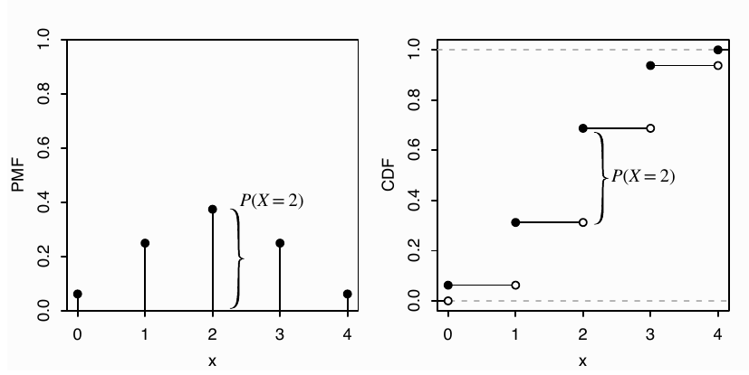
  <figcaption>Probability at a point becomes the height of a CDF jump. Reproduced from Joseph K. Blitzstein and Jessica Hwang, <em>Introduction to Probability</em>, Figure 3.8, p. 109.</figcaption>
</figure>

**Core idea:** A PMF assigns probability separately; a CDF accumulates it. They describe the same discrete distribution in different forms.

### Part 4 — CDF properties and endpoint probabilities

Every CDF has three defining properties:

- **Nondecreasing:** If $$a\le b$$, then $$F_X(a)\le F_X(b)$$ because $$\{X\le a\}\subseteq\{X\le b\}$$.
- **Right-continuous:** $$F_X(a)=\lim_{x\downarrow a}F_X(x)$$. At a jump, the value includes the mass at the jump location.
- **Correct limits:** $$F_X(x)\to0$$ as $$x\to-\infty$$ and $$F_X(x)\to1$$ as $$x\to\infty$$.

A CDF can have flat regions and jumps; it need not increase strictly or be continuous everywhere.

Define the left limit $$F_X(a^-)=\lim_{x\uparrow a}F_X(x)=P(X<a)$$. Then:

$$
P(X=a)=F_X(a)-F_X(a^-).
$$

For an integer-valued variable and integer $$k$$, this simplifies to:

$$
P(X=k)=F_X(k)-F_X(k-1).
$$

The integer formula should not be applied blindly to a variable with noninteger support.

#### Supplementary clarification: Which endpoints are included?

For $$a<b$$:

| Requested probability | CDF expression |
|---|---|
| $$P(a<X\le b)$$ | $$F_X(b)-F_X(a)$$ |
| $$P(a\le X\le b)$$ | $$F_X(b)-F_X(a^-)$$ |
| $$P(X>a)$$ | $$1-F_X(a)$$ |
| $$P(X\ge a)$$ | $$1-F_X(a^-)$$ |

For the four-toss example:

$$
P(1<X\le3)=\frac{15}{16}-\frac5{16}=\frac58,
$$

whereas:

$$
P(1\le X\le3)=\frac{15}{16}-\frac1{16}=\frac78.
$$

The difference is exactly $$P(X=1)=4/16$$.

<div class="misconception-block" markdown="1">

**Incorrect:** $$P(X\ge a)=1-F_X(a)$$ for every random variable.

**Correction:** That expression gives $$P(X>a)$$. If there is positive probability at $$a$$, including or excluding the endpoint changes the answer.

</div>

### Part 5 — Discrete and continuous probability

A discrete variable has probability mass at individual values. A continuous distribution has a continuous CDF and no positive probability at a single point. Its probability is assigned to ranges of values.

For example, a continuously uniform location on $$[0,1]$$ has:

$$
F_X(x)=
\begin{cases}
0,&x<0,\\
x,&0\le x\le1,\\
1,&x>1.
\end{cases}
$$

Then $$P(1/4<X\le3/4)=1/2$$, but $$P(X=1/2)=0$$. Observing a particular value does not require that value to have positive point probability.

The CDF works for both discrete and continuous distributions. A PMF describes discrete probability mass; continuous distributions with densities are treated in more detail later. Mixed distributions can contain both point masses and a continuous component.

**Core idea:** Zero probability at each individual point is compatible with positive probability over an interval containing infinitely many points.

### Part 6 — Binomial counts and combining trials

For $$n$$ independent Bernoulli trials with common success probability $$p$$:

$$
X=I_1+\cdots+I_n\sim\operatorname{Bin}(n,p),\qquad
P(X=k)=\binom nk p^k(1-p)^{n-k}.
$$

The story, indicator sum, and PMF are three descriptions of the same model.

#### Independent and identically distributed

The indicators $$I_1,\ldots,I_n$$ are **i.i.d.**, short for **independent and identically distributed**:

- *Independent*: they come from independent trials, so learning some of them tells us nothing about the others.
- *Identically distributed*: each has the same distribution, $$\operatorname{Bern}(p)$$.

Identically distributed does not mean equal. $$I_1$$ indicates success on the first trial and $$I_2$$ on the second; they are different random variables, and in a given experiment one may be 1 while the other is 0. They share only their distribution: the same probabilities of taking each value. Many different random variables can have the same distribution, just as many houses can be built from one blueprint.

#### Adding independent Binomial counts: three proofs

If $$X\sim\operatorname{Bin}(n,p)$$ and $$Y\sim\operatorname{Bin}(m,p)$$ are independent, then:

$$
\boxed{X+Y\sim\operatorname{Bin}(n+m,p).}
$$

Here $$X+Y$$ is a sum of two functions on the same sample space: for each outcome, compute both and add.

**1. Story.** Let $$X$$ count successes in $$n$$ independent trials and $$Y$$ count successes in $$m$$ further independent trials, all with success probability $$p$$. Then $$X+Y$$ counts the successes in $$n+m$$ such trials, so it is $$\operatorname{Bin}(n+m,p)$$.

**2. Indicator sums.** Write $$X=X_1+\cdots+X_n$$ and $$Y=Y_1+\cdots+Y_m$$, where all the $$X_j$$ and $$Y_j$$ are i.i.d. $$\operatorname{Bern}(p)$$. Then $$X+Y$$ is a sum of $$n+m$$ i.i.d. $$\operatorname{Bern}(p)$$ indicators, which is $$\operatorname{Bin}(n+m,p)$$.

**3. PMF.** Condition on $$X=j$$ by LOTP. Given $$X=j$$, the event $$X+Y=k$$ is the event $$Y=k-j$$, and by independence conditioning on $$X$$ does not change the distribution of $$Y$$. With impossible terms interpreted as zero:

$$
\begin{aligned}
P(X+Y=k)
&=\sum_jP(X=j)P(Y=k-j)\\
&=p^k(1-p)^{n+m-k}\sum_j\binom nj\binom m{k-j}\\
&=\binom{n+m}{k}p^k(1-p)^{n+m-k}.
\end{aligned}
$$

The last step uses Vandermonde’s identity. A sum of this kind, the distribution of a sum of independent random variables, is called a **convolution**. This route takes the most work, and it would get stuck without Vandermonde. Read the other way, since the story proof already guarantees the answer, the calculation is a second proof of Vandermonde’s identity.

Independence and a common $$p$$ are essential for this conclusion; two Binomial marginal distributions alone do not establish it.

**Core idea:** Thinking of a Binomial as a story or as a sum of indicators often replaces a hard calculation with one line.

### Part 7 — Hypergeometric: sampling without replacement

A population contains $$w$$ success-type items and $$b$$ failure-type items. Choose a sample of size $$n$$ uniformly without replacement, meaning every subset of size $$n$$ is equally likely. Let $$X$$ count success-type items in the sample:

$$
X\sim\operatorname{HGeom}(w,b,n).
$$

Assume $$w,b,n$$ are nonnegative integers, $$w+b>0$$, and $$0\le n\le w+b$$.

There are $$\binom{w+b}{n}$$ possible samples. A sample with exactly $$k$$ successes must contain $$k$$ of the $$w$$ success items and $$n-k$$ of the $$b$$ failure items. Therefore:

<div class="result-box" markdown="1">

$$
\boxed{P(X=k)=\frac{\binom wk\binom b{n-k}}{\binom{w+b}n}.}
$$

</div>

The feasible integer values satisfy:

$$
0\le k\le w,\qquad 0\le n-k\le b,
$$

or equivalently:

$$
\boxed{\max(0,n-b)\le k\le\min(n,w).}
$$

The PMF is zero outside this range. If the sample is larger than the supply of failures, some successes are unavoidable. If the success supply is smaller than the sample, the count cannot exceed that supply.

Vandermonde’s identity verifies normalization:

$$
\sum_k\binom wk\binom b{n-k}=\binom{w+b}n.
$$

**Core idea:** Count the successful sample subsets, then divide by all equally likely sample subsets. The finite supplies determine both the numerator and the feasible range.

#### Supplementary numerical example: Three items from a small urn

An urn contains four white balls and two black balls. Select three uniformly without replacement, and let $$X$$ count white balls. Then $$X\sim\operatorname{HGeom}(4,2,3)$$.

Since only two black balls exist, at least one white ball must be selected. The support is $$\{1,2,3\}$$. There are $$\binom63=20$$ samples:

| $$k$$ | Successful subsets | $$P(X=k)$$ |
|---|---|---|
| 1 | $$\binom41\binom22=4$$ | $$1/5$$ |
| 2 | $$\binom42\binom21=12$$ | $$3/5$$ |
| 3 | $$\binom43\binom20=4$$ | $$1/5$$ |

Thus $$P(X\ge2)=3/5+1/5=4/5$$. Its CDF is:

$$
F_X(x)=
\begin{cases}
0,&x<1,\\
1/5,&1\le x<2,\\
4/5,&2\le x<3,\\
1,&x\ge3.
\end{cases}
$$

The CDF jumps recover the three PMF values, connecting the sampling story to both distribution representations.

### Part 8 — Why Hypergeometric is different from Binomial

With replacement, each draw from the urn has success probability $$w/(w+b)$$ and, under independent random draws, the success count is:

$$
\operatorname{Bin}\left(n,\frac{w}{w+b}\right).
$$

Without replacement, successive outcomes are dependent. In the four-white, two-black urn:

$$
P(\text{second white}\mid\text{first white})=\frac35,
$$

but:

$$
P(\text{second white}\mid\text{first black})=\frac45.
$$

The second draw’s unconditional white probability is still $$4/6$$ by symmetry. Equal marginal success probabilities do not imply independence.

| Feature | Binomial | Hypergeometric |
|---|---|---|
| Basic experiment | Independent binary trials | Uniform sample from a finite population |
| Urn interpretation | With replacement | Without replacement |
| Dependence | Trials independent | Draws generally dependent |
| Parameters | $$n,p$$ | $$w,b,n$$ |
| Support | $$0,\ldots,n$$ for $$0<p<1$$ | $$\max(0,n-b),\ldots,\min(n,w)$$ |

<div class="misconception-block" markdown="1">

**Incorrect:** The initial white-ball proportion is $$2/3$$, so three draws without replacement give $$\operatorname{Bin}(3,2/3)$$.

**Correction:** The composition changes after each draw. The Hypergeometric model gives $$P(X=3)=1/5$$, while the with-replacement Binomial model gives $$(2/3)^3=8/27$$. They describe different experiments.

</div>

#### Large populations: Hypergeometric is approximately Binomial

If the population is huge compared with the sample, for example 10 marbles drawn from a billion, it is extremely unlikely that the same item would be picked twice even with replacement. Sampling with and without replacement then behave almost identically, so

$$
\operatorname{HGeom}(w,b,n)\approx\operatorname{Bin}\left(n,\frac{w}{w+b}\right)
\quad\text{when }w+b\text{ is much larger than }n.
$$

For example, keep the white fraction at $$0.6$$ and draw $$n=5$$. The probability that all five are white is:

| Population size $$w+b$$ | Hypergeometric | $$\operatorname{Bin}(5,0.6)$$ |
|---:|---:|---:|
| 10 | $$0.0238$$ | $$0.0778$$ |
| 100 | $$0.0725$$ | $$0.0778$$ |
| 1000 | $$0.0772$$ | $$0.0778$$ |
| 1,000,000 | $$0.07776$$ | $$0.07776$$ |

In a small population, each white draw noticeably depletes the white balls. In a large one, it hardly matters.

### Part 9 — Applications: aces and tagged animals

#### Aces in a five-card hand

The number of aces in a hand is a natural count that is **not** Binomial. Think of each card as a trial: the trials are not independent, because each ace dealt makes later aces less likely, and if the first four cards are aces the fifth cannot be. The possible values are 0, 1, 2, 3, and 4.

A uniformly chosen five-card hand from a standard 52-card deck contains four possible aces and 48 non-aces. If $$X$$ counts aces, then:

$$
X\sim\operatorname{HGeom}(4,48,5),\qquad
P(X=3)=\frac{\binom43\binom{48}2}{\binom{52}5}
=\frac{4512}{2598960}\approx0.001736.
$$

This is approximately $$0.1736\%$$. Selecting which three aces and which two non-aces gives the favorable hands; ordering within a hand is irrelevant.

#### Tagged animals in a recapture sample

A population has $$N$$ animals, of which $$m$$ have been tagged. A later sample of $$n$$ distinct animals is uniformly selected. If $$X$$ counts tagged animals in the sample:

$$
X\sim\operatorname{HGeom}(m,N-m,n).
$$

For $$N=20$$, $$m=5$$, and $$n=4$$:

$$
P(X=2)=\frac{\binom52\binom{15}2}{\binom{20}4}
=\frac{1050}{4845}=\frac{70}{323}\approx0.2167.
$$

Uniform sampling assumes that tagged and untagged animals are sampled under the same mechanism; tagging must not alter recapture chances for this model.

**Core idea:** White balls, aces, and tagged animals share the same structure: a fixed success subset intersected with a uniform sample subset.

### Part 10 — Original practice questions

Try these before reading the answers.

1. A variable takes values $$-1,0,2$$ with probabilities $$c,2c,c$$. Find $$c$$, its support, and $$P(X>0)$$.
2. Construct the full CDF for the variable in Question 1. Find $$F_X(1)$$ and the jump at 2.
3. For $$X\sim\operatorname{Bin}(4,1/2)$$, find $$P(X<2)$$, $$P(X\le2)$$, and $$P(X\ge2)$$. Explain the endpoint differences.
4. Does a function with $$F(0)=0.6$$ and $$F(1)=0.4$$ qualify as a CDF? Explain.
5. If a continuously uniform variable on $$[0,1]$$ has zero probability at every individual point, why is $$P(0<X<1)=1$$?
6. An urn contains three white and seven black balls. Sample four without replacement. Find the support and $$P(X=2)$$ for the white count.
7. An urn contains eight white and two black balls. Sample five without replacement. Why is $$P(X=2)=0$$?
8. For the four-white, two-black, three-draw example, find $$F_X(2.5)$$ and $$P(X>1)$$.
9. Independent variables have distributions $$\operatorname{Bin}(3,1/4)$$ and $$\operatorname{Bin}(2,1/4)$$. Find the distribution of their sum and its probability of being zero.

### Part 11 — Practice answers

#### 1. Normalize a PMF

The total mass is $$4c=1$$, so $$c=1/4$$. The support is $$\{-1,0,2\}$$ and $$P(X>0)=P(X=2)=1/4$$.

#### 2. Construct a CDF

$$
F_X(x)=
\begin{cases}
0,&x<-1,\\
1/4,&-1\le x<0,\\
3/4,&0\le x<2,\\
1,&x\ge2.
\end{cases}
$$

Thus $$F_X(1)=3/4$$ and the jump at 2 is $$1-3/4=1/4=P(X=2)$$.

#### 3. Include or exclude a mass point

$$
P(X<2)=\frac5{16},\qquad P(X\le2)=\frac{11}{16},\qquad
P(X\ge2)=1-\frac5{16}=\frac{11}{16}.
$$

The first two differ by the mass $$P(X=2)=6/16$$. For the last probability, subtract $$P(X<2)$$, leaving the endpoint mass included.

#### 4. A decreasing candidate

No. A CDF is nondecreasing, but the candidate drops from 0.6 to 0.4 as the threshold increases from 0 to 1. The events cannot lose probability as more values become included.

#### 5. Continuous probability

Probability is countably additive, not additive through an unrestricted sum over uncountably many individual points. The interval probability is determined by the CDF: $$F_X(1)-F_X(0)=1$$. The endpoints have zero mass, so strict inequalities give the same result here.

#### 6. A Hypergeometric count

$$
X\sim\operatorname{HGeom}(3,7,4),\qquad 0\le X\le3.
$$

All integers in that range are feasible, and:

$$
P(X=2)=\frac{\binom32\binom72}{\binom{10}4}
=\frac{63}{210}=\frac3{10}.
$$

#### 7. Too few failures

Five sampled items can include at most two black balls, so at least three must be white. The support is $$\{3,4,5\}$$ and a white count of 2 is impossible.

#### 8. Read the urn CDF

$$F_X(2.5)=P(X\le2)=1/5+3/5=4/5$$. Also $$P(X>1)=1-F_X(1)=4/5$$. These happen to match because the support is $$\{1,2,3\}$$.

#### 9. Combine independent blocks

The sum is $$\operatorname{Bin}(5,1/4)$$. Zero successes means failure in all five trials:

$$
P(X+Y=0)=\left(\frac34\right)^5=\frac{243}{1024}.
$$

### Part 12 — Quick revision sheet

| Concept | Essential fact |
|---|---|
| Random variable | Numerical function of an outcome |
| Distribution | Probabilities of numerical events |
| Discrete support | Values with $$P(X=x)>0$$ |
| PMF | $$p_X(x)=P(X=x)$$; nonnegative and sums to 1 |
| CDF | $$F_X(x)=P(X\le x)$$, defined for every real threshold |
| Valid CDF | Nondecreasing, right-continuous, limits 0 and 1 |
| PMF from CDF | $$P(X=a)=F_X(a)-F_X(a^-)$$ |
| Integer-valued case | $$P(X=k)=F_X(k)-F_X(k-1)$$ for integer $$k$$ |
| Interval | $$P(a<X\le b)=F_X(b)-F_X(a)$$ |
| Strict upper tail | $$P(X>a)=1-F_X(a)$$ |
| Continuous point probability | No mass at a single point; ranges can have positive probability |
| Hypergeometric story | Uniform sample of $$n$$ items without replacement |
| Hypergeometric PMF | $$\binom wk\binom b{n-k}/\binom{w+b}n$$ |
| Hypergeometric support | $$\max(0,n-b)\le k\le\min(n,w)$$, integer $$k$$ |
| Binomial comparison | Independent trials versus dependent finite-population draws |
| Large population | $$\operatorname{HGeom}(w,b,n)\approx\operatorname{Bin}(n,w/(w+b))$$ when $$w+b\gg n$$ |
| i.i.d. | Independent and identically distributed; same distribution, not the same random variable |
| Sum of Binomials | Independent $$\operatorname{Bin}(n,p)+\operatorname{Bin}(m,p)\sim\operatorname{Bin}(n+m,p)$$: story, indicators, or convolution with Vandermonde |

### Term Glossary

<div class="glossary-entry" markdown="1">
<div class="gterm">Support <span class="gcat cat-defn">Definition</span></div>

For a discrete random variable, the set of numerical values with positive probability.

</div>

<div class="glossary-entry" markdown="1">
<div class="gterm">Probability mass function <span class="gcat cat-meas">Measure</span></div>

The function giving the probability of each individual value of a discrete random variable.

</div>

<div class="glossary-entry" markdown="1">
<div class="gterm">Cumulative distribution function <span class="gcat cat-meas">Measure</span></div>

The function giving the probability of falling at or below each real threshold. It describes discrete, continuous, and mixed distributions.

</div>

<div class="glossary-entry" markdown="1">
<div class="gterm">CDF jump <span class="gcat cat-prop">Property</span></div>

The difference between the CDF value at a point and its left limit, equal to the probability mass at that point.

</div>

<div class="glossary-entry" markdown="1">
<div class="gterm">Right-continuity <span class="gcat cat-prop">Property</span></div>

The CDF value at a point equals the limit approached from larger thresholds; a mass point is included at its own threshold.

</div>

<div class="glossary-entry" markdown="1">
<div class="gterm">Hypergeometric distribution <span class="gcat cat-defn">Definition</span></div>

The distribution of a success count in a uniform sample of fixed size drawn without replacement from a finite population with known success and failure counts.

</div>

<div class="glossary-entry" markdown="1">
<div class="gterm">Sampling without replacement <span class="gcat cat-defn">Definition</span></div>

Selecting distinct population items so a selected item cannot be drawn again. The remaining composition depends on earlier draws.

</div>

<div class="glossary-entry" markdown="1">
<div class="gterm">i.i.d. <span class="gcat cat-defn">Definition</span></div>

Independent and identically distributed: random variables that are independent and all have the same distribution, such as the success indicators of Binomial trials.

</div>

<div class="glossary-entry" markdown="1">
<div class="gterm">Convolution <span class="gcat cat-defn">Definition</span></div>

The distribution of a sum of independent random variables, computed by conditioning on one of them and summing (or integrating) over its values.

</div>

<div class="ref-tags">
  <span class="ref-tag">Statistics 110</span>
  <span class="ref-tag">Lecture 8</span>
  <span class="ref-tag">Random variables</span>
  <span class="ref-tag">PMF</span>
  <span class="ref-tag">CDF</span>
  <span class="ref-tag">Hypergeometric</span>
</div>

  </div>
</div>

## Lecture 9 - Expectation, Indicator Random Variables, and Linearity

<div class="chapter-block">
  <button type="button" class="chapter-toggle" id="lecture-9-toggle" onclick="toggleLecture('lecture-9')" aria-expanded="true" aria-controls="lecture-9-body">
    <span class="chapter-toggle-left">
      <span class="chapter-badge">Lecture 9</span>
      <span>
        <span class="chapter-title">Lecture 9 - Expectation, Indicator Random Variables, and Linearity</span>
        <span class="chapter-subtitle">Independence, Geometric waiting times, weighted averages, and symmetry</span>
      </span>
    </span>
    <span class="chapter-arrow open" id="lecture-9-arrow" aria-hidden="true">▼</span>
  </button>
  <div class="chapter-body open" id="lecture-9-body" markdown="1">

<div class="note-abstract" markdown="1">

Expectation compresses a distribution into a probability-weighted average. Its most useful property is linearity: expectations of sums add even when the summands are dependent. Indicators turn counts into sums of simple yes/no variables, and their expectations are probabilities. Together with symmetry, this connects probability calculations to expected counts without requiring the full distribution of the count. Geometric waiting times provide an example where the counting convention matters by exactly one trial.

</div>

### Notation at a Glance

<div class="notation-panel" markdown="1">

| Symbol | Meaning |
|---|---|
| $$X\perp Y$$ | Independent random variables |
| $$p$$, $$q=1-p$$ | Success and failure probabilities in repeated independent trials |
| $$G\sim\operatorname{Geom}(p)$$ | Number of failures before the first success |
| $$T=G+1$$ | Total trials through and including the first success |
| $$E(X)$$ | Expected value, or mean, of $$X$$ |
| $$\sum_x xP(X=x)$$ | Probability-weighted average over distinct support values |
| $$I_A$$ | Indicator of event $$A$$ |
| $$E(I_A)=P(A)$$ | Fundamental bridge between expectation and probability |
| $$C=\sum_j I_j$$ | A count written as a sum of indicators |
| $$w,b,n$$ | Success population, failure population, and sample size in a Hypergeometric model |

</div>

### Learning objectives

After studying these notes, you should be able to:

- State independence of random variables and distinguish it from having the same distribution.
- Derive the Geometric PMF from independent repeated trials.
- Distinguish failures before success from trials through success.
- Calculate a discrete expectation as a probability-weighted average.
- Explain why an expected value need not be a possible observed value.
- Apply linearity without assuming independence.
- Use indicators and the fundamental bridge to calculate expected counts.
- Use symmetry to obtain Binomial and Hypergeometric expectations.

### Part 1 — Independence of random variables

Random variables $$X$$ and $$Y$$ are independent when learning the value of one does not change the distribution of the other. A definition that works generally is:

$$
P(X\le x,Y\le y)=P(X\le x)P(Y\le y)
$$

for all real $$x,y$$. For discrete variables, an equivalent condition is:

$$
P(X=x,Y=y)=P(X=x)P(Y=y)
$$

for every pair of support values. Where $$P(X=x)>0$$, this gives $$P(Y=y\mid X=x)=P(Y=y)$$.

Having the same distribution is a different property. If one fair coin is tossed and $$X$$ indicates Heads while $$Y=1-X$$ indicates Tails, both are $$\operatorname{Bern}(1/2)$$. But:

$$
P(X=1,Y=1)=0\ne\frac12\frac12.
$$

They are dependent. Indicators from two independent fair tosses also have the same distribution, but are independent.

For several variables, mutual independence requires the analogous factorization for all value combinations. Pairwise independence alone is weaker. The abbreviation **i.i.d.** means independent and identically distributed: it specifies both properties.

**Core idea:** Marginal distributions tell how each variable behaves separately. Independence specifies how their outcomes occur together.

### Part 2 — Geometric waiting times

Perform independent Bernoulli trials, each with success probability $$p$$, where $$0<p<1$$. Stop at the first success. Let $$G$$ count the failures before that success:

$$
G\sim\operatorname{Geom}(p),\qquad G\in\{0,1,2,\ldots\}.
$$

The event $$G=k$$ requires exactly $$k$$ failures followed by one success. Independence gives:

<div class="result-box" markdown="1">

$$
\boxed{P(G=k)=q^kp,\qquad k=0,1,2,\ldots,\quad q=1-p.}
$$

</div>

There is no binomial coefficient: stopping at the first success fixes the order. Summing the geometric series verifies normalization:

$$
\sum_{k=0}^{\infty}q^kp=\frac{p}{1-q}=1.
$$

The probability of no success in the first $$m$$ trials is $$q^m\to0$$. Thus a success eventually occurs with probability 1, although there is no finite bound on the possible waiting time.

#### Two counting conventions

Let $$T=G+1$$ count all trials, including the success. The textbook calls this the **First Success** distribution. Then:

$$
P(T=t)=q^{t-1}p,\qquad t=1,2,3,\ldots.
$$

| Quantity counted | Smallest value | Probability formula |
|---|---|---|
| Failures before success, $$G$$ | 0 | $$P(G=k)=q^kp$$ |
| Trials including success, $$T$$ | 1 | $$P(T=t)=q^{t-1}p$$ |

<div class="example-block" markdown="1">
<div class="ex-title">First six on repeated die rolls <span class="ex-pill pill-num">Worked example</span></div>

Roll a fair die independently until the first six. Here $$p=1/6$$ and $$q=5/6$$. A first six on roll 4 means three non-sixes followed by a six:

$$
P(T=4)=P(G=3)=\left(\frac56\right)^3\frac16=\frac{125}{1296}.
$$

At least four rolls are required precisely when the first three rolls are non-sixes:

$$
P(T\ge4)=\left(\frac56\right)^3=\frac{125}{216}.
$$

<div class="ex-lesson">“First success on trial 4” and “no success before trial 4” differ by the requirement of success on that fourth trial.</div>
</div>

### Part 3 — Expectation is a weighted average

For a discrete random variable with distinct support values:

<div class="result-box" markdown="1">

$$
\boxed{E(X)=\sum_x xP(X=x).}
$$

</div>

Each possible value receives weight equal to its probability. For the finite expectations used here, the sum is well-defined; with an infinite support, absolute convergence, $$\sum_x|x|P(X=x)<\infty$$, guarantees a finite expectation. A nonnegative variable can also have an infinite mean.

For a fair die result $$D$$:

$$
E(D)=\frac{1+2+3+4+5+6}{6}=\frac72=3.5.
$$

No die roll equals 3.5. The mean describes the center of the distribution, not a guaranteed or necessarily possible observation.

#### Supplementary numerical example: Unequal probability weights

Suppose $$X$$ takes values $$-2,1,4$$ with probabilities $$1/4,1/2,1/4$$. Then:

$$
E(X)=(-2)\frac14+1\frac12+4\frac14=1.
$$

The simple average of the three distinct values happens also to be 1 here, but that coincidence does not justify ignoring the weights. For example, changing the probabilities to $$1/2,1/4,1/4$$ changes the expectation to $$1/4$$ while leaving the possible values unchanged.

The expectation depends only on the distribution. Equal distributions imply equal expectations when finite. The converse fails: a constant 1 and a variable taking 0 or 2 with equal probability both have mean 1 but different distributions.

<div class="misconception-block" markdown="1">

**Incorrect:** Replace $$X$$ by $$E(X)$$ whenever a formula contains $$X$$.

**Correction:** $$X$$ is a random variable; $$E(X)$$ is a number. Replacing one by the other generally discards variability and changes the quantity being calculated.

</div>

### Part 4 — The fundamental bridge

An indicator $$I_A$$ equals 1 if event $$A$$ occurs and 0 otherwise. Its expectation is:

$$
E(I_A)=1\cdot P(A)+0\cdot P(A^c)=P(A).
$$

<div class="result-box" markdown="1">

$$
\boxed{E(I_A)=P(A).}
$$

</div>

This is the **fundamental bridge**: probabilities can be expressed as expectations of indicators. For example, if $$I$$ indicates that a die shows six, then $$E(I)=1/6$$. If $$J$$ indicates at least one Head in two independent fair tosses, then $$E(J)=3/4$$.

A count $$C$$ can often be written as a sum of indicators, one per counted item. Each indicator asks a simpler yes/no question than the full count distribution.

**Core idea:** An indicator converts an event into a numerical variable whose expected value is exactly the event’s probability.

### Part 5 — Linearity of expectation

For variables with finite expectations and constants $$a,b,c$$:

<div class="result-box" markdown="1">

$$
\boxed{E(aX+bY+c)=aE(X)+bE(Y)+c.}
$$

</div>

In particular:

$$
E(X+Y)=E(X)+E(Y),\qquad E(aX)=aE(X).
$$

**Independence is not required.** More generally, for a finite sum:

$$
E\left(\sum_{j=1}^nX_j\right)=\sum_{j=1}^nE(X_j).
$$

#### Supplementary textbook proof: Average over the same outcomes

On a finite sample space, group outcomes by the value assigned by $$X$$ or average directly over individual outcomes:

$$
E(X)=\sum_sX(s)P(\{s\}).
$$

<figure>
  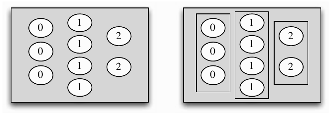
  <figcaption>Grouping outcomes by value gives the PMF-weighted average; averaging directly over the same outcomes makes linearity transparent. Reproduced from Blitzstein and Hwang, <em>Introduction to Probability</em>, Figure 4.3, p. 141.</figcaption>
</figure>

Both $$X$$ and $$Y$$ use the same outcome probabilities, so:

$$
\begin{aligned}
E(X+Y)
&=\sum_s[X(s)+Y(s)]P(\{s\})\\
&=\sum_sX(s)P(\{s\})+\sum_sY(s)P(\{s\})\\
&=E(X)+E(Y).
\end{aligned}
$$

No factorization of joint probabilities is used. Even $$Y=X$$, an extreme dependence, gives $$E(X+Y)=E(2X)=2E(X)$$.

<div class="misconception-block" markdown="1">

**Incorrect:** Dependent summands prevent adding expectations.

**Correction:** Dependence affects the distribution of a sum but does not invalidate linearity. A different operation, such as multiplying variables, does not inherit this rule: generally $$E(XY)\ne E(X)E(Y)$$ without additional assumptions.

</div>

### Part 6 — Binomial expectation through indicators

Let $$X\sim\operatorname{Bin}(n,p)$$ count successes in $$n$$ independent trials with common probability $$p$$. Write:

$$
X=I_1+\cdots+I_n,
$$

where $$I_j$$ indicates success on trial $$j$$. By the fundamental bridge, $$E(I_j)=p$$. Therefore:

$$
\boxed{E(X)=np.}
$$

For ten independent trials with success probability $$0.3$$, the expected success count is 3. The observed count remains random; it need not equal 3.

#### Compare: the mean directly from the definition

The same answer follows from $$E(X)=\sum_k kP(X=k)$$, at the cost of more work:

$$
E(X)=\sum_{k=0}^{n}k\binom nk p^kq^{n-k},\qquad q=1-p.
$$

Without the factor $$k$$ this would be the binomial theorem. To remove the $$k$$, use the committee-with-president identity $$k\binom nk=n\binom{n-1}{k-1}$$. The $$k=0$$ term is zero, so start at $$k=1$$, and take out $$np$$:

$$
E(X)=np\sum_{k=1}^{n}\binom{n-1}{k-1}p^{k-1}q^{n-k}.
$$

With $$j=k-1$$, the sum becomes $$\sum_{j=0}^{n-1}\binom{n-1}{j}p^jq^{n-1-j}=(p+q)^{n-1}=1$$ by the binomial theorem. Hence $$E(X)=np$$.

**Core idea:** The definition works, but only with the right identity at hand. Linearity with indicators gives the answer in one line, and still works if the indicators are dependent.

The calculation of the mean uses only the individual success probabilities. Independence is needed for the Binomial distribution story, but a count of dependent indicators, each with success probability $$p$$, still has mean $$np$$ even when its distribution is not Binomial.

#### Supplementary counterexample: A mean does not identify a model

Toss one fair coin and copy its result into ten records. The total number of recorded Heads is 0 or 10, each with probability $$1/2$$. Its mean is 5, just like $$\operatorname{Bin}(10,1/2)$$, but its distribution is very different.

**Core idea:** Linearity can determine an expected count from marginal probabilities without identifying the joint model or the full count distribution.

### Part 7 — Hypergeometric expectation through symmetry

Sample $$n$$ items uniformly without replacement from a population with $$w$$ success-type and $$b$$ failure-type items. Let $$X$$ count successes and $$I_j$$ indicate that draw $$j$$ is a success:

$$
X=\sum_{j=1}^nI_j.
$$

By symmetry, each draw position is equally likely to contain any population item. Its **unconditional** success probability is:

$$
P(I_j=1)=\frac{w}{w+b}.
$$

Earlier draws change conditional probabilities, so the indicators are generally dependent. Nonetheless:

<div class="result-box" markdown="1">

$$
\boxed{E(X)=\sum_{j=1}^nE(I_j)=n\frac{w}{w+b}.}
$$

</div>

#### Worked example: Aces in a five-card hand

Shuffle a standard deck uniformly and inspect its first five cards. Let $$X$$ count aces. The five position indicators each have probability $$4/52=1/13$$ of being 1, so:

$$
E(X)=5\frac1{13}=\frac5{13}.
$$

This is an expected count of about 0.385 aces, not a probability of drawing an ace or a claim that a hand contains a fractional card.

An alternative decomposition uses one indicator per ace. Each of the four aces has probability $$5/52$$ of appearing in the hand. Thus:

$$
E(X)=4\frac5{52}=\frac5{13}.
$$

**Core idea:** Choose indicators indexed by draw positions or by population items. Both decompositions count the same quantity, and symmetry supplies the individual probabilities.

### Part 8 — Expected Geometric waiting time

Let $$G\sim\operatorname{Geom}(p)$$ and $$q=1-p$$. By definition:

$$
E(G)=\sum_{k=0}^{\infty}kq^kp.
$$

For $$0<q<1$$, differentiate the geometric power series:

$$
\sum_{k=0}^{\infty}q^k=\frac1{1-q}
\quad\Longrightarrow\quad
\sum_{k=1}^{\infty}kq^{k-1}=\frac1{(1-q)^2}.
$$

Multiplying by $$pq$$ gives:

$$
E(G)=\frac{pq}{(1-q)^2}=\frac qp.
$$

Since $$T=G+1$$, linearity gives:

<div class="result-box" markdown="1">

$$
\boxed{E(G)=\frac{1-p}{p},\qquad E(T)=\frac1p.}
$$

</div>

For independent fair die rolls until a six, $$E(G)=5$$ non-sixes and $$E(T)=6$$ total rolls. Neither mean specifies an exact stopping time in a particular experiment.

#### Story proof: Restart after a failure

This argument avoids the series and the derivative; it uses only the story and the fact, shown above, that the mean is finite. Think of flipping a coin with heads probability $$p$$ until the first heads, and let $$\mu=E(G)$$. A first-trial success contributes zero failures. A first-trial failure contributes one failure, and then the problem starts over: the coin has no memory of the failure, so the remaining wait has the same distribution as before. Averaging these cases:

$$
\mu=p\cdot0+q(1+\mu).
$$

Thus $$p\mu=q$$ and $$\mu=q/p$$, agreeing with the direct calculation. Independence and unchanged success probability make the restart argument valid.

### Part 9 — Supplementary applications and limits of linearity

#### Expected matches in a random permutation

Return $$n$$ labeled items uniformly at random to $$n$$ labeled recipients, one item each. Let $$M$$ count correct matches and $$I_j$$ indicate that recipient $$j$$ receives their own item.

Each recipient has probability $$1/n$$ of a match by symmetry. Therefore:

$$
M=\sum_{j=1}^nI_j,\qquad E(M)=n\frac1n=1.
$$

The indicators are dependent, but the expected number of matches is 1 for every positive $$n$$. This does not mean exactly one match is guaranteed or that the probability of any match is 1.

#### Nonlinear operations need separate calculations

Let $$X$$ equal $$-1$$ or 1 with equal probability. Then $$E(X)=0$$ but $$X^2=1$$ always, so:

$$
E(X^2)=1\ne0=(E(X))^2.
$$

Linearity applies to sums and constant multiples. It does not allow moving expectation through an arbitrary square, reciprocal, or other nonlinear function.

### Part 10 — Original practice questions

Try these before reading the answers.

1. Let $$X$$ indicate Heads on one fair toss and $$Y=1-X$$. Are they identically distributed? Are they independent? Show one probability calculation.
2. Independently toss a coin with Heads probability $$1/4$$ until the first Head. Find the probability of exactly two preceding Tails, and both waiting-time means.
3. For the same experiment, find the probability that at least four tosses are needed.
4. A variable has values $$0,2,5$$ with probabilities $$1/2,1/3,1/6$$. Calculate its mean. Must an observation equal that mean?
5. If $$E(X)=3$$ and $$E(Y)=-1$$, find $$E(2X-4Y+7)$$. Is independence required?
6. An urn has six white and four black balls. Draw three uniformly without replacement. Find the expected white count and explain why dependence does not obstruct the calculation.
7. Twenty binary records each have success probability $$0.2$$, but may be dependent. Find the expected total. Can you conclude the total is Binomial?
8. Four labeled items are randomly returned to four recipients. Find the expected number of correct matches. Does this equal the probability of at least one match?
9. A fair die has mean $$7/2$$. Find the mean of the sum of two fair dice when the second die always copies the first. Is the sum distributed like two independent dice?

### Part 11 — Practice answers

#### 1. Same distribution, dependence

Both variables are $$\operatorname{Bern}(1/2)$$. They cannot both equal 1, so $$P(X=1,Y=1)=0$$, whereas $$P(X=1)P(Y=1)=1/4$$. They are dependent.

#### 2. Failures and total trials

Here $$p=1/4$$ and $$q=3/4$$:

$$
P(G=2)=\left(\frac34\right)^2\frac14=\frac9{64}.
$$

The means are $$E(G)=q/p=3$$ failures and $$E(T)=1/p=4$$ total tosses.

#### 3. At least four tosses

The first three tosses must all fail:

$$
P(T\ge4)=q^3=\frac{27}{64}.
$$

Success on the fourth toss is not required by this event.

#### 4. Weighted mean

$$
E(X)=0\frac12+2\frac13+5\frac16=\frac32.
$$

The mean is not in the support, so no observation equals it.

#### 5. Linear combination

$$
E(2X-4Y+7)=2(3)-4(-1)+7=17.
$$

Independence is not required; finite expectations suffice here.

#### 6. Sampling without replacement

Each position has unconditional white probability $$6/10$$. Thus $$E(X)=3(6/10)=9/5$$. The draw indicators are dependent, but linearity still applies.

#### 7. Dependent binary records

The expected total is $$20(0.2)=4$$. Dependence may change its distribution, so a Binomial conclusion is not justified.

#### 8. Expected matches versus a probability

Each of four recipients matches with probability $$1/4$$, giving $$E(M)=1$$. This is not the probability of at least one match. For four items, that probability is $$1-9/24=5/8$$, using the nine permutations with no matches; its inequality with the mean illustrates the distinction between an event indicator and the match count.

#### 9. Copied dice

Writing the second result as $$Y=X$$:

$$
E(X+Y)=E(X)+E(Y)=7.
$$

The sum takes only the even values $$2,4,6,8,10,12$$, each with probability $$1/6$$. Its mean equals the independent-dice mean, but its distribution does not.

### Part 12 — Quick revision sheet

| Concept | Essential fact |
|---|---|
| Independence, discrete case | Joint value probabilities factor for every pair |
| Identical distributions | Does not imply independence or equal observed values |
| Geometric convention | $$G$$ counts failures before success, starting at 0 |
| Geometric PMF | $$P(G=k)=q^kp$$ |
| Total waiting time | $$T=G+1$$ counts the successful trial |
| Expectation | $$E(X)=\sum_xxP(X=x)$$ |
| Interpretation | Probability-weighted average; need not be an attainable value |
| Fundamental bridge | $$E(I_A)=P(A)$$ |
| Linearity | $$E(\sum_j a_jX_j+c)=\sum_j a_jE(X_j)+c$$ for finite expectations |
| Dependence | Does not invalidate linearity |
| Binomial mean | $$np$$, by indicators; directly via $$k\binom nk=n\binom{n-1}{k-1}$$ and the binomial theorem |
| Hypergeometric mean | $$nw/(w+b)$$ |
| Geometric mean | $$(1-p)/p$$ failures, by differentiating a series or by restarting: $$\mu=p\cdot0+q(1+\mu)$$ |
| First Success mean | $$1/p$$ total trials |
| Nonlinear transformations | Generally $$E(g(X))\ne g(E(X))$$ |

### Term Glossary

<div class="glossary-entry" markdown="1">
<div class="gterm">Independent random variables <span class="gcat cat-defn">Definition</span></div>

Variables whose joint probabilities factor into marginal probabilities, so observing one does not change the distribution of the other.

</div>

<div class="glossary-entry" markdown="1">
<div class="gterm">Geometric distribution <span class="gcat cat-defn">Definition</span></div>

The distribution of failures before the first success in independent trials with a fixed success probability, under the convention used here.

</div>

<div class="glossary-entry" markdown="1">
<div class="gterm">First Success distribution <span class="gcat cat-defn">Definition</span></div>

The distribution of the total number of trials up to and including the first success; one more than the corresponding failure count.

</div>

<div class="glossary-entry" markdown="1">
<div class="gterm">Expected value <span class="gcat cat-meas">Measure</span></div>

A probability-weighted average of a random variable’s values, also called its mean or expectation.

</div>

<div class="glossary-entry" markdown="1">
<div class="gterm">Fundamental bridge <span class="gcat cat-thm">Identity</span></div>

The identity $$E(I_A)=P(A)$$ connecting event probabilities with expectations of their indicators.

</div>

<div class="glossary-entry" markdown="1">
<div class="gterm">Linearity of expectation <span class="gcat cat-thm">Theorem</span></div>

Finite sums and constant multiples pass through expectation when the expectations are finite, regardless of dependence.

</div>

<div class="glossary-entry" markdown="1">
<div class="gterm">Symmetry <span class="gcat cat-prop">Property</span></div>

Invariance of the probability model under exchanging equivalent labels or positions, allowing their event probabilities to be identified as equal.

</div>

<div class="ref-tags">
  <span class="ref-tag">Statistics 110</span>
  <span class="ref-tag">Lecture 9</span>
  <span class="ref-tag">Expectation</span>
  <span class="ref-tag">Indicators</span>
  <span class="ref-tag">Linearity</span>
  <span class="ref-tag">Geometric</span>
</div>

  </div>
</div>

## Lecture 10 - Expectation Continued

<div class="chapter-block">
  <button type="button" class="chapter-toggle" id="lecture-10-toggle" onclick="toggleLecture('lecture-10')" aria-expanded="true" aria-controls="lecture-10-body">
    <span class="chapter-toggle-left">
      <span class="chapter-badge">Lecture 10</span>
      <span>
        <span class="chapter-title">Lecture 10 - Expectation Continued</span>
        <span class="chapter-subtitle">Proving linearity, local maxima, Negative Binomial waiting times, and St. Petersburg</span>
      </span>
    </span>
    <span class="chapter-arrow open" id="lecture-10-arrow" aria-hidden="true">▼</span>
  </button>
  <div class="chapter-body open" id="lecture-10-body" markdown="1">

<div class="note-abstract" markdown="1">

Linearity follows from averaging different numerical functions over the same experimental outcomes. Combined with indicators and symmetry, it makes the average number of local maxima in a permutation easy to calculate despite complicated dependence. Waiting for several successes gives the Negative Binomial distribution, a sum of Geometric failure counts. The St. Petersburg game shows a different limit of expectation: a payoff can be finite in every completed game while its mean is infinite.

</div>

### Notation at a Glance

<div class="notation-panel" markdown="1">

| Symbol | Meaning |
|---|---|
| $$E(X)$$ | Expected value of random variable $$X$$ |
| $$s\in S$$ | Outcome in a sample space |
| $$a_1,\ldots,a_n$$ | A permutation of $$1,\ldots,n$$ |
| $$I_j$$ | Indicator of a local maximum at position $$j$$ |
| $$L=\sum_jI_j$$ | Number of local maxima |
| $$p$$, $$q=1-p$$ | Success and failure probabilities in independent trials |
| $$r$$ | Fixed positive integer number of successes being awaited |
| $$X\sim\operatorname{NBin}(r,p)$$ | Failures before the $$r$$th success |
| $$G_j$$ | Failures between the $$(j-1)$$st and $$j$$th successes |
| $$T=X+r$$ | Total trials through the $$r$$th success |
| $$N$$ | Toss number of the first Head in St. Petersburg |
| $$W=2^N$$ | Ideal St. Petersburg payoff |
| $$m$$ | Cutoff toss number in a finite-payoff version |

</div>

### Learning objectives

After studying these notes, you should be able to:

- Prove linearity by averaging over common sample outcomes.
- Explain why dependence does not obstruct adding finite expectations.
- Define local maxima at interior and endpoint positions in a permutation.
- Use indicators and symmetry to derive their expected count.
- Derive the Negative Binomial PMF with the last trial constrained to be successful.
- Express a Negative Binomial failure count as a sum of Geometric variables.
- Convert failure counts into total trial counts and calculate their means.
- Derive the infinite St. Petersburg mean and compare two finite-payoff variants.
- Explain why expectation does not commute with nonlinear transformations.

### Part 1 — Prove linearity over the same outcomes

For a finite sample space, the PMF definition of expectation can be rewritten as:

$$
E(X)=\sum_x xP(X=x)=\sum_{s\in S}X(s)P(\{s\}).
$$

To obtain the second expression, replace each $$P(X=x)$$ by the sum of probabilities of outcomes mapped to $$x$$. Every outcome contributes its assigned value times its probability.

Now $$X$$ and $$Y$$ use the same outcome weights:

$$
\begin{aligned}
E(X+Y)
&=\sum_s(X(s)+Y(s))P(\{s\})\\
&=\sum_sX(s)P(\{s\})+\sum_sY(s)P(\{s\})\\
&=E(X)+E(Y).
\end{aligned}
$$

Similarly, $$E(cX)=cE(X)$$ for a constant $$c$$. The same conclusion extends to general random variables with finite expectations; the finite-space argument makes its arithmetic structure explicit.

<div class="result-box" markdown="1">

$$
\boxed{E\left(\sum_{j=1}^na_jX_j+c\right)=\sum_{j=1}^na_jE(X_j)+c.}
$$

</div>

No independence assumption appears. Dependence may change the distribution of the sum, but not this identity.

**Core idea:** Average the sum at each outcome, or add the separate averages. Both use the same probabilities and differ only in the order of addition.

### Part 2 — Putnam problem: Local maxima in a permutation

Choose a permutation $$a_1,\ldots,a_n$$ of $$1,\ldots,n$$ uniformly, with all $$n!$$ permutations equally likely. Assume $$n\ge2$$.

An interior position $$j$$ is a **local maximum** when:

$$
a_j>a_{j-1}\quad\text{and}\quad a_j>a_{j+1}.
$$

At the endpoints, there is only one neighbor: position 1 is a local maximum if $$a_1>a_2$$, and position $$n$$ is one if $$a_n>a_{n-1}$$.

For example, $$4,2,5,3,6,1$$ has local maxima at positions 1, 3, and 5. A local maximum need not be the largest value in the whole permutation.

<figure>
  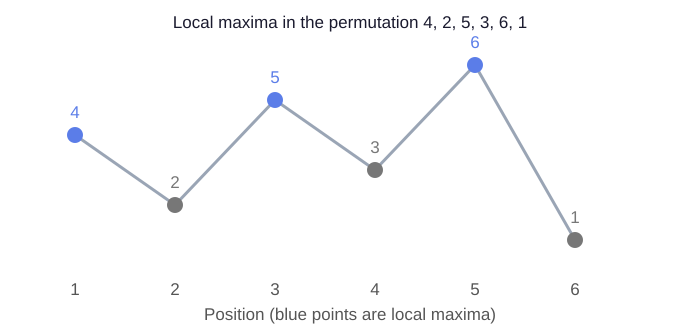
  <figcaption>Original diagram for these notes, using the example in Blitzstein and Hwang, <em>Introduction to Probability</em>, Example 4.4.6, p. 154. A local maximum exceeds its immediate neighbors.</figcaption>
</figure>

The average count across all permutations is an expectation. Let $$I_j$$ indicate a local maximum at position $$j$$, so $$L=\sum_{j=1}^nI_j$$.

#### Interior positions

For $$2\le j\le n-1$$, the three values at $$j-1,j,j+1$$ are distinct. Their relative ordering is uniform among the six possible orders. Each position is equally likely to contain the largest of the three, so:

$$
E(I_j)=P(I_j=1)=\frac13.
$$

#### Endpoint positions

Each endpoint is equally likely to exceed or fall below its sole neighbor:

$$
E(I_1)=E(I_n)=\frac12.
$$

By linearity:

<div class="result-box" markdown="1">

$$
\boxed{E(L)=2\frac12+(n-2)\frac13=\frac{n+1}{3},\qquad n\ge2.}
$$

</div>

For $$n=6$$, the expected count is $$7/3$$, while the particular illustrated permutation has three maxima. For $$n=2$$, exactly one of the two positions is a maximum, consistent with the formula.

<div class="misconception-block" markdown="1">

**Incorrect:** All positions have probability $$1/3$$ of being maxima, or the indicators must be independent to add their expectations.

**Correction:** Endpoints have only one neighbor and probability $$1/2$$. Adjacent positions cannot both be strict local maxima, so their indicators are dependent; linearity still applies.

</div>

**Core idea:** The global count has a complicated distribution, but each local indicator requires only the relative order of two or three values.

### Part 3 — Negative Binomial: Wait for a fixed number of successes

Run independent Bernoulli trials, each with the same success probability $$p$$, where $$0<p<1$$. Stop as soon as the $$r$$th success occurs. Let $$X$$ count failures before that success:

$$
X\sim\operatorname{NBin}(r,p),\qquad X\in\{0,1,2,\ldots\}.
$$

The stopping rule differs from Binomial sampling:

| Model | Fixed in advance | Random quantity counted |
|---|---|---|
| Binomial | Number of trials $$n$$ | Successes in those trials |
| Geometric | One required success | Failures before that success |
| Negative Binomial | Number of successes $$r$$ | Failures before the $$r$$th success |

When $$r=1$$, the Negative Binomial is the Geometric distribution under the failures-before-success convention.

### Part 4 — Derive the Negative Binomial PMF

If $$X=k$$, there were $$k$$ failures and $$r$$ successes, so the experiment lasted $$k+r$$ trials. Its final trial must be the $$r$$th success. In the preceding $$k+r-1$$ positions, choose where the other $$r-1$$ successes occurred:

$$
\binom{k+r-1}{r-1}.
$$

Each admissible sequence has probability $$p^rq^k$$. Adding their probabilities gives:

<div class="result-box" markdown="1">

$$
\boxed{P(X=k)=\binom{k+r-1}{r-1}p^rq^k,\qquad k=0,1,2,\ldots.}
$$

</div>

The coefficient can equivalently be written $$\binom{k+r-1}{k}$$. The distribution is normalized because independent trials with positive success probability eventually accumulate any fixed number $$r$$ of successes with probability 1.

<div class="example-block" markdown="1">
<div class="ex-title">Supplementary numerical example: Failures before a third Head <span class="ex-pill pill-num">Worked example</span></div>

Toss a fair coin independently until the third Head. Exactly two preceding Tails means five tosses total, with the last toss Heads. Among the first four positions, choose the two positions containing the earlier Heads:

$$
P(X=2)=\binom42\left(\frac12\right)^3\left(\frac12\right)^2
=\frac6{32}=\frac3{16}.
$$

The six admissible sequences end in Heads. Using $$\binom53$$ would also count five-toss sequences whose third Head occurred earlier, after which this experiment would already have stopped.

<div class="ex-lesson">The final success is fixed by the stopping rule; only the earlier success positions are free to choose.</div>
</div>

### Part 5 — Decompose the waiting time into Geometric pieces

Let $$G_1$$ count failures before the first success, $$G_2$$ failures between the first and second successes, and so on through $$G_r$$. Then:

$$
X=G_1+\cdots+G_r.
$$

Every interval restarts independent trials with the same success probability, so the $$G_j$$ are i.i.d. $$\operatorname{Geom}(p)$$ variables. Since $$E(G_j)=q/p$$:

$$
\boxed{E(X)=\frac{rq}{p}.}
$$

The total trial count $$T=X+r$$ includes the $$r$$ successful trials:

$$
\boxed{E(T)=\frac{rq}{p}+r=\frac rp.}
$$

Its PMF is obtained by shifting the failure count:

$$
P(T=t)=\binom{t-1}{r-1}p^rq^{t-r},\qquad t=r,r+1,\ldots.
$$

For the third-Head example, $$E(X)=3$$ Tails and $$E(T)=6$$ total tosses.

<div class="misconception-block" markdown="1">

**Incorrect:** Every source’s “Negative Binomial” variable starts at 0 and has mean $$rq/p$$.

**Correction:** Some sources count failures, while others count all trials. Define the variable explicitly. Counting all trials shifts the support to $$\{r,r+1,\ldots\}$$ and the mean to $$r/p$$.

</div>

**Core idea:** A waiting time for several successes is a sum of waiting intervals. Linearity obtains its mean without summing the Negative Binomial PMF.

### Part 6 — St. Petersburg: A finite payoff with infinite mean

Toss a fair coin independently until the first Head. If that Head appears on toss $$N=n$$, receive a payoff of $$2^n$$ dollars. Thus:

$$
P(N=n)=2^{-n},\qquad n=1,2,3,\ldots,
$$

and $$W=2^N$$. The payoff distribution begins:

| First Head on toss $$n$$ | Probability | Payoff | Contribution to $$E(W)$$ |
|---|---|---|---|
| 1 | $$1/2$$ | 2 | 1 |
| 2 | $$1/4$$ | 4 | 1 |
| 3 | $$1/8$$ | 8 | 1 |
| $$n$$ | $$2^{-n}$$ | $$2^n$$ | 1 |

Every toss number contributes one dollar to the expectation:

<div class="result-box" markdown="1">

$$
\boxed{E(W)=\sum_{n=1}^{\infty}2^n2^{-n}=\sum_{n=1}^{\infty}1=\infty.}
$$

</div>

The game ends with probability 1 because $$P(N>m)=2^{-m}\to0$$. Its payout is finite whenever it ends. Infinite expectation therefore does not mean infinite winnings in a typical game, or any positive probability of an infinite payoff. It means the weighted tail cannot be summed to a finite mean.

The paradox is that this idealized infinite expected payoff does not correspond to an unlimited practical willingness to pay. The mathematical model permits arbitrarily large payouts, while a real payer has finite resources. Expected money alone also does not describe a person’s preferences over uncertain outcomes.

**Core idea:** Exponentially small probabilities can be exactly offset by exponentially large payoffs, making the total expected contribution diverge.

### Part 7 — Finite-payoff versions: Specify the tail rule

#### Zero payoff if the game exceeds $$m$$ tosses

Keep the original payout for $$N\le m$$, but pay nothing when $$N>m$$. Let:

$$
W_m=2^N I_{\{N\le m\}}.
$$

Only the first $$m$$ one-dollar contributions remain:

$$
\boxed{E(W_m)=\sum_{n=1}^m2^n2^{-n}=m.}
$$

With $$m=40$$, this expectation is $40, even though the probability of crossing the cutoff is only $$2^{-40}$$.

#### Cap the payout at $$2^m$$

Instead define $$V_m=\min(2^N,2^m)$$. Retain the original payout through toss $$m$$, and pay the cap if the first Head arrives later. Then:

$$
\begin{aligned}
E(V_m)
&=\sum_{n=1}^m2^n2^{-n}+2^mP(N>m)\\
&=m+2^m2^{-m}=m+1.
\end{aligned}
$$

With $$m=40$$, the capped expectation is $41. Both tail rules make the mean finite, but they define different payoff variables.

<div class="misconception-block" markdown="1">

**Incorrect:** An extremely rare cutoff can have only a negligible effect on the expected payoff.

**Correction:** Rarity alone does not determine an event’s contribution to expectation. Its payoff matters too. The omitted infinite tail contributes an infinite amount in the ideal game despite having very small probability.

</div>

### Part 8 — Nonlinear functions do not commute with expectation

The first-Head trial count has $$E(N)=2$$. But:

$$
E(2^N)=\infty,\qquad 2^{E(N)}=4.
$$

Replacing a random input by its mean before applying a nonlinear function can give an entirely different result. To calculate an expected payoff, weight the actual payoff in each case by that case’s probability.

#### Supplementary finite example

If $$X$$ takes 0 and 2 with equal probability, then $$E(X)=1$$. Yet:

$$
E(X^2)=\frac12(0^2)+\frac12(2^2)=2,
\qquad (E(X))^2=1.
$$

The failure of $$E(g(X))=g(E(X))$$ is not restricted to infinite means. Linearity applies to sums and constant multiples, not arbitrary nonlinear transformations.

### Part 9 — Original practice questions

Try these before reading the answers.

1. Explain why the outcome-based proof of $$E(X+Y)=E(X)+E(Y)$$ does not require independence.
2. Find the expected number of local maxima in a uniform permutation of $$1,\ldots,8$$, counting endpoints. What if only interior positions count?
3. In the permutation $$3,1,4,2$$, identify all local maxima under the endpoint convention.
4. Independent trials have success probability $$1/3$$. Let $$X$$ count failures before the second success. Find $$P(X=3)$$.
5. For the same experiment, find the expected failure count and expected total trial count.
6. Explain why $$\binom{k+r}{r}p^rq^k$$ is not the PMF for failures before the $$r$$th success.
7. In St. Petersburg, calculate $$P(W\ge16)$$. Does infinite mean imply the payout is infinite with positive probability?
8. Compute the means under a cutoff at $$m=5$$ for the zero-tail and capped-payoff versions.
9. Why does $$2^{E(N)}$$ not give the expected St. Petersburg payoff?

### Part 10 — Practice answers

#### 1. Common outcome weights

Both variables are averaged over the same outcomes with the same probabilities. Distributing the weighted sum over $$X(s)+Y(s)$$ proves the identity without factoring any joint probabilities.

#### 2. Endpoint and interior counts

With endpoints, $$E(L)=(8+1)/3=3$$. Counting only interiors gives $$(8-2)/3=2$$. The two endpoints contribute $$1/2$$ each.

#### 3. Identify the maxima

Positions 1 and 3 are maxima: 3 exceeds its sole neighbor 1, and 4 exceeds both neighbors 1 and 2. The count is 2.

#### 4. Negative Binomial probability

With $$r=2$$, $$k=3$$, $$p=1/3$$, and $$q=2/3$$:

$$
P(X=3)=\binom41\left(\frac13\right)^2\left(\frac23\right)^3
=\frac{32}{243}.
$$

The last of five trials is a success; the other success can occupy any of the first four positions.

#### 5. Two means

$$
E(X)=\frac{2(2/3)}{1/3}=4,\qquad E(T)=\frac2{1/3}=6.
$$

The total count exceeds the failure count by the two required successful trials.

#### 6. Respect the stopping rule

That coefficient counts all sequences with $$r$$ successes in $$k+r$$ positions, including sequences whose $$r$$th success occurs before the last position. The experiment would stop earlier in those cases. Fix the final success and choose only $$r-1$$ earlier success positions, giving $$\binom{k+r-1}{r-1}$$.

#### 7. Large payout and finite termination

$$W\ge16$$ is equivalent to $$N\ge4$$, which requires Tails on the first three tosses:

$$
P(W\ge16)=\frac18.
$$

The game ends almost surely and its realized payout is finite almost surely. Its infinite mean comes from the unbounded weighted tail.

#### 8. Finite-payoff means

The zero-tail version has mean $5. The capped version has mean $6, since the tail adds $$2^5P(N>5)=32/32=1$$ dollar to the expectation.

#### 9. Nonlinear transformation

Exponentiation is nonlinear. The expected payoff is $$\sum_n2^nP(N=n)$$, which diverges, whereas exponentiating the mean trial count gives 4. They are different operations on the distribution.

### Part 11 — Quick revision sheet

| Concept | Essential fact |
|---|---|
| Linearity proof | Average over common outcomes and distribute the sum |
| Independence | Not needed for linearity with finite expectations |
| Interior local maximum | Largest of three neighboring values: probability $$1/3$$ |
| Endpoint maximum | Larger than its sole neighbor: probability $$1/2$$ |
| Mean maxima count | $$(n+1)/3$$ for $$n\ge2$$, including endpoints |
| Negative Binomial story | Failures before a fixed $$r$$th success |
| PMF | $$\binom{k+r-1}{r-1}p^r(1-p)^k$$, $$k\ge0$$ |
| Geometric decomposition | $$X=\sum_{j=1}^rG_j$$ with i.i.d. $$\operatorname{Geom}(p)$$ intervals |
| Failure-count mean | $$rq/p$$ |
| Total-trial mean | $$r/p$$ |
| St. Petersburg | $$P(N=n)=2^{-n}$$, payoff $$2^n$$, mean infinite |
| Zero payoff beyond $$m$$ | Mean $$m$$ |
| Payout capped at $$2^m$$ | Mean $$m+1$$ |
| Nonlinear expectation | Generally $$E(g(X))\ne g(E(X))$$ |

### Term Glossary

<div class="glossary-entry" markdown="1">
<div class="gterm">Local maximum <span class="gcat cat-defn">Definition</span></div>

A permutation value larger than each immediate neighbor, with only one comparison at an endpoint under the convention used here.

</div>

<div class="glossary-entry" markdown="1">
<div class="gterm">Negative Binomial distribution <span class="gcat cat-defn">Definition</span></div>

The distribution of failures before a fixed number of successes in independent Bernoulli trials with a common success probability.

</div>

<div class="glossary-entry" markdown="1">
<div class="gterm">Stopping rule <span class="gcat cat-defn">Definition</span></div>

The condition determining when an experiment ends, such as reaching the $$r$$th success. It constrains which outcome sequences are admissible.

</div>

<div class="glossary-entry" markdown="1">
<div class="gterm">Infinite expectation <span class="gcat cat-meas">Measure</span></div>

For a nonnegative variable, divergence of the probability-weighted sum of values, even when the realized value is finite almost surely.

</div>

<div class="glossary-entry" markdown="1">
<div class="gterm">Tail contribution <span class="gcat cat-defn">Definition</span></div>

The part of an expected value contributed by outcomes beyond a specified threshold. Both their probabilities and values determine its size.

</div>

<div class="glossary-entry" markdown="1">
<div class="gterm">Capped payoff <span class="gcat cat-defn">Definition</span></div>

A payoff limited to a fixed maximum, represented here by $$\min(2^N,2^m)$$.

</div>

<div class="ref-tags">
  <span class="ref-tag">Statistics 110</span>
  <span class="ref-tag">Lecture 10</span>
  <span class="ref-tag">Linearity</span>
  <span class="ref-tag">Putnam problem</span>
  <span class="ref-tag">Negative Binomial</span>
  <span class="ref-tag">St. Petersburg</span>
</div>

  </div>
</div>

## Lecture 11 - The Poisson Distribution

<div class="chapter-block">
  <button type="button" class="chapter-toggle" id="lecture-11-toggle" onclick="toggleLecture('lecture-11')" aria-expanded="true" aria-controls="lecture-11-body">
    <span class="chapter-toggle-left">
      <span class="chapter-badge">Lecture 11</span>
      <span>
        <span class="chapter-title">Lecture 11 - The Poisson Distribution</span>
        <span class="chapter-subtitle">Sympathetic magic, the Poisson PMF and mean, the Poisson paradigm, the Binomial limit, and birthday matches</span>
      </span>
    </span>
    <span class="chapter-arrow open" id="lecture-11-arrow" aria-hidden="true">▼</span>
  </button>
  <div class="chapter-body open" id="lecture-11-body" markdown="1">

<div class="note-abstract" markdown="1">

A random variable and its distribution are different objects. Arithmetic on random variables does not translate into the same arithmetic on their PMFs. The Poisson distribution counts rare events across many opportunities. It has one parameter, the rate $$\lambda$$, which is also its mean. The Poisson paradigm approximates the number of events that occur among many unlikely, independent or weakly dependent events by a Poisson count with the same mean. The Binomial distribution converges to the Poisson when the number of trials grows and the success probability shrinks with their product held fixed. Birthday problems show the approximation in use: matching pairs and matching triples become one-line calculations.

</div>

### Notation at a Glance

<div class="notation-panel" markdown="1">

| Symbol | Meaning |
|---|---|
| $$X\sim\operatorname{Pois}(\lambda)$$ | $$X$$ has the Poisson distribution with rate $$\lambda>0$$ |
| $$\lambda$$ | Rate parameter: the expected number of events |
| $$e^{-\lambda}\lambda^k/k!$$ | Poisson probability of exactly $$k$$ events |
| $$A_1,\ldots,A_n$$ | Events whose occurrences are counted |
| $$p_j=P(A_j)$$ | Probability of the $$j$$th event |
| $$I(A_j)$$ | Indicator of event $$A_j$$ |
| $$X=\sum_jI(A_j)$$ | Number of the events $$A_j$$ that occur |
| $$\operatorname{Bin}(n,p)$$ | Successes in $$n$$ independent trials with success probability $$p$$ |
| $$q=1-p$$ | Failure probability |
| $$I_{ijk}$$ | Indicator that persons $$i<j<k$$ share a birthday |
| $$\approx$$ | Approximately equal (an approximation, not an identity) |

</div>

### Learning objectives

After studying these notes, you should be able to:

- Distinguish a random variable from its distribution and identify sympathetic-magic errors.
- State the Poisson PMF and verify that it sums to 1.
- Derive the Poisson mean by shifting the summation index.
- Interpret $$\lambda$$ as the expected count of rare events.
- State the Poisson paradigm and explain what “rare” and “weakly dependent” mean in it.
- Prove that the Binomial PMF converges to the Poisson PMF when $$n\to\infty$$, $$p\to0$$, and $$np=\lambda$$ is fixed.
- Use the Poisson approximation for birthday pairs, near-birthday matches, and triple matches.

### Part 1 — Sympathetic magic: A random variable is not its distribution

A random variable $$X$$ is a function that assigns a number to each outcome of an experiment. Its distribution, for example its PMF $$p_X(x)=P(X=x)$$, records how probability is spread over the possible values. The distribution describes the random variable, but it is not the random variable. Treating one as the other is called **sympathetic magic**: manipulating the description as if that manipulated the object itself.

The distribution is a blueprint and the random variable is a house built from it. Many houses can share one blueprint. Likewise, many random variables, possibly defined on different experiments, can share one distribution.

<div class="example-block" markdown="1">
<div class="ex-title">Adding random variables is not adding PMFs <span class="ex-pill pill-ex">Worked example</span></div>

Let $$X$$ and $$Y$$ be random variables with PMFs $$p_X$$ and $$p_Y$$. A tempting but wrong claim is

$$
P(X+Y=t)\overset{?}{=}P(X=t)+P(Y=t).
$$

The right-hand side need not even be a valid probability. Take a fair coin, with $$X$$ the indicator of Heads and $$Y=X$$. Then $$P(X=1)+P(Y=1)=1/2+1/2=1$$, and summing the claimed PMF over $$t\in\{0,1\}$$ gives a total of 2, not 1.

The correct calculation starts from the random variables. Here $$X+Y=2X$$ takes the value 0 or 2, each with probability $$1/2$$:

$$
P(X+Y=0)=\frac12,\qquad P(X+Y=2)=\frac12.
$$

The value 1 is impossible, although the incorrect formula assigns it probability 1.

<div class="ex-lesson"><strong>Core idea:</strong> Operations act on the random variables, outcome by outcome. Find the distribution of the result from the definition of the new random variable, not by applying the operation to PMFs.</div>
</div>

The same error appears when scaling. The PMF of $$2X$$ moves each value $$x$$ to $$2x$$ while keeping its probability. That is a horizontal stretch of the PMF. Multiplying the PMF of $$X$$ by 2 is a vertical stretch, and the result sums to 2.

<figure>
  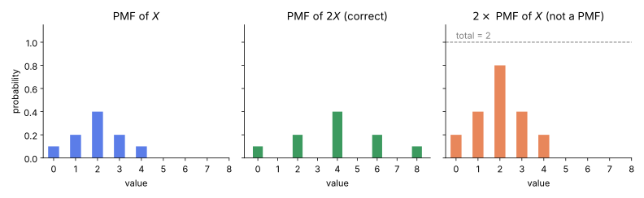
  <figcaption>Original figure for these notes, illustrating the scaling example in Blitzstein and Hwang, <em>Introduction to Probability</em>, Section 3.7 (sympathetic magic). The PMF of $$2X$$ relocates probabilities; doubling the PMF of $$X$$ does not produce a PMF.</figcaption>
</figure>

A second form of the error is to conclude from equal distributions that the random variables are equal. In the coin example, the indicator of Heads $$X$$ and the indicator of Tails $$1-X$$ both have the $$\operatorname{Bern}(1/2)$$ distribution, yet $$X=1-X$$ never happens.

<div class="misconception-block" markdown="1">

**Incorrect:** If $$X$$ and $$Y$$ have the same distribution, then $$X=Y$$, or at least $$P(X=Y)$$ is large.

**Correction:** Equal distributions only mean equal probabilities for each value. Random variables with the same distribution can be equal always, sometimes, or never.

</div>

**Core idea:** Before writing an answer, check its category: a number, an event, a random variable, or a distribution. Many errors in this course are category errors.

### Part 2 — The Poisson distribution

<div class="example-block" markdown="1">
<div class="ex-title">Poisson distribution <span class="ex-pill pill-defn">Definition</span></div>

A random variable $$X$$ has the **Poisson distribution** with parameter $$\lambda>0$$, written $$X\sim\operatorname{Pois}(\lambda)$$, if

$$
P(X=k)=\frac{e^{-\lambda}\lambda^k}{k!},\qquad k=0,1,2,\ldots.
$$

</div>

The support is all nonnegative integers. Unlike the Binomial, there is no upper bound on the count.

#### Validity of the PMF

Each term is positive because $$e^{-\lambda}>0$$, $$\lambda^k>0$$, and $$k!>0$$. For the total, use the Taylor series of the exponential function, which converges for every real $$\lambda$$:

$$
e^{\lambda}=\sum_{k=0}^{\infty}\frac{\lambda^k}{k!}.
$$

Factor $$e^{-\lambda}$$ out of the sum:

<div class="result-box" markdown="1">

$$
\boxed{\sum_{k=0}^{\infty}\frac{e^{-\lambda}\lambda^k}{k!}=e^{-\lambda}\sum_{k=0}^{\infty}\frac{\lambda^k}{k!}=e^{-\lambda}e^{\lambda}=1.}
$$

</div>

The factor $$e^{-\lambda}$$ is exactly the normalizing constant that turns the terms of the exponential series into probabilities.

#### Shape of the PMF

The ratio of consecutive probabilities is

$$
\frac{P(X=k+1)}{P(X=k)}=\frac{\lambda}{k+1}.
$$

The probabilities increase while $$k+1<\lambda$$ and decrease once $$k+1>\lambda$$, so the PMF rises to a peak near $$\lambda$$ and then falls. For small $$\lambda$$ the PMF is strongly right-skewed. For larger $$\lambda$$ it becomes more symmetric and bell-shaped.

<figure>
  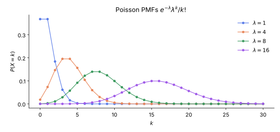
  <figcaption>Original figure for these notes. Poisson PMFs for $$\lambda=1,4,8,16$$; compare Blitzstein and Hwang, <em>Introduction to Probability</em>, Figure 4.7.</figcaption>
</figure>

### Part 3 — The Poisson mean

Let $$X\sim\operatorname{Pois}(\lambda)$$. By definition of expectation,

$$
E(X)=\sum_{k=0}^{\infty}k\frac{e^{-\lambda}\lambda^k}{k!}.
$$

The derivation has three steps.

1. **Drop the zero term.** The $$k=0$$ term is $$0$$, so the sum may start at $$k=1$$.
2. **Cancel $$k$$.** For $$k\ge1$$, $$k/k!=1/(k-1)!$$.
3. **Factor out one $$\lambda$$ and re-index.** Write $$\lambda^k=\lambda\cdot\lambda^{k-1}$$ and set $$j=k-1$$.

$$
\begin{aligned}
E(X)
&=e^{-\lambda}\sum_{k=1}^{\infty}\frac{\lambda^k}{(k-1)!}
=\lambda e^{-\lambda}\sum_{k=1}^{\infty}\frac{\lambda^{k-1}}{(k-1)!}\\
&=\lambda e^{-\lambda}\sum_{j=0}^{\infty}\frac{\lambda^{j}}{j!}
=\lambda e^{-\lambda}e^{\lambda}=\lambda.
\end{aligned}
$$

<div class="result-box" markdown="1">

$$
\boxed{X\sim\operatorname{Pois}(\lambda)\implies E(X)=\lambda.}
$$

</div>

The parameter is therefore the average count. If a count is modeled as Poisson, $$\lambda$$ is read as a rate: the expected number of events per hour, per page, per cookie, or per region.

#### Supplementary: The variance is also $$\lambda$$

Textbook Example 4.7.2 shows that $$\operatorname{Var}(X)=\lambda$$ as well. A short route uses the same shifting idea on $$E(X(X-1))$$:

$$
E(X(X-1))=e^{-\lambda}\sum_{k=2}^{\infty}\frac{\lambda^k}{(k-2)!}=\lambda^2.
$$

Then $$E(X^2)=E(X(X-1))+E(X)=\lambda^2+\lambda$$, so $$\operatorname{Var}(X)=E(X^2)-(E(X))^2=\lambda$$. Equality of mean and variance is a quick diagnostic: count data whose variance is far larger than their mean are poorly described by a single Poisson model.

### Part 4 — What the Poisson counts

The Poisson is used for the number of successes when there are many opportunities for success, each with a small probability. Typical counts are:

| Count | Many opportunities | Small probability for each |
|---|---|---|
| Emails received in an hour | Many possible senders, or many short time slots | Any given sender writes, or any given millisecond brings an email |
| Chocolate chips in a cookie | Many small cubes of dough | Any given cube contains a chip |
| Earthquakes in a region in a year | Many places and times | Any given place and time has a quake |
| Buses arriving at a stop in a day | Many short intervals | Any given interval contains an arrival |

The counts above are not exactly Poisson. The number of possible senders is finite, and only so many chips fit in a cookie, while a Poisson variable is unbounded. The Poisson is an approximation, and the approximation is good when the individual probabilities are small.

<div class="misconception-block" markdown="1">

**Incorrect:** The Poisson “law of rare events” requires the total count to be small, so $$\lambda$$ must be small.

**Correction:** “Rare” refers to each individual event $$A_j$$ having a small probability. The total rate $$\lambda=\sum_jp_j$$ can be large, because many small probabilities add up. A popular inbox can have $$\lambda=20$$ emails per hour even though any single person is unlikely to write in that hour.

</div>

### Part 5 — The Poisson paradigm

<div class="example-block" markdown="1">
<div class="ex-title">Poisson paradigm <span class="ex-pill pill-thm">Approximation</span></div>

Let $$A_1,\ldots,A_n$$ be events with $$p_j=P(A_j)$$. Suppose $$n$$ is large, every $$p_j$$ is small, and the events are independent or weakly dependent. Let

$$
X=\sum_{j=1}^nI(A_j)
$$

count how many of the events occur. Then

$$
X\ \dot\sim\ \operatorname{Pois}(\lambda),\qquad \lambda=\sum_{j=1}^np_j.
$$

</div>

Here $$\dot\sim$$ means “is approximately distributed as.” Three features make the paradigm flexible:

1. **Unequal probabilities are allowed.** The $$p_j$$ need not be equal, so the count need not be Binomial.
2. **Mild dependence is allowed.** The events need not be independent, provided that knowing whether some occur changes the probabilities of the others only slightly.
3. **The rate comes from linearity.** By the fundamental bridge and linearity, $$E(X)=\sum_jE(I(A_j))=\sum_jp_j$$. This is exact, whatever the dependence. The paradigm chooses the Poisson distribution with that same mean.

The approximation is most useful for small counts, especially for

$$
P(X\ge1)=1-P(X=0)\approx1-e^{-\lambda}.
$$

Computing $$P(X=0)$$ exactly requires the joint behavior of all the events. The approximation requires only their total probability.

#### Supplementary: How good is the approximation?

For independent $$A_j$$ and $$N\sim\operatorname{Pois}(\lambda)$$, the textbook (Section 4.7) quotes a bound, proved by the Stein–Chen method: for every set $$B$$ of nonnegative integers,

$$
|P(X\in B)-P(N\in B)|\le\min\left(1,\frac1\lambda\right)\sum_{j=1}^np_j^2.
$$

The error is controlled by $$\sum_jp_j^2$$. This makes “small $$p_j$$” precise: the squares of the probabilities must sum to something small compared with $$\lambda$$. For instance, if all $$p_j=p$$, the right side is at most $$\min(np^2,p)$$.

### Part 6 — The Binomial converges to the Poisson

The Binomial is the special case of the Poisson paradigm in which the events are independent and share one probability $$p$$. In that case the approximation can be proved exactly as a limit.

<div class="example-block" markdown="1">
<div class="ex-title">Poisson limit of the Binomial <span class="ex-pill pill-thm">Theorem</span></div>

Let $$X\sim\operatorname{Bin}(n,p)$$. If $$n\to\infty$$ and $$p\to0$$ with $$\lambda=np$$ held fixed, then for each fixed $$k\in\{0,1,2,\ldots\}$$,

$$
P(X=k)\to\frac{e^{-\lambda}\lambda^k}{k!}.
$$

</div>

**Proof.** Fix $$k$$ and take $$n\ge k$$. Substitute $$p=\lambda/n$$ into the Binomial PMF and expand the binomial coefficient:

$$
\begin{aligned}
P(X=k)
&=\binom nk\left(\frac{\lambda}{n}\right)^k\left(1-\frac{\lambda}{n}\right)^{n-k}\\
&=\frac{\lambda^k}{k!}\cdot\frac{n(n-1)\cdots(n-k+1)}{n^k}\cdot\left(1-\frac{\lambda}{n}\right)^{n}\cdot\left(1-\frac{\lambda}{n}\right)^{-k}.
\end{aligned}
$$

Take the limit of each factor separately as $$n\to\infty$$.

| Factor | Limit | Reason |
|---|---|---|
| $$\dfrac{\lambda^k}{k!}$$ | $$\dfrac{\lambda^k}{k!}$$ | Does not depend on $$n$$ |
| $$\dfrac{n(n-1)\cdots(n-k+1)}{n^k}=\prod_{i=0}^{k-1}\left(1-\dfrac in\right)$$ | $$1$$ | A fixed number $$k$$ of factors, each tending to 1 |
| $$\left(1-\dfrac{\lambda}{n}\right)^n$$ | $$e^{-\lambda}$$ | Compound-interest limit $$\left(1+\dfrac xn\right)^n\to e^x$$ with $$x=-\lambda$$ |
| $$\left(1-\dfrac{\lambda}{n}\right)^{-k}$$ | $$1$$ | Fixed power of a quantity tending to 1 |

Multiplying the limits gives

<div class="result-box" markdown="1">

$$
\boxed{\lim_{n\to\infty}\binom nk\left(\frac{\lambda}{n}\right)^k\left(1-\frac{\lambda}{n}\right)^{n-k}=\frac{e^{-\lambda}\lambda^k}{k!}.}
$$

</div>

$$\blacksquare$$

The key step is that $$k$$ stays fixed while $$n$$ grows. A fixed number of factors near 1 multiplies to something near 1. The only factor whose exponent grows with $$n$$ is $$(1-\lambda/n)^n$$, and it produces the $$e^{-\lambda}$$.

<figure>
  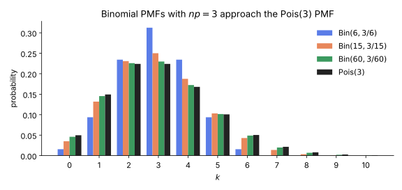
  <figcaption>Original figure for these notes, illustrating Blitzstein and Hwang, <em>Introduction to Probability</em>, Theorem 4.8.3. With $$np=3$$ fixed, the largest pointwise PMF gap to $$\operatorname{Pois}(3)$$ is about 0.088 for $$n=6$$, 0.026 for $$n=15$$, and 0.006 for $$n=60$$.</figcaption>
</figure>

<div class="misconception-block" markdown="1">

**Incorrect:** Any Binomial with large $$n$$ is approximately Poisson.

**Correction:** The success probability must be small. If $$p$$ stays fixed while $$n$$ grows, the mean $$np$$ and the variance $$np(1-p)$$ grow without bound, and the variance stays below the mean. That is a different regime (later approximated by the Normal). The Poisson limit needs $$p\to0$$ with $$np$$ moderate.

</div>

<div class="example-block" markdown="1">
<div class="ex-title">Supplementary numerical example: Rare defects <span class="ex-pill pill-num">Worked example</span></div>

A machine produces 1000 items independently, and each is defective with probability $$0.003$$. Find the probability of at most one defect.

**Model.** The defect count is $$X\sim\operatorname{Bin}(1000,0.003)$$. Here $$n$$ is large, $$p$$ is small, and $$\lambda=np=3$$ is moderate, so use $$\operatorname{Pois}(3)$$.

**Approximation.**

$$
P(X\le1)\approx e^{-3}+e^{-3}\cdot3=4e^{-3}\approx0.1991.
$$

**Exact value.** $$P(X\le1)=(0.997)^{1000}+1000(0.003)(0.997)^{999}\approx0.1987$$.

The absolute error is about $$0.0004$$, well within the bound $$\min(p,np^2)=0.003$$.

<div class="ex-lesson">The Poisson approximation replaces large powers and binomial coefficients with one exponential and a few small factorials, with little loss of accuracy when $$p$$ is small.</div>
</div>

### Part 7 — Thought experiment: Counting raindrops

Count the raindrops that land on a patch of ground during one minute. To fit a Binomial model, divide the patch into a fine grid of $$n$$ tiny squares and call a square a success if a drop lands in it. Each square has a small chance of a hit, and there are very many squares.

The Binomial model has three weaknesses here:

1. **The grid is arbitrary.** Each choice of $$n$$ gives a different model, and refining the grid sends $$n\to\infty$$ and $$p\to0$$. The Poisson is the limit that does not depend on the grid.
2. **A square can receive two drops.** A Binomial square only records hit or miss. The Poisson counts drops directly, with no cap per square.
3. **Equal, independent squares are a strong assumption.** Wind or overhanging trees can make some squares more likely to be hit. The Poisson paradigm tolerates unequal $$p_j$$ and mild dependence.

Computing with $$\binom nk$$ for astronomically large $$n$$ is also numerically awkward. The Poisson PMF needs only $$\lambda$$, the expected number of drops.

**Core idea:** The Poisson is the natural model when events can happen anywhere in a continuum of time or space and any small piece rarely contains one.

### Part 8 — Birthday problems by the Poisson paradigm

Assume 365 equally likely birthdays, independent across people, and ignore February 29.

#### Supplementary: Matching pairs

With $$m$$ people there are $$\binom m2$$ pairs. Let $$A_{ij}$$ be the event that persons $$i<j$$ share a birthday. Each has probability $$1/365$$. The events are weakly dependent: for example, if persons 1 and 2 match and persons 2 and 3 match, then persons 1 and 3 must match. The Poisson paradigm gives

$$
X=\#\{\text{matching pairs}\}\ \dot\sim\ \operatorname{Pois}(\lambda),\qquad \lambda=\binom m2\frac1{365}.
$$

<div class="example-block" markdown="1">
<div class="ex-title">Supplementary: Twenty-three people <span class="ex-pill pill-ex">Worked example</span></div>

For $$m=23$$, there are $$\binom{23}2=253$$ pairs, so $$\lambda=253/365\approx0.6932$$. Then

$$
P(\text{at least one match})=1-P(X=0)\approx1-e^{-253/365}\approx0.5000.
$$

The exact answer from Lecture 3 is about $$0.5073$$, so the approximation recovers the familiar threshold of 23 people.

<div class="ex-lesson"><strong>Core idea:</strong> Although $$m=23$$ is small, the number of trials is the number of pairs, 253. Many trials, each with probability $$1/365$$, is the Poisson setting.</div>
</div>

#### Supplementary: Near-birthday matches

Textbook Example 4.7.5 asks for at least one pair with birthdays at most one day apart. For two given people, the second must have birthday on the first person's day or on one of the two adjacent days, so the probability is $$3/365$$. Then $$\lambda=\binom m2\frac3{365}$$. Setting $$1-e^{-\lambda}\ge1/2$$ requires $$\lambda\ge\ln2$$, which first holds at $$m=14$$. The exact answer is also 14, while an exact calculation without the approximation is much harder.

#### Triple matches

Now ask for three people who share a birthday. For each triple $$i<j<k$$, let $$I_{ijk}$$ indicate that all three share a birthday. Whatever the birthday of person $$i$$, persons $$j$$ and $$k$$ must both match it:

$$
E(I_{ijk})=P(\text{triple }ijk\text{ matches})=\left(\frac1{365}\right)^2.
$$

By linearity, the expected number of triple matches among $$m$$ people is

$$
E\left(\sum_{i<j<k}I_{ijk}\right)=\binom m3\frac1{365^2}.
$$

The indicators are dependent. For example, $$I_{123}$$ and $$I_{124}$$ share persons 1 and 2, so knowing $$I_{123}=1$$ raises the chance that $$I_{124}=1$$. But each triple is very unlikely and there are many triples, so the dependence is weak. Hence, with $$\lambda=\binom m3/365^2$$,

<div class="result-box" markdown="1">

$$
\boxed{P(\text{at least one triple match})\approx1-e^{-\lambda},\qquad\lambda=\binom m3\frac1{365^2}.}
$$

</div>

<div class="example-block" markdown="1">
<div class="ex-title">How many people for an even chance of a triple match? <span class="ex-pill pill-num">Worked example</span></div>

Require $$1-e^{-\lambda}\ge1/2$$, that is, $$\lambda\ge\ln2\approx0.6931$$. This means

$$
\binom m3\ge0.6931\times365^2\approx92{,}340.
$$

Since $$\binom m3\approx m^3/6$$, this gives $$m\approx\sqrt[3]{554{,}000}\approx82$$. Checking exact values of $$\binom m3$$:

| $$m$$ | $$\lambda=\binom m3/365^2$$ | $$1-e^{-\lambda}$$ |
|---|---|---|
| 82 | 0.665 | 0.486 |
| 83 | 0.690 | 0.498 |
| 84 | 0.715 | 0.511 |

The approximation therefore suggests about 84 people.

**Supplementary caveat.** The exact threshold for a triple match is 88 people. The approximation is less accurate here than for pairs because the dependence is stronger. A single day shared by four people creates $$\binom43=4$$ matching triples at once, so matching triples arrive in clumps. Clumping raises $$P(X=0)$$ above $$e^{-\lambda}$$ for a given mean, so the Poisson estimate is slightly too optimistic.

<div class="ex-lesson">Linearity gives the mean exactly. The Poisson paradigm turns that mean into an approximate probability of no occurrences, whose accuracy depends on how weak the dependence really is.</div>
</div>

<div class="misconception-block" markdown="1">

**Incorrect:** The Poisson paradigm needs independent events, so it cannot be used for birthday matches.

**Correction:** Weak dependence is allowed. Pair and triple indicators overlap in people and are dependent, but each event is rare and any one event's dependence on the rest is slight. The approximation is excellent for pairs and reasonable for triples.

</div>

### Part 9 — Original practice questions

Try these before reading the answers.

1. Let $$X$$ be the indicator that a fair die shows 6, and let $$Y=1-X$$. Someone claims that the PMF of $$X+Y$$ is $$p_X+p_Y$$. Find the correct distribution of $$X+Y$$ and explain the error.
2. Let $$X\sim\operatorname{Pois}(4)$$. Find $$P(X=2)$$ and $$P(X\le2)$$.
3. For $$X\sim\operatorname{Pois}(\lambda)$$, find $$\lambda$$ such that $$P(X=0)=0.1$$.
4. Show that the most likely value of a $$\operatorname{Pois}(\lambda)$$ variable is $$\lfloor\lambda\rfloor$$ when $$\lambda$$ is not an integer. *(Supplementary.)*
5. Each of 300 acquaintances independently emails you this week with probability $$0.005$$. Approximate the probability of at least two emails.
6. Approximate the probability of at least one shared birthday among 30 people, and compare it with the exact value $$0.7063$$.
7. Approximate the probability of at least one triple birthday match among 100 people.
8. Explain why $$n\to\infty$$ with fixed $$p$$ does not lead to a Poisson limit.
9. In the proof of the Binomial limit, why does $$\frac{n(n-1)\cdots(n-k+1)}{n^k}\to1$$ require $$k$$ to be fixed?

### Part 10 — Practice answers

#### 1. Constant sum

Since $$Y=1-X$$, the sum is $$X+Y=1$$ for every outcome, so $$P(X+Y=1)=1$$. The proposed formula assigns $$p_X(1)+p_Y(1)=1/6+5/6=1$$ to the value 1 and $$p_X(0)+p_Y(0)=5/6+1/6=1$$ to the value 0, a total of 2. It treats PMFs as if they were the random variables. The distribution of a sum depends on how $$X$$ and $$Y$$ are related, not only on their separate PMFs.

#### 2. Poisson probabilities

$$
P(X=2)=e^{-4}\frac{4^2}{2!}=8e^{-4}\approx0.1465,
$$

$$
P(X\le2)=e^{-4}\left(1+4+8\right)=13e^{-4}\approx0.2381.
$$

#### 3. Solving for the rate

$$P(X=0)=e^{-\lambda}=0.1$$ gives $$\lambda=\ln10\approx2.303$$.

#### 4. The mode

From $$P(X=k+1)/P(X=k)=\lambda/(k+1)$$, the PMF increases from $$k$$ to $$k+1$$ exactly when $$k+1<\lambda$$ and decreases when $$k+1>\lambda$$. If $$\lambda$$ is not an integer, the last increase reaches $$k=\lfloor\lambda\rfloor$$, after which the PMF decreases. (If $$\lambda$$ is an integer, $$\lambda-1$$ and $$\lambda$$ tie.)

#### 5. Emails

Here $$\lambda=300\times0.005=1.5$$:

$$
P(X\ge2)=1-e^{-1.5}(1+1.5)=1-2.5e^{-1.5}\approx0.4422.
$$

#### 6. Thirty people

$$\lambda=\binom{30}2/365=435/365\approx1.1918$$, so $$1-e^{-\lambda}\approx0.6963$$. The approximation is about $$0.010$$ below the exact $$0.7063$$.

#### 7. Triple matches among 100 people

$$\lambda=\binom{100}3/365^2=161{,}700/133{,}225\approx1.214$$, so $$P\approx1-e^{-1.214}\approx0.703$$. The clumping caveat in Part 8 suggests the true value is somewhat smaller.

#### 8. Fixed success probability

With $$p$$ fixed, $$E(X)=np\to\infty$$, so for each fixed $$k$$, $$P(X=k)\to0$$. Probability escapes to ever larger values and no limiting PMF exists. A Poisson limit requires the expected count $$np$$ to stay bounded, which forces $$p\to0$$.

#### 9. Fixed number of factors

The ratio is $$\prod_{i=0}^{k-1}(1-i/n)$$. With $$k$$ fixed, it is a product of finitely many factors, each tending to 1. If $$k$$ grew with $$n$$, for example $$k=n$$, the product would become $$n!/n^n$$, which tends to 0.

### Part 11 — Quick revision sheet

| Concept | Essential fact |
|---|---|
| Sympathetic magic | Confusing a random variable with its distribution |
| Sum of random variables | Find its distribution from the variables, not by adding PMFs |
| Scaling | PMF of $$2X$$ relocates values; $$2p_X$$ is not a PMF |
| Poisson PMF | $$P(X=k)=e^{-\lambda}\lambda^k/k!$$, $$k=0,1,2,\ldots$$ |
| Validity | Taylor series $$\sum_k\lambda^k/k!=e^\lambda$$ |
| Mean | $$E(X)=\lambda$$ by dropping $$k=0$$ and re-indexing |
| Variance *(supplementary)* | $$\operatorname{Var}(X)=\lambda$$ |
| Consecutive ratio | $$P(X=k+1)/P(X=k)=\lambda/(k+1)$$ |
| Poisson paradigm | Count of many rare, weakly dependent events $$\dot\sim\operatorname{Pois}(\sum_jp_j)$$ |
| “Rare” | Each $$p_j$$ small; $$\lambda$$ itself need not be small |
| Binomial limit | $$\operatorname{Bin}(n,\lambda/n)\to\operatorname{Pois}(\lambda)$$ as $$n\to\infty$$ |
| Key limit | $$(1-\lambda/n)^n\to e^{-\lambda}$$ |
| At least one event | $$P(X\ge1)\approx1-e^{-\lambda}$$ |
| Birthday pairs | $$\lambda=\binom m2/365$$; 23 people gives about 0.50 |
| Triple matches | $$\lambda=\binom m3/365^2$$; about 84 people by approximation, 88 exactly |

### Term Glossary

<div class="glossary-entry" markdown="1">
<div class="gterm">Sympathetic magic <span class="gcat cat-defn">Definition</span></div>

The category error of confusing a random variable with its distribution, for example by adding or scaling PMFs to represent adding or scaling random variables.

</div>

<div class="glossary-entry" markdown="1">
<div class="gterm">Category error <span class="gcat cat-defn">Definition</span></div>

An answer of the wrong type of mathematical object, such as a distribution where a number is required. It is necessarily wrong, not merely inaccurate.

</div>

<div class="glossary-entry" markdown="1">
<div class="gterm">Poisson distribution <span class="gcat cat-defn">Definition</span></div>

The distribution on $$\{0,1,2,\ldots\}$$ with PMF $$e^{-\lambda}\lambda^k/k!$$ for a rate $$\lambda>0$$. Its mean and variance both equal $$\lambda$$.

</div>

<div class="glossary-entry" markdown="1">
<div class="gterm">Rate parameter $$\lambda$$ <span class="gcat cat-notn">Notation</span></div>

The Poisson parameter, interpreted as the expected number of events in the given unit of time, area, or volume.

</div>

<div class="glossary-entry" markdown="1">
<div class="gterm">Poisson paradigm <span class="gcat cat-thm">Approximation</span></div>

The approximation of the number of occurring events among many independent or weakly dependent rare events by a Poisson distribution with $$\lambda=\sum_jP(A_j)$$. Also called the law of rare events.

</div>

<div class="glossary-entry" markdown="1">
<div class="gterm">Weak dependence <span class="gcat cat-defn">Definition</span></div>

Dependence in which learning whether some of the events occurred changes the probabilities of the others only slightly.

</div>

<div class="glossary-entry" markdown="1">
<div class="gterm">Poisson limit of the Binomial <span class="gcat cat-thm">Theorem</span></div>

As $$n\to\infty$$ and $$p\to0$$ with $$np=\lambda$$ fixed, the $$\operatorname{Bin}(n,p)$$ PMF converges pointwise to the $$\operatorname{Pois}(\lambda)$$ PMF.

</div>

<div class="glossary-entry" markdown="1">
<div class="gterm">Count data <span class="gcat cat-defn">Definition</span></div>

Data whose values are nonnegative integers, such as numbers of arrivals or occurrences. The Poisson is a standard first model for such data.

</div>

<div class="ref-tags">
  <span class="ref-tag">Statistics 110</span>
  <span class="ref-tag">Lecture 11</span>
  <span class="ref-tag">Poisson</span>
  <span class="ref-tag">Poisson paradigm</span>
  <span class="ref-tag">Binomial limit</span>
  <span class="ref-tag">Birthday problem</span>
  <span class="ref-tag">Sympathetic magic</span>
</div>

  </div>
</div>

## Lecture 12 - Discrete vs. Continuous Distributions and the Uniform

<div class="chapter-block">
  <button type="button" class="chapter-toggle" id="lecture-12-toggle" onclick="toggleLecture('lecture-12')" aria-expanded="true" aria-controls="lecture-12-body">
    <span class="chapter-toggle-left">
      <span class="chapter-badge">Lecture 12</span>
      <span>
        <span class="chapter-title">Lecture 12 - Discrete vs. Continuous Distributions and the Uniform</span>
        <span class="chapter-subtitle">PDFs, CDFs, continuous expectation, variance and standard deviation, LOTUS, and the Uniform distribution</span>
      </span>
    </span>
    <span class="chapter-arrow open" id="lecture-12-arrow" aria-hidden="true">▼</span>
  </button>
  <div class="chapter-body open" id="lecture-12-body" markdown="1">

<div class="note-abstract" markdown="1">

A continuous random variable can take any value in an interval, and every single value has probability 0. Its distribution is described by a probability density function (PDF), whose integral over a region gives the probability of that region. The PDF is the derivative of the CDF, and the CDF is the accumulated area under the PDF. Expectation replaces sums with integrals. Variance measures spread as the average squared distance from the mean, and the standard deviation returns it to the original units. LOTUS computes $$E(g(X))$$ directly from the distribution of $$X$$. The Uniform distribution, a completely random point in an interval, is the simplest continuous model: probability is proportional to length.

</div>

### Notation at a Glance

<div class="notation-panel" markdown="1">

| Symbol | Meaning |
|---|---|
| $$F(x)=P(X\le x)$$ | Cumulative distribution function (CDF) |
| $$f(x)$$ | Probability density function (PDF) of a continuous random variable |
| $$F'(x)=f(x)$$ | The PDF is the derivative of the CDF |
| $$\int_a^bf(x)\,dx$$ | Probability that $$X$$ lies between $$a$$ and $$b$$ |
| $$\mu=E(X)$$ | Mean of $$X$$ |
| $$\operatorname{Var}(X)=E\left((X-\mu)^2\right)$$ | Variance of $$X$$ |
| $$\operatorname{SD}(X)=\sqrt{\operatorname{Var}(X)}$$ | Standard deviation of $$X$$ |
| $$EX^2$$ | Shorthand for $$E(X^2)$$, not $$(EX)^2$$ |
| $$g(X)$$ | A function of the random variable $$X$$ |
| $$U\sim\operatorname{Unif}(a,b)$$ | $$U$$ is Uniform on the interval $$(a,b)$$ |
| $$\varepsilon$$ | Length of a small interval |

</div>

### Learning objectives

After studying these notes, you should be able to:

- Contrast discrete and continuous random variables through their PMFs, PDFs, and CDFs.
- State the two conditions for a valid PDF and find a normalizing constant.
- Convert between a PDF and a CDF and compute interval probabilities.
- Explain why $$P(X=x)=0$$ for a continuous random variable while $$f(x)$$ can exceed 1.
- Compute expectations of continuous random variables.
- Define variance and standard deviation and prove $$\operatorname{Var}(X)=E(X^2)-(EX)^2$$.
- Use LOTUS to compute $$E(g(X))$$ in the discrete and continuous cases.
- Derive the PDF, CDF, mean, and variance of the Uniform distribution.

### Part 1 — Discrete versus continuous random variables

A discrete random variable takes values in a list, finite or countably infinite, such as $$\{0,1,2,\ldots\}$$. A continuous random variable takes values in an interval of the real line, such as $$(0,1)$$ or $$(-\infty,\infty)$$. The two cases share the CDF but differ in how probability is assigned to individual values.

| Object | Discrete random variable | Continuous random variable |
|---|---|---|
| CDF | $$F(x)=P(X\le x)$$, a step function | $$F(x)=P(X\le x)$$, continuous, differentiable except at finitely many points |
| Mass at one point | $$P(X=x)$$ is the PMF, the jump of $$F$$ at $$x$$ | $$P(X=x)=0$$ for every $$x$$ |
| Description | PMF, nonnegative and summing to 1 | PDF $$f=F'$$, nonnegative and integrating to 1 |
| Probability of a set | Sum the PMF over the set | Integrate the PDF over the set |
| Expectation | $$\sum_xxP(X=x)$$ | $$\int_{-\infty}^{\infty}xf(x)\,dx$$ |
| LOTUS | $$\sum_xg(x)P(X=x)$$ | $$\int_{-\infty}^{\infty}g(x)f(x)\,dx$$ |

The rule of translation is simple: sums become integrals and the PMF becomes the PDF.

<figure>
  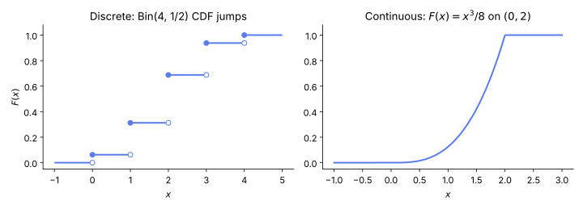
  <figcaption>Original figure for these notes; compare Blitzstein and Hwang, <em>Introduction to Probability</em>, Figure 5.1. A discrete CDF jumps at each value in the support. A continuous CDF has no jumps.</figcaption>
</figure>

### Part 2 — Probability density functions

<div class="example-block" markdown="1">
<div class="ex-title">Continuous random variable and PDF <span class="ex-pill pill-defn">Definition</span></div>

A random variable $$X$$ is **continuous** if its CDF $$F$$ is differentiable, allowing finitely many points (such as endpoints of the support) where $$F$$ is continuous but not differentiable. Its **probability density function** is

$$
f(x)=F'(x).
$$

The **support** of $$X$$ is the set where $$f(x)>0$$.

</div>

#### Validity of a PDF

<div class="result-box" markdown="1">

$$
\boxed{f(x)\ge0\ \text{for all }x,\qquad\int_{-\infty}^{\infty}f(x)\,dx=1.}
$$

</div>

- **Nonnegativity.** The CDF never decreases, so its slope cannot be negative.
- **Total area 1.** The integral over the whole line is the probability that $$X$$ takes some real value.

Conversely, every function with these two properties is the PDF of some continuous random variable.

#### Points have probability 0

For a continuous $$X$$ and any number $$a$$,

$$
P(X=a)\le P(a-\varepsilon<X\le a)=F(a)-F(a-\varepsilon)\to0\quad\text{as }\varepsilon\to0,
$$

because $$F$$ is continuous. Hence $$P(X=a)=0$$. Two consequences follow:

1. **Endpoints do not matter.** $$P(a<X<b)=P(a\le X\le b)=P(a<X\le b)=P(a\le X<b)$$. For discrete random variables they do matter.
2. **Probability 0 does not mean impossible.** Every value is possible, yet each individual value has probability 0. Positive probability belongs to intervals, not points.

#### What the density measures

The value $$f(x)$$ is not a probability. It is probability per unit length near $$x$$. For a short interval of length $$\varepsilon$$ centered at $$x$$, where $$f$$ is roughly constant,

$$
P\left(x-\tfrac{\varepsilon}{2}<X<x+\tfrac{\varepsilon}{2}\right)=\int_{x-\varepsilon/2}^{x+\varepsilon/2}f(t)\,dt\approx f(x)\,\varepsilon.
$$

If $$X$$ is measured in centimeters, $$f(x)$$ has units of $$\text{cm}^{-1}$$; multiplying by the length $$dx$$ in an integral returns a dimensionless probability. A density can exceed 1 as long as the region where it is large is short. For example, the $$\operatorname{Unif}(0,1/2)$$ density equals 2 on its support.

<div class="misconception-block" markdown="1">

**Incorrect:** $$f(x)$$ is the probability that $$X=x$$, so it must lie between 0 and 1.

**Correction:** For a continuous random variable, $$P(X=x)=0$$. The density $$f(x)$$ is a rate: probability per unit length. It can be larger than 1. Only areas under $$f$$ are probabilities.

</div>

### Part 3 — From PDF to CDF and back

Because $$f=F'$$ and $$F(-\infty)=0$$, the fundamental theorem of calculus gives

$$
F(x)=\int_{-\infty}^{x}f(t)\,dt.
$$

The CDF is the area under the PDF to the left of $$x$$. The variable $$t$$ is a dummy variable, renamed to avoid a clash with the upper limit $$x$$. For an interval,

<div class="result-box" markdown="1">

$$
\boxed{P(a<X\le b)=F(b)-F(a)=\int_a^bf(x)\,dx.}
$$

</div>

The same probability appears as an **area** under the PDF and as a **rise** in the CDF.

<div class="example-block" markdown="1">
<div class="ex-title">Normalizing a density and computing probabilities <span class="ex-pill pill-ex">Worked example</span></div>

Let $$f(x)=cx^2$$ for $$0<x<2$$ and $$f(x)=0$$ otherwise. Find $$c$$, the CDF, and $$P(0.5<X<1.5)$$.

**Step 1: Normalize.** Nonnegativity holds for $$c>0$$. The total area must be 1:

$$
\int_0^2cx^2\,dx=c\frac{x^3}{3}\Big|_0^2=\frac{8c}{3}=1\implies c=\frac38.
$$

**Step 2: CDF.** For $$0<x<2$$,

$$
F(x)=\int_0^x\frac38t^2\,dt=\frac{x^3}{8},
$$

with $$F(x)=0$$ for $$x\le0$$ and $$F(x)=1$$ for $$x\ge2$$. Check: $$F'(x)=3x^2/8=f(x)$$.

**Step 3: Probability.**

$$
P(0.5<X<1.5)=F(1.5)-F(0.5)=\frac{3.375-0.125}{8}=\frac{13}{32}\approx0.406.
$$

**Observation.** The density at $$x=2$$ is $$f(2)=3/2>1$$, which is allowed.

<div class="ex-lesson"><strong>Core idea:</strong> Find the constant from total area 1, integrate once to get the CDF, then read off any interval probability as a difference of CDF values.</div>
</div>

<figure>
  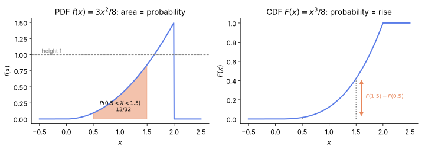
  <figcaption>Original figure for these notes, in the style of Blitzstein and Hwang, <em>Introduction to Probability</em>, Figures 5.2–5.3. The shaded area under the PDF equals the rise of the CDF.</figcaption>
</figure>

### Part 4 — Expectation of a continuous random variable

<div class="example-block" markdown="1">
<div class="ex-title">Continuous expectation <span class="ex-pill pill-defn">Definition</span></div>

For a continuous random variable $$X$$ with PDF $$f$$,

$$
E(X)=\int_{-\infty}^{\infty}xf(x)\,dx,
$$

provided the integral converges absolutely. In practice, integrate over the support only.

</div>

The integrand weights each value $$x$$ by the probability $$f(x)\,dx$$ of a short interval near it, exactly as $$xP(X=x)$$ does in the discrete case. The mean is the balancing point of the PDF. Linearity of expectation holds for continuous random variables as well.

For the density $$f(x)=3x^2/8$$ on $$(0,2)$$:

$$
E(X)=\int_0^2x\cdot\frac38x^2\,dx=\frac38\cdot\frac{x^4}{4}\Big|_0^2=\frac38\cdot4=\frac32.
$$

The mean lies to the right of the midpoint 1, because the density puts more weight near 2.

### Part 5 — Variance and standard deviation

The mean locates a distribution but says nothing about its spread. Two random variables can share a mean and differ greatly in how far they typically fall from it.

<div class="example-block" markdown="1">
<div class="ex-title">Variance and standard deviation <span class="ex-pill pill-defn">Definition</span></div>

Let $$\mu=E(X)$$. The **variance** of $$X$$ is

$$
\operatorname{Var}(X)=E\left((X-\mu)^2\right),
$$

and the **standard deviation** is $$\operatorname{SD}(X)=\sqrt{\operatorname{Var}(X)}$$.

</div>

Each part of the definition has a reason:

1. **Why not $$E(X-\mu)$$?** By linearity it always equals $$\mu-\mu=0$$. Positive and negative deviations cancel.
2. **Why square?** Squaring makes every deviation count positively. The alternative $$E\lvert X-\mu\rvert$$ also does this, but the absolute value is not differentiable at 0 and lacks the algebraic and geometric properties of squares (expansion, the Pythagorean structure behind adding variances).
3. **Why take a square root?** Variance is in squared units, such as square dollars. The standard deviation is back in the units of $$X$$.

#### The computational formula

<div class="result-box" markdown="1">

$$
\boxed{\operatorname{Var}(X)=E(X^2)-(EX)^2.}
$$

</div>

**Proof.** Expand the square and use linearity, treating $$\mu$$ as a constant:

$$
\begin{aligned}
\operatorname{Var}(X)
&=E\left(X^2-2\mu X+\mu^2\right)\\
&=E(X^2)-2\mu E(X)+\mu^2\\
&=E(X^2)-2\mu^2+\mu^2=E(X^2)-\mu^2.
\end{aligned}
$$

$$\blacksquare$$

Since $$\operatorname{Var}(X)\ge0$$, the formula also shows $$E(X^2)\ge(EX)^2$$. The notation $$EX^2$$ means $$E(X^2)$$: square first, then average.

#### Properties of variance

For constants $$a$$ and $$c$$:

| Property | Reason |
|---|---|
| $$\operatorname{Var}(X+c)=\operatorname{Var}(X)$$ | Shifting moves the mean by the same amount, leaving every deviation unchanged |
| $$\operatorname{Var}(aX)=a^2\operatorname{Var}(X)$$ | Every deviation is multiplied by $$a$$, so squared deviations are multiplied by $$a^2$$ |
| $$\operatorname{Var}(X)\ge0$$, with equality only if $$X$$ is constant with probability 1 | Average of a nonnegative quantity |
| $$\operatorname{Var}(X+Y)=\operatorname{Var}(X)+\operatorname{Var}(Y)$$ if $$X,Y$$ independent | Proved later; fails in general without independence |

Variance is not linear. For example, $$\operatorname{Var}(X+X)=\operatorname{Var}(2X)=4\operatorname{Var}(X)$$, not $$2\operatorname{Var}(X)$$, unless $$\operatorname{Var}(X)=0$$.

<div class="example-block" markdown="1">
<div class="ex-title">Variance of a fair die and of the cubic density <span class="ex-pill pill-num">Worked example</span></div>

**Fair die.** Let $$X$$ be uniform on $$\{1,\ldots,6\}$$. Then $$E(X)=3.5$$ and

$$
E(X^2)=\frac{1^2+2^2+\cdots+6^2}{6}=\frac{91}{6}.
$$

So $$\operatorname{Var}(X)=\frac{91}{6}-\frac{49}{4}=\frac{182-147}{12}=\frac{35}{12}\approx2.917$$ and $$\operatorname{SD}(X)\approx1.708$$.

**Continuous density.** For $$f(x)=3x^2/8$$ on $$(0,2)$$, with $$E(X)=3/2$$,

$$
E(X^2)=\int_0^2x^2\cdot\frac38x^2\,dx=\frac38\cdot\frac{32}{5}=\frac{12}{5},
\qquad
\operatorname{Var}(X)=\frac{12}{5}-\frac94=\frac{3}{20}.
$$

So $$\operatorname{SD}(X)=\sqrt{0.15}\approx0.387$$.

<div class="ex-lesson">The same two-step recipe applies in both cases: compute $$E(X)$$ and $$E(X^2)$$, then subtract.</div>
</div>

<div class="misconception-block" markdown="1">

**Incorrect:** $$E(X^2)=(EX)^2$$, so the variance formula is always 0.

**Correction:** Squaring is nonlinear. $$E(X^2)$$ averages the squares, while $$(EX)^2$$ squares the average. Their difference is exactly the variance, which is positive unless $$X$$ is constant.

</div>

### Part 6 — LOTUS: The law of the unconscious statistician

Computing $$E(X^2)$$ raises a question. $$X^2$$ is a new random variable, so the definition of expectation asks for the distribution of $$X^2$$. LOTUS avoids that step.

<div class="example-block" markdown="1">
<div class="ex-title">LOTUS <span class="ex-pill pill-thm">Theorem</span></div>

For a function $$g:\mathbb R\to\mathbb R$$,

$$
E(g(X))=\sum_xg(x)P(X=x)\quad\text{(discrete)},\qquad
E(g(X))=\int_{-\infty}^{\infty}g(x)f(x)\,dx\quad\text{(continuous)}.
$$

</div>

The weights stay those of $$X$$; only the values change from $$x$$ to $$g(x)$$.

**Why it holds in the discrete case.** Group the values $$x$$ by the value $$y=g(x)$$ they produce. Then $$P(g(X)=y)=\sum_{x:\,g(x)=y}P(X=x)$$, so

$$
\sum_yyP(g(X)=y)=\sum_y\sum_{x:\,g(x)=y}g(x)P(X=x)=\sum_xg(x)P(X=x).
$$

Grouping or not grouping gives the same total. The continuous version replaces sums with integrals; its proof is deferred in the textbook.

The name refers to how easily it is used without thinking: it looks like substituting $$g(x)$$ for $$x$$ in the definition, which is correct, but it is a theorem, not a definition.

<div class="misconception-block" markdown="1">

**Incorrect:** $$E(g(X))=g(E(X))$$, so LOTUS is unnecessary.

**Correction:** This equality holds for linear $$g$$ but generally fails otherwise. For example, $$E(X^2)\ne(EX)^2$$ unless the variance is 0. LOTUS applies $$g$$ to each value before averaging.

</div>

### Part 7 — The Uniform distribution

<div class="example-block" markdown="1">
<div class="ex-title">Uniform distribution <span class="ex-pill pill-defn">Definition</span></div>

A continuous random variable $$U$$ is **Uniform on $$(a,b)$$**, written $$U\sim\operatorname{Unif}(a,b)$$, if its PDF is constant on $$(a,b)$$ and 0 elsewhere:

$$
f(x)=\begin{cases}\dfrac1{b-a}, & a<x<b,\\[4pt] 0, & \text{otherwise.}\end{cases}
$$

</div>

**Why the constant is $$1/(b-a)$$.** Constant density $$c$$ on an interval of length $$b-a$$ gives total area $$c(b-a)$$, which must equal 1.

**CDF.** Integrating the constant density gives a linear ramp:

$$
F(x)=\begin{cases}0, & x\le a,\\[2pt] \dfrac{x-a}{b-a}, & a<x<b,\\[6pt] 1, & x\ge b.\end{cases}
$$

The **standard Uniform** $$\operatorname{Unif}(0,1)$$ has $$f(x)=1$$ and $$F(x)=x$$ on $$(0,1)$$.

#### Probability is proportional to length

For a subinterval $$(c,d)\subseteq(a,b)$$,

$$
P(c<U<d)=\frac{d-c}{b-a}.
$$

Only the length of the subinterval matters, not its location. This is what “completely random point” means, and among continuous distributions it characterizes the Uniform.

<figure>
  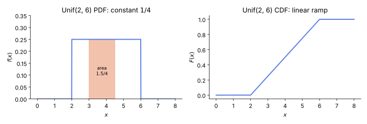
  <figcaption>Original figure for these notes; compare Blitzstein and Hwang, <em>Introduction to Probability</em>, Figure 5.5. A Uniform PDF is flat and its CDF is a linear ramp.</figcaption>
</figure>

### Part 8 — Mean and variance of the Uniform

#### Standard Uniform

Let $$U\sim\operatorname{Unif}(0,1)$$. Using the definition and LOTUS with $$f(x)=1$$ on $$(0,1)$$:

$$
E(U)=\int_0^1x\,dx=\frac12,\qquad
E(U^2)=\int_0^1x^2\,dx=\frac13,
$$

so

<div class="result-box" markdown="1">

$$
\boxed{\operatorname{Var}(U)=\frac13-\frac14=\frac1{12},\qquad\operatorname{SD}(U)=\frac1{\sqrt{12}}\approx0.289.}
$$

</div>

#### General Uniform on $$(a,b)$$

Direct integration gives

$$
E(U)=\int_a^b\frac{x}{b-a}\,dx=\frac{b^2-a^2}{2(b-a)}=\frac{a+b}{2},
$$

the midpoint of the interval, as symmetry requires. By LOTUS,

$$
E(U^2)=\int_a^b\frac{x^2}{b-a}\,dx=\frac{b^3-a^3}{3(b-a)}=\frac{a^2+ab+b^2}{3}.
$$

Therefore

$$
\operatorname{Var}(U)=\frac{a^2+ab+b^2}{3}-\frac{(a+b)^2}{4}
=\frac{4a^2+4ab+4b^2-3a^2-6ab-3b^2}{12}
=\frac{(b-a)^2}{12}.
$$

<div class="result-box" markdown="1">

$$
\boxed{U\sim\operatorname{Unif}(a,b)\implies E(U)=\frac{a+b}{2},\qquad\operatorname{Var}(U)=\frac{(b-a)^2}{12}.}
$$

</div>

The variance depends only on the length of the interval, consistent with the fact that shifting does not change spread.

#### Supplementary: The location-scale shortcut

Textbook Section 5.2 obtains the general result from the standard case. If $$U\sim\operatorname{Unif}(0,1)$$, then $$a+(b-a)U\sim\operatorname{Unif}(a,b)$$: scaling by $$b-a$$ stretches the interval to length $$b-a$$ and adding $$a$$ shifts it. Then

$$
E(a+(b-a)U)=a+\frac{b-a}2=\frac{a+b}2,\qquad
\operatorname{Var}(a+(b-a)U)=(b-a)^2\cdot\frac1{12}.
$$

This avoids the algebra above and uses only the variance properties in Part 5. The trick does not work for nonlinear transformations: $$U^2$$ is not Uniform on $$(0,1)$$.

<div class="example-block" markdown="1">
<div class="ex-title">A Uniform waiting time <span class="ex-pill pill-ex">Worked example</span></div>

A shuttle departs at a time Uniform between 2 and 6 minutes after you reach the stop, so the wait is $$W\sim\operatorname{Unif}(2,6)$$.

**Interval probability.** The interval $$(3,4.5)$$ has length 1.5 out of 4:

$$
P(3<W<4.5)=\frac{1.5}{4}=0.375.
$$

**Mean and spread.**

$$
E(W)=\frac{2+6}{2}=4,\qquad\operatorname{Var}(W)=\frac{4^2}{12}=\frac43,\qquad\operatorname{SD}(W)=\frac{2}{\sqrt3}\approx1.155.
$$

**A LOTUS calculation.** The expected squared wait is

$$
E(W^2)=\operatorname{Var}(W)+(EW)^2=\frac43+16=\frac{52}{3}\approx17.33,
$$

which differs from $$(EW)^2=16$$.

<div class="ex-lesson"><strong>Core idea:</strong> For a Uniform, probabilities are length ratios; the mean is the midpoint and the variance is the squared length over 12.</div>
</div>

<div class="misconception-block" markdown="1">

**Incorrect:** Since every point of $$(a,b)$$ is equally likely, $$P(U=x)=1/(b-a)$$.

**Correction:** $$1/(b-a)$$ is the density, not a probability, and $$P(U=x)=0$$. “Equally likely” for a continuous Uniform means that intervals of equal length have equal probability.

</div>

### Part 9 — Original practice questions

Try these before reading the answers.

1. Let $$f(x)=c(1-x^2)$$ for $$-1<x<1$$ and $$0$$ otherwise. Find $$c$$, $$P(X>1/2)$$, $$E(X)$$, and $$\operatorname{Var}(X)$$.
2. Is $$f(x)=2$$ for $$0<x<1/2$$ (and 0 otherwise) a valid PDF? What distribution is it?
3. A random variable has CDF $$F(x)=1-1/x^2$$ for $$x\ge1$$ and $$0$$ for $$x<1$$. Find its PDF, its mean, and $$E(X^2)$$. What does this say about its variance?
4. If $$\operatorname{Var}(X)=4$$, find $$\operatorname{Var}(3X+2)$$ and $$\operatorname{SD}(3X+2)$$.
5. Let $$X\sim\operatorname{Bern}(p)$$. Find $$\operatorname{Var}(X)$$ and the value of $$p$$ that maximizes it.
6. Let $$U\sim\operatorname{Unif}(0,1)$$. Use LOTUS to find $$E(\sqrt U)$$ and $$E(U^3)$$. Compare $$E(\sqrt U)$$ with $$\sqrt{E(U)}$$.
7. Let $$U\sim\operatorname{Unif}(0,1)$$. Find $$P(0.2<U<0.5\mid U<0.6)$$. *(Supplementary: conditional Uniform.)*
8. Explain why $$P(X=0.5)=0$$ for $$X\sim\operatorname{Unif}(0,1)$$ does not make the value $$0.5$$ impossible.
9. Show that $$\operatorname{Var}(X+c)=\operatorname{Var}(X)$$ from the definition of variance.

### Part 10 — Practice answers

#### 1. A parabolic density

Normalize: $$\int_{-1}^1(1-x^2)\,dx=2-\frac23=\frac43$$, so $$c=\frac34$$. Then

$$
P(X>\tfrac12)=\frac34\int_{1/2}^1(1-x^2)\,dx=\frac34\left[\left(1-\frac13\right)-\left(\frac12-\frac1{24}\right)\right]=\frac34\cdot\frac5{24}=\frac5{32}.
$$

The density is symmetric about 0, so $$E(X)=0$$. By LOTUS,

$$
E(X^2)=\frac34\int_{-1}^1(x^2-x^4)\,dx=\frac34\left(\frac23-\frac25\right)=\frac15,
$$

so $$\operatorname{Var}(X)=\frac15$$.

#### 2. A density larger than 1

Yes. It is nonnegative and its area is $$2\times\frac12=1$$. It is the $$\operatorname{Unif}(0,1/2)$$ PDF. The density value 2 is not a probability.

#### 3. A heavy-tailed variable

Differentiate: $$f(x)=2x^{-3}$$ for $$x>1$$. Then

$$
E(X)=\int_1^\infty x\cdot2x^{-3}\,dx=\int_1^\infty2x^{-2}\,dx=2,
\qquad
E(X^2)=\int_1^\infty2x^{-1}\,dx=\infty.
$$

The mean is finite but the second moment diverges, so the variance is infinite. A finite mean does not guarantee a finite variance.

#### 4. Linear transformation

$$\operatorname{Var}(3X+2)=9\cdot4=36$$ and $$\operatorname{SD}(3X+2)=6$$. The shift by 2 has no effect; the scale factor 3 is squared in the variance.

#### 5. Bernoulli variance

$$X^2=X$$ because $$X\in\{0,1\}$$, so $$E(X^2)=p$$ and $$\operatorname{Var}(X)=p-p^2=p(1-p)$$. This is maximized at $$p=1/2$$, where it equals $$1/4$$.

#### 6. LOTUS with the standard Uniform

$$
E(\sqrt U)=\int_0^1x^{1/2}\,dx=\frac23,\qquad E(U^3)=\int_0^1x^3\,dx=\frac14.
$$

Here $$\sqrt{E(U)}=\sqrt{1/2}\approx0.707>2/3$$. Applying a nonlinear function before or after averaging gives different results.

#### 7. Conditional Uniform

$$
P(0.2<U<0.5\mid U<0.6)=\frac{P(0.2<U<0.5)}{P(U<0.6)}=\frac{0.3}{0.6}=\frac12.
$$

Given $$U<0.6$$, the variable is $$\operatorname{Unif}(0,0.6)$$, and probability is still proportional to length.

#### 8. Probability zero versus impossible

Every outcome of $$U$$ is some specific number, and each specific number has probability 0. An event of probability 0 can still occur. Impossible events are those outside the sample space or support; $$0.5$$ is inside $$(0,1)$$.

#### 9. Shift invariance

$$E(X+c)=\mu+c$$, so $$(X+c)-E(X+c)=X-\mu$$. Hence $$\operatorname{Var}(X+c)=E\left((X-\mu)^2\right)=\operatorname{Var}(X)$$.

### Part 11 — Quick revision sheet

| Concept | Essential fact |
|---|---|
| Continuous random variable | Differentiable CDF; $$P(X=x)=0$$ for every $$x$$ |
| PDF | $$f=F'$$; probability per unit length |
| Valid PDF | $$f\ge0$$ and $$\int f=1$$ |
| PDF to CDF | $$F(x)=\int_{-\infty}^xf(t)\,dt$$ |
| Interval probability | $$P(a<X\le b)=F(b)-F(a)=\int_a^bf$$ |
| Endpoints | Irrelevant for continuous, relevant for discrete |
| Density above 1 | Allowed; only areas are probabilities |
| Continuous mean | $$E(X)=\int xf(x)\,dx$$ |
| Variance | $$E((X-\mu)^2)=E(X^2)-(EX)^2$$ |
| Standard deviation | $$\sqrt{\operatorname{Var}(X)}$$, in the units of $$X$$ |
| Shift and scale | $$\operatorname{Var}(aX+c)=a^2\operatorname{Var}(X)$$ |
| LOTUS | $$E(g(X))=\int g(x)f(x)\,dx$$ or $$\sum g(x)P(X=x)$$ |
| Nonlinear $$g$$ | Generally $$E(g(X))\ne g(EX)$$ |
| Uniform PDF | $$1/(b-a)$$ on $$(a,b)$$ |
| Uniform CDF | $$(x-a)/(b-a)$$ on $$(a,b)$$ |
| Uniform probability | Length of interval divided by $$b-a$$ |
| Uniform mean and variance | $$(a+b)/2$$ and $$(b-a)^2/12$$ |
| Standard Uniform | Mean $$1/2$$, variance $$1/12$$ |

### Term Glossary

<div class="glossary-entry" markdown="1">
<div class="gterm">Continuous random variable <span class="gcat cat-defn">Definition</span></div>

A random variable whose CDF is differentiable, except possibly at finitely many points where it is still continuous. It assigns probability 0 to each single value.

</div>

<div class="glossary-entry" markdown="1">
<div class="gterm">Probability density function (PDF) <span class="gcat cat-defn">Definition</span></div>

The derivative $$f=F'$$ of the CDF of a continuous random variable. Integrating it over a region gives the probability of that region.

</div>

<div class="glossary-entry" markdown="1">
<div class="gterm">Support <span class="gcat cat-defn">Definition</span></div>

The set of values where the PMF or PDF is positive.

</div>

<div class="glossary-entry" markdown="1">
<div class="gterm">Variance <span class="gcat cat-meas">Measure</span></div>

The expected squared deviation from the mean, $$E((X-\mu)^2)$$, equivalently $$E(X^2)-(EX)^2$$.

</div>

<div class="glossary-entry" markdown="1">
<div class="gterm">Standard deviation <span class="gcat cat-meas">Measure</span></div>

The square root of the variance, measuring spread in the units of the random variable.

</div>

<div class="glossary-entry" markdown="1">
<div class="gterm">$$EX^2$$ <span class="gcat cat-notn">Notation</span></div>

The expectation of $$X^2$$, also called the second moment. It is not $$(EX)^2$$.

</div>

<div class="glossary-entry" markdown="1">
<div class="gterm">LOTUS <span class="gcat cat-thm">Theorem</span></div>

The law of the unconscious statistician: $$E(g(X))$$ is computed by weighting $$g(x)$$ with the PMF or PDF of $$X$$, without finding the distribution of $$g(X)$$.

</div>

<div class="glossary-entry" markdown="1">
<div class="gterm">Uniform distribution <span class="gcat cat-defn">Definition</span></div>

The distribution of a completely random point in an interval $$(a,b)$$, with constant density $$1/(b-a)$$, so that probability is proportional to length.

</div>

<div class="glossary-entry" markdown="1">
<div class="gterm">Location-scale transformation <span class="gcat cat-prop">Technique</span></div>

A transformation $$Y=\sigma X+\mu$$ with $$\sigma>0$$, which shifts and rescales a distribution. It preserves the Uniform family.

</div>

<div class="ref-tags">
  <span class="ref-tag">Statistics 110</span>
  <span class="ref-tag">Lecture 12</span>
  <span class="ref-tag">Continuous random variables</span>
  <span class="ref-tag">PDF</span>
  <span class="ref-tag">Variance</span>
  <span class="ref-tag">LOTUS</span>
  <span class="ref-tag">Uniform</span>
</div>

  </div>
</div>

## Lecture 13 - Universality of the Uniform, Independence, and the Normal Distribution

<div class="chapter-block">
  <button type="button" class="chapter-toggle" id="lecture-13-toggle" onclick="toggleLecture('lecture-13')" aria-expanded="true" aria-controls="lecture-13-body">
    <span class="chapter-toggle-left">
      <span class="chapter-badge">Lecture 13</span>
      <span>
        <span class="chapter-title">Lecture 13 - Universality of the Uniform, Independence, and the Normal Distribution</span>
        <span class="chapter-subtitle">Inverse-CDF simulation, plugging a random variable into its own CDF, independence of random variables, and the standard Normal</span>
      </span>
    </span>
    <span class="chapter-arrow open" id="lecture-13-arrow" aria-hidden="true">▼</span>
  </button>
  <div class="chapter-body open" id="lecture-13-body" markdown="1">

<div class="note-abstract" markdown="1">

A single $$\operatorname{Unif}(0,1)$$ random variable can be turned into a random variable with any continuous distribution by applying the inverse CDF. In the other direction, plugging a continuous random variable into its own CDF produces a $$\operatorname{Unif}(0,1)$$ random variable. Independence of random variables means that the joint CDF factors into marginal CDFs, which is stronger than pairwise independence. The standard Normal distribution has density proportional to $$e^{-z^2/2}$$. A polar-coordinates argument finds its normalizing constant $$1/\sqrt{2\pi}$$, odd symmetry gives mean 0, and integration by parts gives variance 1.

</div>

### Notation at a Glance

<div class="notation-panel" markdown="1">

| Symbol | Meaning |
|---|---|
| $$U\sim\operatorname{Unif}(0,1)$$ | Standard Uniform random variable |
| $$F$$ | A CDF, continuous and strictly increasing on its support |
| $$F^{-1}$$ | Inverse CDF, also called the quantile function |
| $$F(X)$$ | The random variable obtained by plugging $$X$$ into the function $$F$$ |
| $$X_1,\ldots,X_n$$ | Random variables defined on the same experiment |
| i.i.d. | Independent and identically distributed |
| $$Z\sim\mathcal N(0,1)$$ | $$Z$$ has the standard Normal distribution |
| $$\varphi(z)$$ | Standard Normal PDF, $$\frac1{\sqrt{2\pi}}e^{-z^2/2}$$ |
| $$\Phi(z)$$ | Standard Normal CDF, $$\int_{-\infty}^z\varphi(t)\,dt$$ |
| $$(r,\theta)$$ | Polar coordinates, with $$x=r\cos\theta$$, $$y=r\sin\theta$$ |

</div>

### Learning objectives

After studying these notes, you should be able to:

- State and prove both directions of the universality of the Uniform.
- Simulate a continuous random variable from $$\operatorname{Unif}(0,1)$$ by inverting its CDF.
- Interpret $$F(X)$$ correctly and explain why it is not $$P(X\le X)$$.
- Simulate a discrete random variable by partitioning $$(0,1)$$.
- Define independence of random variables through the joint CDF and the joint PMF.
- Construct random variables that are pairwise independent but not independent.
- Derive the normalizing constant of the standard Normal PDF.
- Show that $$E(Z)=0$$ and $$\operatorname{Var}(Z)=1$$ for $$Z\sim\mathcal N(0,1)$$.

### Part 1 — Universality of the Uniform

<div class="example-block" markdown="1">
<div class="ex-title">Universality of the Uniform <span class="ex-pill pill-thm">Theorem</span></div>

Let $$F$$ be a CDF that is continuous and strictly increasing on the support of its distribution, so that $$F^{-1}:(0,1)\to\mathbb R$$ exists.

1. If $$U\sim\operatorname{Unif}(0,1)$$ and $$X=F^{-1}(U)$$, then $$X$$ has CDF $$F$$.
2. If $$X$$ has CDF $$F$$, then $$F(X)\sim\operatorname{Unif}(0,1)$$.

</div>

The theorem says that $$\operatorname{Unif}(0,1)$$ is a universal raw material: every continuous distribution can be built from it, and every continuous random variable can be converted back to it. It is also called the probability integral transform or inverse transform sampling.

**Proof of part 1.** Because $$F$$ is strictly increasing, $$F^{-1}(U)\le x$$ holds exactly when $$U\le F(x)$$. For a standard Uniform, $$P(U\le u)=u$$ for $$u\in(0,1)$$. Hence

$$
P(X\le x)=P\left(F^{-1}(U)\le x\right)=P\left(U\le F(x)\right)=F(x).
$$

**Proof of part 2.** Let $$Y=F(X)$$, which takes values in $$(0,1)$$. For $$y\in(0,1)$$, apply the increasing function $$F^{-1}$$ to both sides of the inequality:

$$
P(Y\le y)=P\left(F(X)\le y\right)=P\left(X\le F^{-1}(y)\right)=F\left(F^{-1}(y)\right)=y.
$$

This is the $$\operatorname{Unif}(0,1)$$ CDF. $$\blacksquare$$

Both proofs use only one fact: an increasing function preserves inequalities, so an event about $$X$$ can be rewritten as an event about $$U$$.

#### What $$F(X)$$ means

$$F$$ is an ordinary function, so $$F(X)$$ is a function of a random variable and hence a random variable. First write $$F(x)$$ as a formula in $$x$$, then substitute $$X$$. For example, if $$F(x)=1-e^{-x}$$ for $$x>0$$, then $$F(X)=1-e^{-X}$$.

<div class="misconception-block" markdown="1">

**Incorrect:** $$F(X)=P(X\le X)=1$$.

**Correction:** $$F(x)=P(X\le x)$$ defines a function of a fixed number $$x$$. Replacing $$x$$ inside the probability by the random $$X$$ confuses the function with the event that defines it. The correct object is the formula $$F(x)$$ evaluated at $$x=X$$, which is a random number between 0 and 1.

</div>

**Interpretation as percentiles.** If $$X$$ is the score of a randomly chosen student and $$F$$ is the score distribution, then $$F(x)$$ is the fraction of students scoring below $$x$$, the percentile of score $$x$$. $$F(X)$$ is the percentile of a random student. Scores can have any shape, but percentiles are spread evenly: 10% of students lie in each tenth of the percentile scale. That is part 2 of the theorem.

### Part 2 — Simulating with the inverse CDF

<div class="example-block" markdown="1">
<div class="ex-title">Simulating the Exponential distribution <span class="ex-pill pill-ex">Worked example</span></div>

The $$\operatorname{Expo}(1)$$ distribution has CDF $$F(x)=1-e^{-x}$$ for $$x>0$$. Generate draws from it using only Uniform draws.

**Step 1: Invert the CDF.** Solve $$u=1-e^{-x}$$ for $$x$$:

$$
e^{-x}=1-u\implies x=-\ln(1-u),\qquad F^{-1}(u)=-\ln(1-u).
$$

**Step 2: Substitute the Uniform.** By part 1 of the theorem,

$$
X=-\ln(1-U)\sim\operatorname{Expo}(1).
$$

**Step 3: Check directly.** For $$x>0$$,

$$
P(-\ln(1-U)\le x)=P(1-U\ge e^{-x})=P(U\le1-e^{-x})=1-e^{-x}.
$$

**Step 4: Simplify (optional).** Since $$1-U\sim\operatorname{Unif}(0,1)$$ as well, $$-\ln U\sim\operatorname{Expo}(1)$$ too. To simulate ten independent draws, apply the transformation to ten independent Uniforms.

**Reverse direction.** If $$X\sim\operatorname{Expo}(1)$$, part 2 gives $$1-e^{-X}\sim\operatorname{Unif}(0,1)$$.

<div class="ex-lesson"><strong>Core idea:</strong> Simulation reduces to algebra: solve $$u=F(x)$$ for $$x$$, then substitute $$U$$. A computer that can only produce Uniform numbers can produce any continuous distribution whose CDF can be inverted.</div>
</div>

<figure>
  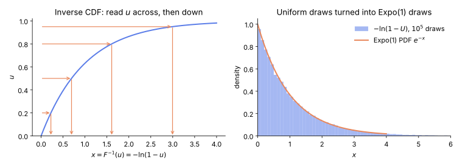
  <figcaption>Original figure for these notes, illustrating Blitzstein and Hwang, <em>Introduction to Probability</em>, Theorem 5.3.1 (compare Figures 5.6–5.7). Left: the inverse CDF maps Uniform heights to $$x$$-values. Right: $$10^5$$ simulated values of $$-\ln(1-U)$$ follow the $$\operatorname{Expo}(1)$$ PDF.</figcaption>
</figure>

Large values of $$u$$ near 1 map to widely spaced $$x$$-values because the CDF is flat in the right tail. A flat region of $$F$$ means little probability per unit length, so the inverse spreads Uniform mass thinly there.

#### Transformations of the Uniform

- **Symmetry:** $$1-U\sim\operatorname{Unif}(0,1)$$.
- **Linear maps:** $$a+bU$$ with $$b>0$$ is $$\operatorname{Unif}(a,a+b)$$.
- **Nonlinear maps:** generally not Uniform. For example, $$\sqrt U$$ has CDF $$P(\sqrt U\le x)=P(U\le x^2)=x^2$$ on $$(0,1)$$, with PDF $$2x$$. This is universality again: $$F(x)=x^2$$ has inverse $$\sqrt u$$.

#### Supplementary: The discrete case

A discrete CDF has jumps and flat parts, so it has no ordinary inverse. Part 1 still works with a different construction. To build $$X$$ with $$P(X=j)=p_j$$ for $$j=0,1,\ldots$$, cut $$(0,1)$$ into consecutive pieces of lengths $$p_0,p_1,\ldots$$ and let $$X=j$$ when $$U$$ falls in the $$j$$th piece. Since probability is length for $$U$$, $$P(X=j)=p_j$$. For example, $$X=I(U<p)$$ is $$\operatorname{Bern}(p)$$.

Part 2 fails for discrete $$X$$: $$F(X)$$ is still discrete. If $$X\sim\operatorname{Bern}(p)$$, then $$F(X)$$ takes only the values $$1-p$$ and $$1$$.

### Part 3 — Independence of random variables

<div class="example-block" markdown="1">
<div class="ex-title">Independence of random variables <span class="ex-pill pill-defn">Definition</span></div>

Random variables $$X_1,\ldots,X_n$$ are **independent** if

$$
P(X_1\le x_1,\ldots,X_n\le x_n)=P(X_1\le x_1)\cdots P(X_n\le x_n)\quad\text{for all }x_1,\ldots,x_n\in\mathbb R.
$$

For discrete random variables, this is equivalent to factorization of the joint PMF:

$$
P(X_1=x_1,\ldots,X_n=x_n)=P(X_1=x_1)\cdots P(X_n=x_n)\quad\text{for all }x_1,\ldots,x_n.
$$

Infinitely many random variables are independent if every finite subcollection is.

</div>

**Meaning.** Learning the values of any subset of the variables does not change the distribution of the others.

**One equation, infinitely many conditions.** For $$n$$ events, independence requires checking every subcollection of 2, 3, …, $$n$$ events. For random variables, one product formula suffices because it must hold for every choice of $$x_1,\ldots,x_n$$. Letting some $$x_k\to\infty$$ removes those variables from the statement, so the definition already includes every subcollection. A single choice of values where the formula fails proves dependence.

**i.i.d.** Random variables are **independent and identically distributed** when they are independent and share one distribution. The two properties are unrelated: independence concerns information, identical distribution concerns the shape of the PMF or CDF.

<div class="example-block" markdown="1">
<div class="ex-title">Supplementary: Maximum and minimum of two dice <span class="ex-pill pill-ex">Worked example</span></div>

Roll two fair dice. Let $$M$$ be the larger value and $$L$$ the smaller. Are $$M$$ and $$L$$ independent?

Find one pair of values where the joint PMF does not factor. Take $$M=1$$ and $$L=6$$. The maximum cannot be below the minimum, so $$P(M=1,L=6)=0$$. But $$P(M=1)=1/36$$ (both dice show 1) and $$P(L=6)=1/36$$ (both dice show 6), so

$$
P(M=1)P(L=6)=\frac1{1296}\ne0.
$$

Hence $$M$$ and $$L$$ are dependent.

<div class="ex-lesson">Dependence needs only one counterexample. Look for values that are individually possible but jointly impossible.</div>
</div>

<div class="example-block" markdown="1">
<div class="ex-title">Matching pennies: Pairwise independent but not independent <span class="ex-pill pill-ex">Worked example</span></div>

Let $$X_1,X_2$$ be i.i.d. $$\operatorname{Bern}(1/2)$$, two fair coin tosses coded 0 or 1. Let $$X_3=1$$ if $$X_1=X_2$$ and $$X_3=0$$ otherwise.

**Each variable is $$\operatorname{Bern}(1/2)$$.** $$X_3=1$$ for the outcomes $$(0,0)$$ and $$(1,1)$$, so $$P(X_3=1)=1/2$$.

**Each pair is independent.** $$X_1$$ and $$X_2$$ are independent by construction. For $$X_1$$ and $$X_3$$, the four joint probabilities are each $$1/4$$, since each joint value pins down one equally likely outcome. For instance,

$$
P(X_1=1,X_3=1)=P(X_1=1,X_2=1)=\frac14=P(X_1=1)P(X_3=1).
$$

The same argument applies to $$X_2$$ and $$X_3$$.

**The three are not independent.** Knowing $$X_1$$ and $$X_2$$ determines $$X_3$$. For instance,

$$
P(X_1=1,X_2=1,X_3=0)=0\ne\frac18=P(X_1=1)P(X_2=1)P(X_3=0).
$$

<div class="ex-lesson"><strong>Core idea:</strong> Any two of the variables carry no information about each other, but two of them together determine the third. Independence of the whole collection is stronger than independence of every pair.</div>
</div>

<div class="misconception-block" markdown="1">

**Incorrect:** If every pair among $$X_1,\ldots,X_n$$ is independent, then the collection is independent.

**Correction:** Pairwise independence does not imply joint independence, as matching pennies shows. The converse does hold: independence of the collection implies independence of every pair and every subcollection.

</div>

### Part 4 — The Normal distribution and why it matters

The Normal distribution, also called the Gaussian distribution, is the most important distribution in statistics. Its importance comes from the **central limit theorem**: under mild conditions, a sum of many i.i.d. random variables, suitably standardized, has an approximately Normal distribution, whatever the distribution of each term, discrete or continuous. Sums and averages appear throughout statistics, so the Normal appears with them.

The Normal family has two parameters, the mean $$\mu$$ and the variance $$\sigma^2$$, written $$\mathcal N(\mu,\sigma^2)$$. Its PDF is a symmetric bell centered at $$\mu$$, with spread controlled by $$\sigma$$. The standard case $$\mu=0$$, $$\sigma^2=1$$ is treated first.

### Part 5 — The standard Normal PDF and its normalizing constant

Start from the shape $$e^{-z^2/2}$$: positive, symmetric about 0, and decaying very fast. To make it a PDF, multiply by a constant $$c$$ chosen so the total area is 1:

$$
f(z)=ce^{-z^2/2},\qquad c=\left(\int_{-\infty}^{\infty}e^{-z^2/2}\,dz\right)^{-1}.
$$

The antiderivative of $$e^{-z^2/2}$$ has no closed form, but the definite integral over the whole line can still be computed.

#### The polar-coordinates argument

Let $$I=\int_{-\infty}^{\infty}e^{-z^2/2}\,dz$$. The integration variable is a dummy variable, so write $$I$$ twice with different names and multiply:

$$
I^2=\int_{-\infty}^{\infty}e^{-x^2/2}\,dx\int_{-\infty}^{\infty}e^{-y^2/2}\,dy=\int_{-\infty}^{\infty}\int_{-\infty}^{\infty}e^{-(x^2+y^2)/2}\,dx\,dy.
$$

The integrand depends only on the distance $$r=\sqrt{x^2+y^2}$$ from the origin, so switch to polar coordinates. The area element becomes $$dx\,dy=r\,dr\,d\theta$$, where the factor $$r$$ is the Jacobian:

$$
I^2=\int_0^{2\pi}\int_0^{\infty}e^{-r^2/2}\,r\,dr\,d\theta.
$$

The extra $$r$$ makes the inner integral elementary. Substitute $$u=r^2/2$$, so $$du=r\,dr$$:

$$
\int_0^{\infty}e^{-r^2/2}\,r\,dr=\int_0^{\infty}e^{-u}\,du=1.
$$

The outer integral then gives $$I^2=\int_0^{2\pi}1\,d\theta=2\pi$$. Since $$I>0$$, $$I=\sqrt{2\pi}$$.

<div class="example-block" markdown="1">
<div class="ex-title">Standard Normal distribution <span class="ex-pill pill-defn">Definition</span></div>

$$Z$$ has the **standard Normal distribution**, $$Z\sim\mathcal N(0,1)$$, if its PDF is

$$
\varphi(z)=\frac1{\sqrt{2\pi}}e^{-z^2/2},\qquad-\infty<z<\infty.
$$

Its CDF is

$$
\Phi(z)=\int_{-\infty}^{z}\frac1{\sqrt{2\pi}}e^{-t^2/2}\,dt.
$$

</div>

$$\Phi$$ has no closed form in elementary functions, but it is a well-defined function, tabulated and built into software. Reference values: $$\Phi(0)=0.5$$, $$\Phi(1)\approx0.8413$$, $$\Phi(1.96)\approx0.9750$$, $$\Phi(2)\approx0.9772$$.

<figure>
  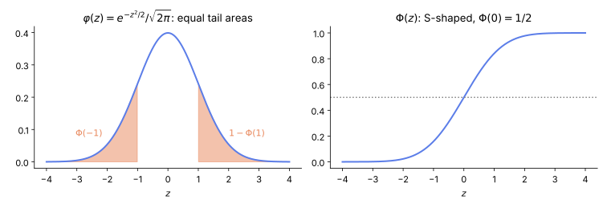
  <figcaption>Original figure for these notes; compare Blitzstein and Hwang, <em>Introduction to Probability</em>, Figure 5.9. The PDF is symmetric, so the left and right tails beyond $$\pm1$$ have equal area.</figcaption>
</figure>

#### Symmetry

Because $$\varphi(-z)=\varphi(z)$$, the area to the left of $$-z$$ equals the area to the right of $$z$$:

<div class="result-box" markdown="1">

$$
\boxed{\Phi(-z)=1-\Phi(z)\quad\text{for all }z.}
$$

</div>

So $$P(\lvert Z\rvert<z)=\Phi(z)-\Phi(-z)=2\Phi(z)-1$$. For example, $$P(\lvert Z\rvert<1)\approx0.6827$$ and $$P(\lvert Z\rvert<1.96)\approx0.95$$. *(Supplementary: the same symmetry shows that $$-Z\sim\mathcal N(0,1)$$.)*

### Part 6 — Mean and variance of the standard Normal

#### Mean

$$
E(Z)=\frac1{\sqrt{2\pi}}\int_{-\infty}^{\infty}ze^{-z^2/2}\,dz.
$$

The integrand $$g(z)=ze^{-z^2/2}$$ is odd: $$g(-z)=-g(z)$$. Its area on $$(-\infty,0)$$ is the negative of its area on $$(0,\infty)$$, and each of these areas is finite: $$\int_0^\infty ze^{-z^2/2}\,dz=1$$ by the substitution $$u=z^2/2$$. Hence

<div class="result-box" markdown="1">

$$
\boxed{E(Z)=0.}
$$

</div>

The finiteness check matters, since $$\infty-\infty$$ is undefined. The same reasoning gives $$E(Z^n)=0$$ for every odd $$n$$.

#### Variance

Since $$E(Z)=0$$, LOTUS gives

$$
\operatorname{Var}(Z)=E(Z^2)=\frac1{\sqrt{2\pi}}\int_{-\infty}^{\infty}z^2e^{-z^2/2}\,dz=\frac2{\sqrt{2\pi}}\int_0^{\infty}z^2e^{-z^2/2}\,dz,
$$

where the last step uses that $$z^2e^{-z^2/2}$$ is even.

Integrate by parts, splitting $$z^2e^{-z^2/2}=z\cdot\left(ze^{-z^2/2}\right)$$:

| Choice | Derivative or antiderivative |
|---|---|
| $$u=z$$ | $$du=dz$$ |
| $$dv=ze^{-z^2/2}\,dz$$ | $$v=-e^{-z^2/2}$$ |

Then

$$
\int_0^{\infty}z^2e^{-z^2/2}\,dz=\Big[-ze^{-z^2/2}\Big]_0^{\infty}+\int_0^{\infty}e^{-z^2/2}\,dz=0+\frac{\sqrt{2\pi}}2.
$$

The boundary term vanishes because $$e^{-z^2/2}$$ decays faster than $$z$$ grows. The remaining integral is half of $$I=\sqrt{2\pi}$$ by symmetry. Therefore

<div class="result-box" markdown="1">

$$
\boxed{\operatorname{Var}(Z)=\frac2{\sqrt{2\pi}}\cdot\frac{\sqrt{2\pi}}2=1.}
$$

</div>

The notation $$\mathcal N(0,1)$$ records exactly these two facts: mean 0 and variance 1.

<figure>
  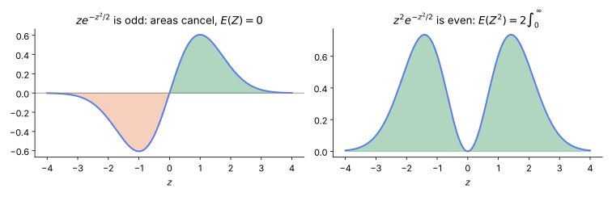
  <figcaption>Original figure for these notes. The mean integrand is odd, so its two lobes cancel. The second-moment integrand is even, so the integral over the whole line is twice the integral over $$(0,\infty)$$.</figcaption>
</figure>

<div class="misconception-block" markdown="1">

**Incorrect:** Any integral of an odd function over $$(-\infty,\infty)$$ equals 0.

**Correction:** The two half-line integrals must be finite. For example, $$\int_{-\infty}^{\infty}z\,dz$$ is undefined, not 0. For the Normal, the rapid decay of $$e^{-z^2/2}$$ makes every moment finite, so the symmetry argument is valid.

</div>

<div class="misconception-block" markdown="1">

**Incorrect:** Since $$\varphi(0)=1/\sqrt{2\pi}\approx0.399$$, the probability that $$Z=0$$ is about 0.4.

**Correction:** $$\varphi(0)$$ is a density. $$P(Z=0)=0$$, and $$P(-\varepsilon/2<Z<\varepsilon/2)\approx0.399\,\varepsilon$$ for small $$\varepsilon$$.

</div>

### Part 7 — Original practice questions

Try these before reading the answers.

1. A random variable has CDF $$F(x)=x^3$$ on $$(0,1)$$. Express a random variable with this distribution as a function of $$U\sim\operatorname{Unif}(0,1)$$, and verify its CDF.
2. Use the universality of the Uniform to simulate a random variable with CDF $$F(x)=1-1/x$$ for $$x\ge1$$.
3. Let $$X\sim\operatorname{Expo}(1)$$. What is the distribution of $$e^{-X}$$?
4. Using $$U\sim\operatorname{Unif}(0,1)$$, construct a random variable that takes values $$1,2,3$$ with probabilities $$0.2,0.5,0.3$$. *(Supplementary: discrete case.)*
5. Roll two fair dice with values $$X$$ and $$Y$$. Are $$X$$ and $$X+Y$$ independent? Justify with one calculation.
6. In matching pennies, are $$X_1$$ and $$(X_2,X_3)$$ independent? Explain.
7. Find $$c$$ such that $$ce^{-z^2/8}$$ is a PDF on the real line.
8. For $$Z\sim\mathcal N(0,1)$$, express $$P(-0.5<Z<1.5)$$ in terms of $$\Phi$$ and evaluate it numerically.
9. Use integration by parts to show $$E(Z^4)=3$$. *(Supplementary.)*

### Part 8 — Practice answers

#### 1. Inverting a cubic CDF

Solve $$u=x^3$$: $$F^{-1}(u)=u^{1/3}$$. So $$X=U^{1/3}$$. Check: for $$0<x<1$$, $$P(U^{1/3}\le x)=P(U\le x^3)=x^3$$.

#### 2. A heavy-tailed variable

Solve $$u=1-1/x$$: $$x=1/(1-u)$$. So $$X=1/(1-U)$$ has the required CDF, and so does $$1/U$$ by symmetry of the Uniform.

#### 3. Exponential back to Uniform

By part 2 of the theorem, $$F(X)=1-e^{-X}\sim\operatorname{Unif}(0,1)$$. Then $$e^{-X}=1-F(X)$$ is also $$\operatorname{Unif}(0,1)$$, because $$1-U$$ is Uniform when $$U$$ is.

#### 4. Partitioning the unit interval

Let $$X=1$$ if $$U<0.2$$, $$X=2$$ if $$0.2\le U<0.7$$, and $$X=3$$ if $$U\ge0.7$$. The three pieces have lengths $$0.2,0.5,0.3$$, which are the required probabilities.

#### 5. A die and the sum

They are dependent. $$P(X=1,X+Y=12)=0$$, since a sum of 12 requires both dice to show 6. But $$P(X=1)P(X+Y=12)=\frac16\cdot\frac1{36}>0$$.

#### 6. One variable against a pair

No. The pair $$(X_2,X_3)$$ determines $$X_1$$: $$X_1=X_2$$ if $$X_3=1$$ and $$X_1=1-X_2$$ if $$X_3=0$$. For example, $$P(X_1=0\mid X_2=1,X_3=1)=0\ne\frac12$$.

#### 7. A wider bell

Substitute $$z=2w$$, $$dz=2\,dw$$: $$\int e^{-z^2/8}\,dz=2\int e^{-w^2/2}\,dw=2\sqrt{2\pi}$$. So $$c=\frac1{2\sqrt{2\pi}}$$. This is the $$\mathcal N(0,4)$$ density.

#### 8. A standard Normal interval

$$P(-0.5<Z<1.5)=\Phi(1.5)-\Phi(-0.5)=\Phi(1.5)+\Phi(0.5)-1\approx0.9332+0.6915-1=0.6247$$.

#### 9. The fourth moment

Write $$E(Z^4)=\frac1{\sqrt{2\pi}}\int z^3\cdot ze^{-z^2/2}\,dz$$ and integrate by parts with $$u=z^3$$ and $$v=-e^{-z^2/2}$$. The boundary term vanishes, leaving

$$
E(Z^4)=\frac1{\sqrt{2\pi}}\int_{-\infty}^{\infty}3z^2e^{-z^2/2}\,dz=3E(Z^2)=3.
$$

### Part 9 — Quick revision sheet

| Concept | Essential fact |
|---|---|
| Universality, part 1 | $$U\sim\operatorname{Unif}(0,1)\implies F^{-1}(U)\sim F$$ |
| Universality, part 2 | $$X\sim F$$ continuous $$\implies F(X)\sim\operatorname{Unif}(0,1)$$ |
| Key step in proofs | Increasing functions preserve inequalities |
| $$F(X)$$ | Formula $$F(x)$$ evaluated at $$x=X$$; not $$P(X\le X)$$ |
| Exponential simulation | $$-\ln(1-U)$$ or $$-\ln U\sim\operatorname{Expo}(1)$$ |
| Uniform symmetry | $$1-U\sim\operatorname{Unif}(0,1)$$ |
| Discrete simulation | Split $$(0,1)$$ into pieces of lengths $$p_j$$ |
| Independence | Joint CDF (or PMF) factors for all values |
| Dependence | One failing pair of values suffices |
| Pairwise vs. joint | Pairwise independence does not imply independence |
| Normal importance | Central limit theorem for sums of i.i.d. variables |
| Standard Normal PDF | $$\varphi(z)=e^{-z^2/2}/\sqrt{2\pi}$$ |
| Gaussian integral | $$\int e^{-z^2/2}\,dz=\sqrt{2\pi}$$ via polar coordinates |
| Symmetry | $$\Phi(-z)=1-\Phi(z)$$ |
| Moments | $$E(Z)=0$$, $$E(Z^2)=\operatorname{Var}(Z)=1$$ |
| Reference values | $$\Phi(1)\approx0.841$$, $$\Phi(1.96)\approx0.975$$ |

### Term Glossary

<div class="glossary-entry" markdown="1">
<div class="gterm">Universality of the Uniform <span class="gcat cat-thm">Theorem</span></div>

The pair of results $$F^{-1}(U)\sim F$$ for $$U\sim\operatorname{Unif}(0,1)$$, and $$F(X)\sim\operatorname{Unif}(0,1)$$ for continuous $$X$$ with CDF $$F$$.

</div>

<div class="glossary-entry" markdown="1">
<div class="gterm">Quantile function <span class="gcat cat-defn">Definition</span></div>

The inverse CDF $$F^{-1}$$, which maps a probability level $$u$$ to the value with that fraction of the distribution below it.

</div>

<div class="glossary-entry" markdown="1">
<div class="gterm">Inverse transform sampling <span class="gcat cat-prop">Technique</span></div>

Generating draws from a distribution by applying its quantile function to Uniform draws.

</div>

<div class="glossary-entry" markdown="1">
<div class="gterm">Independence of random variables <span class="gcat cat-defn">Definition</span></div>

Factorization of the joint CDF into marginal CDFs for all arguments; for discrete variables, equivalently, factorization of the joint PMF.

</div>

<div class="glossary-entry" markdown="1">
<div class="gterm">Pairwise independence <span class="gcat cat-defn">Definition</span></div>

Independence of every pair in a collection. It is weaker than independence of the whole collection.

</div>

<div class="glossary-entry" markdown="1">
<div class="gterm">i.i.d. <span class="gcat cat-notn">Notation</span></div>

Independent and identically distributed: independent random variables sharing a single distribution.

</div>

<div class="glossary-entry" markdown="1">
<div class="gterm">Standard Normal distribution <span class="gcat cat-defn">Definition</span></div>

The distribution with PDF $$\varphi(z)=e^{-z^2/2}/\sqrt{2\pi}$$, mean 0, and variance 1, written $$\mathcal N(0,1)$$.

</div>

<div class="glossary-entry" markdown="1">
<div class="gterm">$$\varphi$$ and $$\Phi$$ <span class="gcat cat-notn">Notation</span></div>

The standard Normal PDF and CDF. $$\Phi$$ has no elementary closed form.

</div>

<div class="glossary-entry" markdown="1">
<div class="gterm">Normalizing constant <span class="gcat cat-defn">Definition</span></div>

The constant multiplying a nonnegative function so that it integrates (or sums) to 1. For the standard Normal it is $$1/\sqrt{2\pi}$$.

</div>

<div class="glossary-entry" markdown="1">
<div class="gterm">Central limit theorem <span class="gcat cat-thm">Theorem</span></div>

The result that a standardized sum of many i.i.d. random variables is approximately standard Normal. It explains the central role of the Normal distribution.

</div>

<div class="ref-tags">
  <span class="ref-tag">Statistics 110</span>
  <span class="ref-tag">Lecture 13</span>
  <span class="ref-tag">Universality of the Uniform</span>
  <span class="ref-tag">Simulation</span>
  <span class="ref-tag">Independence</span>
  <span class="ref-tag">Normal</span>
</div>

  </div>
</div>

## Lecture 14 - Location, Scale, and LOTUS

<div class="chapter-block">
  <button type="button" class="chapter-toggle" id="lecture-14-toggle" onclick="toggleLecture('lecture-14')" aria-expanded="true" aria-controls="lecture-14-body">
    <span class="chapter-toggle-left">
      <span class="chapter-badge">Lecture 14</span>
      <span>
        <span class="chapter-title">Lecture 14 - Location, Scale, and LOTUS</span>
        <span class="chapter-subtitle">General Normal distributions, standardization, the 68-95-99.7% rule, LOTUS, and Poisson and Binomial variances</span>
      </span>
    </span>
    <span class="chapter-arrow open" id="lecture-14-arrow" aria-hidden="true">▼</span>
  </button>
  <div class="chapter-body open" id="lecture-14-body" markdown="1">

<div class="note-abstract" markdown="1">

Every Normal distribution is a shifted and rescaled standard Normal: $$X=\mu+\sigma Z$$. Location-scale reasoning gives its mean, variance, CDF, and PDF directly from the standard case, and standardization turns any Normal probability into a statement about $$\Phi$$. The 68-95-99.7% rule summarizes how much probability lies within one, two, and three standard deviations of the mean. LOTUS computes $$E(g(X))$$ by keeping the probabilities of $$X$$ and changing only the values. Combined with series manipulation and indicator decompositions, it gives the variances of the Poisson and Binomial distributions.

</div>

### Notation at a Glance

<div class="notation-panel" markdown="1">

| Symbol | Meaning |
|---|---|
| $$Z\sim\mathcal N(0,1)$$ | Standard Normal random variable |
| $$\varphi$$, $$\Phi$$ | Standard Normal PDF and CDF |
| $$X\sim\mathcal N(\mu,\sigma^2)$$ | Normal with mean $$\mu$$ and variance $$\sigma^2$$ |
| $$\mu$$ | Location parameter (mean) |
| $$\sigma>0$$ | Scale parameter (standard deviation) |
| $$(X-\mu)/\sigma$$ | Standardized version of $$X$$ |
| $$\Phi^{-1}$$ | Standard Normal quantile function |
| $$g(X)$$ | A function of a random variable |
| $$I_j$$ | Indicator of success on trial $$j$$ |
| $$q=1-p$$ | Failure probability |

</div>

### Learning objectives

After studying these notes, you should be able to:

- Construct $$\mathcal N(\mu,\sigma^2)$$ from $$\mathcal N(0,1)$$ and derive its mean and variance.
- Standardize a Normal random variable and compute probabilities and quantiles with $$\Phi$$.
- Derive the general Normal CDF and PDF from $$\Phi$$ and $$\varphi$$.
- Apply the 68-95-99.7% rule.
- State and prove LOTUS for discrete random variables.
- Derive $$\operatorname{Var}(X)=\lambda$$ for $$X\sim\operatorname{Pois}(\lambda)$$ by differentiating a series.
- Derive $$\operatorname{Var}(X)=npq$$ for $$X\sim\operatorname{Bin}(n,p)$$ using indicators.

### Part 1 — Variance scales by the square

Variance measures squared distance from the mean, so a scale factor enters squared, while a shift has no effect:

<div class="result-box" markdown="1">

$$
\boxed{\operatorname{Var}(aX+b)=a^2\operatorname{Var}(X).}
$$

</div>

A frequent error follows from treating variance as linear. Adding a random variable to itself is the same as doubling it:

$$
\operatorname{Var}(X+X)=\operatorname{Var}(2X)=4\operatorname{Var}(X)\ne2\operatorname{Var}(X)\quad\text{unless }\operatorname{Var}(X)=0.
$$

The value $$2\operatorname{Var}(X)$$ is what independent copies would give: if $$X_1,X_2$$ are i.i.d. with the distribution of $$X$$, then $$\operatorname{Var}(X_1+X_2)=2\operatorname{Var}(X)$$. Two independent copies partly cancel each other's deviations; $$X$$ and itself never do.

<div class="misconception-block" markdown="1">

**Incorrect:** $$X+X$$ and $$X_1+X_2$$ have the same variance because $$X$$, $$X_1$$, and $$X_2$$ have the same distribution.

**Correction:** The variance of a sum depends on how the terms are related, not only on their individual distributions. $$X+X=2X$$ has variance $$4\operatorname{Var}(X)$$; an independent pair has variance $$2\operatorname{Var}(X)$$. Treating the two as equal is sympathetic magic.

</div>

### Part 2 — The general Normal distribution

<div class="example-block" markdown="1">
<div class="ex-title">Normal distribution <span class="ex-pill pill-defn">Definition</span></div>

Let $$Z\sim\mathcal N(0,1)$$, $$\mu\in\mathbb R$$, and $$\sigma>0$$. The random variable

$$
X=\mu+\sigma Z
$$

has the **Normal distribution** with mean $$\mu$$ and variance $$\sigma^2$$, written $$X\sim\mathcal N(\mu,\sigma^2)$$.

</div>

**Mean and variance.** Linearity and the scaling rule give

$$
E(X)=\mu+\sigma E(Z)=\mu,\qquad\operatorname{Var}(X)=\sigma^2\operatorname{Var}(Z)=\sigma^2.
$$

The scale factor is the standard deviation $$\sigma$$, not the variance $$\sigma^2$$. Multiplying $$Z$$ by $$\sigma^2$$ would give variance $$\sigma^4$$.

**Parameter convention.** The second parameter of $$\mathcal N(\mu,\sigma^2)$$ is the variance. $$\mathcal N(0,4)$$ has standard deviation 2. Software often takes the standard deviation instead, so check which one a function expects.

**Standardization.** Solving for $$Z$$ reverses the construction:

<div class="result-box" markdown="1">

$$
\boxed{X\sim\mathcal N(\mu,\sigma^2)\implies\frac{X-\mu}{\sigma}\sim\mathcal N(0,1).}
$$

</div>

The standardized value measures how many standard deviations $$X$$ lies from its mean.

<figure>
  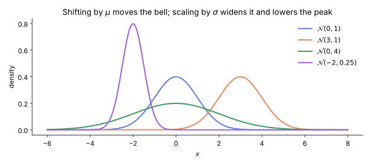
  <figcaption>Original figure for these notes, illustrating the location-scale construction in Blitzstein and Hwang, <em>Introduction to Probability</em>, Section 5.4. Changing $$\mu$$ translates the curve; changing $$\sigma$$ stretches it horizontally and compresses it vertically so the area stays 1.</figcaption>
</figure>

#### CDF and PDF

The CDF follows by standardizing inside the probability. Since $$\sigma>0$$, dividing by $$\sigma$$ preserves the inequality:

$$
F(x)=P(X\le x)=P\left(\frac{X-\mu}{\sigma}\le\frac{x-\mu}{\sigma}\right)=\Phi\left(\frac{x-\mu}{\sigma}\right).
$$

Differentiate with the chain rule. The inner function $$(x-\mu)/\sigma$$ has derivative $$1/\sigma$$:

<div class="result-box" markdown="1">

$$
\boxed{f(x)=\frac1\sigma\varphi\left(\frac{x-\mu}{\sigma}\right)=\frac1{\sigma\sqrt{2\pi}}\exp\left(-\frac{(x-\mu)^2}{2\sigma^2}\right).}
$$

</div>

The factor $$1/\sigma$$ is essential. Stretching the curve horizontally by $$\sigma$$ multiplies its area by $$\sigma$$, so its height must be divided by $$\sigma$$ to keep total area 1.

<div class="misconception-block" markdown="1">

**Incorrect:** The PDF of $$\mu+\sigma Z$$ is $$\mu+\sigma\varphi(z)$$, obtained by shifting and scaling the density.

**Correction:** Location-scale operations act on the random variable, not on its PDF. Applying them to $$\varphi$$ gives a function whose area is not 1. The correct density substitutes the standardized argument and divides by $$\sigma$$: $$\frac1\sigma\varphi\left(\frac{x-\mu}\sigma\right)$$.

</div>

#### Negation and sums

- **Negation.** $$-X=-\mu+\sigma(-Z)$$. Since $$-Z\sim\mathcal N(0,1)$$ by symmetry, $$-X\sim\mathcal N(-\mu,\sigma^2)$$. More generally, $$a+bX\sim\mathcal N(a+b\mu,b^2\sigma^2)$$ for any $$b\ne0$$.
- **Sums of independent Normals (stated now, proved later).** If $$X_1\sim\mathcal N(\mu_1,\sigma_1^2)$$ and $$X_2\sim\mathcal N(\mu_2,\sigma_2^2)$$ are independent, then $$X_1+X_2\sim\mathcal N(\mu_1+\mu_2,\sigma_1^2+\sigma_2^2)$$. The means and variances add for any independent variables; the surprising part is that the sum is still Normal. For the difference, $$X_1-X_2\sim\mathcal N(\mu_1-\mu_2,\sigma_1^2+\sigma_2^2)$$: variances add even when the variables are subtracted.

### Part 3 — Computing Normal probabilities

<div class="example-block" markdown="1">
<div class="ex-title">Heights in a population <span class="ex-pill pill-ex">Worked example</span></div>

Model adult heights as $$X\sim\mathcal N(170,64)$$ in centimeters, so $$\mu=170$$ and $$\sigma=8$$.

**(a) Probability above 186 cm.** Standardize: $$(186-170)/8=2$$. Then

$$
P(X>186)=P(Z>2)=1-\Phi(2)\approx1-0.9772=0.0228.
$$

**(b) Probability between 162 and 186 cm.** The standardized endpoints are $$-1$$ and $$2$$:

$$
P(162<X<186)=\Phi(2)-\Phi(-1)=\Phi(2)-(1-\Phi(1))\approx0.9772-0.1587=0.8186.
$$

**(c) The 90th percentile.** Find $$x$$ with $$P(X\le x)=0.9$$. Since $$\Phi\left(\frac{x-170}8\right)=0.9$$,

$$
x=170+8\,\Phi^{-1}(0.9)\approx170+8(1.2816)\approx180.3\text{ cm}.
$$

<div class="ex-lesson"><strong>Core idea:</strong> Convert every Normal question to the standard scale. Probabilities need $$\Phi$$ of standardized endpoints; quantiles reverse the steps through $$x=\mu+\sigma\,\Phi^{-1}(u)$$.</div>
</div>

#### The 68-95-99.7% rule

For $$X\sim\mathcal N(\mu,\sigma^2)$$, standardization gives $$P(\lvert X-\mu\rvert<k\sigma)=P(\lvert Z\rvert<k)=2\Phi(k)-1$$. The values for $$k=1,2,3$$ are worth memorizing:

<div class="result-box" markdown="1">

$$
\begin{aligned}
P(\lvert X-\mu\rvert<\sigma)&\approx0.68,\\
P(\lvert X-\mu\rvert<2\sigma)&\approx0.95,\\
P(\lvert X-\mu\rvert<3\sigma)&\approx0.997.
\end{aligned}
$$

</div>

More precisely, the three values are $$0.6827$$, $$0.9545$$, and $$0.9973$$. The exact 95% multiplier is $$1.96$$, since $$\Phi(1.96)\approx0.975$$, which is why $$\pm1.96$$ standard deviations appears in 95% confidence intervals.

<figure>
  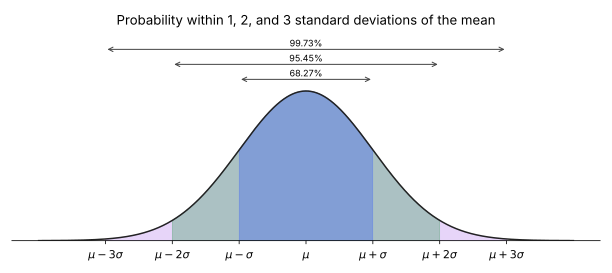
  <figcaption>Original figure for these notes, illustrating Blitzstein and Hwang, <em>Introduction to Probability</em>, Theorem 5.4.5. Nested bands within one, two, and three standard deviations of the mean.</figcaption>
</figure>

The rule gives quick estimates. In the height example, $$162<X<186$$ is $$\mu-\sigma$$ to $$\mu+2\sigma$$. Half the 68% band plus half the 95% band gives $$0.34+0.475=0.815$$, close to the exact $$0.8186$$.

### Part 4 — LOTUS

The distribution of $$g(X)$$ uses the same probabilities as $$X$$, attached to transformed values. If $$X$$ takes values $$0,1,2,3,\ldots$$, then $$X^2$$ takes $$0,1,4,9,\ldots$$ with the same probabilities, so

$$
E(X)=\sum_xxP(X=x),\qquad E(X^2)=\sum_xx^2P(X=x).
$$

This works without change when $$g$$ is one-to-one on the support. When several values of $$x$$ share one value of $$g(x)$$, their probabilities must be combined to get the PMF of $$g(X)$$. LOTUS states that the expectation comes out right either way.

<div class="example-block" markdown="1">
<div class="ex-title">LOTUS for discrete random variables <span class="ex-pill pill-thm">Theorem</span></div>

If $$X$$ is discrete and $$g:\mathbb R\to\mathbb R$$, then

$$
E(g(X))=\sum_xg(x)P(X=x),
$$

where the sum is over the support of $$X$$.

</div>

**Proof.** Work with the sample space $$S$$, finite or countable, each outcome $$s$$ a “pebble” with mass $$P(\{s\})$$. The random variable $$g(X)$$ assigns the value $$g(X(s))$$ to pebble $$s$$, so

$$
E(g(X))=\sum_{s\in S}g(X(s))P(\{s\}).
$$

Group the pebbles by their value of $$X$$. All pebbles with $$X(s)=x$$ form a “super-pebble” of total mass $$P(X=x)$$, and every one of them has the same $$g$$-value $$g(x)$$:

$$
\sum_{s\in S}g(X(s))P(\{s\})=\sum_x\sum_{s:\,X(s)=x}g(x)P(\{s\})=\sum_xg(x)\sum_{s:\,X(s)=x}P(\{s\})=\sum_xg(x)P(X=x).
$$

$$\blacksquare$$

The proof only reorders a sum. Any grouping of the pebbles gives the same total, so grouping by $$x$$ (LOTUS) and grouping by $$g(x)$$ (the definition of $$E(g(X))$$) must agree.

<div class="example-block" markdown="1">
<div class="ex-title">Two routes to $$E(X^2)$$ <span class="ex-pill pill-ex">Worked example</span></div>

Let $$X$$ be uniform on $$\{-2,-1,0,1,2\}$$.

**By LOTUS.** Keep each probability $$1/5$$ and square each value:

$$
E(X^2)=\frac{4+1+0+1+4}{5}=2.
$$

**By the distribution of $$X^2$$.** The values $$\pm1$$ both map to 1, and $$\pm2$$ both map to 4, so $$X^2$$ has PMF $$P(X^2=0)=1/5$$, $$P(X^2=1)=2/5$$, $$P(X^2=4)=2/5$$:

$$
E(X^2)=0\cdot\frac15+1\cdot\frac25+4\cdot\frac25=2.
$$

Both routes give 2. Since $$E(X)=0$$, this is also $$\operatorname{Var}(X)$$.

<div class="ex-lesson">LOTUS skips the step of finding the PMF of $$g(X)$$. That step is easy here but can be hard when $$g$$ merges many values.</div>
</div>

<figure>
  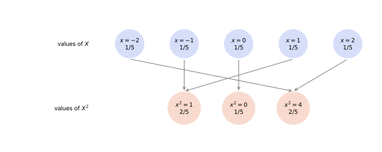
  <figcaption>Original figure for these notes, illustrating the grouping argument behind LOTUS (Blitzstein and Hwang, <em>Introduction to Probability</em>, Theorem 4.5.1). Values of $$X$$ that share a value of $$X^2$$ pool their probabilities.</figcaption>
</figure>

### Part 5 — Variance of the Poisson by differentiating a series

Let $$X\sim\operatorname{Pois}(\lambda)$$. Its mean is $$\lambda$$ (Lecture 11). For the variance, LOTUS gives

$$
E(X^2)=\sum_{k=0}^{\infty}k^2\frac{e^{-\lambda}\lambda^k}{k!}=e^{-\lambda}\sum_{k=0}^{\infty}k^2\frac{\lambda^k}{k!}.
$$

The sum $$\sum k^2\lambda^k/k!$$ can be produced from the exponential series. Each application of the operation “differentiate with respect to $$\lambda$$, then multiply by $$\lambda$$” brings down one factor of $$k$$, because $$\lambda\frac{d}{d\lambda}\lambda^k=k\lambda^k$$.

**Step 1.** Start from $$\sum_{k=0}^\infty\lambda^k/k!=e^\lambda$$.

**Step 2.** Differentiate and multiply by $$\lambda$$:

$$
\sum_{k=0}^{\infty}k\frac{\lambda^k}{k!}=\lambda e^{\lambda}.
$$

**Step 3.** Repeat on both sides:

$$
\sum_{k=0}^{\infty}k^2\frac{\lambda^k}{k!}=\lambda\frac{d}{d\lambda}\left(\lambda e^\lambda\right)=\lambda\left(e^\lambda+\lambda e^\lambda\right)=\lambda e^\lambda(1+\lambda).
$$

Term-by-term differentiation is valid because power series can be differentiated inside their interval of convergence, which here is the whole real line.

**Step 4.** Multiply by $$e^{-\lambda}$$ and subtract the squared mean:

$$
E(X^2)=\lambda(1+\lambda)=\lambda^2+\lambda,\qquad
\operatorname{Var}(X)=\lambda^2+\lambda-\lambda^2=\lambda.
$$

<div class="result-box" markdown="1">

$$
\boxed{X\sim\operatorname{Pois}(\lambda)\implies E(X)=\operatorname{Var}(X)=\lambda.}
$$

</div>

Equal mean and variance is a characteristic feature of the Poisson. Lecture 11 reached the same result through $$E(X(X-1))$$; the derivative method is a general tool for sums of the form $$\sum k^mc_k\lambda^k$$.

### Part 6 — Variance of the Binomial with indicators

Let $$X\sim\operatorname{Bin}(n,p)$$ and write $$X=I_1+\cdots+I_n$$, where $$I_j$$ indicates success on trial $$j$$. The $$I_j$$ are i.i.d. $$\operatorname{Bern}(p)$$, and $$E(X)=np$$ by linearity.

#### Route 1: Expand $$X^2$$

Squaring the sum produces $$n$$ squared terms and $$\binom n2$$ distinct cross terms, each appearing twice:

$$
X^2=\sum_{j=1}^nI_j^2+2\sum_{i<j}I_iI_j.
$$

Two facts make each expectation easy:

- An indicator satisfies $$I_j^2=I_j$$, since $$0^2=0$$ and $$1^2=1$$. So $$E(I_j^2)=p$$.
- $$I_iI_j$$ is the indicator that trials $$i$$ and $$j$$ both succeed. By independence, $$E(I_iI_j)=p^2$$ for $$i\ne j$$.

By linearity,

$$
E(X^2)=np+2\binom n2p^2=np+n(n-1)p^2.
$$

Then

$$
\operatorname{Var}(X)=np+n(n-1)p^2-n^2p^2=np-np^2=np(1-p).
$$

#### Route 2: Add variances of independent indicators

Each indicator has $$\operatorname{Var}(I_j)=E(I_j^2)-(EI_j)^2=p-p^2=pq$$. For independent random variables variances add (proved later), so $$\operatorname{Var}(X)=npq$$ immediately.

<div class="result-box" markdown="1">

$$
\boxed{X\sim\operatorname{Bin}(n,p)\implies\operatorname{Var}(X)=npq=np(1-p).}
$$

</div>

The variance is largest at $$p=1/2$$ and vanishes when $$p=0$$ or $$p=1$$, when the outcome is certain. For $$\operatorname{Bin}(10,0.3)$$, $$\operatorname{Var}(X)=10(0.3)(0.7)=2.1$$.

**Comparison with the Poisson.** With $$np=\lambda$$, the Binomial variance is $$\lambda(1-p)$$, which tends to $$\lambda$$ as $$p\to0$$. This matches the Poisson limit of the Binomial from Lecture 11.

<div class="misconception-block" markdown="1">

**Incorrect:** $$E(I_iI_j)=E(I_i)$$ because indicators satisfy $$I^2=I$$.

**Correction:** $$I^2=I$$ holds for one indicator multiplied by itself. For $$i\ne j$$, $$I_iI_j$$ indicates that two different events both occur, with expectation $$P(A_i\cap A_j)$$, which equals $$p^2$$ only under independence.

</div>

#### Supplementary: Why the Hypergeometric differs

For draws without replacement, the indicators are dependent, so $$E(I_iI_j)\ne p^2$$ and the cross terms change. The same expansion still works with the correct joint probability; the Hypergeometric variance is derived later in the course.

### Part 7 — Original practice questions

Try these before reading the answers.

1. Let $$X\sim\mathcal N(-2,9)$$. Find $$P(X>1)$$ and $$P(\lvert X+2\rvert<6)$$.
2. If $$X\sim\mathcal N(\mu,\sigma^2)$$, what is the distribution of $$3-2X$$?
3. Let $$X\sim\mathcal N(50,25)$$. Find the value $$x$$ exceeded with probability $$0.025$$.
4. Independent $$X\sim\mathcal N(1,4)$$ and $$Y\sim\mathcal N(2,5)$$. Find $$P(X+Y>6)$$ using the stated sum result.
5. Explain why $$\operatorname{Var}(X-Y)=\operatorname{Var}(X)+\operatorname{Var}(Y)$$ for independent $$X,Y$$, rather than a difference.
6. Let $$X\sim\operatorname{Pois}(\lambda)$$. Use LOTUS to find $$E\left(\frac1{X+1}\right)$$.
7. Let $$X\sim\operatorname{Pois}(\lambda)$$. Find $$E(X(X-1))$$ without the derivative method.
8. Find $$\operatorname{Var}(X)$$ for $$X\sim\operatorname{Bin}(20,0.25)$$ and the value of $$p$$ that maximizes the variance of $$\operatorname{Bin}(20,p)$$.
9. Let $$X$$ have PMF $$P(X=k)=q^{k-1}p$$ for $$k=1,2,\ldots$$ (trials up to and including the first success). Find $$E(X)$$ and $$\operatorname{Var}(X)$$ by differentiating a geometric series.

### Part 8 — Practice answers

#### 1. Standardizing

Here $$\sigma=3$$. $$P(X>1)=P\left(Z>\frac{1-(-2)}3\right)=1-\Phi(1)\approx0.1587$$. The second event is $$\lvert X-\mu\rvert<2\sigma$$, so its probability is $$2\Phi(2)-1\approx0.9545$$.

#### 2. A linear transformation

$$3-2X\sim\mathcal N(3-2\mu,4\sigma^2)$$. The mean transforms linearly; the variance picks up $$(-2)^2=4$$.

#### 3. An upper quantile

$$P(X>x)=0.025$$ means $$\Phi\left(\frac{x-50}5\right)=0.975$$, so $$x\approx50+5(1.96)=59.8$$.

#### 4. A Normal sum

$$X+Y\sim\mathcal N(3,9)$$, standard deviation 3. $$P(X+Y>6)=1-\Phi(1)\approx0.1587$$.

#### 5. Variances add for differences

$$X-Y=X+(-1)Y$$ and $$\operatorname{Var}(-Y)=(-1)^2\operatorname{Var}(Y)=\operatorname{Var}(Y)$$. Uncertainty from both sources accumulates whether they are added or subtracted.

#### 6. LOTUS with a reciprocal

$$
E\left(\frac1{X+1}\right)=\sum_{k=0}^\infty\frac1{k+1}\frac{e^{-\lambda}\lambda^k}{k!}=\frac{e^{-\lambda}}{\lambda}\sum_{k=0}^\infty\frac{\lambda^{k+1}}{(k+1)!}=\frac{e^{-\lambda}}{\lambda}\left(e^\lambda-1\right)=\frac{1-e^{-\lambda}}{\lambda}.
$$

Note that this is not $$1/(\lambda+1)$$: for $$\lambda=3$$ it is $$0.317$$, not $$0.25$$.

#### 7. A factorial moment

The terms with $$k=0,1$$ vanish, and $$k(k-1)/k!=1/(k-2)!$$:

$$
E(X(X-1))=e^{-\lambda}\sum_{k=2}^\infty\frac{\lambda^k}{(k-2)!}=\lambda^2e^{-\lambda}\sum_{j=0}^\infty\frac{\lambda^j}{j!}=\lambda^2.
$$

Then $$E(X^2)=\lambda^2+\lambda$$, consistent with Part 5.

#### 8. Binomial variance

$$20(0.25)(0.75)=3.75$$. The function $$p(1-p)$$ is maximized at $$p=1/2$$, giving variance $$5$$.

#### 9. Trials up to the first success

Differentiate $$\sum_{k=0}^\infty q^k=\frac1{1-q}$$: $$\sum_{k=1}^\infty kq^{k-1}=\frac1{(1-q)^2}=\frac1{p^2}$$. So $$E(X)=p\cdot\frac1{p^2}=\frac1p$$.

Multiply by $$q$$ and differentiate again: $$\sum_{k=1}^\infty k^2q^{k-1}=\frac{1+q}{(1-q)^3}$$. So $$E(X^2)=\frac{p(1+q)}{p^3}=\frac{1+q}{p^2}$$ and

$$
\operatorname{Var}(X)=\frac{1+q}{p^2}-\frac1{p^2}=\frac{q}{p^2}.
$$

The failures-before-success version $$X-1$$ has the same variance, since shifting does not change spread.

### Part 9 — Quick revision sheet

| Concept | Essential fact |
|---|---|
| Scaling variance | $$\operatorname{Var}(aX+b)=a^2\operatorname{Var}(X)$$ |
| $$X+X$$ vs. independent copies | $$4\operatorname{Var}(X)$$ vs. $$2\operatorname{Var}(X)$$ |
| General Normal | $$X=\mu+\sigma Z\sim\mathcal N(\mu,\sigma^2)$$ |
| Second parameter | Variance $$\sigma^2$$; scale factor is $$\sigma$$ |
| Standardization | $$(X-\mu)/\sigma\sim\mathcal N(0,1)$$ |
| Normal CDF | $$\Phi\left((x-\mu)/\sigma\right)$$ |
| Normal PDF | $$\frac1\sigma\varphi\left((x-\mu)/\sigma\right)$$ |
| Quantile | $$\mu+\sigma\,\Phi^{-1}(u)$$ |
| Negation | $$-X\sim\mathcal N(-\mu,\sigma^2)$$ |
| Independent sum | $$\mathcal N(\mu_1+\mu_2,\sigma_1^2+\sigma_2^2)$$ |
| 68-95-99.7% | Within $$1,2,3$$ SDs of the mean |
| 95% multiplier | $$1.96$$ |
| LOTUS | $$E(g(X))=\sum_xg(x)P(X=x)$$ |
| LOTUS proof | Regroup a sum over outcomes |
| Series trick | $$\lambda\frac{d}{d\lambda}$$ brings down a factor $$k$$ |
| Poisson | Mean and variance $$\lambda$$ |
| Indicator facts | $$I^2=I$$; $$E(I_iI_j)=P(A_i\cap A_j)$$ |
| Binomial | Variance $$npq$$ |
| First Success | Mean $$1/p$$, variance $$q/p^2$$ |

### Term Glossary

<div class="glossary-entry" markdown="1">
<div class="gterm">Location-scale transformation <span class="gcat cat-prop">Technique</span></div>

A map $$X\mapsto\mu+\sigma X$$ with $$\sigma>0$$. It shifts the center by $$\mu$$ and stretches the spread by $$\sigma$$, and it keeps a random variable within the Normal family (and within the Uniform family).

</div>

<div class="glossary-entry" markdown="1">
<div class="gterm">Normal distribution $$\mathcal N(\mu,\sigma^2)$$ <span class="gcat cat-defn">Definition</span></div>

The distribution of $$\mu+\sigma Z$$ for $$Z\sim\mathcal N(0,1)$$, with mean $$\mu$$, variance $$\sigma^2$$, and PDF $$\frac1{\sigma\sqrt{2\pi}}e^{-(x-\mu)^2/(2\sigma^2)}$$.

</div>

<div class="glossary-entry" markdown="1">
<div class="gterm">Standardization <span class="gcat cat-prop">Technique</span></div>

Subtracting the mean and dividing by the standard deviation, $$(X-\mu)/\sigma$$. For a Normal random variable the result is standard Normal.

</div>

<div class="glossary-entry" markdown="1">
<div class="gterm">68-95-99.7% rule <span class="gcat cat-thm">Rule</span></div>

For a Normal random variable, the approximate probabilities of lying within one, two, and three standard deviations of the mean.

</div>

<div class="glossary-entry" markdown="1">
<div class="gterm">LOTUS <span class="gcat cat-thm">Theorem</span></div>

$$E(g(X))=\sum_xg(x)P(X=x)$$ for discrete $$X$$ (with an integral against the PDF for continuous $$X$$). It follows by regrouping the sum over outcomes.

</div>

<div class="glossary-entry" markdown="1">
<div class="gterm">Super-pebble <span class="gcat cat-notn">Notation</span></div>

The set of outcomes on which $$X$$ takes a given value $$x$$, with total mass $$P(X=x)$$. Grouping pebbles into super-pebbles proves LOTUS.

</div>

<div class="glossary-entry" markdown="1">
<div class="gterm">Factorial moment <span class="gcat cat-meas">Measure</span></div>

An expectation such as $$E(X(X-1))$$. For count variables it is often easier to compute than $$E(X^2)$$ and leads to the variance.

</div>

<div class="ref-tags">
  <span class="ref-tag">Statistics 110</span>
  <span class="ref-tag">Lecture 14</span>
  <span class="ref-tag">Normal</span>
  <span class="ref-tag">Location-scale</span>
  <span class="ref-tag">LOTUS</span>
  <span class="ref-tag">Variance</span>
  <span class="ref-tag">Binomial</span>
  <span class="ref-tag">Poisson</span>
</div>

  </div>
</div>

## Lecture 16 - The Exponential Distribution

<div class="chapter-block">
  <button type="button" class="chapter-toggle" id="lecture-16-toggle" onclick="toggleLecture('lecture-16')" aria-expanded="true" aria-controls="lecture-16-body">
    <span class="chapter-toggle-left">
      <span class="chapter-badge">Lecture 16</span>
      <span>
        <span class="chapter-title">Lecture 16 - The Exponential Distribution</span>
        <span class="chapter-subtitle">PDF and CDF, scaling to Expo(1), mean and variance, the memoryless property, and conditional expectation</span>
      </span>
    </span>
    <span class="chapter-arrow open" id="lecture-16-arrow" aria-hidden="true">▼</span>
  </button>
  <div class="chapter-body open" id="lecture-16-body" markdown="1">

<div class="note-abstract" markdown="1">

The Exponential distribution models a continuous waiting time when events occur at a constant rate $$\lambda$$. Its survival function $$e^{-\lambda x}$$ gives the CDF and PDF at once. Every Exponential is a rescaled $$\operatorname{Expo}(1)$$, so its mean $$1/\lambda$$ and variance $$1/\lambda^2$$ follow from two integrals for the standard case. Its defining feature is the memoryless property: having waited any length of time without the event does not change the distribution of the remaining wait. Memorylessness gives conditional expectations such as $$E(X\mid X>a)=a+1/\lambda$$ immediately, and among continuous distributions on $$(0,\infty)$$ only the Exponential has it.

</div>

### Notation at a Glance

<div class="notation-panel" markdown="1">

| Symbol | Meaning |
|---|---|
| $$X\sim\operatorname{Expo}(\lambda)$$ | $$X$$ is Exponential with rate $$\lambda>0$$ |
| $$\lambda$$ | Rate: expected number of events per unit time |
| $$1/\lambda$$ | Mean waiting time |
| $$f(x)=\lambda e^{-\lambda x}$$ | PDF for $$x>0$$ |
| $$F(x)=1-e^{-\lambda x}$$ | CDF for $$x>0$$ |
| $$G(x)=P(X>x)$$ | Survival function, $$1-F(x)$$ |
| $$s$$ | Time already waited |
| $$t$$ | Additional waiting time |
| $$E(X\mid A)$$ | Conditional expectation of $$X$$ given event $$A$$ |
| $$\operatorname{Geom}(p)$$ | Discrete analogue: failures before the first success |

</div>

### Learning objectives

After studying these notes, you should be able to:

- State the Exponential PDF, CDF, and survival function and interpret the rate $$\lambda$$.
- Show that $$\lambda X\sim\operatorname{Expo}(1)$$ when $$X\sim\operatorname{Expo}(\lambda)$$.
- Derive the mean and variance of $$\operatorname{Expo}(\lambda)$$ from the $$\operatorname{Expo}(1)$$ case.
- State and verify the memoryless property, and explain what it does and does not claim.
- Compute $$E(X\mid X>a)$$ using memorylessness and linearity.
- Explain why the Exponential is the only memoryless continuous distribution on $$(0,\infty)$$.
- Relate the Exponential to the Geometric distribution.

### Part 1 — Definition, PDF, and CDF

<div class="example-block" markdown="1">
<div class="ex-title">Exponential distribution <span class="ex-pill pill-defn">Definition</span></div>

A continuous random variable $$X$$ has the **Exponential distribution** with rate $$\lambda>0$$, written $$X\sim\operatorname{Expo}(\lambda)$$, if its PDF is

$$
f(x)=\lambda e^{-\lambda x},\qquad x>0,
$$

and $$f(x)=0$$ for $$x\le0$$.

</div>

**Validity.** The PDF is positive on $$(0,\infty)$$, and with $$u=\lambda x$$,

$$
\int_0^\infty\lambda e^{-\lambda x}\,dx=\int_0^\infty e^{-u}\,du=1.
$$

**CDF and survival function.** Integrating from 0 to $$x$$:

<div class="result-box" markdown="1">

$$
\boxed{F(x)=1-e^{-\lambda x},\qquad G(x)=P(X>x)=e^{-\lambda x},\qquad x>0.}
$$

</div>

The survival function is the most convenient form. It decays geometrically in continuous time: each additional unit of time multiplies the survival probability by the same factor $$e^{-\lambda}$$.

**Interpretation.** $$X$$ is the waiting time for an event that happens at constant rate $$\lambda$$. If the number of events in $$[0,t]$$ is $$\operatorname{Pois}(\lambda t)$$, then the first event time $$T$$ satisfies $$\{T>t\}=\{\text{no events in }[0,t]\}$$, so $$P(T>t)=e^{-\lambda t}$$. Typical uses are times between arrivals in a queue, times between calls, decay times of radioactive atoms, and lifetimes of components that do not wear out.

<figure>
  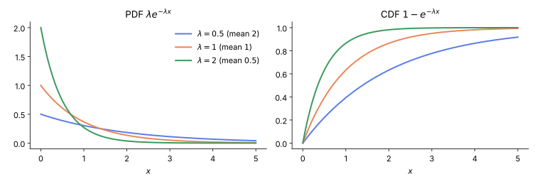
  <figcaption>Original figure for these notes; compare Blitzstein and Hwang, <em>Introduction to Probability</em>, Figure 5.10. A larger rate concentrates the waiting time near 0.</figcaption>
</figure>

<div class="misconception-block" markdown="1">

**Incorrect:** In $$\operatorname{Expo}(\lambda)$$, the parameter $$\lambda$$ is the mean waiting time.

**Correction:** $$\lambda$$ is a rate, in events per unit time; the mean waiting time is $$1/\lambda$$. A rate of 4 calls per hour gives a mean wait of 15 minutes. Some software parametrizes the Exponential by the mean (a “scale”), so check the convention.

</div>

### Part 2 — Scaling to the standard Exponential

Let $$X\sim\operatorname{Expo}(\lambda)$$ and $$Y=\lambda X$$. For $$y>0$$,

$$
P(Y>y)=P\left(X>\frac y\lambda\right)=e^{-\lambda\cdot y/\lambda}=e^{-y}.
$$

<div class="result-box" markdown="1">

$$
\boxed{X\sim\operatorname{Expo}(\lambda)\iff Y=\lambda X\sim\operatorname{Expo}(1).}
$$

</div>

Measuring time in units of the mean waiting time removes the parameter. Conversely, if $$Y\sim\operatorname{Expo}(1)$$, then $$Y/\lambda\sim\operatorname{Expo}(\lambda)$$. This is a scale transformation; shifting is not allowed, because it would move the support away from $$(0,\infty)$$.

### Part 3 — Mean and variance

#### Standard case

Let $$Y\sim\operatorname{Expo}(1)$$. Integrate by parts with $$u=y$$ and $$dv=e^{-y}\,dy$$, so $$v=-e^{-y}$$:

$$
E(Y)=\int_0^\infty ye^{-y}\,dy=\Big[-ye^{-y}\Big]_0^\infty+\int_0^\infty e^{-y}\,dy=0+1=1.
$$

By LOTUS and integration by parts with $$u=y^2$$:

$$
E(Y^2)=\int_0^\infty y^2e^{-y}\,dy=\Big[-y^2e^{-y}\Big]_0^\infty+2\int_0^\infty ye^{-y}\,dy=2E(Y)=2.
$$

So $$\operatorname{Var}(Y)=2-1^2=1$$. The boundary terms vanish because $$e^{-y}$$ decays faster than any power of $$y$$ grows.

#### General case

Write $$X=Y/\lambda$$ and use $$E(cY)=cE(Y)$$ and $$\operatorname{Var}(cY)=c^2\operatorname{Var}(Y)$$:

<div class="result-box" markdown="1">

$$
\boxed{E(X)=\frac1\lambda,\qquad\operatorname{Var}(X)=\frac1{\lambda^2},\qquad\operatorname{SD}(X)=\frac1\lambda.}
$$

</div>

The mean and standard deviation are equal. A faster rate gives a shorter and less variable wait.

<div class="example-block" markdown="1">
<div class="ex-title">Lifetime of a component <span class="ex-pill pill-ex">Worked example</span></div>

A sensor has lifetime $$T\sim\operatorname{Expo}(\lambda)$$ with mean 1000 hours, so $$\lambda=0.001$$ per hour.

**(a) Survival past 1500 hours.**

$$
P(T>1500)=e^{-0.001(1500)}=e^{-1.5}\approx0.223.
$$

**(b) Median lifetime.** Solve $$e^{-\lambda m}=\tfrac12$$:

$$
m=\frac{\ln2}{\lambda}\approx693\text{ hours}.
$$

The median is below the mean because the distribution is right-skewed: a few very long lifetimes pull the mean up.

**(c) Probability of failing before the mean.** $$P(T<1000)=1-e^{-1}\approx0.632$$, not $$0.5$$.

<div class="ex-lesson"><strong>Core idea:</strong> With the survival function $$e^{-\lambda t}$$, tail probabilities and quantiles are one-line calculations. For any Exponential, about 63% of waits are shorter than the mean.</div>
</div>

### Part 4 — The memoryless property

<div class="example-block" markdown="1">
<div class="ex-title">Memoryless property <span class="ex-pill pill-defn">Definition</span></div>

A distribution on $$(0,\infty)$$ is **memoryless** if a random variable $$X$$ with that distribution satisfies

$$
P(X\ge s+t\mid X\ge s)=P(X\ge t)\quad\text{for all }s,t>0.
$$

</div>

Here $$s$$ is the time already waited and $$t$$ is an additional wait. The condition says that, given no event by time $$s$$, the remaining waiting time $$X-s$$ has the same distribution as a fresh wait $$X$$.

**The Exponential is memoryless.** Since $$\{X\ge s+t\}\subseteq\{X\ge s\}$$, the intersection in the conditional probability is just $$\{X\ge s+t\}$$:

$$
P(X\ge s+t\mid X\ge s)=\frac{P(X\ge s+t)}{P(X\ge s)}=\frac{e^{-\lambda(s+t)}}{e^{-\lambda s}}=e^{-\lambda t}=P(X\ge t).
$$

The key step is $$e^{-\lambda(s+t)}=e^{-\lambda s}e^{-\lambda t}$$: the survival function turns sums of times into products of probabilities.

<figure>
  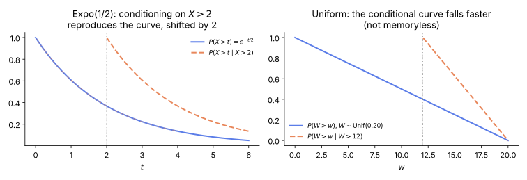
  <figcaption>Original figure for these notes, illustrating Blitzstein and Hwang, <em>Introduction to Probability</em>, Definition 5.5.2. Left: given $$X>2$$, the Exponential's remaining life has the original survival curve. Right: a Uniform waiting time becomes more urgent the longer it lasts.</figcaption>
</figure>

<div class="example-block" markdown="1">
<div class="ex-title">Memoryless versus Uniform waiting <span class="ex-pill pill-ex">Worked example</span></div>

**Exponential wait.** A server's next request arrives after $$X\sim\operatorname{Expo}(1/2)$$ seconds, mean 2 seconds. Given no request in the first 5 seconds, the probability that the next 2 seconds are also quiet is

$$
P(X\ge7\mid X\ge5)=e^{-(1/2)(2)}=e^{-1}\approx0.368,
$$

the same as for a fresh 2-second window. The 5 seconds already waited are irrelevant.

**Uniform wait.** A shuttle arrives at a time $$W\sim\operatorname{Unif}(0,20)$$ minutes. Unconditionally, $$P(W>4)=16/20=0.8$$. Given that 12 minutes have passed, only 8 minutes remain possible, so

$$
P(W>16\mid W>12)=\frac{P(W>16)}{P(W>12)}=\frac{4/20}{8/20}=0.5.
$$

Waiting makes the shuttle more likely to arrive soon. The Uniform is not memoryless.

<div class="ex-lesson">Memorylessness is a strong modeling assumption: the process has no notion of being “due.” It fits events with no build-up or wear, and fails for anything with a schedule or with ageing.</div>
</div>

**When the assumption fits.** Radioactive decay is well modeled as memoryless: an atom that has not decayed is physically identical to a fresh one. Machine and human lifetimes are not, because ageing makes failure more likely as time passes. The Exponential is still important for such problems, as a building block for more flexible lifetime models and because of its exact links to the Poisson.

<div class="misconception-block" markdown="1">

**Incorrect:** Memoryless means the total waiting time does not depend on how long one has already waited, so $$P(X\ge s+t\mid X\ge s)=P(X\ge s+t)$$.

**Correction:** Memorylessness concerns the remaining wait. Given $$X\ge s$$, the remaining time $$X-s$$ is distributed like a fresh $$X$$. The total time $$X$$ is still at least $$s$$, so conditioning does change the distribution of $$X$$ itself.

</div>

### Part 5 — Conditional expectation from memorylessness

Let $$X\sim\operatorname{Expo}(\lambda)$$ and $$a>0$$. Find $$E(X\mid X>a)$$.

Write $$X=a+(X-a)$$. Given $$X>a$$, memorylessness says $$X-a\sim\operatorname{Expo}(\lambda)$$. Conditional expectation is linear, like ordinary expectation, so

<div class="result-box" markdown="1">

$$
\boxed{E(X\mid X>a)=a+E(X-a\mid X>a)=a+\frac1\lambda.}
$$

</div>

The time already spent is added to a fresh expected wait. For the sensor with mean life 1000 hours that has already run 500 hours, the expected total life is 1500 hours and the expected remaining life is still 1000 hours.

Conditional expectation $$E(X\mid A)$$ is computed like $$E(X)$$, with the conditional distribution of $$X$$ given $$A$$ in place of the unconditional one. It is treated systematically later in the course.

<div class="example-block" markdown="1">
<div class="ex-title">Supplementary: Checking the formula directly <span class="ex-pill pill-num">Worked example</span></div>

Given $$X>a$$, the conditional PDF is the original PDF restricted to $$(a,\infty)$$ and rescaled by $$P(X>a)$$:

$$
f(x\mid X>a)=\frac{\lambda e^{-\lambda x}}{e^{-\lambda a}}=\lambda e^{-\lambda(x-a)},\qquad x>a.
$$

This is an $$\operatorname{Expo}(\lambda)$$ PDF shifted to start at $$a$$. Substituting $$y=x-a$$,

$$
E(X\mid X>a)=\int_a^\infty x\lambda e^{-\lambda(x-a)}\,dx=\int_0^\infty(y+a)\lambda e^{-\lambda y}\,dy=\frac1\lambda+a.
$$

</div>

### Part 6 — The Exponential is the only memoryless continuous distribution

<div class="example-block" markdown="1">
<div class="ex-title">Characterization of the Exponential <span class="ex-pill pill-thm">Theorem</span></div>

If $$X$$ is a positive continuous random variable with the memoryless property, then $$X\sim\operatorname{Expo}(\lambda)$$ for some $$\lambda>0$$.

</div>

**Supplementary proof by differentiation.** The main proof, which needs only continuity, is in Lecture 17. A shorter argument, assuming differentiability, runs as follows. Let $$G(x)=P(X>x)$$. For a continuous $$X$$, $$P(X\ge x)=P(X>x)$$, so memorylessness reads

$$
G(s+t)=G(s)G(t)\quad\text{for all }s,t>0.
$$

Since $$X$$ is continuous, $$G$$ is differentiable except possibly at finitely many points; assume differentiability for the argument. Differentiate with respect to $$s$$, then let $$s\to0$$:

$$
G'(t)=G'(0)G(t).
$$

Set $$c=G'(0)$$, a constant. The equation $$G'=cG$$ with $$G(0)=P(X>0)=1$$ has the unique solution $$G(t)=e^{ct}$$. Because $$G$$ decreases toward 0, $$c<0$$. Writing $$\lambda=-c>0$$ gives $$G(t)=e^{-\lambda t}$$, the Exponential survival function. $$\blacksquare$$

### Part 7 — Supplementary: The Geometric connection

The Exponential is the continuous counterpart of the Geometric distribution.

| Feature | $$\operatorname{Geom}(p)$$ | $$\operatorname{Expo}(\lambda)$$ |
|---|---|---|
| Waiting for | First success in discrete trials | First event in continuous time |
| Support | $$\{0,1,2,\ldots\}$$ | $$(0,\infty)$$ |
| Survival | $$P(X\ge k)=q^k$$ | $$P(X>x)=e^{-\lambda x}$$ |
| Mean | $$q/p$$ | $$1/\lambda$$ |
| Memoryless | Yes, among distributions on $$\{0,1,\ldots\}$$ | Yes, among continuous distributions on $$(0,\infty)$$ |

**Discrete memorylessness.** For $$X\sim\operatorname{Geom}(p)$$, $$P(X\ge m+n\mid X\ge m)=q^{m+n}/q^m=q^n=P(X\ge n)$$. A run of failures does not make a success more likely: independent trials have no memory.

**Supplementary: a limit.** Perform trials every $$1/n$$ time units with success probability $$\lambda/n$$. The number of failures before the first success is $$\operatorname{Geom}(\lambda/n)$$, and the waiting time in time units is that count divided by $$n$$. Its survival probability at time $$x$$ is approximately $$(1-\lambda/n)^{nx}\to e^{-\lambda x}$$, the same compound-interest limit as in the Poisson limit of the Binomial.

### Part 8 — Original practice questions

Try these before reading the answers.

1. Let $$X\sim\operatorname{Expo}(4)$$. Find $$P(X>0.5)$$, the median, $$E(X)$$, and $$\operatorname{SD}(X)$$.
2. If $$Y\sim\operatorname{Expo}(1)$$, what is the distribution of $$3Y$$?
3. Use LOTUS to find $$E(e^{X/2})$$ for $$X\sim\operatorname{Expo}(1)$$. What happens to $$E(e^{X})$$?
4. Calls arrive at a help desk with Exponential waiting times, 6 per hour on average. Given no call in the past 20 minutes, find the probability of no call in the next 10 minutes and the expected time until the next call.
5. Is $$U\sim\operatorname{Unif}(0,1)$$ memoryless? Check with $$s=0.5$$ and $$t=0.25$$.
6. Let $$X\sim\operatorname{Expo}(1)$$. Find $$E(X\mid X>2)$$, then use $$E(X)=P(X<2)E(X\mid X<2)+P(X>2)E(X\mid X>2)$$ to find $$E(X\mid X<2)$$. *(Supplementary: uses the law of total expectation.)*
7. Carbon-14 has a half-life of about 5730 years. Treating the decay time of one atom as Exponential, find $$\lambda$$ and the mean lifetime.
8. Show that $$P(X>2/\lambda)$$ is the same for every $$\lambda$$ when $$X\sim\operatorname{Expo}(\lambda)$$, and find it.
9. A light bulb is advertised with “average life 1000 hours, Exponential.” A bulb has lasted 3000 hours. Why does memorylessness suggest that the Exponential model is unrealistic here?

### Part 9 — Practice answers

#### 1. A fast rate

$$P(X>0.5)=e^{-2}\approx0.135$$. Median $$\ln2/4\approx0.173$$. $$E(X)=\operatorname{SD}(X)=0.25$$.

#### 2. Rescaling

$$P(3Y>x)=P(Y>x/3)=e^{-x/3}$$, so $$3Y\sim\operatorname{Expo}(1/3)$$, with mean 3.

#### 3. Exponential moments

$$E(e^{X/2})=\int_0^\infty e^{x/2}e^{-x}\,dx=\int_0^\infty e^{-x/2}\,dx=2$$. For $$E(e^X)$$ the integrand is $$e^{x}e^{-x}=1$$, and $$\int_0^\infty1\,dx=\infty$$: the expectation is infinite.

#### 4. Help desk

Rate $$\lambda=6$$ per hour, so 10 minutes is $$1/6$$ hour. By memorylessness the past 20 minutes are irrelevant: $$P=e^{-6/6}=e^{-1}\approx0.368$$. Expected time to the next call is $$1/6$$ hour, 10 minutes.

#### 5. The Uniform is not memoryless

$$P(U\ge0.75\mid U\ge0.5)=\frac{0.25}{0.5}=0.5$$, while $$P(U\ge0.25)=0.75$$. They differ.

#### 6. Truncated means

$$E(X\mid X>2)=3$$. With $$P(X>2)=e^{-2}$$ and $$E(X)=1$$:

$$
E(X\mid X<2)=\frac{1-3e^{-2}}{1-e^{-2}}\approx0.687.
$$

It lies between 0 and 2 and below 1, as it must.

#### 7. Half-life

$$e^{-5730\lambda}=\tfrac12$$ gives $$\lambda=\ln2/5730\approx1.21\times10^{-4}$$ per year. Mean lifetime $$1/\lambda=5730/\ln2\approx8267$$ years, longer than the half-life.

#### 8. A rate-free probability

$$P(X>2/\lambda)=e^{-\lambda\cdot2/\lambda}=e^{-2}\approx0.135$$. Any statement in units of the mean is the same for all Exponentials, by the scaling result.

#### 9. Ageing

Memorylessness would give the 3000-hour bulb another 1000 expected hours, exactly as for a new bulb. Real filaments degrade, so an old bulb is more likely to fail soon. A lifetime model with an increasing failure rate is more realistic.

### Part 10 — Quick revision sheet

| Concept | Essential fact |
|---|---|
| PDF | $$\lambda e^{-\lambda x}$$, $$x>0$$ |
| CDF | $$1-e^{-\lambda x}$$ |
| Survival | $$P(X>x)=e^{-\lambda x}$$ |
| Rate vs. mean | Rate $$\lambda$$, mean $$1/\lambda$$ |
| Scaling | $$\lambda X\sim\operatorname{Expo}(1)$$ |
| $$\operatorname{Expo}(1)$$ moments | $$E(Y)=1$$, $$E(Y^2)=2$$, $$\operatorname{Var}(Y)=1$$ |
| General moments | Mean $$1/\lambda$$, variance $$1/\lambda^2$$ |
| Median | $$\ln2/\lambda$$ |
| Memoryless | $$P(X\ge s+t\mid X\ge s)=P(X\ge t)$$ |
| Remaining wait | Given $$X>s$$, $$X-s\sim\operatorname{Expo}(\lambda)$$ |
| Conditional mean | $$E(X\mid X>a)=a+1/\lambda$$ |
| Characterization | Only memoryless continuous distribution on $$(0,\infty)$$ |
| Functional equation | $$G(s+t)=G(s)G(t)$$ |
| Discrete analogue | Geometric, also memoryless |

### Term Glossary

<div class="glossary-entry" markdown="1">
<div class="gterm">Exponential distribution <span class="gcat cat-defn">Definition</span></div>

The continuous distribution on $$(0,\infty)$$ with PDF $$\lambda e^{-\lambda x}$$, modeling the waiting time for an event occurring at constant rate $$\lambda$$.

</div>

<div class="glossary-entry" markdown="1">
<div class="gterm">Rate parameter <span class="gcat cat-notn">Notation</span></div>

The parameter $$\lambda$$ of the Exponential, measured in events per unit time. It is the reciprocal of the mean waiting time.

</div>

<div class="glossary-entry" markdown="1">
<div class="gterm">Survival function <span class="gcat cat-defn">Definition</span></div>

$$G(x)=P(X>x)=1-F(x)$$. For the Exponential it is $$e^{-\lambda x}$$.

</div>

<div class="glossary-entry" markdown="1">
<div class="gterm">Memoryless property <span class="gcat cat-prop">Property</span></div>

$$P(X\ge s+t\mid X\ge s)=P(X\ge t)$$ for all $$s,t>0$$: the remaining wait does not depend on the time already waited.

</div>

<div class="glossary-entry" markdown="1">
<div class="gterm">Conditional expectation given an event <span class="gcat cat-defn">Definition</span></div>

$$E(X\mid A)$$, the mean of $$X$$ computed with its conditional distribution given $$A$$.

</div>

<div class="glossary-entry" markdown="1">
<div class="gterm">Half-life <span class="gcat cat-meas">Measure</span></div>

The median of an Exponential lifetime, $$\ln2/\lambda$$: the time by which half of a large population of independent items has decayed or failed.

</div>

<div class="ref-tags">
  <span class="ref-tag">Statistics 110</span>
  <span class="ref-tag">Lecture 16</span>
  <span class="ref-tag">Exponential</span>
  <span class="ref-tag">Memoryless property</span>
  <span class="ref-tag">Survival function</span>
  <span class="ref-tag">Geometric</span>
</div>

  </div>
</div>

## Lecture 17 - Moment Generating Functions

<div class="chapter-block">
  <button type="button" class="chapter-toggle" id="lecture-17-toggle" onclick="toggleLecture('lecture-17')" aria-expanded="true" aria-controls="lecture-17-body">
    <span class="chapter-toggle-left">
      <span class="chapter-badge">Lecture 17</span>
      <span>
        <span class="chapter-title">Lecture 17 - Moment Generating Functions</span>
        <span class="chapter-subtitle">Conditional life expectancy, the MGF and its three key properties, Bernoulli, Binomial, and Normal MGFs, and Laplace's rule of succession</span>
      </span>
    </span>
    <span class="chapter-arrow open" id="lecture-17-arrow" aria-hidden="true">▼</span>
  </button>
  <div class="chapter-body open" id="lecture-17-body" markdown="1">

<div class="note-abstract" markdown="1">

Memorylessness is rarely true of lifetimes, but it clarifies what a life expectancy is: a conditional expectation given survival to a certain age, not one fixed number. The moment generating function $$M(t)=E(e^{tX})$$ packages every moment of a distribution into one function. Its derivatives at $$t=0$$ are the moments, it determines the distribution uniquely, and it turns sums of independent random variables into products. These properties give the Binomial MGF from the Bernoulli MGF in one line and the Normal MGF by completing the square. Laplace's rule of succession treats an unknown success probability as a Uniform random variable and updates it with data: after $$n$$ successes in $$n$$ trials, the probability of another success is $$(n+1)/(n+2)$$.

</div>

### Notation at a Glance

<div class="notation-panel" markdown="1">

| Symbol | Meaning |
|---|---|
| $$M_X(t)=E(e^{tX})$$ | Moment generating function of $$X$$ |
| $$t$$ | Dummy variable of the MGF; no physical meaning |
| $$(-a,a)$$ | Open interval around 0 on which the MGF must be finite |
| $$E(X^n)$$ | $$n$$th moment of $$X$$ |
| $$M^{(n)}(0)$$ | $$n$$th derivative of $$M$$ evaluated at $$t=0$$ |
| $$E(T\mid T>a)$$ | Expected lifetime given survival to age $$a$$ |
| $$p\sim\operatorname{Unif}(0,1)$$ | Prior distribution for an unknown success probability |
| $$S_n=X_1+\cdots+X_n$$ | Number of successes in the first $$n$$ trials |
| $$f(p\mid S_n=k)$$ | Posterior density of $$p$$ given the data |

</div>

### Learning objectives

After studying these notes, you should be able to:

- Interpret life expectancy as a conditional expectation and explain why it rises with age.
- Define the MGF, state when it exists, and check $$M(0)=1$$.
- Derive $$E(X^n)=M^{(n)}(0)$$ from the Taylor expansion of $$M$$.
- State the uniqueness and sum properties of MGFs and use them to identify distributions.
- Compute the Bernoulli, Binomial, and Normal MGFs.
- Find the MGF of $$a+bX$$ from the MGF of $$X$$.
- Derive Laplace's rule of succession using a Uniform prior and Bayes' rule with a density.

### Part 1 — Memorylessness and life expectancy

Lecture 16 showed that the Exponential is the only memoryless continuous distribution on $$(0,\infty)$$. For a memoryless lifetime $$T\sim\operatorname{Expo}(\lambda)$$, the expected remaining life at every age is $$1/\lambda$$, so

$$
E(T\mid T>a)=a+\frac1\lambda.
$$

#### Proof that only the Exponential is memoryless

Let $$X$$ be a positive continuous random variable with survival function $$G(x)=P(X\ge x)$$. Memorylessness says $$P(X\ge s+t)=P(X\ge s)P(X\ge t)$$, that is,

$$
G(s+t)=G(s)G(t)\quad\text{for all }s,t>0.
$$

The strategy is to solve this equation for the unknown function $$G$$.

1. **Integer multiples.** Taking $$s=t$$ gives $$G(2t)=G(t)^2$$. Repeating, $$G(kt)=G(t)^k$$ for every positive integer $$k$$.
2. **Integer fractions.** Apply step 1 to $$t/n$$ with $$k=n$$: $$G(t)=G(t/n)^n$$, so $$G(t/n)=G(t)^{1/n}$$.
3. **Rationals.** Combining, $$G\left(\tfrac mnt\right)=G(t)^{m/n}$$, so $$G(xt)=G(t)^x$$ for every positive rational $$x$$.
4. **All reals.** Rationals are dense and $$G$$ is continuous (because $$X$$ is continuous), so $$G(xt)=G(t)^x$$ for all real $$x>0$$.
5. **Identify the form.** Set $$t=1$$: $$G(x)=G(1)^x=e^{x\ln G(1)}$$. Since $$0<G(1)<1$$, $$\lambda=-\ln G(1)>0$$ and $$G(x)=e^{-\lambda x}$$.

This is the $$\operatorname{Expo}(\lambda)$$ survival function. $$\blacksquare$$

This argument needs only the continuity of $$G$$, not differentiability; a shorter supplementary proof that assumes differentiability is included in Lecture 16. (Step 5 also uses $$0<G(1)<1$$: $$G(1)=0$$ or $$G(1)=1$$ would put all probability at 0 or at infinity, impossible for a positive continuous random variable.)

#### Lifetimes are not memoryless

Human lifetimes are not memoryless: an 80-year-old does not have the remaining life expectancy of a newborn. But the same conditional quantity is what answers practical questions about life expectancy.

**Life expectancy is conditional.** A single number such as “life expectancy at birth is 80 years” is $$E(T)$$, averaged over all lifetimes, including those that end early. Someone who has reached age $$a$$ has survived the early risks, so their expected lifetime is $$E(T\mid T>a)$$, which is at least $$a$$ and typically larger than $$E(T)$$.

<div class="example-block" markdown="1">
<div class="ex-title">Conditional life expectancy in a simple model <span class="ex-pill pill-ex">Worked example</span></div>

Take a deliberately simple lifetime model $$T\sim\operatorname{Unif}(0,100)$$ years.

- **At birth:** $$E(T)=50$$.
- **Given survival to 60:** the conditional distribution is $$\operatorname{Unif}(60,100)$$, so $$E(T\mid T>60)=80$$. Expected remaining life is 20 years.
- **Given survival to 90:** $$E(T\mid T>90)=95$$. Expected remaining life is 5 years.

Conditional expected total life increases with age, while expected remaining life decreases. Under an Exponential model the expected remaining life would instead stay constant.

<div class="ex-lesson"><strong>Core idea:</strong> Conditioning on survival removes the outcomes that ended earlier. A life expectancy is only meaningful once it says what it is conditioned on.</div>
</div>

**Censored data.** Estimating lifetimes from data has an extra difficulty: some subjects are still alive when a study ends, so only a lower bound $$T>c$$ is observed. Such observations are called censored. Ignoring them, or treating $$c$$ as the lifetime, biases estimates downward. Survival analysis develops methods for this; the conditional reasoning above is its starting point.

<div class="misconception-block" markdown="1">

**Incorrect:** If life expectancy at birth is 80, a 79-year-old should expect to live about one more year.

**Correction:** That uses the unconditional mean for someone already known to have survived to 79. The relevant quantity is $$E(T\mid T>79)$$, which exceeds 80 by more than one year in realistic models.

</div>

### Part 2 — The moment generating function

<div class="example-block" markdown="1">
<div class="ex-title">Moment generating function <span class="ex-pill pill-defn">Definition</span></div>

The **moment generating function (MGF)** of a random variable $$X$$ is

$$
M_X(t)=E\left(e^{tX}\right),
$$

as a function of $$t$$, provided it is finite for all $$t$$ in some open interval $$(-a,a)$$ with $$a>0$$. Otherwise $$X$$ has no MGF.

</div>

**What $$t$$ is.** $$t$$ has no probabilistic meaning. It is a bookkeeping variable that lets calculus act on the whole sequence of moments at once.

**Why the name.** Expand $$e^{tX}$$ as a power series and take expectations term by term (justified when the MGF exists on an interval around 0):

$$
M(t)=E\left(\sum_{n=0}^\infty\frac{X^nt^n}{n!}\right)=\sum_{n=0}^\infty E(X^n)\frac{t^n}{n!}.
$$

The MGF is a power series whose coefficients are the moments, each divided by $$n!$$.

**A built-in check.** $$M(0)=E(e^0)=1$$ for every MGF.

**The MGF is another description of the distribution.** Alongside the CDF and the PMF or PDF, it is a third way to encode a distribution. It is computed with LOTUS: $$M(t)=\sum_xe^{tx}P(X=x)$$ or $$\int e^{tx}f(x)\,dx$$.

### Part 3 — Three reasons the MGF is useful

#### 1. Moments are derivatives at zero

<div class="result-box" markdown="1">

$$
\boxed{E(X^n)=M^{(n)}(0).}
$$

</div>

**Proof.** A power series equals its own Taylor series, so the coefficient of $$t^n/n!$$ in $$M(t)$$ is $$M^{(n)}(0)$$. From the expansion in Part 2 the same coefficient is $$E(X^n)$$. Matching coefficients gives the result. $$\blacksquare$$

Directly: $$M'(t)=E(Xe^{tX})$$, so $$M'(0)=E(X)$$; $$M''(t)=E(X^2e^{tX})$$, so $$M''(0)=E(X^2)$$. Differentiation replaces an integral or sum for each moment.

#### 2. The MGF determines the distribution

If $$X$$ and $$Y$$ have MGFs that agree on some open interval around 0, then $$X$$ and $$Y$$ have the same distribution. The proof is a difficult result in analysis and is not given here. Its use is identification: compute an MGF, recognize its form, and conclude the distribution.

#### 3. Sums of independent random variables

If $$X$$ and $$Y$$ are independent, then

<div class="result-box" markdown="1">

$$
\boxed{M_{X+Y}(t)=E\left(e^{tX}e^{tY}\right)=E\left(e^{tX}\right)E\left(e^{tY}\right)=M_X(t)M_Y(t).}
$$

</div>

The middle step uses that $$e^{tX}$$ and $$e^{tY}$$ are independent (functions of independent variables) and that the expectation of a product of independent random variables is the product of their expectations, proved later in the course. Finding the PMF or PDF of a sum directly requires a convolution sum or integral; with MGFs it is a multiplication.

<div class="misconception-block" markdown="1">

**Incorrect:** $$M_{X+Y}=M_X\,M_Y$$ for any $$X$$ and $$Y$$.

**Correction:** Independence is required. For example, with $$Y=X$$, $$M_{2X}(t)=M_X(2t)$$, which generally differs from $$M_X(t)^2$$.

</div>

#### Supplementary: Location and scale

For constants $$a,b$$,

$$
M_{a+bX}(t)=E\left(e^{t(a+bX)}\right)=e^{at}E\left(e^{(bt)X}\right)=e^{at}M_X(bt).
$$

A shift multiplies the MGF by $$e^{at}$$; a scale rescales its argument.

### Part 4 — Bernoulli and Binomial MGFs

<div class="example-block" markdown="1">
<div class="ex-title">Bernoulli and Binomial MGFs <span class="ex-pill pill-ex">Worked example</span></div>

**Bernoulli.** If $$X\sim\operatorname{Bern}(p)$$, then $$e^{tX}$$ equals $$e^t$$ with probability $$p$$ and $$e^0=1$$ with probability $$q$$:

$$
M_X(t)=pe^t+q,\qquad t\in\mathbb R.
$$

Check: $$M(0)=p+q=1$$, and $$M'(0)=p=E(X)$$.

**Binomial.** $$X\sim\operatorname{Bin}(n,p)$$ is a sum of $$n$$ i.i.d. $$\operatorname{Bern}(p)$$ variables. By the sum property,

$$
M_X(t)=\left(pe^t+q\right)^n.
$$

**Moments.** Differentiate once:

$$
M'(t)=n\left(pe^t+q\right)^{n-1}pe^t\implies M'(0)=np.
$$

Differentiate again with the product rule:

$$
M''(t)=n(n-1)\left(pe^t+q\right)^{n-2}p^2e^{2t}+n\left(pe^t+q\right)^{n-1}pe^t\implies M''(0)=n(n-1)p^2+np.
$$

So $$\operatorname{Var}(X)=n(n-1)p^2+np-n^2p^2=np(1-p)$$, matching Lecture 14.

**A sum of Binomials.** If $$X\sim\operatorname{Bin}(n,p)$$ and $$Y\sim\operatorname{Bin}(m,p)$$ are independent, then $$M_{X+Y}(t)=(pe^t+q)^{n+m}$$, the $$\operatorname{Bin}(n+m,p)$$ MGF. By uniqueness, $$X+Y\sim\operatorname{Bin}(n+m,p)$$.

<div class="ex-lesson"><strong>Core idea:</strong> Build complex MGFs from simple ones through the sum property, then read moments off derivatives and distributions off recognizable forms.</div>
</div>

<figure>
  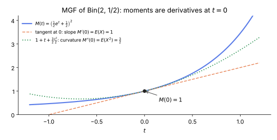
  <figcaption>Original figure for these notes; compare Blitzstein and Hwang, <em>Introduction to Probability</em>, Figure 6.7. For $$\operatorname{Bin}(2,1/2)$$, the slope at 0 is $$E(X)=1$$ and the second derivative at 0 is $$E(X^2)=3/2$$, so $$\operatorname{Var}(X)=1/2$$.</figcaption>
</figure>

### Part 5 — The Normal MGF

Let $$Z\sim\mathcal N(0,1)$$. By LOTUS,

$$
M_Z(t)=\frac1{\sqrt{2\pi}}\int_{-\infty}^\infty e^{tz}e^{-z^2/2}\,dz=\frac1{\sqrt{2\pi}}\int_{-\infty}^\infty e^{-(z^2-2tz)/2}\,dz.
$$

**Complete the square** in the exponent: $$z^2-2tz=(z-t)^2-t^2$$. Then

$$
M_Z(t)=e^{t^2/2}\int_{-\infty}^\infty\frac1{\sqrt{2\pi}}e^{-(z-t)^2/2}\,dz=e^{t^2/2}.
$$

The remaining integrand is the $$\mathcal N(t,1)$$ PDF, which integrates to 1.

<div class="result-box" markdown="1">

$$
\boxed{M_Z(t)=e^{t^2/2},\qquad X=\mu+\sigma Z\sim\mathcal N(\mu,\sigma^2)\implies M_X(t)=e^{\mu t+\sigma^2t^2/2}.}
$$

</div>

The general case follows from the location-scale rule: $$M_X(t)=e^{\mu t}M_Z(\sigma t)$$.

**Checks.** $$M_X'(t)=(\mu+\sigma^2t)M_X(t)$$ gives $$M_X'(0)=\mu$$. $$M_X''(t)=\left(\sigma^2+(\mu+\sigma^2t)^2\right)M_X(t)$$ gives $$M_X''(0)=\sigma^2+\mu^2$$, so the variance is $$\sigma^2$$.

**Sums of independent Normals.** If $$X_j\sim\mathcal N(\mu_j,\sigma_j^2)$$ are independent, then

$$
M_{X_1+X_2}(t)=e^{(\mu_1+\mu_2)t+(\sigma_1^2+\sigma_2^2)t^2/2},
$$

the $$\mathcal N(\mu_1+\mu_2,\sigma_1^2+\sigma_2^2)$$ MGF. This proves the result stated in Lecture 14.

#### Supplementary: All standard Normal moments at once

Expand $$e^{t^2/2}=\sum_{k=0}^\infty\frac{t^{2k}}{2^kk!}$$ and match with $$\sum_nE(Z^n)\frac{t^n}{n!}$$. Odd moments are 0, and

$$
E(Z^{2k})=\frac{(2k)!}{2^kk!}=1\cdot3\cdot5\cdots(2k-1).
$$

So $$E(Z^2)=1$$, $$E(Z^4)=3$$, $$E(Z^6)=15$$, with no further integration.

#### Supplementary: Exponential and Poisson MGFs

- **Exponential.** For $$X\sim\operatorname{Expo}(\lambda)$$ and $$t<\lambda$$, $$M(t)=\int_0^\infty e^{tx}\lambda e^{-\lambda x}\,dx=\frac{\lambda}{\lambda-t}$$. It is infinite for $$t\ge\lambda$$, but finite on an interval around 0, so the MGF exists. Expanding $$\frac1{1-t/\lambda}=\sum_n(t/\lambda)^n$$ gives $$E(X^n)=n!/\lambda^n$$.
- **Poisson.** For $$X\sim\operatorname{Pois}(\lambda)$$, $$M(t)=\sum_ke^{tk}\frac{e^{-\lambda}\lambda^k}{k!}=e^{-\lambda}e^{\lambda e^t}=e^{\lambda(e^t-1)}$$. Multiplying two such MGFs shows that independent $$\operatorname{Pois}(\lambda_1)$$ and $$\operatorname{Pois}(\lambda_2)$$ variables sum to $$\operatorname{Pois}(\lambda_1+\lambda_2)$$.

### Part 6 — Laplace's rule of succession

An experiment has been repeated $$n$$ times with $$n$$ successes. What is the probability that the next trial is also a success? Laplace's example was the sun rising: given that the sun has risen on each of $$n$$ recorded days, how probable is a sunrise tomorrow?

**Model.** The success probability $$p$$ is unknown, so treat it as a random variable.

1. **Prior.** $$p\sim\operatorname{Unif}(0,1)$$, expressing no initial preference among values of $$p$$.
2. **Likelihood.** Given $$p$$, the trials $$X_1,X_2,\ldots$$ are i.i.d. $$\operatorname{Bern}(p)$$. So $$S_n\mid p\sim\operatorname{Bin}(n,p)$$.

The trials are **conditionally independent given $$p$$** but not unconditionally independent: each success raises the plausibility of large $$p$$ and hence of further successes.

**Posterior.** Bayes' rule with a density for $$p$$ replaces the prior probability with the prior PDF. With $$k$$ successes in $$n$$ trials, the likelihood is $$\binom nkp^k(1-p)^{n-k}$$, so in general

$$
f(p\mid S_n=k)\propto p^k(1-p)^{n-k},\qquad0<p<1,
$$

where $$\propto$$ means “proportional to, as a function of $$p$$”: constants not involving $$p$$ are absorbed into the normalizing constant. For the sunrise case $$k=n$$:

$$
f(p\mid S_n=n)=\frac{P(S_n=n\mid p)\,f(p)}{P(S_n=n)}=\frac{p^n\cdot1}{P(S_n=n)},\qquad0<p<1.
$$

The denominator does not depend on $$p$$; it is the normalizing constant. By the law of total probability with a density,

$$
P(S_n=n)=\int_0^1p^n\,dp=\frac1{n+1}.
$$

So the posterior density is

$$
f(p\mid S_n=n)=(n+1)p^n,\qquad0<p<1.
$$

**Prediction.** Condition on $$p$$ and average over its posterior:

$$
P(X_{n+1}=1\mid S_n=n)=\int_0^1p\cdot(n+1)p^n\,dp=\frac{n+1}{n+2}.
$$

<div class="result-box" markdown="1">

$$
\boxed{P(\text{success on trial }n+1\mid n\text{ successes in }n\text{ trials})=\frac{n+1}{n+2}.}
$$

</div>

The prediction is the mean of the posterior distribution of $$p$$. This is the fundamental bridge in conditional form: given $$p$$, the probability of success is $$p$$, so averaging over what is now believed about $$p$$ gives $$P(X_{n+1}=1\mid S_n=n)=E(p\mid S_n=n)$$.

<figure>
  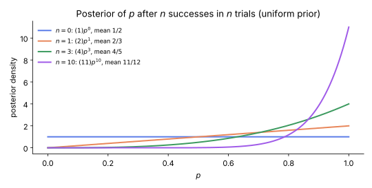
  <figcaption>Original figure for these notes, illustrating Laplace's law of succession as posed in an end-of-chapter exercise of Blitzstein and Hwang, <em>Introduction to Probability</em> (p. 420). Each success shifts the posterior toward $$p=1$$, and the predictive probability equals the posterior mean $$(n+1)/(n+2)$$.</figcaption>
</figure>

<div class="example-block" markdown="1">
<div class="ex-title">Reading the formula <span class="ex-pill pill-num">Worked example</span></div>

| Observed | Prediction for next trial |
|---|---|
| No data ($$n=0$$) | $$1/2$$, the prior mean |
| 1 success in 1 trial | $$2/3$$ |
| 10 successes in 10 trials | $$11/12\approx0.917$$ |
| 1000 successes in 1000 trials | $$1001/1002\approx0.999$$ |

The prediction approaches 1 but never reaches it. Compare the naive estimate $$n/n=1$$, which would rule out failure entirely after any streak of successes.

<div class="ex-lesson"><strong>Core idea:</strong> Treating an unknown parameter as random and updating it with Bayes' rule produces predictions that learn from data without becoming overconfident.</div>
</div>

**Limits of the model.** The rule assumes exchangeable trials with an unchanging $$p$$ and a Uniform prior. For sunrises, physics supplies far stronger information than a Uniform prior, and days are not repeated independent trials. The rule is a model of reasoning from repetition alone.

#### Supplementary: The general predictive rule

With $$k$$ successes in $$n$$ trials, the posterior is proportional to $$p^k(1-p)^{n-k}$$. Using the integral $$\int_0^1p^a(1-p)^b\,dp=\frac{a!\,b!}{(a+b+1)!}$$ (derived later in the course), the predictive probability of success is

$$
P(X_{n+1}=1\mid S_n=k)=\frac{k+1}{n+2}.
$$

It behaves like adding one imaginary success and one imaginary failure to the data.

<div class="misconception-block" markdown="1">

**Incorrect:** If $$X_1,X_2,\ldots$$ are i.i.d. given $$p$$, they are independent, so past successes cannot change the probability of the next success.

**Correction:** Conditional independence given $$p$$ is not independence. When $$p$$ is unknown, observing successes changes the distribution of $$p$$, which changes the predictive probability of the next trial.

</div>

### Part 7 — Original practice questions

Try these before reading the answers.

1. $$X$$ is uniform on $$\{1,2,3\}$$. Find $$M_X(t)$$ and use it to find $$E(X)$$ and $$E(X^2)$$.
2. A random variable has MGF $$M(t)=(0.3e^t+0.7)^8$$. Identify its distribution and its variance.
3. $$X$$ has MGF $$e^{2t+8t^2}$$. Identify the distribution and find $$P(X>10)$$ in terms of $$\Phi$$.
4. Let $$Z\sim\mathcal N(0,1)$$ and $$Y=3-2Z$$. Find $$M_Y(t)$$ and identify the distribution of $$Y$$.
5. Use MGFs to show that if $$X\sim\operatorname{Bern}(p)$$, then $$1-X\sim\operatorname{Bern}(q)$$.
6. Why does a random variable with $$P(X>x)=1/x^2$$ for $$x\ge1$$ have no MGF?
7. For a lifetime $$T\sim\operatorname{Unif}(0,90)$$, find $$E(T\mid T>30)$$ and the expected remaining life at age 30.
8. Using Laplace's rule, find the probability of success on the next trial after 20 successes in 20 trials, and after 0 successes in $$n$$ trials.
9. Using the general rule (supplementary), find the predictive probability after 7 successes in 10 trials, and compare with $$7/10$$.

### Part 8 — Practice answers

#### 1. A discrete uniform MGF

$$M(t)=\frac{e^t+e^{2t}+e^{3t}}3$$. Then $$M'(0)=\frac{1+2+3}3=2$$ and $$M''(0)=\frac{1+4+9}3=\frac{14}3$$, so $$\operatorname{Var}(X)=\frac{14}3-4=\frac23$$.

#### 2. Recognizing a Binomial

The form $$(pe^t+q)^n$$ with $$p=0.3$$, $$n=8$$ is the $$\operatorname{Bin}(8,0.3)$$ MGF. By uniqueness, $$X\sim\operatorname{Bin}(8,0.3)$$, with variance $$8(0.3)(0.7)=1.68$$.

#### 3. Recognizing a Normal

Match $$e^{\mu t+\sigma^2t^2/2}$$: $$\mu=2$$ and $$\sigma^2/2=8$$, so $$\sigma^2=16$$. $$X\sim\mathcal N(2,16)$$ and $$P(X>10)=1-\Phi(2)\approx0.0228$$.

#### 4. A linear transformation

$$M_Y(t)=e^{3t}M_Z(-2t)=e^{3t+2t^2}$$, the $$\mathcal N(3,4)$$ MGF.

#### 5. Swapping outcomes

$$M_{1-X}(t)=e^tM_X(-t)=e^t\left(pe^{-t}+q\right)=p+qe^t$$, the $$\operatorname{Bern}(q)$$ MGF.

#### 6. A heavy tail

$$E(X)$$ is finite, but for any $$t>0$$, $$e^{tx}f(x)=2e^{tx}x^{-3}\to\infty$$, so $$E(e^{tX})=\infty$$. The MGF is not finite on any interval around 0.

#### 7. Conditional life expectancy

Given $$T>30$$, $$T\sim\operatorname{Unif}(30,90)$$, so $$E(T\mid T>30)=60$$. Expected remaining life is 30 years, compared with $$E(T)=45$$ at birth.

#### 8. Streaks

After 20 successes: $$21/22\approx0.955$$. After 0 successes in $$n$$ trials, the posterior is $$(n+1)(1-p)^n$$ and the predictive probability is $$\int_0^1p(n+1)(1-p)^n\,dp=\frac1{n+2}$$.

#### 9. Mixed data

$$\frac{7+1}{10+2}=\frac23\approx0.667$$, pulled slightly from $$0.7$$ toward the prior mean $$1/2$$.

### Part 9 — Quick revision sheet

| Concept | Essential fact |
|---|---|
| Life expectancy | $$E(T\mid T>a)$$ depends on current age $$a$$ |
| Memoryless lifetime | $$E(T\mid T>a)=a+1/\lambda$$ |
| MGF | $$M(t)=E(e^{tX})$$, finite near 0 |
| Check | $$M(0)=1$$ |
| Series form | $$M(t)=\sum_nE(X^n)t^n/n!$$ |
| Moments | $$E(X^n)=M^{(n)}(0)$$ |
| Uniqueness | Same MGF near 0 $$\implies$$ same distribution |
| Independent sums | $$M_{X+Y}=M_XM_Y$$ |
| Location-scale | $$M_{a+bX}(t)=e^{at}M_X(bt)$$ |
| Bernoulli | $$pe^t+q$$ |
| Binomial | $$(pe^t+q)^n$$ |
| Standard Normal | $$e^{t^2/2}$$ |
| Normal | $$e^{\mu t+\sigma^2t^2/2}$$ |
| Exponential (supplementary) | $$\lambda/(\lambda-t)$$, $$t<\lambda$$ |
| Poisson (supplementary) | $$e^{\lambda(e^t-1)}$$ |
| Rule of succession | $$(n+1)/(n+2)$$; generally $$(k+1)/(n+2)$$ |

### Term Glossary

<div class="glossary-entry" markdown="1">
<div class="gterm">Conditional life expectancy <span class="gcat cat-meas">Measure</span></div>

$$E(T\mid T>a)$$, the expected lifetime of someone known to have survived to age $$a$$.

</div>

<div class="glossary-entry" markdown="1">
<div class="gterm">Censored observation <span class="gcat cat-defn">Definition</span></div>

An observation known only to exceed (or fall below) some value, such as a subject still alive at the end of a study.

</div>

<div class="glossary-entry" markdown="1">
<div class="gterm">Moment generating function <span class="gcat cat-defn">Definition</span></div>

$$M_X(t)=E(e^{tX})$$, required to be finite on an open interval around 0. Its Taylor coefficients encode all moments of $$X$$.

</div>

<div class="glossary-entry" markdown="1">
<div class="gterm">Moment <span class="gcat cat-meas">Measure</span></div>

$$E(X^n)$$ for a positive integer $$n$$. The first moment is the mean; the first two determine the variance.

</div>

<div class="glossary-entry" markdown="1">
<div class="gterm">Completing the square <span class="gcat cat-prop">Technique</span></div>

Rewriting $$z^2-2tz$$ as $$(z-t)^2-t^2$$, which turns the Normal MGF integral into a Normal PDF times a constant.

</div>

<div class="glossary-entry" markdown="1">
<div class="gterm">Prior and posterior distributions <span class="gcat cat-defn">Definition</span></div>

The distribution of an unknown parameter before observing data, and its conditional distribution after the data, linked by Bayes' rule.

</div>

<div class="glossary-entry" markdown="1">
<div class="gterm">Conditional independence <span class="gcat cat-defn">Definition</span></div>

Independence that holds given the value of another random variable, such as Bernoulli trials given $$p$$. It does not imply unconditional independence.

</div>

<div class="glossary-entry" markdown="1">
<div class="gterm">Laplace's rule of succession <span class="gcat cat-thm">Theorem</span></div>

Under a Uniform prior on $$p$$, the probability of success on the next trial after $$k$$ successes in $$n$$ trials is $$(k+1)/(n+2)$$.

</div>

<div class="ref-tags">
  <span class="ref-tag">Statistics 110</span>
  <span class="ref-tag">Lecture 17</span>
  <span class="ref-tag">MGF</span>
  <span class="ref-tag">Moments</span>
  <span class="ref-tag">Normal</span>
  <span class="ref-tag">Rule of succession</span>
  <span class="ref-tag">Bayes</span>
</div>

  </div>
</div>

## Lecture 18 - MGFs Continued and Joint Distributions

<div class="chapter-block">
  <button type="button" class="chapter-toggle" id="lecture-18-toggle" onclick="toggleLecture('lecture-18')" aria-expanded="true" aria-controls="lecture-18-body">
    <span class="chapter-toggle-left">
      <span class="chapter-badge">Lecture 18</span>
      <span>
        <span class="chapter-title">Lecture 18 - MGFs Continued and Joint Distributions</span>
        <span class="chapter-subtitle">Exponential and Normal moments from series, sums of Poissons, and joint, marginal, and conditional distributions</span>
      </span>
    </span>
    <span class="chapter-arrow open" id="lecture-18-arrow" aria-hidden="true">▼</span>
  </button>
  <div class="chapter-body open" id="lecture-18-body" markdown="1">

<div class="note-abstract" markdown="1">

When an MGF has a recognizable power series, every moment can be read off at once by matching coefficients. This gives $$E(X^n)=n!/\lambda^n$$ for the Exponential and $$E(Z^{2k})=(2k-1)(2k-3)\cdots1$$ for the standard Normal. The Poisson MGF $$e^{\lambda(e^t-1)}$$ shows in one line that independent Poissons add to a Poisson. The second half moves from one random variable to several. A joint distribution describes random variables together; marginal distributions are obtained by summing or integrating out the others; conditional distributions renormalize a slice of the joint. Independence means the joint factors into marginals everywhere. A Uniform point in a square has independent coordinates, while a Uniform point in a disk does not.

</div>

### Notation at a Glance

<div class="notation-panel" markdown="1">

| Symbol | Meaning |
|---|---|
| $$M(t)=E(e^{tX})$$ | Moment generating function |
| $$E(X^n)$$ | $$n$$th moment |
| $$(2k-1)!!$$ | Double factorial $$(2k-1)(2k-3)\cdots3\cdot1$$ |
| $$F_{X,Y}(x,y)=P(X\le x,Y\le y)$$ | Joint CDF |
| $$P(X=x,Y=y)$$ | Joint PMF (discrete) |
| $$f_{X,Y}(x,y)$$ | Joint PDF (continuous) |
| $$P(X=x)=\sum_yP(X=x,Y=y)$$ | Marginal PMF |
| $$f_X(x)=\int f_{X,Y}(x,y)\,dy$$ | Marginal PDF |
| $$P(Y=y\mid X=x)$$, $$f_{Y\mid X}(y\mid x)$$ | Conditional PMF, conditional PDF |
| $$\iint_Af_{X,Y}\,dx\,dy$$ | Probability that $$(X,Y)$$ falls in region $$A$$ |

</div>

### Learning objectives

After studying these notes, you should be able to:

- Explain the physical origin of the word “moment”.
- Find the MGF of the Exponential and read off all its moments from a geometric series.
- Obtain every moment of the standard Normal from the series of $$e^{t^2/2}$$.
- Derive the Poisson MGF and prove that independent Poissons sum to a Poisson.
- Define joint, marginal, and conditional distributions in the discrete and continuous cases.
- Test independence by factoring a joint PMF or PDF, paying attention to the support.
- Compare a Uniform point in a square with a Uniform point in a disk.

### Part 1 — Why “moments”

The name comes from mechanics. Place mass $$P(X=x)$$ at each point $$x$$ of a rod, or spread mass with density $$f$$.

- The **mean** $$E(X)$$ is the center of mass, the balancing point.
- The **variance** $$E\left((X-\mu)^2\right)$$ is the moment of inertia about the center of mass: mass times squared distance from the axis.

Higher moments $$E(X^n)$$ extend the same weighted-power idea. The MGF collects all of them in one function, $$M(t)=\sum_nE(X^n)t^n/n!$$, when it exists near 0.

Two ways to extract moments from an MGF:

1. **Differentiate:** $$E(X^n)=M^{(n)}(0)$$. Reliable but tedious for large $$n$$.
2. **Expand:** if $$M(t)$$ has a known power series, the coefficient of $$t^n$$ times $$n!$$ is $$E(X^n)$$. This gives all moments at once.

### Part 2 — Exponential moments in one step

Let $$X\sim\operatorname{Expo}(1)$$. For $$t<1$$,

$$
M(t)=\int_0^\infty e^{tx}e^{-x}\,dx=\int_0^\infty e^{-(1-t)x}\,dx=\frac1{1-t}.
$$

For $$t\ge1$$ the integral diverges, but the MGF is finite on $$(-1,1)$$, which is all that is needed.

**Match coefficients.** For $$\lvert t\rvert<1$$, the geometric series gives

$$
\frac1{1-t}=\sum_{n=0}^\infty t^n=\sum_{n=0}^\infty n!\,\frac{t^n}{n!}.
$$

Comparing with $$M(t)=\sum_nE(X^n)\frac{t^n}{n!}$$:

<div class="result-box" markdown="1">

$$
\boxed{X\sim\operatorname{Expo}(1)\implies E(X^n)=n!\quad\text{for all }n.}
$$

</div>

**General rate.** If $$Y\sim\operatorname{Expo}(\lambda)$$, then $$Y=X/\lambda$$ with $$X\sim\operatorname{Expo}(1)$$, so

$$
E(Y^n)=\frac{E(X^n)}{\lambda^n}=\frac{n!}{\lambda^n},\qquad M_Y(t)=M_X(t/\lambda)=\frac{\lambda}{\lambda-t},\quad t<\lambda.
$$

In particular $$E(Y)=1/\lambda$$ and $$\operatorname{Var}(Y)=2/\lambda^2-1/\lambda^2=1/\lambda^2$$, confirming Lecture 16 without integration by parts.

<div class="example-block" markdown="1">
<div class="ex-title">A tenth moment without ten derivatives <span class="ex-pill pill-num">Worked example</span></div>

For $$Y\sim\operatorname{Expo}(2)$$, the third and tenth moments are

$$
E(Y^3)=\frac{3!}{2^3}=\frac68=0.75,\qquad E(Y^{10})=\frac{10!}{2^{10}}=\frac{3{,}628{,}800}{1024}\approx3543.75.
$$

Differentiating $$\frac{2}{2-t}$$ ten times would give the same answer with much more work.

<div class="ex-lesson"><strong>Core idea:</strong> If an MGF is a familiar function with a known series, expand it instead of differentiating.</div>
</div>

### Part 3 — Normal moments in one step

Let $$Z\sim\mathcal N(0,1)$$, with $$M(t)=e^{t^2/2}$$ (Lecture 17). Expand the exponential series with $$t^2/2$$ in place of the variable:

$$
e^{t^2/2}=\sum_{k=0}^\infty\frac{(t^2/2)^k}{k!}=\sum_{k=0}^\infty\frac{t^{2k}}{2^kk!}=\sum_{k=0}^\infty\frac{(2k)!}{2^kk!}\cdot\frac{t^{2k}}{(2k)!}.
$$

Only even powers of $$t$$ appear, so every odd moment is 0, as symmetry requires. The even moments are the coefficients of $$t^{2k}/(2k)!$$:

<div class="result-box" markdown="1">

$$
\boxed{E(Z^{2k})=\frac{(2k)!}{2^kk!}=(2k-1)(2k-3)\cdots3\cdot1,\qquad E(Z^{2k+1})=0.}
$$

</div>

**Why the two forms agree.** $$(2k)!$$ is the product of the numbers $$1,\ldots,2k$$. Its even factors are $$2\cdot4\cdots2k=2^kk!$$; dividing them out leaves the odd factors.

| $$n$$ | 2 | 4 | 6 | 8 |
|---|---|---|---|---|
| $$E(Z^n)$$ | 1 | 3 | 15 | 105 |

The fourth moment 3 is the benchmark for tail heaviness: a distribution with standardized fourth moment above 3 has heavier tails than the Normal.

### Part 4 — Sums of independent Poissons

**Poisson MGF.** For $$X\sim\operatorname{Pois}(\lambda)$$, by LOTUS and the exponential series,

$$
M_X(t)=\sum_{k=0}^\infty e^{tk}\frac{e^{-\lambda}\lambda^k}{k!}=e^{-\lambda}\sum_{k=0}^\infty\frac{(\lambda e^t)^k}{k!}=e^{-\lambda}e^{\lambda e^t}=e^{\lambda(e^t-1)}.
$$

**Moments check.** $$M'(t)=\lambda e^tM(t)$$, so $$E(X)=\lambda$$. $$M''(t)=(\lambda e^t+\lambda^2e^{2t})M(t)$$, so $$E(X^2)=\lambda+\lambda^2$$ and $$\operatorname{Var}(X)=\lambda$$.

**Sum.** If $$X\sim\operatorname{Pois}(\lambda)$$ and $$Y\sim\operatorname{Pois}(\mu)$$ are independent,

$$
M_{X+Y}(t)=e^{\lambda(e^t-1)}e^{\mu(e^t-1)}=e^{(\lambda+\mu)(e^t-1)},
$$

the $$\operatorname{Pois}(\lambda+\mu)$$ MGF. By uniqueness:

<div class="result-box" markdown="1">

$$
\boxed{X\sim\operatorname{Pois}(\lambda),\ Y\sim\operatorname{Pois}(\mu)\text{ independent}\implies X+Y\sim\operatorname{Pois}(\lambda+\mu).}
$$

</div>

This matches the story: two independent streams of rare events, at rates $$\lambda$$ and $$\mu$$, merge into one stream at rate $$\lambda+\mu$$.

<div class="misconception-block" markdown="1">

**Incorrect:** If $$X$$ and $$Y$$ are each $$\operatorname{Pois}(\lambda)$$, then $$X+Y\sim\operatorname{Pois}(2\lambda)$$.

**Correction:** Independence is essential. If $$Y=X$$, then $$X+Y=2X$$ takes only even values, so it cannot be Poisson. Its MGF is $$M_X(2t)=e^{\lambda(e^{2t}-1)}$$, not $$e^{2\lambda(e^t-1)}$$.

</div>

### Part 5 — Joint, marginal, and conditional distributions

One random variable is described by its CDF, PMF, or PDF. Several random variables defined on the same experiment need a description of how they behave together.

<div class="example-block" markdown="1">
<div class="ex-title">Joint, marginal, and conditional distributions <span class="ex-pill pill-defn">Definition</span></div>

For random variables $$X$$ and $$Y$$:

- **Joint CDF:** $$F_{X,Y}(x,y)=P(X\le x,Y\le y)$$, valid for any types of variables.
- **Joint PMF (discrete):** $$P(X=x,Y=y)$$, nonnegative and summing to 1 over all pairs.
- **Joint PDF (continuous):** $$f_{X,Y}(x,y)\ge0$$ with $$\iint f_{X,Y}\,dx\,dy=1$$, and $$P\big((X,Y)\in A\big)=\iint_Af_{X,Y}(x,y)\,dx\,dy$$ for regions $$A$$.
- **Marginal distribution:** the distribution of one variable alone, found by summing or integrating out the other:

$$
P(X=x)=\sum_yP(X=x,Y=y),\qquad f_X(x)=\int_{-\infty}^\infty f_{X,Y}(x,y)\,dy.
$$

- **Conditional distribution:** the distribution of $$Y$$ after learning $$X=x$$, obtained by renormalizing the slice of the joint at $$x$$:

$$
P(Y=y\mid X=x)=\frac{P(X=x,Y=y)}{P(X=x)},\qquad f_{Y\mid X}(y\mid x)=\frac{f_{X,Y}(x,y)}{f_X(x)}.
$$

</div>

**How they relate.** The joint determines both marginals and all conditionals. The marginals alone do not determine the joint, because they discard how the variables move together. The joint can be rebuilt from a marginal and a conditional: $$f_{X,Y}(x,y)=f_{Y\mid X}(y\mid x)f_X(x)$$.

**Independence.** $$X$$ and $$Y$$ are independent exactly when the joint factors into the marginals for all $$x,y$$:

$$
P(X=x,Y=y)=P(X=x)P(Y=y)\quad\text{or}\quad f_{X,Y}(x,y)=f_X(x)f_Y(y).
$$

Equivalently, every conditional distribution of $$Y$$ given $$X=x$$ equals the marginal distribution of $$Y$$.

<div class="example-block" markdown="1">
<div class="ex-title">A joint PMF table <span class="ex-pill pill-ex">Worked example</span></div>

Let $$X\in\{0,1\}$$ and $$Y\in\{0,1,2\}$$ have the joint PMF below.

| | $$y=0$$ | $$y=1$$ | $$y=2$$ | $$P(X=x)$$ |
|---|---|---|---|---|
| $$x=0$$ | 0.10 | 0.20 | 0.10 | 0.40 |
| $$x=1$$ | 0.20 | 0.30 | 0.10 | 0.60 |
| $$P(Y=y)$$ | 0.30 | 0.50 | 0.20 | 1 |

**Marginals.** Row sums give the PMF of $$X$$; column sums give the PMF of $$Y$$. They are written in the margins of the table, which is where the name comes from.

**Independence check.** $$P(X=0,Y=0)=0.10$$, but $$P(X=0)P(Y=0)=0.4\times0.3=0.12$$. One failing cell is enough: $$X$$ and $$Y$$ are dependent.

**Conditional distribution.** Given $$X=1$$, divide the second row by $$0.60$$:

$$
P(Y=0\mid X=1)=\frac13,\quad P(Y=1\mid X=1)=\frac12,\quad P(Y=2\mid X=1)=\frac16.
$$

Its mean is $$E(Y\mid X=1)=0\cdot\frac13+1\cdot\frac12+2\cdot\frac16=\frac56$$, compared with $$E(Y)=0.9$$ overall.

**An independent table with the same marginals.** Filling each cell with the product of its margins, for example $$0.4\times0.3=0.12$$ in the top-left, gives a different joint PMF with identical marginals.

<div class="ex-lesson"><strong>Core idea:</strong> Marginals are row and column totals. Many different joint tables share the same totals, so marginals cannot reveal dependence.</div>
</div>

<figure>
  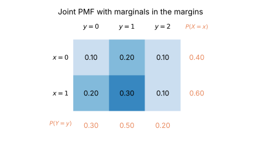
  <figcaption>Original figure for these notes. The joint PMF fills the table; the marginal PMFs are its row and column sums.</figcaption>
</figure>

<div class="example-block" markdown="1">
<div class="ex-title">Two Bernoulli tables: independent and dependent <span class="ex-pill pill-ex">Worked example</span></div>

Both tables below describe a pair of Bernoulli random variables $$X$$ and $$Y$$.

| Table A | $$y=0$$ | $$y=1$$ | $$P(X=x)$$ |
|---|---|---|---|
| $$x=0$$ | 1/3 | 1/6 | 1/2 |
| $$x=1$$ | 1/3 | 1/6 | 1/2 |
| $$P(Y=y)$$ | 2/3 | 1/3 | 1 |

| Table B | $$y=0$$ | $$y=1$$ | $$P(X=x)$$ |
|---|---|---|---|
| $$x=0$$ | 1/3 | 0 | 1/3 |
| $$x=1$$ | 1/3 | 1/3 | 2/3 |
| $$P(Y=y)$$ | 2/3 | 1/3 | 1 |

**Table A** is independent: every cell equals the product of its margins, for example $$\frac12\cdot\frac23=\frac13$$ and $$\frac12\cdot\frac13=\frac16$$. Both rows are the same, so learning $$X$$ does not change the distribution of $$Y$$.

**Table B** is dependent: $$P(X=0,Y=1)=0$$ but $$P(X=0)P(Y=1)=\frac13\cdot\frac13=\frac19$$. Here $$Y=1$$ forces $$X=1$$. The marginal of $$Y$$ is the same in both tables; only the joint reveals the difference.

<div class="ex-lesson">For a $$2\times2$$ table, independence is equivalent to the two rows being proportional. A single zero cell with positive margins rules it out.</div>
</div>

<div class="example-block" markdown="1">
<div class="ex-title">Supplementary: Continuous joint PDFs, one dependent and one independent <span class="ex-pill pill-ex">Worked example</span></div>

**Dependent.** Let $$f(x,y)=x+y$$ on the unit square $$0<x,y<1$$.

- *Validity:* $$\int_0^1\int_0^1(x+y)\,dx\,dy=\frac12+\frac12=1$$.
- *Marginal:* $$f_X(x)=\int_0^1(x+y)\,dy=x+\frac12$$, and by symmetry $$f_Y(y)=y+\frac12$$.
- *Dependence:* $$f_X(x)f_Y(y)=(x+\tfrac12)(y+\tfrac12)\ne x+y$$; for instance at $$(0,0)$$ the product is $$\tfrac14$$ while the joint is 0.
- *A region probability:*

$$
P(X+Y<1)=\int_0^1\int_0^{1-x}(x+y)\,dy\,dx=\int_0^1\frac{1-x^2}2\,dx=\frac13.
$$

**Independent.** Let $$f(x,y)=6e^{-2x-3y}$$ for $$x,y>0$$. It factors as $$\left(2e^{-2x}\right)\left(3e^{-3y}\right)$$ on a product region, so $$X\sim\operatorname{Expo}(2)$$ and $$Y\sim\operatorname{Expo}(3)$$ are independent.

</div>

### Part 6 — Uniform on a square versus Uniform on a disk

A **Uniform** point in a region $$R$$ of the plane has joint PDF equal to $$1/\text{area}(R)$$ on $$R$$ and 0 elsewhere. Probabilities are then proportional to area.

**Square.** For the unit square, $$f_{X,Y}(x,y)=1$$ for $$0\le x,y\le1$$. This equals $$1\cdot1=f_X(x)f_Y(y)$$ with $$X,Y\sim\operatorname{Unif}(0,1)$$, everywhere in the plane. The coordinates are independent: learning $$X$$ leaves $$Y$$ Uniform on $$[0,1]$$.

**Disk.** For the unit disk $$x^2+y^2\le1$$, $$f_{X,Y}(x,y)=1/\pi$$ inside and 0 outside.

- *Marginal.* At a given $$x$$, $$y$$ ranges over $$\left[-\sqrt{1-x^2},\sqrt{1-x^2}\right]$$, so

$$
f_X(x)=\int_{-\sqrt{1-x^2}}^{\sqrt{1-x^2}}\frac1\pi\,dy=\frac2\pi\sqrt{1-x^2},\qquad-1\le x\le1.
$$

  The marginal is not Uniform: values near 0 are more likely because the disk is tallest there.
- *Conditional.* Given $$X=x$$, $$f_{Y\mid X}(y\mid x)=\frac{1/\pi}{(2/\pi)\sqrt{1-x^2}}=\frac1{2\sqrt{1-x^2}}$$ on that interval, so $$Y\mid X=x$$ is Uniform on $$\left[-\sqrt{1-x^2},\sqrt{1-x^2}\right]$$. Its range depends on $$x$$.
- *Dependence.* $$f_{X,Y}(0.9,0.9)=0$$ because $$(0.9,0.9)$$ lies outside the disk, but $$f_X(0.9)f_Y(0.9)>0$$. So $$X$$ and $$Y$$ are dependent.

<figure>
  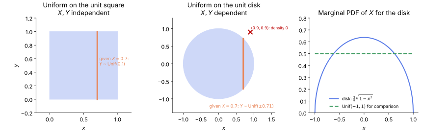
  <figcaption>Original figure for these notes, illustrating Blitzstein and Hwang, <em>Introduction to Probability</em>, Example 7.1.22. In the square every vertical slice is the same; in the disk the slice length depends on $$x$$, so $$X$$ carries information about $$Y$$.</figcaption>
</figure>

<div class="misconception-block" markdown="1">

**Incorrect:** Inside the disk the joint PDF is the constant $$\frac1\pi=\frac1\pi\cdot1$$, a function of $$x$$ times a function of $$y$$, so $$X$$ and $$Y$$ are independent.

**Correction:** Factorization must hold everywhere, including the support. Writing the disk PDF over the whole plane requires the indicator $$I(x^2+y^2\le1)$$, which does not split into a function of $$x$$ times a function of $$y$$. A joint PDF that factors on a rectangle, like the square, does indicate independence.

</div>

### Part 7 — Original practice questions

Try these before reading the answers.

1. Let $$X\sim\operatorname{Expo}(1)$$. Find $$E(X^5)$$ and $$E\left((X/3)^3\right)$$.
2. A random variable has MGF $$M(t)=(1-t)^{-2}$$ for $$t<1$$. Find $$E(X)$$ and $$\operatorname{Var}(X)$$, and describe $$X$$ as a sum of simpler variables.
3. Find $$E(Z^8)$$ for $$Z\sim\mathcal N(0,1)$$, and $$E\left((X-\mu)^4\right)$$ for $$X\sim\mathcal N(\mu,\sigma^2)$$.
4. Independent $$X_1\sim\operatorname{Pois}(2)$$, $$X_2\sim\operatorname{Pois}(3)$$, $$X_3\sim\operatorname{Pois}(5)$$. Find the distribution of $$X_1+X_2+X_3$$ and $$P(X_1+X_2+X_3=0)$$.
5. Check $$P(X_1+X_2+X_3=0)$$ in question 4 directly, without MGFs.
6. $$(X,Y)$$ is Uniform on the triangle $$0<y<x<1$$. Find the joint PDF, both marginals, and the conditional distribution of $$Y$$ given $$X=x$$. Are $$X$$ and $$Y$$ independent?
7. $$(X,Y)$$ is Uniform on the unit disk. Find $$P(X>0.5)$$.
8. Find $$c$$ so that $$f(x,y)=cxy$$ on the unit square is a joint PDF, and decide whether $$X$$ and $$Y$$ are independent.
9. Using the joint PMF table in Part 5, find $$P(Y\ge1\mid X=0)$$ and $$P(X=1\mid Y=2)$$.

### Part 8 — Practice answers

#### 1. Exponential moments

$$E(X^5)=5!=120$$. $$E\left((X/3)^3\right)=3!/27=2/9$$.

#### 2. A squared geometric MGF

$$(1-t)^{-2}=\sum_{n\ge0}(n+1)t^n$$, so $$E(X^n)=(n+1)\,n!$$: $$E(X)=2$$, $$E(X^2)=6$$, $$\operatorname{Var}(X)=2$$. It is the MGF of a sum of two independent $$\operatorname{Expo}(1)$$ variables, since $$(1-t)^{-1}(1-t)^{-1}=(1-t)^{-2}$$.

#### 3. Normal fourth and eighth moments

$$E(Z^8)=7\cdot5\cdot3\cdot1=105$$. Since $$X-\mu=\sigma Z$$, $$E\left((X-\mu)^4\right)=\sigma^4E(Z^4)=3\sigma^4$$.

#### 4. Three Poisson streams

The sum is $$\operatorname{Pois}(10)$$, so $$P(\text{sum}=0)=e^{-10}\approx4.54\times10^{-5}$$.

#### 5. Direct check

The sum is 0 only if all three are 0. By independence, $$e^{-2}e^{-3}e^{-5}=e^{-10}$$.

#### 6. Uniform on a triangle

The triangle has area $$1/2$$, so $$f(x,y)=2$$ on $$0<y<x<1$$. Then $$f_X(x)=\int_0^x2\,dy=2x$$ on $$(0,1)$$ and $$f_Y(y)=\int_y^12\,dx=2(1-y)$$ on $$(0,1)$$. Given $$X=x$$, $$f_{Y\mid X}(y\mid x)=2/(2x)=1/x$$ on $$(0,x)$$, so $$Y\mid X=x\sim\operatorname{Unif}(0,x)$$. They are dependent: the conditional range depends on $$x$$, and $$f(0.2,0.8)=0\ne f_X(0.2)f_Y(0.8)$$.

#### 7. A cap of the disk

The region $$x>0.5$$ inside the unit disk has area $$\cos^{-1}(0.5)-0.5\sqrt{1-0.25}=\frac\pi3-\frac{\sqrt3}4\approx0.614$$. Dividing by $$\pi$$ gives $$P(X>0.5)\approx0.196$$.

#### 8. A product density

$$\int_0^1\int_0^1xy\,dx\,dy=\frac14$$, so $$c=4$$. Then $$f(x,y)=(2x)(2y)$$ on a square, so $$X$$ and $$Y$$ are independent with marginal PDFs $$2x$$ and $$2y$$.

#### 9. Conditioning in the table

$$P(Y\ge1\mid X=0)=\frac{0.20+0.10}{0.40}=0.75$$. $$P(X=1\mid Y=2)=\frac{0.10}{0.20}=0.5$$.

### Part 9 — Quick revision sheet

| Concept | Essential fact |
|---|---|
| “Moment” | Mean = center of mass; variance = moment of inertia |
| Moments from series | $$E(X^n)=n!\times$$ coefficient of $$t^n$$ in $$M(t)$$ |
| $$\operatorname{Expo}(1)$$ MGF | $$1/(1-t)$$, $$t<1$$ |
| $$\operatorname{Expo}(\lambda)$$ moments | $$E(X^n)=n!/\lambda^n$$ |
| Normal moments | Odd 0; $$E(Z^{2k})=(2k-1)!!$$; $$E(Z^4)=3$$ |
| Poisson MGF | $$e^{\lambda(e^t-1)}$$ |
| Poisson sums | Independent $$\operatorname{Pois}(\lambda)+\operatorname{Pois}(\mu)=\operatorname{Pois}(\lambda+\mu)$$ |
| Joint PMF/PDF | Describes $$(X,Y)$$ together; sums or integrates to 1 |
| Marginal | Sum or integrate out the other variable |
| Conditional | Joint divided by marginal of the conditioning variable |
| Reconstruction | Joint = conditional × marginal |
| Independence | Joint = product of marginals everywhere |
| Marginals alone | Cannot detect dependence |
| Uniform on square | Independent coordinates |
| Uniform on disk | Dependent; marginal $$\frac2\pi\sqrt{1-x^2}$$ |

### Term Glossary

<div class="glossary-entry" markdown="1">
<div class="gterm">Moment of inertia analogy <span class="gcat cat-prop">Interpretation</span></div>

Viewing probability as mass: the mean is the center of mass and the variance is the moment of inertia about it.

</div>

<div class="glossary-entry" markdown="1">
<div class="gterm">Double factorial <span class="gcat cat-notn">Notation</span></div>

$$(2k-1)!!=(2k-1)(2k-3)\cdots3\cdot1$$, the even moments of the standard Normal.

</div>

<div class="glossary-entry" markdown="1">
<div class="gterm">Joint distribution <span class="gcat cat-defn">Definition</span></div>

The distribution of several random variables considered together, given by a joint CDF, joint PMF, or joint PDF.

</div>

<div class="glossary-entry" markdown="1">
<div class="gterm">Marginal distribution <span class="gcat cat-defn">Definition</span></div>

The distribution of one random variable on its own, obtained from the joint distribution by summing or integrating over the other variables.

</div>

<div class="glossary-entry" markdown="1">
<div class="gterm">Conditional distribution <span class="gcat cat-defn">Definition</span></div>

The distribution of one variable given the value of another: the corresponding slice of the joint, renormalized to total probability 1.

</div>

<div class="glossary-entry" markdown="1">
<div class="gterm">Uniform distribution on a region <span class="gcat cat-defn">Definition</span></div>

A joint PDF equal to $$1/\text{area}(R)$$ on a region $$R$$ and 0 elsewhere, so that probability is proportional to area.

</div>

<div class="glossary-entry" markdown="1">
<div class="gterm">Factorization criterion <span class="gcat cat-thm">Theorem</span></div>

Random variables are independent exactly when their joint PMF or PDF equals the product of the marginals, or of some function of $$x$$ and some function of $$y$$, for all points in the plane.

</div>

<div class="ref-tags">
  <span class="ref-tag">Statistics 110</span>
  <span class="ref-tag">Lecture 18</span>
  <span class="ref-tag">MGF</span>
  <span class="ref-tag">Moments</span>
  <span class="ref-tag">Poisson</span>
  <span class="ref-tag">Joint distributions</span>
  <span class="ref-tag">Independence</span>
</div>

  </div>
</div>

## Lecture 19 - Joint, Conditional, and Marginal Distributions

<div class="chapter-block">
  <button type="button" class="chapter-toggle" id="lecture-19-toggle" onclick="toggleLecture('lecture-19')" aria-expanded="true" aria-controls="lecture-19-body">
    <span class="chapter-toggle-left">
      <span class="chapter-badge">Lecture 19</span>
      <span>
        <span class="chapter-title">Lecture 19 - Joint, Conditional, and Marginal Distributions</span>
        <span class="chapter-subtitle">Joint PDFs, 2D LOTUS, E(XY) under independence, expected distance between Uniforms, and the chicken-egg problem</span>
      </span>
    </span>
    <span class="chapter-arrow open" id="lecture-19-arrow" aria-hidden="true">▼</span>
  </button>
  <div class="chapter-body open" id="lecture-19-body" markdown="1">

<div class="note-abstract" markdown="1">

A joint PDF is the mixed partial derivative of the joint CDF, and probabilities of regions are double integrals of it. LOTUS extends to two variables: $$E(g(X,Y))$$ integrates $$g$$ against the joint PDF without finding the distribution of $$g(X,Y)$$. One consequence is that independent random variables satisfy $$E(XY)=E(X)E(Y)$$. Two-dimensional LOTUS also gives the expected distance between two independent Uniforms, $$E\lvert X-Y\rvert=1/3$$, which can be cross-checked through the maximum and minimum. Finally, when a Poisson number of eggs each hatch independently, the hatched and unhatched counts turn out to be independent Poissons, a fact special to the Poisson.

</div>

### Notation at a Glance

<div class="notation-panel" markdown="1">

| Symbol | Meaning |
|---|---|
| $$F(x,y)=P(X\le x,Y\le y)$$ | Joint CDF |
| $$f(x,y)=\dfrac{\partial^2F}{\partial x\,\partial y}$$ | Joint PDF |
| $$f_X$$, $$f_Y$$ | Marginal PDFs |
| $$f_{Y\mid X}(y\mid x)$$ | Conditional PDF of $$Y$$ given $$X=x$$ |
| $$g(X,Y)$$ | A function of two random variables |
| $$M=\max(X,Y)$$, $$L=\min(X,Y)$$ | Larger and smaller of $$X$$ and $$Y$$ |
| $$N$$ | Number of eggs |
| $$p$$, $$q=1-p$$ | Hatching and non-hatching probabilities |
| $$X$$, $$Y=N-X$$ | Numbers of hatched and unhatched eggs |

</div>

### Learning objectives

After studying these notes, you should be able to:

- Relate the joint CDF and joint PDF, and compute region probabilities with correct integration limits.
- Obtain marginal and conditional PDFs and test independence.
- State and apply LOTUS for functions of two random variables.
- Prove $$E(XY)=E(X)E(Y)$$ for independent $$X,Y$$, and explain why the converse fails.
- Compute $$E\lvert X-Y\rvert$$ for i.i.d. Uniforms by integration and by a max-min argument.
- Derive the joint PMF in the chicken-egg problem and show the two counts are independent Poissons.

### Part 1 — Joint CDF, joint PDF, and region probabilities

Lecture 18 introduced joint, marginal, and conditional distributions. The continuous case is collected here.

- **Joint CDF:** $$F(x,y)=P(X\le x,Y\le y)$$, defined for any pair of random variables.
- **Joint PDF:** for continuous $$X,Y$$, the mixed partial derivative

$$
f(x,y)=\frac{\partial^2}{\partial x\,\partial y}F(x,y).
$$

- **Region probabilities:** $$P\big((X,Y)\in A\big)=\iint_Af(x,y)\,dx\,dy$$.
- **Marginal:** $$f_X(x)=\int_{-\infty}^\infty f(x,y)\,dy$$.
- **Conditional:** $$f_{Y\mid X}(y\mid x)=\dfrac{f(x,y)}{f_X(x)}$$, and by Bayes' rule $$f_{Y\mid X}(y\mid x)=\dfrac{f_{X\mid Y}(x\mid y)f_Y(y)}{f_X(x)}$$.
- **Independence:** $$f(x,y)=f_X(x)f_Y(y)$$ for all $$x,y$$, equivalently $$F(x,y)=F_X(x)F_Y(y)$$ for all $$x,y$$. The PDF version is usually easier to check.

**Setting integration limits.** For a region that is not a rectangle, fix the outer variable first and describe the range of the inner variable as a function of it. The Uniform point in the unit disk from Lecture 18 is an example: for fixed $$x$$, $$y$$ runs from $$-\sqrt{1-x^2}$$ to $$\sqrt{1-x^2}$$. Comparing its conditional distribution, Uniform on that interval, with its marginal, $$\frac2\pi\sqrt{1-y^2}$$, shows directly that the coordinates are dependent.

<div class="example-block" markdown="1">
<div class="ex-title">A probability over a triangle <span class="ex-pill pill-ex">Worked example</span></div>

Let $$X,Y$$ be i.i.d. $$\operatorname{Expo}(1)$$, so $$f(x,y)=e^{-x}e^{-y}$$ for $$x,y>0$$. Find $$P(X<Y)$$ and $$P(X+Y<1)$$.

**$$P(X<Y)$$.** The region is above the diagonal. Fix $$y$$ outside, let $$x$$ run from 0 to $$y$$:

$$
P(X<Y)=\int_0^\infty\int_0^ye^{-x}e^{-y}\,dx\,dy=\int_0^\infty(1-e^{-y})e^{-y}\,dy=1-\frac12=\frac12,
$$

as symmetry predicts.

**$$P(X+Y<1)$$.** Fix $$x\in(0,1)$$; then $$y$$ runs from 0 to $$1-x$$:

$$
\int_0^1\int_0^{1-x}e^{-x}e^{-y}\,dy\,dx=\int_0^1e^{-x}\left(1-e^{-(1-x)}\right)dx=(1-e^{-1})-e^{-1}=1-2e^{-1}\approx0.264.
$$

<div class="ex-lesson"><strong>Core idea:</strong> Sketch the region, choose which variable is outer, and express the inner limits in terms of it. Errors in double integrals are usually errors in the limits.</div>
</div>

### Part 2 — LOTUS in two dimensions

<div class="example-block" markdown="1">
<div class="ex-title">Two-dimensional LOTUS <span class="ex-pill pill-thm">Theorem</span></div>

For a function $$g:\mathbb R^2\to\mathbb R$$,

$$
E\big(g(X,Y)\big)=\iint g(x,y)f(x,y)\,dx\,dy\quad\text{(continuous)},\qquad
E\big(g(X,Y)\big)=\sum_x\sum_yg(x,y)P(X=x,Y=y)\quad\text{(discrete)}.
$$

</div>

As in one dimension, the probabilities stay those of the pair $$(X,Y)$$; only the values change from $$(x,y)$$ to $$g(x,y)$$. There is no need to find the distribution of $$g(X,Y)$$ first.

#### Independence implies $$E(XY)=E(X)E(Y)$$

<div class="example-block" markdown="1">
<div class="ex-title">Expectation of a product <span class="ex-pill pill-thm">Theorem</span></div>

If $$X$$ and $$Y$$ are independent with finite means, then $$E(XY)=E(X)E(Y)$$.

</div>

**Proof (continuous case).** Apply 2D LOTUS with $$g(x,y)=xy$$, factor the joint PDF, and separate the double integral:

$$
E(XY)=\iint xy\,f_X(x)f_Y(y)\,dx\,dy=\left(\int xf_X(x)\,dx\right)\left(\int yf_Y(y)\,dy\right)=E(X)E(Y).
$$

The discrete case is identical with sums. $$\blacksquare$$

More generally, $$E\big(g(X)h(Y)\big)=E\big(g(X)\big)E\big(h(Y)\big)$$ for independent $$X,Y$$. This justifies the MGF product rule used in Lectures 17 and 18: $$E(e^{tX}e^{tY})=E(e^{tX})E(e^{tY})$$.

Random variables with $$E(XY)=E(X)E(Y)$$ are called **uncorrelated**. Independence implies uncorrelated, but not conversely.

<div class="misconception-block" markdown="1">

**Incorrect:** If $$E(XY)=E(X)E(Y)$$, then $$X$$ and $$Y$$ are independent.

**Correction:** Let $$X$$ be uniform on $$\{-1,0,1\}$$ and $$Y=X^2$$. Then $$E(XY)=E(X^3)=0=E(X)E(Y)$$, yet $$Y$$ is a function of $$X$$. A product condition on means captures only one kind of linear association, not all dependence.

</div>

### Part 3 — Expected distance between two Uniforms

Let $$X,Y$$ be i.i.d. $$\operatorname{Unif}(0,1)$$, two random points on a unit stick. Find $$E\lvert X-Y\rvert$$.

**By 2D LOTUS.** The joint PDF is 1 on the unit square. Split at the diagonal, where $$\lvert x-y\rvert$$ changes formula, and use symmetry between the two triangles:

$$
E\lvert X-Y\rvert=\int_0^1\int_0^1\lvert x-y\rvert\,dx\,dy=2\int_0^1\int_y^1(x-y)\,dx\,dy.
$$

The inner integral is $$\int_y^1(x-y)\,dx=\frac{(1-y)^2}2$$. Then

$$
2\int_0^1\frac{(1-y)^2}2\,dy=\int_0^1(1-y)^2\,dy=\frac13.
$$

<div class="result-box" markdown="1">

$$
\boxed{X,Y\overset{\text{i.i.d.}}{\sim}\operatorname{Unif}(0,1)\implies E\lvert X-Y\rvert=\frac13.}
$$

</div>

**By the maximum and minimum.** Let $$M=\max(X,Y)$$ and $$L=\min(X,Y)$$. Then:

1. $$\lvert X-Y\rvert=M-L$$, since subtracting the smaller from the larger gives the distance.
2. $$M+L=X+Y$$, since the pair $$\{M,L\}$$ is the pair $$\{X,Y\}$$ in some order. By linearity, $$E(M)+E(L)=1$$.
3. The CDF of $$M$$ is $$P(M\le m)=P(X\le m,Y\le m)=m^2$$ on $$(0,1)$$, so $$f_M(m)=2m$$ and $$E(M)=\int_0^12m^2\,dm=\frac23$$.
4. Hence $$E(L)=1-\frac23=\frac13$$ and $$E\lvert X-Y\rvert=E(M)-E(L)=\frac13$$.

The two points split the stick into three pieces with expected lengths $$E(L)=\frac13$$, $$E(M-L)=\frac13$$, and $$E(1-M)=\frac13$$. By symmetry each piece has the same expected length.

<figure>
  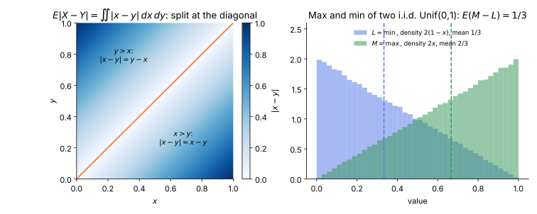
  <figcaption>Original figure for these notes, illustrating Blitzstein and Hwang, <em>Introduction to Probability</em>, Example 7.2.2. Left: the integrand of 2D LOTUS. Right: simulated minimum and maximum, whose means differ by $$1/3$$.</figcaption>
</figure>

<div class="misconception-block" markdown="1">

**Incorrect:** $$E\lvert X-Y\rvert=\lvert E(X)-E(Y)\rvert=0$$.

**Correction:** The absolute value is nonlinear, and $$\lvert X-Y\rvert$$ is positive with probability 1, so its mean cannot be 0. Expectation can be moved inside only linear functions.

</div>

### Part 4 — The chicken-egg problem

A hen lays $$N\sim\operatorname{Pois}(\lambda)$$ eggs. Each egg hatches with probability $$p$$, independently of the other eggs and of $$N$$. Let $$X$$ be the number that hatch and $$Y=N-X$$ the number that do not. Find the joint distribution of $$X$$ and $$Y$$.

**Structure.** Conditional on $$N=n$$, $$X\mid N=n\sim\operatorname{Bin}(n,p)$$. Since $$N=X+Y$$, the event $$\{X=i,Y=j\}$$ is the same as $$\{N=i+j,X=i\}$$.

**Joint PMF.** Multiply the marginal of $$N$$ by the conditional of $$X$$:

$$
P(X=i,Y=j)=P(N=i+j)\,P(X=i\mid N=i+j)=\frac{e^{-\lambda}\lambda^{i+j}}{(i+j)!}\cdot\frac{(i+j)!}{i!\,j!}p^iq^j.
$$

The factorials $$(i+j)!$$ cancel. Write $$e^{-\lambda}=e^{-\lambda p}e^{-\lambda q}$$ and $$\lambda^{i+j}p^iq^j=(\lambda p)^i(\lambda q)^j$$:

<div class="result-box" markdown="1">

$$
\boxed{P(X=i,Y=j)=\frac{e^{-\lambda p}(\lambda p)^i}{i!}\cdot\frac{e^{-\lambda q}(\lambda q)^j}{j!}.}
$$

</div>

The joint PMF is the product of a $$\operatorname{Pois}(\lambda p)$$ PMF in $$i$$ and a $$\operatorname{Pois}(\lambda q)$$ PMF in $$j$$, on the full product of their supports. Therefore:

- $$X\sim\operatorname{Pois}(\lambda p)$$ and $$Y\sim\operatorname{Pois}(\lambda q)$$;
- $$X$$ and $$Y$$ are **independent**.

**Why this is surprising.** $$X$$ and $$Y$$ are built from the same total $$N$$, so one might expect a large hatched count to signal a large total and hence a large unhatched count. That reasoning would hold for a fixed or non-Poisson total. With a Poisson total, the information about $$N$$ carried by $$X$$ exactly cancels in its effect on $$Y$$. Conversely, if $$N=n$$ were fixed, then $$Y=n-X$$ would be completely determined by $$X$$.

<div class="example-block" markdown="1">
<div class="ex-title">Splitting a stream of customers <span class="ex-pill pill-ex">Worked example</span></div>

A shop receives $$N\sim\operatorname{Pois}(10)$$ customers in an hour, and each independently makes a purchase with probability $$0.3$$.

- **Buyers:** $$X\sim\operatorname{Pois}(3)$$, so $$P(\text{no purchase this hour})=e^{-3}\approx0.0498$$.
- **Browsers:** $$Y\sim\operatorname{Pois}(7)$$, independent of $$X$$.
- **Learning about browsers from buyers:** given $$X=2$$, $$Y$$ is still $$\operatorname{Pois}(7)$$, so $$E(N\mid X=2)=2+7=9$$, below the unconditional $$E(N)=10$$ because fewer buyers than average were seen.

<div class="ex-lesson"><strong>Core idea:</strong> Independently classifying the points of a Poisson count splits it into independent Poisson counts. This is called Poisson thinning or splitting.</div>
</div>

<figure>
  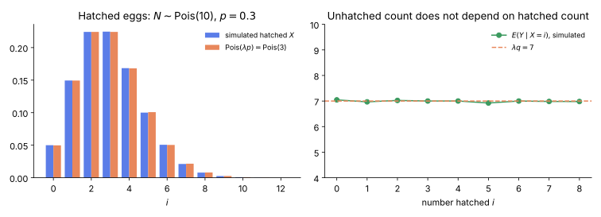
  <figcaption>Original figure for these notes, illustrating Blitzstein and Hwang, <em>Introduction to Probability</em>, Example 7.1.9 (chicken-egg). Simulation with $$\lambda=10$$, $$p=0.3$$: the hatched count is $$\operatorname{Pois}(3)$$, and the unhatched count averages 7 whatever the hatched count.</figcaption>
</figure>

<div class="misconception-block" markdown="1">

**Incorrect:** Since $$X$$ and $$Y$$ add to $$N$$, they must be negatively dependent.

**Correction:** That holds when $$N$$ is fixed. When $$N$$ is Poisson, the joint PMF factors, so $$X$$ and $$Y$$ are independent. The conclusion depends on the distribution of the total, not only on the sum relation.

</div>

### Part 5 — Original practice questions

Try these before reading the answers.

1. Let $$X,Y$$ be i.i.d. $$\operatorname{Unif}(0,1)$$. Find $$E(XY)$$ and $$E\left((X-Y)^2\right)$$.
2. Let $$(X,Y)$$ have joint PDF $$x+y$$ on the unit square. Use 2D LOTUS to compute $$E(XY)$$, and compare with $$E(X)E(Y)$$.
3. Let $$(X,Y)$$ be Uniform on the unit disk. Find $$E(X^2+Y^2)$$ using polar coordinates, and $$E(XY)$$ by symmetry. Are $$X$$ and $$Y$$ independent?
4. Let $$X,Y$$ be i.i.d. $$\operatorname{Unif}(0,1)$$. Find the PDF of $$L=\min(X,Y)$$ and verify $$E(L)=1/3$$ directly.
5. Three points are chosen independently and uniformly on $$(0,1)$$. Find the expected value of the largest.
6. In the chicken-egg problem with $$\lambda=12$$ and $$p=1/4$$, find $$P(X=0,Y=0)$$ and $$P(X=2\mid N=8)$$.
7. In the chicken-egg setup, suppose instead $$N=n$$ is fixed. Find $$P(X=n,Y=n)$$ and explain why $$X$$ and $$Y$$ are dependent.
8. Let $$X,Y$$ be i.i.d. $$\operatorname{Expo}(1)$$. Find $$E\lvert X-Y\rvert$$. *(Supplementary: use that $$\min(X,Y)\sim\operatorname{Expo}(2)$$.)*
9. Show that $$E(X+Y)^2=E(X^2)+2E(X)E(Y)+E(Y^2)$$ for independent $$X,Y$$, and deduce $$\operatorname{Var}(X+Y)=\operatorname{Var}(X)+\operatorname{Var}(Y)$$.

### Part 6 — Practice answers

#### 1. Products and squared distance

$$E(XY)=E(X)E(Y)=\frac14$$. $$E\left((X-Y)^2\right)=E(X^2)-2E(X)E(Y)+E(Y^2)=\frac13-\frac12+\frac13=\frac16$$.

#### 2. A dependent pair

$$E(XY)=\int_0^1\int_0^1xy(x+y)\,dx\,dy=2\int_0^1\int_0^1x^2y\,dx\,dy=2\cdot\frac13\cdot\frac12=\frac13$$. From $$f_X(x)=x+\tfrac12$$, $$E(X)=\frac13+\frac14=\frac7{12}=E(Y)$$, so $$E(X)E(Y)=\frac{49}{144}\approx0.340\ne\frac13$$. They are dependent, consistent with Lecture 18.

#### 3. Moments on the disk

$$E(X^2+Y^2)=\frac1\pi\int_0^{2\pi}\int_0^1r^2\cdot r\,dr\,d\theta=\frac1\pi\cdot2\pi\cdot\frac14=\frac12$$. The disk is symmetric under $$x\mapsto-x$$, so $$E(XY)=0=E(X)E(Y)$$. Yet $$X$$ and $$Y$$ are dependent: another uncorrelated but dependent pair.

#### 4. The minimum directly

$$P(L>l)=P(X>l)P(Y>l)=(1-l)^2$$, so $$f_L(l)=2(1-l)$$ on $$(0,1)$$ and $$E(L)=\int_0^12l(1-l)\,dl=1-\frac23=\frac13$$.

#### 5. Maximum of three

$$P(\max\le m)=m^3$$, so the PDF is $$3m^2$$ and the mean is $$\int_0^13m^3\,dm=\frac34$$.

#### 6. Chicken-egg numbers

$$X\sim\operatorname{Pois}(3)$$ and $$Y\sim\operatorname{Pois}(9)$$ independently, so $$P(X=0,Y=0)=e^{-3}e^{-9}=e^{-12}$$, which is also $$P(N=0)$$. Given $$N=8$$, $$X\sim\operatorname{Bin}(8,1/4)$$: $$P(X=2\mid N=8)=\binom82(1/4)^2(3/4)^6\approx0.311$$.

#### 7. A fixed total

$$X+Y=n$$ always, so $$P(X=n,Y=n)=0$$ for $$n\ge1$$, while $$P(X=n)P(Y=n)=p^nq^n>0$$. The joint does not factor; $$Y$$ is determined by $$X$$.

#### 8. Distance between Exponentials

$$\lvert X-Y\rvert=M-L$$ and $$M+L=X+Y$$, so $$E(M)=2-E(L)$$. With $$L\sim\operatorname{Expo}(2)$$, $$E(L)=\frac12$$, so $$E(M)=\frac32$$ and $$E\lvert X-Y\rvert=1$$. By memorylessness, after the first of the two occurs, the remaining wait for the other is a fresh $$\operatorname{Expo}(1)$$, which also gives 1.

#### 9. Variances add under independence

Expanding and using $$E(XY)=E(X)E(Y)$$ gives the identity. Subtracting $$(E(X)+E(Y))^2=E(X)^2+2E(X)E(Y)+E(Y)^2$$ leaves $$\operatorname{Var}(X)+\operatorname{Var}(Y)$$. This proves the additivity used in Lecture 14.

### Part 7 — Quick revision sheet

| Concept | Essential fact |
|---|---|
| Joint PDF | $$\partial^2F/\partial x\,\partial y$$; integrate over regions |
| Limits | Fix the outer variable; inner limits depend on it |
| Marginal | $$f_X=\int f(x,y)\,dy$$ |
| Conditional | $$f_{Y\mid X}=f/f_X$$ |
| Independence | $$f=f_Xf_Y$$ everywhere, or $$F=F_XF_Y$$ |
| 2D LOTUS | $$E(g(X,Y))=\iint g\,f\,dx\,dy$$ |
| Product of independents | $$E(XY)=E(X)E(Y)$$; more generally $$E(g(X)h(Y))=E(g(X))E(h(Y))$$ |
| Uncorrelated | $$E(XY)=E(X)E(Y)$$; does not imply independence |
| Expected distance | $$E\lvert X-Y\rvert=1/3$$ for i.i.d. $$\operatorname{Unif}(0,1)$$ |
| Max and min of two Uniforms | Means $$2/3$$ and $$1/3$$ |
| Chicken-egg joint PMF | Product of $$\operatorname{Pois}(\lambda p)$$ and $$\operatorname{Pois}(\lambda q)$$ PMFs |
| Poisson splitting | Hatched and unhatched counts are independent Poissons |
| Fixed total | Splitting a fixed $$n$$ gives dependent counts |

### Term Glossary

<div class="glossary-entry" markdown="1">
<div class="gterm">Joint PDF <span class="gcat cat-defn">Definition</span></div>

The mixed partial derivative of the joint CDF of continuous random variables; its integral over a region is the probability of that region.

</div>

<div class="glossary-entry" markdown="1">
<div class="gterm">Two-dimensional LOTUS <span class="gcat cat-thm">Theorem</span></div>

$$E(g(X,Y))=\iint g(x,y)f(x,y)\,dx\,dy$$, or the corresponding double sum for discrete variables.

</div>

<div class="glossary-entry" markdown="1">
<div class="gterm">Uncorrelated <span class="gcat cat-defn">Definition</span></div>

Random variables with $$E(XY)=E(X)E(Y)$$. Independent variables are uncorrelated; uncorrelated variables need not be independent.

</div>

<div class="glossary-entry" markdown="1">
<div class="gterm">Order statistics (max and min) <span class="gcat cat-defn">Definition</span></div>

The largest and smallest of a collection of random variables. For two variables, their difference is the distance and their sum is the total.

</div>

<div class="glossary-entry" markdown="1">
<div class="gterm">Poisson thinning (splitting) <span class="gcat cat-prop">Property</span></div>

If each of $$N\sim\operatorname{Pois}(\lambda)$$ items is independently classified as type 1 with probability $$p$$, the type counts are independent $$\operatorname{Pois}(\lambda p)$$ and $$\operatorname{Pois}(\lambda q)$$ variables.

</div>

<div class="ref-tags">
  <span class="ref-tag">Statistics 110</span>
  <span class="ref-tag">Lecture 19</span>
  <span class="ref-tag">Joint distributions</span>
  <span class="ref-tag">2D LOTUS</span>
  <span class="ref-tag">Independence</span>
  <span class="ref-tag">Chicken-egg</span>
  <span class="ref-tag">Poisson</span>
</div>

  </div>
</div>

## Lecture 20 - Multinomial and Cauchy

<div class="chapter-block">
  <button type="button" class="chapter-toggle" id="lecture-20-toggle" onclick="toggleLecture('lecture-20')" aria-expanded="true" aria-controls="lecture-20-body">
    <span class="chapter-toggle-left">
      <span class="chapter-badge">Lecture 20</span>
      <span>
        <span class="chapter-title">Lecture 20 - Multinomial and Cauchy</span>
        <span class="chapter-subtitle">Expected distance between Normals, the Multinomial distribution with its marginals, lumping, and conditioning, and the Cauchy distribution</span>
      </span>
    </span>
    <span class="chapter-arrow open" id="lecture-20-arrow" aria-hidden="true">▼</span>
  </button>
  <div class="chapter-body open" id="lecture-20-body" markdown="1">

<div class="note-abstract" markdown="1">

The expected distance between two independent standard Normals needs no double integral: their difference is $$\mathcal N(0,2)$$, so $$E\lvert Z_1-Z_2\rvert=\sqrt2\,E\lvert Z\rvert=2/\sqrt\pi$$. The Multinomial distribution extends the Binomial from two categories to $$k$$. It counts how many of $$n$$ independent objects fall in each category. Each count is Binomial, merging categories gives another Multinomial, and conditioning on one count leaves a Multinomial on the rest with renormalized probabilities. The Cauchy distribution is the ratio of two independent standard Normals. Its PDF $$\frac1{\pi(1+t^2)}$$ follows from a CDF calculation, and its tails are so heavy that its mean does not exist.

</div>

### Notation at a Glance

<div class="notation-panel" markdown="1">

| Symbol | Meaning |
|---|---|
| $$Z_1,Z_2$$ | i.i.d. $$\mathcal N(0,1)$$ |
| $$\mathbf X=(X_1,\ldots,X_k)$$ | Category counts |
| $$\mathbf p=(p_1,\ldots,p_k)$$ | Category probabilities, $$p_j\ge0$$, $$\sum_jp_j=1$$ |
| $$\mathbf X\sim\operatorname{Mult}_k(n,\mathbf p)$$ | Multinomial with $$n$$ objects and $$k$$ categories |
| $$\dfrac{n!}{n_1!\cdots n_k!}$$ | Multinomial coefficient |
| $$p_j'=p_j/(1-p_1)$$ | Renormalized probability after conditioning on $$X_1$$ |
| $$T=X/Y$$ | Ratio of i.i.d. $$\mathcal N(0,1)$$ variables |
| $$\operatorname{Cauchy}$$ | Distribution of $$T$$ |
| $$\Phi$$, $$\varphi$$ | Standard Normal CDF and PDF |

</div>

### Learning objectives

After studying these notes, you should be able to:

- Compute $$E\lvert Z_1-Z_2\rvert$$ using the distribution of a difference of independent Normals.
- State the Multinomial story and derive its joint PMF.
- Show that each Multinomial count is Binomial.
- Merge Multinomial categories and condition on one count.
- Derive the Cauchy CDF and PDF from the ratio of two Normals.
- Explain why the Cauchy distribution has no mean.

### Part 1 — Expected distance between two Normals

Let $$Z_1,Z_2$$ be i.i.d. $$\mathcal N(0,1)$$. Find $$E\lvert Z_1-Z_2\rvert$$.

Two-dimensional LOTUS would require integrating $$\lvert z_1-z_2\rvert\varphi(z_1)\varphi(z_2)$$ over the plane. A shorter route uses facts already proved.

1. **The difference is Normal.** Independent Normals add to a Normal (Lecture 17), and $$-Z_2\sim\mathcal N(0,1)$$. So $$Z_1-Z_2\sim\mathcal N(0,1+1)=\mathcal N(0,2)$$.
2. **Rescale.** Then $$Z_1-Z_2$$ has the same distribution as $$\sqrt2\,Z$$ with $$Z\sim\mathcal N(0,1)$$.
3. **Use $$E\lvert Z\rvert$$.** By symmetry and LOTUS,

$$
E\lvert Z\rvert=2\int_0^\infty z\frac{e^{-z^2/2}}{\sqrt{2\pi}}\,dz=\frac2{\sqrt{2\pi}}=\sqrt{\frac2\pi}.
$$

<div class="result-box" markdown="1">

$$
\boxed{E\lvert Z_1-Z_2\rvert=\sqrt2\cdot\sqrt{\frac2\pi}=\frac2{\sqrt\pi}\approx1.128.}
$$

</div>

For i.i.d. $$\mathcal N(\mu,\sigma^2)$$ variables, the mean cancels and the scale multiplies, giving $$2\sigma/\sqrt\pi$$.

**Core idea:** An expectation depends only on the distribution of the quantity inside. Identify that distribution first, and the integral may become one-dimensional or already known.

### Part 2 — The Multinomial distribution

<div class="example-block" markdown="1">
<div class="ex-title">Multinomial distribution <span class="ex-pill pill-defn">Definition</span></div>

Each of $$n$$ objects is placed independently into one of $$k$$ categories, landing in category $$j$$ with probability $$p_j$$, where $$p_j\ge0$$ and $$p_1+\cdots+p_k=1$$. Let $$X_j$$ be the number of objects in category $$j$$. Then

$$
\mathbf X=(X_1,\ldots,X_k)\sim\operatorname{Mult}_k(n,\mathbf p).
$$

</div>

The counts are always dependent: they add to $$n$$, so the last count is determined by the others. With $$k=2$$, $$X_1\sim\operatorname{Bin}(n,p_1)$$ and $$X_2=n-X_1$$.

**Joint PMF.** Fix counts $$n_1,\ldots,n_k$$ with $$n_1+\cdots+n_k=n$$.

1. Any particular assignment of objects to categories with these counts has probability $$p_1^{n_1}\cdots p_k^{n_k}$$, by independence.
2. The number of such assignments is the number of ways to choose which $$n_1$$ objects go to category 1, which $$n_2$$ of the rest go to category 2, and so on:

$$
\binom{n}{n_1}\binom{n-n_1}{n_2}\cdots\binom{n_k}{n_k}=\frac{n!}{n_1!\,n_2!\cdots n_k!}.
$$

<div class="result-box" markdown="1">

$$
\boxed{P(X_1=n_1,\ldots,X_k=n_k)=\frac{n!}{n_1!\cdots n_k!}\,p_1^{n_1}\cdots p_k^{n_k},\qquad n_1+\cdots+n_k=n,}
$$

</div>

and 0 otherwise.

<div class="example-block" markdown="1">
<div class="ex-title">Rolling a die twelve times <span class="ex-pill pill-num">Worked example</span></div>

Roll a fair die 12 times and record how many times each face appears. The counts are $$\operatorname{Mult}_6(12,(1/6,\ldots,1/6))$$. The probability that each face appears exactly twice is

$$
\frac{12!}{(2!)^6}\left(\frac16\right)^{12}=\frac{7{,}484{,}400}{2{,}176{,}782{,}336}\approx0.0034.
$$

Perfectly balanced outcomes are rare, even though each face is equally likely.

</div>

### Part 3 — Marginals, lumping, and conditioning

#### Each count is Binomial

To study category $$j$$ alone, call it “success” and every other category “failure”. Each object succeeds independently with probability $$p_j$$, so

$$
X_j\sim\operatorname{Bin}(n,p_j),\qquad E(X_j)=np_j,\qquad\operatorname{Var}(X_j)=np_j(1-p_j).
$$

No summation over the joint PMF is needed: the story gives the marginal directly.

#### Lumping categories

Merging categories produces another Multinomial, with the merged probabilities added. For example, if the last $$k-2$$ categories are combined,

$$
(X_1,X_2,X_3+\cdots+X_k)\sim\operatorname{Mult}_3\big(n,(p_1,p_2,p_3+\cdots+p_k)\big).
$$

Each object lands in the merged category exactly when it lands in one of its parts, with probability the sum of their probabilities, and objects remain independent.

#### Conditioning on one count

Given $$X_1=n_1$$, the other $$n-n_1$$ objects are known not to be in category 1. Each of them is in category $$j\ge2$$ with conditional probability

$$
p_j'=P(\text{category }j\mid\text{not category }1)=\frac{p_j}{1-p_1}=\frac{p_j}{p_2+\cdots+p_k}.
$$

These objects are still independent of each other, so

<div class="result-box" markdown="1">

$$
\boxed{(X_2,\ldots,X_k)\mid X_1=n_1\ \sim\ \operatorname{Mult}_{k-1}\left(n-n_1,(p_2',\ldots,p_k')\right).}
$$

</div>

<div class="example-block" markdown="1">
<div class="ex-title">Blood types in a sample <span class="ex-pill pill-ex">Worked example</span></div>

Suppose blood types O, A, B, AB occur with probabilities $$0.45,0.40,0.11,0.04$$, and 10 unrelated people are typed. Let $$\mathbf X=(X_O,X_A,X_B,X_{AB})\sim\operatorname{Mult}_4(10,\mathbf p)$$.

**(a) A specific outcome.**

$$
P(4,4,1,1)=\frac{10!}{4!\,4!\,1!\,1!}(0.45)^4(0.40)^4(0.11)(0.04)\approx0.0291.
$$

**(b) A marginal.** $$X_A\sim\operatorname{Bin}(10,0.40)$$, so $$P(X_A=4)=\binom{10}4(0.4)^4(0.6)^6\approx0.251$$ and $$E(X_A)=4$$.

**(c) Lumping.** Combining B and AB gives $$(X_O,X_A,X_B+X_{AB})\sim\operatorname{Mult}_3(10,(0.45,0.40,0.15))$$.

**(d) Conditioning.** Given $$X_O=4$$, the other 6 people are typed among A, B, AB with probabilities $$\frac{0.40}{0.55},\frac{0.11}{0.55},\frac{0.04}{0.55}\approx(0.727,0.200,0.073)$$. So $$E(X_A\mid X_O=4)=6(0.727)\approx4.36$$, compared with $$E(X_A)=4$$.

<div class="ex-lesson"><strong>Core idea:</strong> Multinomial questions are usually answered by redefining the categories, not by summing the joint PMF. Single out one category for a marginal, merge categories for lumping, and drop a category and renormalize for conditioning.</div>
</div>

<div class="misconception-block" markdown="1">

**Incorrect:** Given $$X_1=n_1$$, the remaining counts are $$\operatorname{Mult}_{k-1}(n-n_1,(p_2,\ldots,p_k))$$.

**Correction:** The probabilities $$p_2,\ldots,p_k$$ sum to $$1-p_1$$, not 1, so they are not a valid probability vector. Each must be divided by $$1-p_1$$.

</div>

### Part 4 — The Cauchy distribution

<div class="example-block" markdown="1">
<div class="ex-title">Cauchy distribution <span class="ex-pill pill-defn">Definition</span></div>

Let $$X,Y$$ be i.i.d. $$\mathcal N(0,1)$$. The distribution of $$T=X/Y$$ is the **Cauchy distribution**.

</div>

The ratio is defined with probability 1, since $$P(Y=0)=0$$. The plan is to find the CDF and then differentiate.

#### The CDF

The sign of $$Y$$ complicates the inequality $$X/Y\le t$$. Symmetry removes it: $$(X,Y)$$ and $$(X\cdot\text{sign}(Y),\lvert Y\rvert)$$ give the same ratio, and $$X\cdot\text{sign}(Y)$$ is still $$\mathcal N(0,1)$$ and independent of $$\lvert Y\rvert$$. So $$T$$ has the same distribution as $$X/\lvert Y\rvert$$, and

$$
P(T\le t)=P\left(X\le t\lvert Y\rvert\right).
$$

Condition on $$Y=y$$ and use independence: given $$Y=y$$, the probability is $$\Phi(t\lvert y\rvert)$$. Averaging over $$Y$$ (the continuous law of total probability):

$$
F(t)=\int_{-\infty}^\infty\Phi(t\lvert y\rvert)\varphi(y)\,dy=2\int_0^\infty\Phi(ty)\varphi(y)\,dy.
$$

The last step uses that the integrand is even in $$y$$. This integral has no elementary antiderivative in $$y$$, but its derivative in $$t$$ is easy.

#### The PDF

Differentiate under the integral sign, using $$\frac{d}{dt}\Phi(ty)=y\varphi(ty)$$:

$$
f(t)=2\int_0^\infty y\varphi(ty)\varphi(y)\,dy=\frac2{2\pi}\int_0^\infty ye^{-(1+t^2)y^2/2}\,dy.
$$

Substitute $$u=(1+t^2)y^2/2$$, so $$du=(1+t^2)y\,dy$$:

$$
f(t)=\frac1\pi\cdot\frac1{1+t^2}\int_0^\infty e^{-u}\,du=\frac1{\pi(1+t^2)}.
$$

<div class="result-box" markdown="1">

$$
\boxed{f(t)=\frac1{\pi(1+t^2)},\qquad F(t)=\frac12+\frac1\pi\arctan t,\qquad t\in\mathbb R.}
$$

</div>

The CDF follows by integrating the PDF, since $$\frac{d}{dt}\arctan t=\frac1{1+t^2}$$, with the constant $$\frac12$$ fixed by $$F(-\infty)=0$$. Checks: $$F(0)=\frac12$$ by symmetry, and $$F(1)=\frac34$$, so the quartiles are $$\pm1$$.

#### No mean

By LOTUS,

$$
E\lvert T\rvert=\frac2\pi\int_0^\infty\frac{t}{1+t^2}\,dt=\frac1\pi\Big[\ln(1+t^2)\Big]_0^\infty=\infty.
$$

So $$E(T)$$ does not exist, even though the PDF is symmetric about 0. The two half-integrals are $$+\infty$$ and $$-\infty$$, and $$\infty-\infty$$ is undefined. The variance and all higher moments are also infinite or undefined, and the MGF does not exist.

The reason is the tail. $$P(\lvert T\rvert>t)\approx\frac2{\pi t}$$ for large $$t$$, which decays only like $$1/t$$. For the Normal, the tail decays like $$e^{-t^2/2}$$.

<figure>
  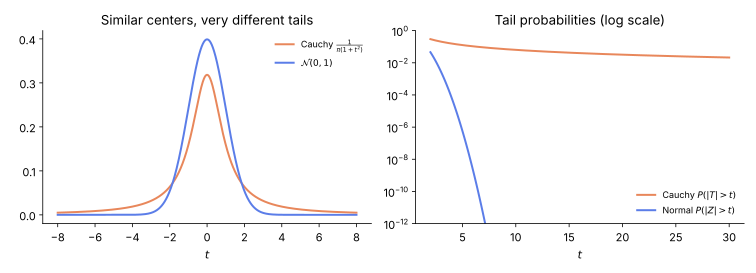
  <figcaption>Original figure for these notes, illustrating Blitzstein and Hwang, <em>Introduction to Probability</em>, Example 7.1.24. Near the center the shapes look similar; in the tails the Cauchy assigns vastly more probability.</figcaption>
</figure>

<div class="example-block" markdown="1">
<div class="ex-title">How heavy is the tail? <span class="ex-pill pill-num">Worked example</span></div>

$$
P(\lvert T\rvert>10)=1-\frac2\pi\arctan10\approx0.0635.
$$

About one Cauchy draw in 16 exceeds 10 in absolute value. For a standard Normal, $$P(\lvert Z\rvert>10)\approx1.5\times10^{-23}$$.

</div>

#### Supplementary: Averages do not settle

If $$T_1,\ldots,T_n$$ are i.i.d. Cauchy, their average is again Cauchy, with the same distribution as a single $$T_j$$ (a result proved with tools beyond this lecture). Averaging more Cauchy observations therefore gives no more precision. The occasional enormous value keeps dragging the average away.

<figure>
  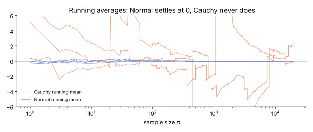
  <figcaption>Original simulation for these notes (supplementary). Normal running means converge to 0; Cauchy running means keep jumping after single extreme draws.</figcaption>
</figure>

<div class="misconception-block" markdown="1">

**Incorrect:** The Cauchy PDF is symmetric about 0, so its mean is 0.

**Correction:** Symmetry gives a mean of 0 only when the mean exists, that is, when $$E\lvert T\rvert<\infty$$. For the Cauchy, $$E\lvert T\rvert=\infty$$. The median is 0; the mean is undefined.

</div>

### Part 5 — Original practice questions

Try these before reading the answers.

1. Let $$X,Y$$ be i.i.d. $$\mathcal N(3,4)$$. Find $$E\lvert X-Y\rvert$$.
2. Let $$Z_1,Z_2,Z_3$$ be i.i.d. $$\mathcal N(0,1)$$. Find $$E\lvert Z_1+Z_2+Z_3\rvert$$.
3. Survey responses fall into “agree”, “neutral”, “disagree” with probabilities $$0.5,0.3,0.2$$. For 8 independent responses, find $$P(4,3,1)$$ and $$E(\text{number neutral})$$.
4. In question 3, find the distribution of the number of responses that are not “agree”.
5. In question 3, given that exactly 5 responses agree, find the distribution of the number of neutral responses.
6. Show that the multinomial coefficients sum to $$k^n$$ over all $$(n_1,\ldots,n_k)$$ with $$\sum n_j=n$$. *(Hint: set every $$p_j=1/k$$.)*
7. For $$T\sim\operatorname{Cauchy}$$, find $$P(-1<T<\sqrt3)$$.
8. Show that $$1/T$$ is also Cauchy when $$T$$ is Cauchy.
9. Let $$U\sim\operatorname{Unif}(0,1)$$. Show that $$\tan\left(\pi(U-\tfrac12)\right)$$ is Cauchy. *(Supplementary: universality of the Uniform.)*

### Part 6 — Practice answers

#### 1. Non-standard Normals

$$X-Y\sim\mathcal N(0,8)$$, so $$E\lvert X-Y\rvert=\sqrt8\sqrt{2/\pi}=4/\sqrt\pi\approx2.257$$, matching $$2\sigma/\sqrt\pi$$ with $$\sigma=2$$.

#### 2. A sum of three

$$Z_1+Z_2+Z_3\sim\mathcal N(0,3)$$, so the answer is $$\sqrt3\sqrt{2/\pi}=\sqrt{6/\pi}\approx1.382$$.

#### 3. A survey

$$P(4,3,1)=\frac{8!}{4!\,3!\,1!}(0.5)^4(0.3)^3(0.2)=280(0.0625)(0.027)(0.2)\approx0.0945$$. The neutral count is $$\operatorname{Bin}(8,0.3)$$ with mean $$2.4$$.

#### 4. Lumping

“Not agree” merges two categories with total probability $$0.5$$, so the count is $$\operatorname{Bin}(8,0.5)$$.

#### 5. Conditioning

The other 3 responses are neutral or disagree with probabilities $$0.3/0.5=0.6$$ and $$0.4$$. So the neutral count given 5 agrees is $$\operatorname{Bin}(3,0.6)$$.

#### 6. Counting assignments

With $$p_j=1/k$$, the PMF values are $$\frac{n!}{n_1!\cdots n_k!}k^{-n}$$ and must sum to 1. Multiplying by $$k^n$$ gives the identity. Directly: each of $$n$$ objects has $$k$$ choices.

#### 7. A Cauchy interval

$$F(\sqrt3)-F(-1)=\frac1\pi\left(\arctan\sqrt3-\arctan(-1)\right)=\frac1\pi\left(\frac\pi3+\frac\pi4\right)=\frac7{12}$$.

#### 8. Reciprocal

$$1/T=Y/X$$, the ratio of the same two i.i.d. Normals in the other order, which has the same distribution as $$X/Y$$.

#### 9. Simulation by inverse CDF

Solving $$u=\frac12+\frac1\pi\arctan t$$ gives $$t=\tan\left(\pi(u-\tfrac12)\right)=F^{-1}(u)$$. By universality, $$F^{-1}(U)$$ has the Cauchy CDF.

### Part 7 — Quick revision sheet

| Concept | Essential fact |
|---|---|
| Difference of i.i.d. $$\mathcal N(0,1)$$ | $$Z_1-Z_2\sim\mathcal N(0,2)$$ |
| $$E\lvert Z\rvert$$ | $$\sqrt{2/\pi}$$ |
| Expected Normal distance | $$2/\sqrt\pi$$, or $$2\sigma/\sqrt\pi$$ |
| Multinomial story | $$n$$ independent objects into $$k$$ categories |
| Multinomial PMF | $$\frac{n!}{n_1!\cdots n_k!}p_1^{n_1}\cdots p_k^{n_k}$$ |
| Marginal | $$X_j\sim\operatorname{Bin}(n,p_j)$$ |
| Lumping | Merge categories; add their probabilities |
| Conditioning | Remaining counts Multinomial with $$p_j/(1-p_1)$$ |
| Cauchy definition | $$X/Y$$ for i.i.d. $$\mathcal N(0,1)$$ |
| Cauchy PDF | $$\frac1{\pi(1+t^2)}$$ |
| Cauchy CDF | $$\frac12+\frac1\pi\arctan t$$ |
| Cauchy mean | Does not exist; median 0 |
| Tail | $$P(\lvert T\rvert>t)\approx2/(\pi t)$$ |

### Term Glossary

<div class="glossary-entry" markdown="1">
<div class="gterm">Multinomial distribution <span class="gcat cat-defn">Definition</span></div>

The joint distribution of category counts when $$n$$ objects are independently assigned to $$k$$ categories with fixed probabilities.

</div>

<div class="glossary-entry" markdown="1">
<div class="gterm">Multinomial coefficient <span class="gcat cat-notn">Notation</span></div>

$$\frac{n!}{n_1!\cdots n_k!}$$, the number of ways to divide $$n$$ labeled objects into groups of sizes $$n_1,\ldots,n_k$$.

</div>

<div class="glossary-entry" markdown="1">
<div class="gterm">Lumping property <span class="gcat cat-prop">Property</span></div>

Merging Multinomial categories yields a Multinomial whose probabilities are sums of the merged probabilities.

</div>

<div class="glossary-entry" markdown="1">
<div class="gterm">Cauchy distribution <span class="gcat cat-defn">Definition</span></div>

The distribution of the ratio of two i.i.d. standard Normals, with PDF $$\frac1{\pi(1+t^2)}$$. It has no mean.

</div>

<div class="glossary-entry" markdown="1">
<div class="gterm">Heavy tail <span class="gcat cat-meas">Measure</span></div>

A tail probability that decays slowly, such as like a power of $$t$$ rather than exponentially, so that extreme values remain non-negligible and moments may fail to exist.

</div>

<div class="ref-tags">
  <span class="ref-tag">Statistics 110</span>
  <span class="ref-tag">Lecture 20</span>
  <span class="ref-tag">Normal</span>
  <span class="ref-tag">Multinomial</span>
  <span class="ref-tag">Cauchy</span>
  <span class="ref-tag">Heavy tails</span>
</div>

  </div>
</div>


## Lecture 21 - Covariance and Correlation

<div class="chapter-block">
  <button type="button" class="chapter-toggle" id="lecture-21-toggle" onclick="toggleLecture('lecture-21')" aria-expanded="true" aria-controls="lecture-21-body">
    <span class="chapter-toggle-left">
      <span class="chapter-badge">Lecture 21</span>
      <span>
        <span class="chapter-title">Lecture 21 - Covariance and Correlation</span>
        <span class="chapter-subtitle">Covariance and its bilinearity, the variance of a sum, uncorrelated versus independent, correlation bounds, and covariances in the Multinomial, Binomial, and Hypergeometric</span>
      </span>
    </span>
    <span class="chapter-arrow open" id="lecture-21-arrow" aria-hidden="true">▼</span>
  </button>
  <div class="chapter-body open" id="lecture-21-body" markdown="1">

<div class="note-abstract" markdown="1">

Variance is not linear, so the variance of a sum needs a new tool: covariance, which measures how two random variables vary together. Covariance is symmetric, ignores added constants, and is bilinear, so it expands like a product of sums. With it, $$\operatorname{Var}(X+Y)=\operatorname{Var}(X)+\operatorname{Var}(Y)+2\operatorname{Cov}(X,Y)$$. Independent random variables are uncorrelated, but uncorrelated ones need not be independent. Correlation is covariance after standardizing, so it has no units and always lies between $$-1$$ and $$1$$. These tools give the negative covariance of two Multinomial counts, the Binomial variance in one line, and the first step of the Hypergeometric variance.

</div>

### Notation at a Glance

<div class="notation-panel" markdown="1">

| Symbol | Meaning |
|---|---|
| $$\operatorname{Cov}(X,Y)$$ | Covariance, $$E\big((X-EX)(Y-EY)\big)$$ |
| $$\operatorname{Corr}(X,Y)$$, $$\rho$$ | Correlation, the covariance of the standardized variables |
| $$\operatorname{SD}(X)$$ | Standard deviation, $$\sqrt{\operatorname{Var}(X)}$$ |
| $$\dfrac{X-EX}{\operatorname{SD}(X)}$$ | Standardized $$X$$: mean 0, variance 1 |
| $$I_A$$ | Indicator random variable of event $$A$$ |
| $$\mathbf X\sim\operatorname{Mult}_k(n,\mathbf p)$$ | Multinomial category counts |
| $$X\sim\operatorname{HGeom}(w,b,n)$$ | White balls in a sample of $$n$$ drawn without replacement from $$w$$ white and $$b$$ black |

</div>

### Learning objectives

After studying these notes, you should be able to:

- Define covariance, interpret its sign, and compute it with $$E(XY)-E(X)E(Y)$$.
- Use symmetry, constants, and bilinearity to expand the covariance of sums.
- Compute the variance of a sum of possibly dependent random variables.
- Explain why independence implies zero covariance, and give an uncorrelated pair that is dependent.
- Define correlation as the covariance of standardized variables and prove that it lies in $$[-1,1]$$.
- Find the covariance of two Multinomial counts using the lumping property.
- Use indicator facts to find the Binomial variance and to set up the Hypergeometric variance.

### Part 1 — Covariance: how two random variables vary together

<div class="example-block" markdown="1">
<div class="ex-title">Covariance <span class="ex-pill pill-defn">Definition</span></div>

For random variables $$X$$ and $$Y$$ on the same sample space,

$$
\boxed{\operatorname{Cov}(X,Y)=E\big((X-EX)(Y-EY)\big).}
$$

</div>

The product brings the two variables together. If $$X$$ tends to be above its mean when $$Y$$ is above its mean, and below when $$Y$$ is below, the two deviations usually have the same sign, so the product is usually positive and the covariance is positive: $$X$$ and $$Y$$ are **positively correlated**. If being above the mean in one tends to go with being below the mean in the other, the product is usually negative, and they are **negatively correlated**.

Expanding the product and using linearity gives the formula used most often in practice:

$$
\begin{aligned}
\operatorname{Cov}(X,Y)
&=E\big(XY-X\,EY-Y\,EX+EX\,EY\big)\\
&=E(XY)-EX\,EY-EX\,EY+EX\,EY\\
&=E(XY)-E(X)E(Y).
\end{aligned}
$$

<div class="result-box" markdown="1">

$$
\boxed{\operatorname{Cov}(X,Y)=E(XY)-E(X)E(Y).}
$$

</div>

The definition is better for intuition; the second form is usually easier to compute. With $$Y=X$$, it becomes $$E(X^2)-(EX)^2$$, the familiar variance formula.

### Part 2 — Properties and bilinearity

Each property follows by substituting into the definition, or into $$E(XY)-E(X)E(Y)$$, and using linearity of expectation.

| Property | Statement |
|---|---|
| 1. Variance | $$\operatorname{Cov}(X,X)=\operatorname{Var}(X)$$ |
| 2. Symmetry | $$\operatorname{Cov}(X,Y)=\operatorname{Cov}(Y,X)$$ |
| 3. Constants | $$\operatorname{Cov}(X,c)=0$$ for any constant $$c$$ |
| 4. Scaling | $$\operatorname{Cov}(cX,Y)=c\operatorname{Cov}(X,Y)$$ |
| 5. Sums | $$\operatorname{Cov}(X,Y+Z)=\operatorname{Cov}(X,Y)+\operatorname{Cov}(X,Z)$$ |

For property 3, $$c-E(c)=0$$, so the product inside the expectation is 0. For property 5, replace $$Y$$ by $$Y+Z$$: $$E(X(Y+Z))=E(XY)+E(XZ)$$ and $$E(Y+Z)=EY+EZ$$, and the terms regroup into the two covariances.

Properties 4 and 5 together are called **bilinearity**: holding one argument fixed, covariance is linear in the other. Adding a constant changes nothing either, since $$\operatorname{Cov}(X+c,Y)=\operatorname{Cov}(X,Y)+\operatorname{Cov}(c,Y)=\operatorname{Cov}(X,Y)$$.

Bilinearity works like the distributive law. For example,

$$
\operatorname{Cov}(X+Y,Z+W)=\operatorname{Cov}(X,Z)+\operatorname{Cov}(X,W)+\operatorname{Cov}(Y,Z)+\operatorname{Cov}(Y,W).
$$

In general, for constants $$a_i,b_j$$,

<div class="result-box" markdown="1">

$$
\boxed{\operatorname{Cov}\left(\sum_{i=1}^m a_iX_i,\ \sum_{j=1}^n b_jY_j\right)=\sum_{i=1}^m\sum_{j=1}^n a_ib_j\operatorname{Cov}(X_i,Y_j).}
$$

</div>

Every term on the left is paired with every term on the right, and constants come out. Using these rules directly is usually much easier than returning to the definition.

### Part 3 — The variance of a sum

By property 1 and bilinearity,

$$
\operatorname{Var}(X_1+X_2)=\operatorname{Cov}(X_1+X_2,X_1+X_2)
=\operatorname{Var}(X_1)+\operatorname{Var}(X_2)+\operatorname{Cov}(X_1,X_2)+\operatorname{Cov}(X_2,X_1).
$$

The two cross terms are equal by symmetry, so

<div class="result-box" markdown="1">

$$
\boxed{\operatorname{Var}(X_1+X_2)=\operatorname{Var}(X_1)+\operatorname{Var}(X_2)+2\operatorname{Cov}(X_1,X_2).}
$$

For $$n$$ terms,

$$
\boxed{\operatorname{Var}\left(\sum_{j=1}^n X_j\right)=\sum_{j=1}^n\operatorname{Var}(X_j)+2\sum_{i<j}\operatorname{Cov}(X_i,X_j).}
$$

</div>

The factor 2 is there because the sum runs over $$i<j$$, so each pair appears once although $$\operatorname{Cov}(X_i,X_j)$$ and $$\operatorname{Cov}(X_j,X_i)$$ both occur. Summing over all $$i\ne j$$ instead would need no factor 2.

The variance of a sum equals the sum of the variances exactly when the covariance terms add to zero. Independence is one way for this to happen, but not the only way.

For a difference, write $$X-Y=X+(-Y)$$:

$$
\operatorname{Var}(X-Y)=\operatorname{Var}(X)+\operatorname{Var}(Y)-2\operatorname{Cov}(X,Y).
$$

The variances still add; only the covariance term changes sign.

<div class="example-block" markdown="1">
<div class="ex-title">A die and the sum of two dice <span class="ex-pill pill-num">Worked example</span></div>

Roll two fair dice independently. Let $$X$$ be the first die and $$S=X+Y$$ the total, where $$Y$$ is the second die. Each die has variance $$35/12$$.

By bilinearity and independence of $$X$$ and $$Y$$,

$$
\operatorname{Cov}(X,S)=\operatorname{Cov}(X,X)+\operatorname{Cov}(X,Y)=\frac{35}{12}+0=\frac{35}{12},
$$

$$
\operatorname{Var}(S)=\frac{35}{12}+\frac{35}{12}=\frac{35}{6}.
$$

The covariance is positive: a high first die tends to make the total high. Correlation (Part 5) puts this on a fixed scale:

$$
\operatorname{Corr}(X,S)=\frac{35/12}{\sqrt{(35/12)(35/6)}}=\frac1{\sqrt2}\approx0.707.
$$

<div class="ex-lesson">Expanding covariances with bilinearity avoids computing $$E(XS)$$ from the joint distribution.</div>
</div>

### Part 4 — Uncorrelated versus independent

<div class="example-block" markdown="1">
<div class="ex-title">Independent implies uncorrelated <span class="ex-pill pill-thm">Theorem</span></div>

If $$X$$ and $$Y$$ are independent, then $$\operatorname{Cov}(X,Y)=0$$. Random variables with zero covariance are called **uncorrelated**.

</div>

**Proof.** Independence gives $$E(XY)=E(X)E(Y)$$, shown in Lecture 19 with two-dimensional LOTUS. So $$\operatorname{Cov}(X,Y)=E(XY)-E(X)E(Y)=0$$.

The converse is false.

<div class="example-block" markdown="1">
<div class="ex-title">A Normal and its square <span class="ex-pill pill-ex">Worked example</span></div>

Let $$Z\sim\mathcal N(0,1)$$, $$X=Z$$, and $$Y=Z^2$$. The odd moments of a standard Normal are 0, so

$$
\operatorname{Cov}(X,Y)=E(Z^3)-E(Z)E(Z^2)=0-0\cdot1=0.
$$

So $$X$$ and $$Y$$ are uncorrelated. They are extremely dependent: $$Y$$ is a function of $$X$$, so knowing $$X$$ determines $$Y$$ completely. Knowing $$Y$$ also gives information about $$X$$: it determines $$\lvert X\rvert=\sqrt Y$$, leaving only the sign unknown.

<div class="ex-lesson">Correlation measures linear association. Here the relationship is a perfect parabola, with no linear trend at all.</div>
</div>

<figure>
  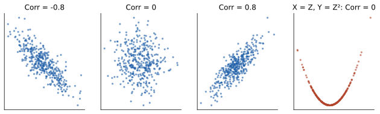
  <figcaption>Original figure for these notes. Correlation measures the linear trend of a cloud of points. The last panel is uncorrelated yet completely dependent.</figcaption>
</figure>

A stronger statement is true but beyond these notes: if every function of $$X$$ is uncorrelated with every function of $$Y$$, then $$X$$ and $$Y$$ are independent. Zero correlation between $$X$$ and $$Y$$ themselves is not enough.

<div class="misconception-block" markdown="1">

**Incorrect:** The covariance is 0, so $$X$$ and $$Y$$ are independent.

**Correction:** Zero covariance rules out a linear trend only. $$X=Z$$ and $$Y=Z^2$$ are uncorrelated but completely dependent. Independence implies uncorrelated; the reverse direction fails.

</div>

### Part 5 — Correlation

Covariance depends on units. If $$X$$ and $$Y$$ are lengths, measuring them in nanometers instead of light-years changes the covariance by an enormous factor, so a covariance of 42 says little by itself. Correlation removes the units by standardizing first.

<div class="example-block" markdown="1">
<div class="ex-title">Correlation <span class="ex-pill pill-defn">Definition</span></div>

$$
\boxed{\operatorname{Corr}(X,Y)=\operatorname{Cov}\left(\frac{X-EX}{\operatorname{SD}(X)},\frac{Y-EY}{\operatorname{SD}(Y)}\right)=\frac{\operatorname{Cov}(X,Y)}{\operatorname{SD}(X)\operatorname{SD}(Y)}.}
$$

</div>

The two forms agree: subtracting the means is adding constants, which does not change covariance, and the standard deviations come out as constants by property 4. The standardized variables have mean 0 and variance 1 and are unitless, since a measurement in nanometers minus nanometers, divided by nanometers, has no units.

<div class="example-block" markdown="1">
<div class="ex-title">Correlation bounds <span class="ex-pill pill-thm">Theorem</span></div>

For any $$X$$ and $$Y$$ with positive finite variances,

$$
\boxed{-1\le\operatorname{Corr}(X,Y)\le1.}
$$

</div>

**Proof.** Standardizing does not change the correlation, so assume without loss of generality that $$X$$ and $$Y$$ already have mean 0 and variance 1. Then $$\operatorname{Cov}(X,Y)=\operatorname{Corr}(X,Y)=\rho$$, and

$$
\operatorname{Var}(X+Y)=1+1+2\rho=2+2\rho,\qquad
\operatorname{Var}(X-Y)=1+1-2\rho=2-2\rho.
$$

Variances are nonnegative, so $$2+2\rho\ge0$$ and $$2-2\rho\ge0$$, which gives $$-1\le\rho\le1$$. $$\blacksquare$$

The proof also shows when the extremes occur: $$\rho=1$$ exactly when $$\operatorname{Var}(X-Y)=0$$, so the standardized variables are equal with probability 1, and $$\rho=-1$$ exactly when they are negatives of each other. A correlation of $$0.9$$ is therefore high, because the largest possible value is 1. This inequality is a form of the Cauchy–Schwarz inequality.

### Part 6 — Covariance in a Multinomial

Let $$\mathbf X=(X_1,\ldots,X_k)\sim\operatorname{Mult}_k(n,\mathbf p)$$. Each count is Binomial, so $$\operatorname{Cov}(X_i,X_i)=\operatorname{Var}(X_i)=np_i(1-p_i)$$. For two different categories, the covariance should be negative: the $$n$$ objects are fixed in number, so more objects in category 1 leaves fewer for category 2.

Find $$c=\operatorname{Cov}(X_1,X_2)$$ by computing $$\operatorname{Var}(X_1+X_2)$$ in two ways. By the variance of a sum,

$$
\operatorname{Var}(X_1+X_2)=np_1(1-p_1)+np_2(1-p_2)+2c.
$$

By the lumping property, merging categories 1 and 2 gives a Binomial count with success probability $$p_1+p_2$$:

$$
\operatorname{Var}(X_1+X_2)=n(p_1+p_2)(1-p_1-p_2).
$$

Setting these equal and expanding, the terms $$np_1-np_1^2+np_2-np_2^2$$ cancel from both sides, leaving $$2c=-2np_1p_2$$. Relabeling gives the general result:

<div class="result-box" markdown="1">

$$
\boxed{\operatorname{Cov}(X_i,X_j)=-np_ip_j,\qquad i\ne j.}
$$

</div>

The covariance is negative, as predicted.

<div class="example-block" markdown="1">
<div class="ex-title">Counting ones and twos <span class="ex-pill pill-num">Worked example</span></div>

Roll a fair die 12 times. Let $$X_1$$ and $$X_2$$ be the numbers of ones and twos. Then

$$
\operatorname{Cov}(X_1,X_2)=-12\cdot\frac16\cdot\frac16=-\frac13,\qquad
\operatorname{Var}(X_1)=\operatorname{Var}(X_2)=12\cdot\frac16\cdot\frac56=\frac53,
$$

$$
\operatorname{Corr}(X_1,X_2)=\frac{-1/3}{5/3}=-\frac15.
$$

<div class="ex-lesson">The categories compete for a fixed number of objects, so their counts are negatively correlated.</div>
</div>

### Part 7 — Indicators: the Binomial variance

Two facts about indicator random variables are simple but often overlooked.

<div class="result-box" markdown="1">

$$
\boxed{I_A^k=I_A\ \text{for any positive integer }k,\qquad I_AI_B=I_{A\cap B}.}
$$

</div>

Powers of 0 and 1 are 0 and 1, and a product of two 0/1 values is 1 exactly when both are 1.

**Bernoulli variance.** If $$I\sim\operatorname{Bern}(p)$$, then $$I^2=I$$, so

$$
\operatorname{Var}(I)=E(I^2)-(EI)^2=p-p^2=p(1-p)=pq.
$$

**Binomial variance.** Write $$X\sim\operatorname{Bin}(n,p)$$ as $$X=I_1+\cdots+I_n$$ with $$I_j$$ i.i.d. $$\operatorname{Bern}(p)$$. The indicators are independent, so every covariance term is 0, and

$$
\boxed{\operatorname{Var}(X)=npq.}
$$

This agrees with the indicator calculation in Lecture 14, now in one line.

### Part 8 — Setting up the Hypergeometric variance

Let $$X\sim\operatorname{HGeom}(w,b,n)$$: draw $$n$$ balls without replacement from an urn with $$w$$ white and $$b$$ black balls, and count the white ones. Write $$X=I_1+\cdots+I_n$$, where $$I_j$$ indicates that the $$j$$th ball drawn is white. Now the indicators are **dependent**, so the covariance terms remain:

$$
\operatorname{Var}(X)=\sum_{j=1}^n\operatorname{Var}(I_j)+2\sum_{i<j}\operatorname{Cov}(I_i,I_j).
$$

**Symmetry.** Before any ball is drawn, the $$j$$th ball is equally likely to be any of the $$w+b$$ balls, so each $$I_j\sim\operatorname{Bern}(p)$$ with $$p=w/(w+b)$$. These are unconditional statements: no earlier draw is being observed. Likewise every pair of positions has the same joint distribution, so all $$\binom n2$$ covariances equal $$\operatorname{Cov}(I_1,I_2)$$:

$$
\operatorname{Var}(X)=np(1-p)+2\binom n2\operatorname{Cov}(I_1,I_2).
$$

**The covariance.** By $$I_1I_2=I_{A_1\cap A_2}$$ and the fundamental bridge,

$$
\operatorname{Cov}(I_1,I_2)=P(\text{first two balls white})-p^2=\frac{w}{w+b}\cdot\frac{w-1}{w+b-1}-p^2.
$$

Everything is now known; the remaining step is algebra, completed in Lecture 22.

<div class="misconception-block" markdown="1">

**Incorrect:** To find $$P(I_2=1)$$, the second ball's color must be conditioned on the first ball's color.

**Correction:** Without observing the first ball, the second ball is equally likely to be any ball in the urn, so $$P(I_2=1)=w/(w+b)$$ by symmetry. Conditioning on the first ball is needed only for joint events such as both balls being white.

</div>

### Part 9 — Original practice questions

Try these before reading the answers.

1. Suppose $$\operatorname{Var}(X)=4$$, $$\operatorname{Var}(Y)=9$$, and $$\operatorname{Cov}(X,Y)=-2$$. Find $$\operatorname{Var}(X+Y)$$ and $$\operatorname{Var}(X-Y)$$.
2. With $$\operatorname{Var}(X)=1$$, $$\operatorname{Var}(Y)=4$$, and $$\operatorname{Cov}(X,Y)=0.5$$, find $$\operatorname{Cov}(2X+3,\,Y-X)$$.
3. Let $$X\sim\operatorname{Unif}(-1,1)$$ and $$Y=X^2$$. Show that $$X$$ and $$Y$$ are uncorrelated but dependent.
4. Let $$X$$ and $$Y$$ be i.i.d. with variance $$\sigma^2>0$$. Find $$\operatorname{Corr}(X,X+Y)$$.
5. For constants $$a,c\ne0$$ and $$b,d$$, express $$\operatorname{Corr}(aX+b,\,cY+d)$$ in terms of $$\operatorname{Corr}(X,Y)$$.
6. Ten people answer a survey with three categories of probabilities $$0.5,0.3,0.2$$. Find $$\operatorname{Cov}(X_1,X_2)$$, and check $$\operatorname{Var}(X_1+X_2)$$ by lumping.
7. Show that $$\operatorname{Corr}(X,Y)=1$$ implies that the standardized versions of $$X$$ and $$Y$$ are equal with probability 1.
8. A deck of $$n\ge2$$ cards labeled $$1,\ldots,n$$ is shuffled. Let $$M$$ be the number of cards in their own position. Find $$\operatorname{Var}(M)$$.
9. Explain why $$\operatorname{Var}(X_1+\cdots+X_n)=n\operatorname{Var}(X_1)$$ for i.i.d. variables but not for $$X_1=\cdots=X_n$$.

### Part 10 — Practice answers

#### 1. Sums and differences

$$\operatorname{Var}(X+Y)=4+9+2(-2)=9$$ and $$\operatorname{Var}(X-Y)=4+9-2(-2)=17$$.

#### 2. Bilinearity

The constant 3 drops out. Then $$\operatorname{Cov}(2X,Y-X)=2\operatorname{Cov}(X,Y)-2\operatorname{Var}(X)=1-2=-1$$.

#### 3. A symmetric parabola

$$E(X)=0$$ and $$E(X^3)=0$$ by symmetry, so $$\operatorname{Cov}(X,X^2)=E(X^3)-E(X)E(X^2)=0$$. They are dependent: for example, $$P(Y>1/4)=1/2$$, but given $$X=0.9$$, $$Y=0.81>1/4$$ with certainty.

#### 4. A variable and a sum containing it

$$\operatorname{Cov}(X,X+Y)=\operatorname{Var}(X)+\operatorname{Cov}(X,Y)=\sigma^2$$, and $$\operatorname{Var}(X+Y)=2\sigma^2$$. So $$\operatorname{Corr}=\sigma^2/(\sigma\cdot\sqrt2\,\sigma)=1/\sqrt2$$, matching the dice example.

#### 5. Changing units

$$\operatorname{Cov}(aX+b,cY+d)=ac\operatorname{Cov}(X,Y)$$ and $$\operatorname{SD}(aX+b)\operatorname{SD}(cY+d)=\lvert a\rvert\lvert c\rvert\operatorname{SD}(X)\operatorname{SD}(Y)$$. So the correlation is $$\operatorname{Corr}(X,Y)$$ if $$ac>0$$ and $$-\operatorname{Corr}(X,Y)$$ if $$ac<0$$. Changing units does not change correlation.

#### 6. Survey counts

$$\operatorname{Cov}(X_1,X_2)=-10(0.5)(0.3)=-1.5$$. Then $$\operatorname{Var}(X_1)+\operatorname{Var}(X_2)+2\operatorname{Cov}=2.5+2.1-3=1.6$$. By lumping, $$X_1+X_2\sim\operatorname{Bin}(10,0.8)$$ with variance $$10(0.8)(0.2)=1.6$$. They agree.

#### 7. The extreme case

For standardized $$\tilde X,\tilde Y$$ with correlation 1, $$\operatorname{Var}(\tilde X-\tilde Y)=2-2(1)=0$$. A variable with variance 0 equals its mean with probability 1, and $$E(\tilde X-\tilde Y)=0$$, so $$\tilde X=\tilde Y$$ with probability 1. Equivalently, $$Y$$ is an increasing linear function of $$X$$.

#### 8. Matches in a shuffled deck

Let $$I_j$$ indicate a match at position $$j$$, so $$P(I_j=1)=1/n$$ and, for $$i\ne j$$, $$P(I_i=I_j=1)=\frac1{n(n-1)}$$. Then

$$
\operatorname{Var}(M)=n\cdot\frac1n\left(1-\frac1n\right)+2\binom n2\left(\frac1{n(n-1)}-\frac1{n^2}\right)
=\left(1-\frac1n\right)+\frac1n=1.
$$

The mean and variance of the number of matches are both 1.

#### 9. Independent copies versus one variable repeated

For i.i.d. variables all covariances are 0, giving $$n\operatorname{Var}(X_1)$$. If all $$X_j$$ equal $$X_1$$, every covariance equals $$\operatorname{Var}(X_1)$$, and the sum is $$nX_1$$ with variance $$n^2\operatorname{Var}(X_1)$$.

### Part 11 — Quick revision sheet

| Concept | Essential fact |
|---|---|
| Covariance | $$E((X-EX)(Y-EY))=E(XY)-E(X)E(Y)$$ |
| Sign | Positive: tend to be above or below their means together |
| Basic properties | $$\operatorname{Cov}(X,X)=\operatorname{Var}(X)$$; symmetric; $$\operatorname{Cov}(X,c)=0$$ |
| Bilinearity | $$\operatorname{Cov}(\sum a_iX_i,\sum b_jY_j)=\sum\sum a_ib_j\operatorname{Cov}(X_i,Y_j)$$ |
| Variance of a sum | $$\sum\operatorname{Var}(X_j)+2\sum_{i<j}\operatorname{Cov}(X_i,X_j)$$ |
| Difference | $$\operatorname{Var}(X-Y)=\operatorname{Var}X+\operatorname{Var}Y-2\operatorname{Cov}(X,Y)$$ |
| Independence | Implies uncorrelated; not conversely ($$Z$$ and $$Z^2$$) |
| Correlation | Covariance of standardized variables; unitless |
| Bounds | $$-1\le\operatorname{Corr}\le1$$, from $$\operatorname{Var}(X\pm Y)\ge0$$ |
| Multinomial | $$\operatorname{Cov}(X_i,X_j)=-np_ip_j$$ for $$i\ne j$$ |
| Indicators | $$I_A^k=I_A$$, $$I_AI_B=I_{A\cap B}$$ |
| Binomial | $$\operatorname{Var}=npq$$ by adding independent Bernoulli variances |
| Hypergeometric setup | $$np(1-p)+2\binom n2\operatorname{Cov}(I_1,I_2)$$, with dependent indicators |

### Term Glossary

<div class="glossary-entry" markdown="1">
<div class="gterm">Covariance <span class="gcat cat-meas">Measure</span></div>

$$E((X-EX)(Y-EY))$$, a measure of how two random variables vary together. Its sign indicates the direction of their linear association.

</div>

<div class="glossary-entry" markdown="1">
<div class="gterm">Bilinearity <span class="gcat cat-prop">Property</span></div>

Covariance is linear in each argument when the other is held fixed, so the covariance of two sums expands into covariances of all pairs of terms.

</div>

<div class="glossary-entry" markdown="1">
<div class="gterm">Uncorrelated <span class="gcat cat-defn">Definition</span></div>

Having covariance 0. Independent random variables are uncorrelated, but uncorrelated ones may be dependent.

</div>

<div class="glossary-entry" markdown="1">
<div class="gterm">Correlation <span class="gcat cat-meas">Measure</span></div>

The covariance of the standardized variables, $$\operatorname{Cov}(X,Y)/(\operatorname{SD}(X)\operatorname{SD}(Y))$$. It is unitless and lies between $$-1$$ and $$1$$.

</div>

<div class="glossary-entry" markdown="1">
<div class="gterm">Standardization <span class="gcat cat-defn">Definition</span></div>

Replacing $$X$$ by $$(X-EX)/\operatorname{SD}(X)$$, which has mean 0, variance 1, and no units.

</div>

<div class="glossary-entry" markdown="1">
<div class="gterm">Indicator product rule <span class="gcat cat-prop">Property</span></div>

$$I_AI_B=I_{A\cap B}$$ and $$I_A^k=I_A$$, which turn expectations of products of indicators into probabilities of intersections.

</div>

<div class="ref-tags">
  <span class="ref-tag">Statistics 110</span>
  <span class="ref-tag">Lecture 21</span>
  <span class="ref-tag">Covariance</span>
  <span class="ref-tag">Correlation</span>
  <span class="ref-tag">Variance of a sum</span>
  <span class="ref-tag">Multinomial</span>
  <span class="ref-tag">Indicators</span>
</div>

  </div>
</div>


## Lecture 22 - Transformations and Convolutions

<div class="chapter-block">
  <button type="button" class="chapter-toggle" id="lecture-22-toggle" onclick="toggleLecture('lecture-22')" aria-expanded="true" aria-controls="lecture-22-body">
    <span class="chapter-toggle-left">
      <span class="chapter-badge">Lecture 22</span>
      <span>
        <span class="chapter-title">Lecture 22 - Transformations and Convolutions</span>
        <span class="chapter-subtitle">The Hypergeometric variance and finite population correction, change of variables in one and several dimensions, the Log-Normal, convolutions, and the probabilistic method</span>
      </span>
    </span>
    <span class="chapter-arrow open" id="lecture-22-arrow" aria-hidden="true">▼</span>
  </button>
  <div class="chapter-body open" id="lecture-22-body" markdown="1">

<div class="note-abstract" markdown="1">

The Hypergeometric variance is the Binomial variance times a finite population correction, $$\frac{N-n}{N-1}$$. LOTUS gives the mean of a transformed random variable; the change-of-variables formula gives its whole distribution. For a smooth, strictly increasing $$g$$ and $$Y=g(X)$$, the PDF is $$f_Y(y)=f_X(x)\,dx/dy$$, written as a function of $$y$$. The Log-Normal shows the method. In several dimensions the derivative becomes the absolute value of a Jacobian determinant. A convolution is the distribution of a sum of independent random variables, found by conditioning on one of them. Finally, probability can prove that an object exists: if a random object has a property with positive probability, or if the average score is high, some object must have that property or score.

</div>

### Notation at a Glance

<div class="notation-panel" markdown="1">

| Symbol | Meaning |
|---|---|
| $$N=w+b$$, $$p=w/N$$ | Population size and fraction of white balls |
| $$\dfrac{N-n}{N-1}$$ | Finite population correction |
| $$Y=g(X)$$, $$y=g(x)$$ | A transformation and its counterpart for values |
| $$\dfrac{dx}{dy}$$ | Derivative of $$x=g^{-1}(y)$$ with respect to $$y$$ |
| $$\dfrac{\partial\mathbf x}{\partial\mathbf y}$$ | Jacobian matrix of partial derivatives $$\partial x_i/\partial y_j$$ |
| $$\left\lvert\det\dfrac{\partial\mathbf x}{\partial\mathbf y}\right\rvert$$ | Absolute value of the Jacobian determinant |
| $$T=X+Y$$ | A sum whose distribution is a convolution |

</div>

### Learning objectives

After studying these notes, you should be able to:

- Derive the Hypergeometric variance and interpret the finite population correction through extreme cases.
- State and prove the one-dimensional change-of-variables formula, and check its assumptions.
- Derive the Log-Normal PDF.
- Apply the multivariate change-of-variables formula with a Jacobian determinant.
- Write convolution sums and integrals for independent random variables, and justify the continuous case through the CDF.
- Use the probabilistic method to prove that an object with a desired property exists.

### Part 1 — Finishing the Hypergeometric variance

Lecture 21 reduced the variance of $$X\sim\operatorname{HGeom}(w,b,n)$$ to

$$
\operatorname{Var}(X)=np(1-p)+2\binom n2\operatorname{Cov}(I_1,I_2),\qquad
\operatorname{Cov}(I_1,I_2)=p\cdot\frac{w-1}{N-1}-p^2,
$$

where $$N=w+b$$ is the population size and $$p=w/N$$. Simplify the covariance:

$$
\operatorname{Cov}(I_1,I_2)=p\left(\frac{w-1}{N-1}-\frac wN\right)
=p\cdot\frac{N(w-1)-w(N-1)}{N(N-1)}
=p\cdot\frac{w-N}{N(N-1)}
=-\frac{p(1-p)}{N-1}.
$$

It is negative: drawing a white ball first leaves fewer white balls for the second draw. Then

$$
\operatorname{Var}(X)=np(1-p)-n(n-1)\frac{p(1-p)}{N-1}
=np(1-p)\left(1-\frac{n-1}{N-1}\right).
$$

<div class="result-box" markdown="1">

$$
\boxed{\operatorname{Var}(X)=\frac{N-n}{N-1}\,np(1-p),\qquad N=w+b,\ p=\frac wN.}
$$

</div>

This is the Binomial variance $$np(1-p)$$ times a factor called the **finite population correction**. Sampling without replacement varies less than sampling with replacement.

**Checking extreme cases.**

- If $$n=1$$, the factor is 1 and the variance is $$p(1-p)$$. With one draw, replacement cannot matter.
- If $$N$$ is much larger than $$n$$, say $$n=20$$ and $$N=100{,}000$$, the factor is nearly 1 and the variance is nearly Binomial. In a huge population, drawing the same individual twice is very unlikely even with replacement, so the two schemes behave alike.
- If $$n=N$$, the factor is 0. The whole urn is drawn, so $$X=w$$ with certainty.

<div class="example-block" markdown="1">
<div class="ex-title">Aces in a poker hand <span class="ex-pill pill-num">Worked example</span></div>

Let $$X$$ be the number of aces in a five-card hand: $$X\sim\operatorname{HGeom}(4,48,5)$$, with $$N=52$$ and $$p=1/13$$.

$$
np(1-p)=5\cdot\frac1{13}\cdot\frac{12}{13}=\frac{60}{169}\approx0.355,\qquad
\frac{N-n}{N-1}=\frac{47}{51}\approx0.922,
$$

$$
\operatorname{Var}(X)=\frac{47}{51}\cdot\frac{60}{169}=\frac{940}{2873}\approx0.327.
$$

<div class="ex-lesson">Five cards is a small sample from 52, so the correction is modest; the variance is about 8% below the Binomial value.</div>
</div>

### Part 2 — Change of variables in one dimension

LOTUS gives $$E(g(X))$$ without finding the distribution of $$g(X)$$. Often the whole distribution is needed.

<div class="example-block" markdown="1">
<div class="ex-title">Change of variables in one dimension <span class="ex-pill pill-thm">Theorem</span></div>

Let $$X$$ be continuous with PDF $$f_X$$, and let $$Y=g(X)$$, where $$g$$ is differentiable and strictly increasing on the support of $$X$$. Then

$$
\boxed{f_Y(y)=f_X(x)\frac{dx}{dy},}
$$

where $$y=g(x)$$, so $$x=g^{-1}(y)$$, and the right side is written as a function of $$y$$.

</div>

**Reading the formula.** The right side contains $$x$$. Substitute $$x=g^{-1}(y)$$ so that the answer is a function of $$y$$. By the chain rule, $$\frac{dx}{dy}=1\Big/\frac{dy}{dx}$$, so either derivative can be computed, whichever is easier. A mnemonic is $$f_Y(y)\,dy=f_X(x)\,dx$$: probability in a tiny interval is preserved.

**Proof.** Find the CDF and differentiate. Since $$g$$ is strictly increasing, the events $$\{g(X)\le y\}$$ and $$\{X\le g^{-1}(y)\}$$ are the same:

$$
F_Y(y)=P(g(X)\le y)=P(X\le g^{-1}(y))=F_X(g^{-1}(y))=F_X(x).
$$

Differentiating with respect to $$y$$ by the chain rule gives $$f_Y(y)=f_X(x)\frac{dx}{dy}$$. $$\blacksquare$$

If $$g$$ is strictly decreasing instead, the same argument gives $$f_Y(y)=f_X(x)\left\lvert\frac{dx}{dy}\right\rvert$$. The absolute value keeps the density positive.

<div class="misconception-block" markdown="1">

**Incorrect:** For $$Z\sim\mathcal N(0,1)$$ and $$Y=Z^2$$, plug $$g(z)=z^2$$ into the formula.

**Correction:** $$z^2$$ decreases on the negative half-line and increases on the positive half-line, so it is not strictly increasing. Go back to the CDF instead. On a positive support, such as $$X\sim\operatorname{Expo}(1)$$, the function $$x^2$$ is strictly increasing and the formula applies.

</div>

<div class="example-block" markdown="1">
<div class="ex-title">Supplementary: The square of a standard Normal <span class="ex-pill pill-ex">Worked example</span></div>

For $$y>0$$, use the CDF directly:

$$
F_Y(y)=P(-\sqrt y\le Z\le\sqrt y)=2\Phi(\sqrt y)-1.
$$

Differentiating, $$f_Y(y)=2\varphi(\sqrt y)\cdot\frac1{2\sqrt y}=\frac1{\sqrt{2\pi y}}e^{-y/2}$$ for $$y>0$$. This distribution is called the Chi-Square with one degree of freedom.

<div class="ex-lesson">When $$g$$ is not one-to-one, add up the probability from every piece of the support that maps to a given $$y$$; the CDF does this automatically.</div>
</div>

### Part 3 — The Log-Normal distribution

<div class="example-block" markdown="1">
<div class="ex-title">Log-Normal PDF <span class="ex-pill pill-ex">Worked example</span></div>

Let $$Z\sim\mathcal N(0,1)$$ and $$Y=e^Z$$. The name means that $$\log Y=Z$$ is Normal. It does not mean the log of a Normal, which would be undefined for negative values.

The function $$y=e^z$$ is strictly increasing and differentiable, so the theorem applies.

1. Write $$z$$ in terms of $$y$$: $$z=\log y$$.
2. Find the derivative: $$\frac{dy}{dz}=e^z=y$$, so $$\frac{dz}{dy}=\frac1y$$.
3. Substitute into $$f_Y(y)=\varphi(z)\frac{dz}{dy}$$:

$$
\boxed{f_Y(y)=\frac1{y\sqrt{2\pi}}\,e^{-(\log y)^2/2},\qquad y>0.}
$$

Since $$P(Y\le1)=P(Z\le0)=\frac12$$, the median is 1. The mean, found from the Normal MGF, is $$E(Y)=E(e^Z)=e^{1/2}\approx1.65$$, larger than the median because of the long right tail.

<div class="ex-lesson">The derivative factor $$1/y$$ reflects how the exponential stretches the right half of the line and compresses the left half.</div>
</div>

<figure>
  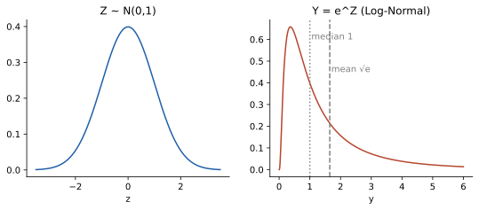
  <figcaption>Original figure for these notes, illustrating Blitzstein and Hwang, <em>Introduction to Probability</em>, Example 8.1.2. Exponentiating a Normal produces a right-skewed distribution on the positive half-line.</figcaption>
</figure>

### Part 4 — Change of variables in several dimensions

Now let $$\mathbf X=(X_1,\ldots,X_n)$$ be a continuous random vector with joint PDF $$f_{\mathbf X}$$, and $$\mathbf Y=g(\mathbf X)$$, where $$g$$ maps $$\mathbb R^n$$ to $$\mathbb R^n$$, is invertible, and has continuous partial derivatives. The analogous formula holds:

<div class="result-box" markdown="1">

$$
\boxed{f_{\mathbf Y}(\mathbf y)=f_{\mathbf X}(\mathbf x)\left\lvert\det\frac{\partial\mathbf x}{\partial\mathbf y}\right\rvert,}
$$

</div>

again written as a function of $$\mathbf y$$. The **Jacobian matrix** collects every partial derivative of the $$x$$'s with respect to the $$y$$'s:

$$
\frac{\partial\mathbf x}{\partial\mathbf y}=
\begin{pmatrix}
\dfrac{\partial x_1}{\partial y_1}&\cdots&\dfrac{\partial x_1}{\partial y_n}\\
\vdots&\ddots&\vdots\\
\dfrac{\partial x_n}{\partial y_1}&\cdots&\dfrac{\partial x_n}{\partial y_n}
\end{pmatrix}.
$$

The bars mean the absolute value of the determinant: the determinant compresses the matrix to one number, and the absolute value keeps the density positive. As in one dimension, $$\left\lvert\det\frac{\partial\mathbf x}{\partial\mathbf y}\right\rvert=1\Big/\left\lvert\det\frac{\partial\mathbf y}{\partial\mathbf x}\right\rvert$$, so compute whichever direction is easier. Writing $$\partial\mathbf x/\partial\mathbf y$$ rather than a bare $$J$$ makes the direction clear. The proof is an exercise in multivariable calculus.

<div class="example-block" markdown="1">
<div class="ex-title">Supplementary: Sum and difference of two Normals <span class="ex-pill pill-ex">Worked example</span></div>

Let $$X,Y$$ be i.i.d. $$\mathcal N(0,1)$$, $$U=X+Y$$, and $$V=X-Y$$. Invert: $$x=\frac{u+v}2$$, $$y=\frac{u-v}2$$. The Jacobian determinant is

$$
\det\begin{pmatrix}1/2&1/2\\1/2&-1/2\end{pmatrix}=-\frac12,\qquad\text{absolute value }\frac12.
$$

Since $$x^2+y^2=\frac{u^2+v^2}{2}$$,

$$
f_{U,V}(u,v)=\frac1{2\pi}e^{-(u^2+v^2)/4}\cdot\frac12
=\left(\frac1{\sqrt{4\pi}}e^{-u^2/4}\right)\left(\frac1{\sqrt{4\pi}}e^{-v^2/4}\right).
$$

The joint PDF factors into two $$\mathcal N(0,2)$$ densities, so $$U$$ and $$V$$ are independent $$\mathcal N(0,2)$$.

<div class="ex-lesson">A Jacobian calculation can reveal independence: if the new joint PDF factors, the new variables are independent.</div>
</div>

### Part 5 — Convolutions

A **convolution** is the distribution of a sum of independent random variables. Stories (the Binomial) and MGFs (the Poisson and Normal) have handled some sums already. When neither helps, compute directly. Let $$T=X+Y$$ with $$X$$ and $$Y$$ independent.

**Discrete case.** For $$T=t$$, $$X$$ must take some value $$x$$ and $$Y$$ must make up the rest. These are disjoint cases, and independence splits each probability:

<div class="result-box" markdown="1">

$$
\boxed{P(T=t)=\sum_xP(X=x)P(Y=t-x).}
$$

**Continuous case.**

$$
\boxed{f_T(t)=\int_{-\infty}^{\infty}f_X(x)f_Y(t-x)\,dx.}
$$

</div>

The continuous formula looks like the discrete one with PMFs replaced by PDFs, but an analogy is not a proof. **Justification.** Condition on $$X$$ with the continuous law of total probability, then use independence to drop the condition:

$$
F_T(t)=\int_{-\infty}^{\infty}P(X+Y\le t\mid X=x)f_X(x)\,dx=\int_{-\infty}^{\infty}F_Y(t-x)f_X(x)\,dx.
$$

Differentiating with respect to $$t$$, and exchanging the derivative and the integral, gives the formula, since $$F_Y'=f_Y$$.

<div class="misconception-block" markdown="1">

**Incorrect:** By analogy with sums, the PDF of a product $$XY$$ is $$\int f_X(x)f_Y(t/x)\,dx$$.

**Correction:** Reasoning by analogy fails here. Conditioning on $$X=x$$ and differentiating $$P(Y\le t/x)$$ (for $$x>0$$) produces an extra factor $$1/\lvert x\rvert$$, so the correct formula is $$\int f_X(x)f_Y(t/x)\frac1{\lvert x\rvert}\,dx$$. Derive such formulas through the CDF.

</div>

<div class="example-block" markdown="1">
<div class="ex-title">Supplementary: Sum of two Exponentials <span class="ex-pill pill-num">Worked example</span></div>

Let $$X,Y$$ be i.i.d. $$\operatorname{Expo}(\lambda)$$. For $$t>0$$, the integrand is nonzero only when $$0<x<t$$:

$$
f_T(t)=\int_0^t\lambda e^{-\lambda x}\,\lambda e^{-\lambda(t-x)}\,dx=\lambda^2e^{-\lambda t}\int_0^t dx=\lambda^2te^{-\lambda t}.
$$

<div class="ex-lesson">The limits of integration come from where both densities are positive. This density reappears in Lecture 24 as a Gamma distribution.</div>
</div>

When possible, prefer a story or an MGF to a convolution integral; use the integral when nothing else works.

### Part 6 — The probabilistic method: proving existence

Probability can prove that an object with a desired property exists, even when the problem mentions no randomness.

**Strategy 1.** Choose an object at random, for example uniformly from a finite collection. Let $$A$$ be the event that the chosen object has the property. If $$P(A)>0$$, then some object has the property, since otherwise $$P(A)$$ would be 0. Only a lower bound on $$P(A)$$ is needed, not its exact value.

**Strategy 2.** Suppose each object has a numerical score. Choose an object at random and let $$X$$ be its score. Then

<div class="result-box" markdown="1">

$$
\boxed{\text{some object has score at least }E(X).}
$$

</div>

Not every object can be below average. If $$E(X)$$ is good, a good object exists, even if none can be exhibited.

**Shannon's theorem.** This method underlies information theory. In 1948 Claude Shannon showed that a noisy channel has a capacity, and that messages can be sent at any rate below it with an arbitrarily small probability of error. He proved that good codes exist by showing that a randomly chosen code performs well on average. Explicit codes achieving this were found only decades later. Modern communication, including cell phones, rests on this work.

<div class="example-block" markdown="1">
<div class="ex-title">Overlapping committees <span class="ex-pill pill-ex">Worked example</span></div>

There are 100 people and 15 committees of 20 people each. Each person is on exactly 3 committees, consistent with $$15\cdot20=300=100\cdot3$$. Show that some two committees share at least 3 members.

Searching every pair of committees directly would be hopeless in general. Instead, choose 2 of the 15 committees at random, all $$\binom{15}2$$ pairs equally likely, and find the expected overlap.

1. **Indicators.** For each person $$i$$, let $$I_i$$ indicate that person $$i$$ is on both chosen committees. The overlap is $$I_1+\cdots+I_{100}$$.
2. **Probability.** Person $$i$$ is on 3 committees, so the chosen pair must be one of the $$\binom32$$ pairs among those three:

$$
P(I_i=1)=\frac{\binom32}{\binom{15}2}=\frac3{105}=\frac1{35}.
$$

3. **Linearity.** The expected overlap is $$100\cdot\frac1{35}=\frac{20}7\approx2.86$$.

Some pair of committees has overlap at least $$20/7$$. An overlap is an integer, so that pair shares at least 3 members.

<div class="ex-lesson">An average of $$20/7$$ guarantees some value at least $$20/7$$, and integer values round this up to 3.</div>
</div>

### Part 7 — Original practice questions

Try these before reading the answers.

1. An urn has 6 white and 4 black balls. Draw 5 without replacement. Find the variance of the number of white balls, and compare with drawing with replacement.
2. Let $$X\sim\operatorname{Unif}(0,1)$$ and $$Y=X^3$$. Find the PDF of $$Y$$.
3. Let $$U\sim\operatorname{Unif}(0,1)$$ and $$Y=-\log U$$. Use the change-of-variables formula to identify the distribution of $$Y$$.
4. Let $$Y=e^{\mu+\sigma Z}$$ with $$Z\sim\mathcal N(0,1)$$ and $$\sigma>0$$. Find the PDF of $$Y$$.
5. Let $$X\sim\operatorname{Expo}(1)$$ and $$Y=X^2$$. Find the PDF of $$Y$$.
6. Let $$X,Y$$ be i.i.d. $$\operatorname{Unif}(0,1)$$. Find the PDF of $$X+Y$$ by a convolution integral.
7. Let $$X\sim\operatorname{Pois}(\lambda)$$ and $$Y\sim\operatorname{Pois}(\mu)$$ be independent. Use the convolution sum to show $$X+Y\sim\operatorname{Pois}(\lambda+\mu)$$.
8. Thirty people form 10 committees of 9, and each person is on exactly 3 committees. What does the probabilistic method guarantee about the largest overlap of two committees?
9. Explain why the probabilistic method can prove existence without producing an example.

### Part 8 — Practice answers

#### 1. Finite population correction

$$N=10$$, $$p=0.6$$, and $$np(1-p)=1.2$$. The correction is $$\frac{10-5}{10-1}=\frac59$$, so $$\operatorname{Var}(X)=\frac59(1.2)=\frac23$$. With replacement the variance would be $$1.2$$.

#### 2. A cube

$$y=x^3$$ is increasing on $$(0,1)$$, with $$x=y^{1/3}$$ and $$\frac{dx}{dy}=\frac13y^{-2/3}$$. So $$f_Y(y)=\frac13y^{-2/3}$$ for $$0<y<1$$.

#### 3. Back to the Exponential

$$y=-\log u$$ is decreasing, with $$u=e^{-y}$$ and $$\left\lvert\frac{du}{dy}\right\rvert=e^{-y}$$. So $$f_Y(y)=1\cdot e^{-y}$$ for $$y>0$$: $$Y\sim\operatorname{Expo}(1)$$, matching universality of the Uniform.

#### 4. General Log-Normal

$$z=\frac{\log y-\mu}\sigma$$ and $$\frac{dz}{dy}=\frac1{\sigma y}$$. So

$$
f_Y(y)=\frac1{\sigma y\sqrt{2\pi}}\exp\left(-\frac{(\log y-\mu)^2}{2\sigma^2}\right),\qquad y>0.
$$

#### 5. Square of an Exponential

On $$x>0$$, $$y=x^2$$ is increasing, $$x=\sqrt y$$, and $$\frac{dx}{dy}=\frac1{2\sqrt y}$$. So $$f_Y(y)=\frac{e^{-\sqrt y}}{2\sqrt y}$$ for $$y>0$$.

#### 6. The triangle

$$f_T(t)=\int_0^1f_Y(t-x)\,dx$$, where $$f_Y(t-x)=1$$ when $$0<t-x<1$$. For $$0<t\le1$$, $$x$$ ranges over $$(0,t)$$, giving $$t$$. For $$1<t<2$$, $$x$$ ranges over $$(t-1,1)$$, giving $$2-t$$. The density is a triangle peaking at $$t=1$$.

#### 7. Poisson convolution

$$
P(X+Y=k)=\sum_{j=0}^k\frac{e^{-\lambda}\lambda^j}{j!}\cdot\frac{e^{-\mu}\mu^{k-j}}{(k-j)!}
=\frac{e^{-(\lambda+\mu)}}{k!}\sum_{j=0}^k\binom kj\lambda^j\mu^{k-j}
=\frac{e^{-(\lambda+\mu)}(\lambda+\mu)^k}{k!},
$$

by the binomial theorem. This confirms the MGF result from Lecture 18.

#### 8. Smaller committees

$$10\cdot9=90=30\cdot3$$, so the counts are consistent. For a random pair of committees, $$P(\text{person on both})=\binom32\big/\binom{10}2=\frac3{45}$$, so the expected overlap is $$30\cdot\frac3{45}=2$$. Some pair shares at least 2 members.

#### 9. Existence without construction

If no object had the property, the probability that a random object has it would be exactly 0. A positive probability, or an average that some object must reach, rules this out, so an object exists without being identified.

### Part 9 — Quick revision sheet

| Concept | Essential fact |
|---|---|
| Hypergeometric covariance | $$\operatorname{Cov}(I_1,I_2)=-p(1-p)/(N-1)$$ |
| Hypergeometric variance | $$\frac{N-n}{N-1}np(1-p)$$ |
| Finite population correction | 1 when $$n=1$$; near 1 when $$N\gg n$$; 0 when $$n=N$$ |
| One-dimensional change of variables | $$f_Y(y)=f_X(x)\lvert dx/dy\rvert$$ for strictly monotone smooth $$g$$ |
| Check assumptions | Not one-to-one, such as $$Z^2$$: return to the CDF |
| Log-Normal | $$Y=e^Z$$: $$f_Y(y)=\frac1{y\sqrt{2\pi}}e^{-(\log y)^2/2}$$, $$y>0$$ |
| Multivariate | $$f_{\mathbf Y}(\mathbf y)=f_{\mathbf X}(\mathbf x)\lvert\det\partial\mathbf x/\partial\mathbf y\rvert$$ |
| Either direction | $$\lvert\det\partial\mathbf x/\partial\mathbf y\rvert=1/\lvert\det\partial\mathbf y/\partial\mathbf x\rvert$$ |
| Discrete convolution | $$P(T=t)=\sum_xP(X=x)P(Y=t-x)$$ |
| Continuous convolution | $$f_T(t)=\int f_X(x)f_Y(t-x)\,dx$$, justified via the CDF |
| Preference order | Story, then MGF, then convolution sum or integral |
| Probabilistic method | $$P(A)>0$$ for a random object, or some object scores at least $$E(X)$$ |
| Committees | Expected overlap $$20/7$$, so some pair shares at least 3 |

### Term Glossary

<div class="glossary-entry" markdown="1">
<div class="gterm">Finite population correction <span class="gcat cat-meas">Measure</span></div>

The factor $$\frac{N-n}{N-1}$$ by which the Hypergeometric variance falls below the corresponding Binomial variance.

</div>

<div class="glossary-entry" markdown="1">
<div class="gterm">Change of variables <span class="gcat cat-thm">Theorem</span></div>

For a smooth invertible transformation, the PDF of the new variable is the old PDF times the absolute derivative, or absolute Jacobian determinant, of the inverse map.

</div>

<div class="glossary-entry" markdown="1">
<div class="gterm">Jacobian <span class="gcat cat-notn">Notation</span></div>

The matrix of all partial derivatives of one set of variables with respect to another. The absolute value of its determinant rescales densities in a multivariate transformation.

</div>

<div class="glossary-entry" markdown="1">
<div class="gterm">Log-Normal distribution <span class="gcat cat-defn">Definition</span></div>

The distribution of $$e^Z$$ with $$Z$$ Normal, so that its logarithm is Normal.

</div>

<div class="glossary-entry" markdown="1">
<div class="gterm">Convolution <span class="gcat cat-defn">Definition</span></div>

The distribution of a sum of independent random variables, given by $$\sum_xP(X=x)P(Y=t-x)$$ or $$\int f_X(x)f_Y(t-x)\,dx$$.

</div>

<div class="glossary-entry" markdown="1">
<div class="gterm">Probabilistic method <span class="gcat cat-thm">Theorem</span></div>

Proving that an object with a property exists by showing that a randomly chosen object has the property with positive probability, or that the average score is high enough.

</div>

<div class="ref-tags">
  <span class="ref-tag">Statistics 110</span>
  <span class="ref-tag">Lecture 22</span>
  <span class="ref-tag">Hypergeometric</span>
  <span class="ref-tag">Change of variables</span>
  <span class="ref-tag">Log-Normal</span>
  <span class="ref-tag">Jacobian</span>
  <span class="ref-tag">Convolution</span>
  <span class="ref-tag">Probabilistic method</span>
</div>

  </div>
</div>


## Lecture 23 - Beta Distribution

<div class="chapter-block">
  <button type="button" class="chapter-toggle" id="lecture-23-toggle" onclick="toggleLecture('lecture-23')" aria-expanded="true" aria-controls="lecture-23-body">
    <span class="chapter-toggle-left">
      <span class="chapter-badge">Lecture 23</span>
      <span>
        <span class="chapter-title">Lecture 23 - Beta Distribution</span>
        <span class="chapter-subtitle">The Beta family on (0,1), Beta–Binomial conjugacy, Bayes’ billiards, and a guest segment on probability in finance</span>
      </span>
    </span>
    <span class="chapter-arrow open" id="lecture-23-arrow" aria-hidden="true">▼</span>
  </button>
  <div class="chapter-body open" id="lecture-23-body" markdown="1">

<div class="note-abstract" markdown="1">

The Beta distribution generalizes the Uniform: it lives on $$(0,1)$$, but its density $$x^{a-1}(1-x)^{b-1}$$ can be flat, sloped, U-shaped, or hump-shaped depending on the parameters $$a,b>0$$. Its main use is as a distribution for an unknown probability. It is the conjugate prior for the Binomial: a $$\operatorname{Beta}(a,b)$$ prior and $$X$$ successes in $$n$$ trials give a $$\operatorname{Beta}(a+X,\,b+n-X)$$ posterior, found without computing any normalizing constant. Bayes’ billiards evaluates $$\int_0^1\binom nk x^k(1-x)^{n-k}\,dx=\frac1{n+1}$$ without calculus, which gives the Beta normalizing constant for integer parameters. A guest segment shows expectation at work in finance.

</div>

### Notation at a Glance

<div class="notation-panel" markdown="1">

| Symbol | Meaning |
|---|---|
| $$X\sim\operatorname{Beta}(a,b)$$ | Beta distribution with parameters $$a,b>0$$ |
| $$\beta(a,b)$$ | Beta function, $$\int_0^1x^{a-1}(1-x)^{b-1}\,dx$$ |
| $$p\sim\operatorname{Beta}(a,b)$$ | Prior distribution for an unknown probability |
| $$X\mid p\sim\operatorname{Bin}(n,p)$$ | Data: successes in $$n$$ trials, given $$p$$ |
| $$f(p\mid X=k)$$ | Posterior PDF of $$p$$ |
| $$\propto$$ | Proportional to, as a function of the variable of interest |
| $$S_T$$, $$K$$ | Asset price at a future time $$T$$ and an option's strike price |

</div>

### Learning objectives

After studying these notes, you should be able to:

- Write the Beta PDF and describe how $$a$$ and $$b$$ control its shape.
- Explain why the Beta is a natural prior for an unknown probability.
- Derive the posterior distribution in the Beta–Binomial model using proportionality.
- Interpret the conjugate update as adding observed successes and failures to the parameters.
- Use Bayes’ billiards to evaluate $$\int_0^1x^k(1-x)^{n-k}\,dx$$ without calculus.
- Describe a financial derivative and express its price as an expectation computed by LOTUS.

### Part 1 — The Beta distribution

So far the Uniform is the only named continuous distribution that is bounded, and its density is flat. The Normal lives on the whole line and the Exponential on the positive half-line. The Beta stays on $$(0,1)$$ but allows other shapes.

<div class="example-block" markdown="1">
<div class="ex-title">Beta distribution <span class="ex-pill pill-defn">Definition</span></div>

A random variable $$X$$ has the **Beta distribution** with parameters $$a>0$$ and $$b>0$$, written $$X\sim\operatorname{Beta}(a,b)$$, if its PDF is

$$
\boxed{f(x)=c\,x^{a-1}(1-x)^{b-1},\qquad0<x<1,}
$$

and 0 otherwise. The normalizing constant is $$c=1/\beta(a,b)$$, where $$\beta(a,b)=\int_0^1x^{a-1}(1-x)^{b-1}\,dx$$ is the **beta function**.

</div>

It is a whole family, one distribution for each choice of $$a$$ and $$b$$, and the parameters need not be integers. Much can be done without knowing $$c$$; its general value is found in Lecture 25.

**A flexible family.** Varying the parameters changes the shape:

| Parameters | Density | Shape |
|---|---|---|
| $$a=b=1$$ | $$1$$ | Flat: $$\operatorname{Beta}(1,1)=\operatorname{Unif}(0,1)$$ |
| $$a=2,\ b=1$$ | $$2x$$ | Increases linearly; the triangle has area 1 |
| $$a=b=\tfrac12$$ | $$\propto x^{-1/2}(1-x)^{-1/2}$$ | U-shaped, blowing up at both ends |
| $$a=b=2$$ | $$6x(1-x)$$ | An upside-down U, symmetric about $$1/2$$ |

In general, $$a$$ pushes mass toward 1 and $$b$$ pushes it toward 0. When $$a=b$$ the density is symmetric about $$1/2$$.

<figure>
  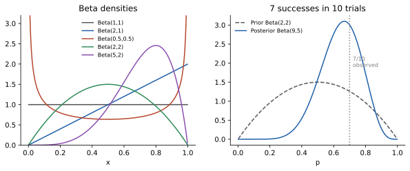
  <figcaption>Original figure for these notes, illustrating Blitzstein and Hwang, <em>Introduction to Probability</em>, Definition 8.3.1 and Story 8.3.3. Left: the shapes available in the Beta family. Right: a prior updated by Binomial data.</figcaption>
</figure>

**Why the Beta matters.**

- It is the most widely used distribution for a quantity between 0 and 1, especially an unknown probability.
- It is the conjugate prior for the Binomial (Part 2).
- It connects to the Uniform, Gamma, and order statistics, as Lectures 24 and 25 show.

### Part 2 — Beta–Binomial conjugacy

Laplace's rule of succession (Lecture 17) treated an unknown probability $$p$$ as Uniform. Replace the Uniform prior with any Beta prior.

**The model.**

$$
p\sim\operatorname{Beta}(a,b),\qquad X\mid p\sim\operatorname{Bin}(n,p).
$$

Here $$p$$ is treated as a random variable to reflect uncertainty about it, the Bayesian approach. The **prior** $$\operatorname{Beta}(a,b)$$ describes beliefs about $$p$$ before the data. $$X$$ is the data. The goal is the **posterior**, the distribution of $$p$$ given $$X$$.

**Bayes’ rule with a density.**

$$
f(p\mid X=k)=\frac{P(X=k\mid p)\,f(p)}{P(X=k)}.
$$

The denominator is a probability that does not depend on $$p$$: it averages over all values of $$p$$. As a function of $$p$$, it is a constant. Constants such as $$\binom nk$$ and $$c$$ can be dropped too:

$$
f(p\mid X=k)\propto p^k(1-p)^{n-k}\cdot p^{a-1}(1-p)^{b-1}=p^{a+k-1}(1-p)^{b+n-k-1}.
$$

This is the shape of a Beta density. The missing constant is whatever makes it integrate to 1, so the posterior must be a Beta:

<div class="result-box" markdown="1">

$$
\boxed{p\mid X\sim\operatorname{Beta}(a+X,\ b+n-X).}
$$

</div>

**Conjugacy.** A family of priors is **conjugate** for a model if every prior in the family produces a posterior in the same family. Starting from a Beta, the data only update the parameters. This is computationally convenient: no new distribution has to be studied. Whether a conjugate prior is the right description of one's uncertainty is a separate, debated question.

**Interpretation.** Read $$a$$ and $$b$$ as earlier, imagined data: $$a$$ prior successes and $$b$$ prior failures. The new data add $$X$$ successes and $$n-X$$ failures. Laplace's rule is the case $$a=b=1$$.

<div class="example-block" markdown="1">
<div class="ex-title">Updating a belief about a success rate <span class="ex-pill pill-num">Worked example</span></div>

Suppose a prior $$p\sim\operatorname{Beta}(2,2)$$, symmetric about $$1/2$$ and mildly favoring middle values. In 10 independent trials there are 7 successes.

The posterior is $$\operatorname{Beta}(2+7,\ 2+3)=\operatorname{Beta}(9,5)$$, with density proportional to $$p^8(1-p)^4$$. It is concentrated near $$0.7$$ and much narrower than the prior: the data have both moved and sharpened the belief.

If the same 10 trials are split into two batches, say 4 successes in 5 trials, then 3 in 5, the sequential updates give $$\operatorname{Beta}(6,3)$$ and then $$\operatorname{Beta}(9,5)$$, the same answer. This is the coherence of Bayes' rule from Lecture 5.

<div class="ex-lesson">The posterior parameters are the prior parameters plus the observed successes and failures.</div>
</div>

**Looking ahead.** Moments of the Beta are easy once the normalizing constant is known: $$x\cdot x^{a-1}=x^{(a+1)-1}$$, so $$E(X)$$ is an integral of the same Beta form with $$a$$ raised by 1, and $$E(X^2)$$ raises $$a$$ by 2. Lecture 25 finds the constant and the mean.

<div class="misconception-block" markdown="1">

**Incorrect:** To find the posterior, the denominator $$P(X=k)$$ must be computed first.

**Correction:** $$P(X=k)$$ does not depend on $$p$$. Work up to proportionality in $$p$$, recognize the Beta shape, and the normalizing constant takes care of itself.

</div>

### Part 3 — Bayes’ billiards

For integer parameters, Bayes found the needed integral without calculus. For integers $$0\le k\le n$$, the goal is

$$
\int_0^1\binom nk x^k(1-x)^{n-k}\,dx.
$$

Expanding by the binomial theorem and integrating term by term would be tedious. Instead, compare two ways of producing the same random picture.

**Story 1.** Take $$n+1$$ white billiard balls and paint one pink. Throw all of them independently and uniformly onto $$(0,1)$$.

**Story 2.** Throw all $$n+1$$ white balls independently and uniformly onto $$(0,1)$$, then choose one at random and paint it pink.

The two stories produce the same distribution of pictures: it does not matter whether the pink ball was chosen before or after the throw. Let $$X$$ be the number of white balls to the left of the pink ball.

**From Story 1.** Throw the pink ball first and condition on its position $$p$$. Each of the $$n$$ white balls independently lands left of the pink ball with probability $$p$$, so $$X\mid p\sim\operatorname{Bin}(n,p)$$. The pink ball's position is Uniform, with density 1. By the continuous law of total probability,

$$
P(X=k)=\int_0^1\binom nk p^k(1-p)^{n-k}\,dp.
$$

**From Story 2.** The pink ball is a uniformly random one of the $$n+1$$ thrown balls, so its rank among them is equally likely to be any of $$1,\ldots,n+1$$. The number of white balls to its left is therefore equally likely to be any of $$0,1,\ldots,n$$:

$$
P(X=k)=\frac1{n+1}.
$$

<div class="result-box" markdown="1">

$$
\boxed{\int_0^1\binom nk x^k(1-x)^{n-k}\,dx=\frac1{n+1},\qquad k=0,1,\ldots,n.}
$$

</div>

Equivalently, $$\beta(k+1,\,n-k+1)=\dfrac{k!\,(n-k)!}{(n+1)!}$$. This is the Beta normalizing constant whenever both parameters are positive integers.

<div class="example-block" markdown="1">
<div class="ex-title">A Beta integral without calculus <span class="ex-pill pill-num">Worked example</span></div>

Find $$\int_0^1x^2(1-x)^3\,dx$$. Here $$k=2$$ and $$n=5$$, so

$$
\int_0^1x^2(1-x)^3\,dx=\frac1{\binom52\cdot6}=\frac1{60}.
$$

So the $$\operatorname{Beta}(3,4)$$ density is $$60x^2(1-x)^3$$.

<div class="ex-lesson">Matching the integrand to a Binomial probability turns the integral into the probability that the pink ball has a given rank.</div>
</div>

### Part 4 — Guest segment: probability in finance

This part summarizes a guest presentation on Statistics 123, Applied Quantitative Finance, a course whose only prerequisite is Statistics 110. It shows how expectation and LOTUS appear in quantitative finance.

**Financial derivatives.** A financial **derivative** is a contract whose payoff at a future date is a function of another random quantity, usually an asset price $$S_T$$ at time $$T$$. A contract paying $1 if Boston gets more than 80 inches of snow this winter is a weather derivative. In finance the payoff is a random variable $$g(S_T)$$, and a key result says that, with the distribution of $$S_T$$ chosen appropriately, the fair price is an expectation:

$$
\text{price}=E\big(g(S_T)\big)=\int g(s)f(s)\,ds,
$$

which is LOTUS.

<div class="example-block" markdown="1">
<div class="ex-title">A puzzle about exchange rates <span class="ex-pill pill-ex">Worked example</span></div>

Suppose one euro is worth $1 today, and in a year it will be worth either $1.25 or $0.80, each with probability $$1/2$$. The expected value of a euro in a year is

$$
\frac12(1.25)+\frac12(0.80)=1.025\text{ dollars},
$$

so the euro is expected to appreciate. Now describe the same model from the dollar's side. A dollar will be worth either $$1/1.25=0.80$$ euros or $$1/0.80=1.25$$ euros, each with probability $$1/2$$, so its expected value is also $$1.025$$ euros. The dollar is expected to appreciate against the euro too.

Both calculations are correct. They concern different random variables, $$S$$ and $$1/S$$, and $$E(1/S)\ne1/E(S)$$ because $$1/s$$ is not linear. Expectation does not commute with nonlinear functions, as the St. Petersburg paradox showed with $$E(2^X)\ne2^{E(X)}$$. Deciding which expectation should be used to price currency contracts is a deeper question, taken up in Statistics 123.

<div class="ex-lesson">A model can predict that each of two currencies will appreciate against the other on average, because the exchange rate and its reciprocal have different expectations.</div>
</div>

<div class="example-block" markdown="1">
<div class="ex-title">Warrants in the 2008 bailout <span class="ex-pill pill-ex">Worked example</span></div>

In October 2008, as part of the government's response to the financial crisis, the US government paid Goldman Sachs about $450 million. In return it received warrants: the right, but not the obligation, to buy 10 million Goldman Sachs shares at $125 each within ten years. The shares were then trading at about $95.

A warrant of this kind works like a **call option** with **strike price** $$K=125$$. At maturity, it is used only if the share price is above $125, so its value is

$$
g(S_T)=\max(S_T-K,\,0).
$$

If the price is $150, it is worth $25; at $100, it is worth $0. The implied price was $$450\text{ million}/10\text{ million}=\$45$$ per option. With a density $$f$$ for $$S_T$$, LOTUS gives

$$
E\big(\max(S_T-K,0)\big)=\int_K^\infty(s-K)f(s)\,ds.
$$

Under a particular Log-Normal model for $$S_T$$, this integral is the Black–Scholes formula.

<div class="ex-lesson">Option pricing reduces to computing the expectation of a function of a random price.</div>
</div>

### Part 5 — Original practice questions

Try these before reading the answers.

1. For $$X\sim\operatorname{Beta}(3,1)$$, find the normalizing constant and $$P(X>1/2)$$.
2. For $$X\sim\operatorname{Beta}(2,2)$$, find $$P(X<1/3)$$.
3. With a Uniform prior on $$p$$, you observe 3 successes in 4 trials. What is the posterior distribution?
4. Starting from a $$\operatorname{Beta}(1,1)$$ prior, you observe a success, a success, then a failure. Find the posterior after each step, and check that the final posterior does not depend on the order.
5. Use Bayes’ billiards to evaluate $$\int_0^1x^3(1-x)^2\,dx$$.
6. Show that if $$X\sim\operatorname{Beta}(a,b)$$ then $$1-X\sim\operatorname{Beta}(b,a)$$.
7. For $$a,b>1$$, find the mode of the $$\operatorname{Beta}(a,b)$$ density.
8. In the exchange-rate model, compute $$E(S)$$ and $$1/E(S)$$ for the euro's dollar value $$S$$, and compare $$1/E(S)$$ with $$E(1/S)$$.
9. Suppose a share price in a year is $$\operatorname{Unif}(100,150)$$. Find the expected payoff of a call option with strike $$K=125$$.

### Part 6 — Practice answers

#### 1. A rising density

$$\int_0^1x^2\,dx=\frac13$$, so $$f(x)=3x^2$$. Then $$P(X>1/2)=1-(1/2)^3=\frac78$$.

#### 2. A symmetric hump

$$f(x)=6x(1-x)$$, with CDF $$3x^2-2x^3$$. So $$P(X<1/3)=\frac13-\frac2{27}=\frac7{27}$$.

#### 3. Laplace's case

The prior is $$\operatorname{Beta}(1,1)$$, so the posterior is $$\operatorname{Beta}(1+3,\,1+1)=\operatorname{Beta}(4,2)$$.

#### 4. Sequential updates

After a success: $$\operatorname{Beta}(2,1)$$. After another success: $$\operatorname{Beta}(3,1)$$. After a failure: $$\operatorname{Beta}(3,2)$$. Any order gives 2 successes and 1 failure, hence $$\operatorname{Beta}(3,2)$$.

#### 5. Bayes’ billiards

With $$k=3$$ and $$n=5$$, $$\binom53\int_0^1x^3(1-x)^2\,dx=\frac16$$, so the integral is $$\frac1{60}$$, matching $$\frac{3!\,2!}{6!}$$.

#### 6. Reflection

Let $$Y=1-X$$, a decreasing map with $$\lvert dx/dy\rvert=1$$. Then $$f_Y(y)=c(1-y)^{a-1}y^{b-1}$$, the $$\operatorname{Beta}(b,a)$$ shape.

#### 7. Mode

Maximize $$(a-1)\log x+(b-1)\log(1-x)$$. Setting the derivative $$\frac{a-1}x-\frac{b-1}{1-x}$$ to 0 gives $$x=\frac{a-1}{a+b-2}$$. For the posterior $$\operatorname{Beta}(9,5)$$ in the worked example, the mode is $$8/12=2/3$$.

#### 8. Reciprocals

$$E(S)=1.025$$, so $$1/E(S)\approx0.976$$. But $$E(1/S)=\frac12(0.80)+\frac12(1.25)=1.025$$. They differ because $$1/s$$ is not linear.

#### 9. A call payoff

$$E(\max(S-125,0))=\int_{125}^{150}(s-125)\frac1{50}\,ds=\frac{25^2/2}{50}=6.25$$ dollars.

### Part 7 — Quick revision sheet

| Concept | Essential fact |
|---|---|
| Beta PDF | $$c\,x^{a-1}(1-x)^{b-1}$$ on $$(0,1)$$, with $$a,b>0$$ |
| Special cases | $$\operatorname{Beta}(1,1)=\operatorname{Unif}(0,1)$$; $$\operatorname{Beta}(2,1)$$ has density $$2x$$ |
| Shapes | U-shaped if $$a,b<1$$; hump-shaped if $$a,b>1$$; symmetric if $$a=b$$ |
| Main use | Prior for an unknown probability |
| Model | $$p\sim\operatorname{Beta}(a,b)$$, $$X\mid p\sim\operatorname{Bin}(n,p)$$ |
| Posterior | $$p\mid X\sim\operatorname{Beta}(a+X,\,b+n-X)$$ |
| Method | Work up to proportionality in $$p$$; the denominator is a constant |
| Conjugacy | Beta prior gives Beta posterior; parameters act as prior successes and failures |
| Bayes’ billiards | $$\int_0^1\binom nk x^k(1-x)^{n-k}dx=\frac1{n+1}$$ |
| Integer constant | $$\beta(k+1,n-k+1)=\frac{k!(n-k)!}{(n+1)!}$$ |
| Derivative price | Expectation of the payoff $$g(S_T)$$, by LOTUS |
| Call option | Payoff $$\max(S_T-K,0)$$ |
| Exchange-rate puzzle | $$E(1/S)\ne1/E(S)$$ |

### Term Glossary

<div class="glossary-entry" markdown="1">
<div class="gterm">Beta distribution <span class="gcat cat-defn">Definition</span></div>

A continuous distribution on $$(0,1)$$ with density proportional to $$x^{a-1}(1-x)^{b-1}$$, generalizing the Uniform.

</div>

<div class="glossary-entry" markdown="1">
<div class="gterm">Beta function <span class="gcat cat-notn">Notation</span></div>

$$\beta(a,b)=\int_0^1x^{a-1}(1-x)^{b-1}\,dx$$, the reciprocal of the Beta normalizing constant.

</div>

<div class="glossary-entry" markdown="1">
<div class="gterm">Prior and posterior distributions <span class="gcat cat-defn">Definition</span></div>

The distribution of an unknown parameter before observing data, and its updated distribution after observing the data via Bayes’ rule.

</div>

<div class="glossary-entry" markdown="1">
<div class="gterm">Conjugate prior <span class="gcat cat-defn">Definition</span></div>

A family of prior distributions for which the posterior, after observing data from a given model, stays in the same family. The Beta is conjugate for the Binomial.

</div>

<div class="glossary-entry" markdown="1">
<div class="gterm">Bayes’ billiards <span class="gcat cat-prop">Story</span></div>

The argument that painting one of $$n+1$$ uniformly thrown balls before or after the throw gives the same picture, which evaluates $$\int_0^1\binom nk x^k(1-x)^{n-k}dx=\frac1{n+1}$$.

</div>

<div class="glossary-entry" markdown="1">
<div class="gterm">Financial derivative <span class="gcat cat-defn">Definition</span></div>

A contract whose payoff is a function of another random quantity, such as an asset price. A call option pays $$\max(S_T-K,0)$$.

</div>

<div class="ref-tags">
  <span class="ref-tag">Statistics 110</span>
  <span class="ref-tag">Lecture 23</span>
  <span class="ref-tag">Beta</span>
  <span class="ref-tag">Conjugate prior</span>
  <span class="ref-tag">Bayesian updating</span>
  <span class="ref-tag">Bayes’ billiards</span>
  <span class="ref-tag">Finance</span>
</div>

  </div>
</div>


## Lecture 24 - Gamma Distribution and Poisson Process

<div class="chapter-block">
  <button type="button" class="chapter-toggle" id="lecture-24-toggle" onclick="toggleLecture('lecture-24')" aria-expanded="true" aria-controls="lecture-24-body">
    <span class="chapter-toggle-left">
      <span class="chapter-badge">Lecture 24</span>
      <span>
        <span class="chapter-title">Lecture 24 - Gamma Distribution and Poisson Process</span>
        <span class="chapter-subtitle">Stirling's formula, the gamma function, the Gamma distribution, arrival times in a Poisson process, the Gamma MGF, and Gamma moments</span>
      </span>
    </span>
    <span class="chapter-arrow open" id="lecture-24-arrow" aria-hidden="true">▼</span>
  </button>
  <div class="chapter-body open" id="lecture-24-body" markdown="1">

<div class="note-abstract" markdown="1">

Factorials grow roughly like $$(n/e)^n$$, made precise by Stirling's formula. The gamma function $$\Gamma(a)=\int_0^\infty x^ae^{-x}\frac{dx}x$$ extends the factorial to all positive reals, with $$\Gamma(n)=(n-1)!$$, $$\Gamma(a+1)=a\Gamma(a)$$, and $$\Gamma(\tfrac12)=\sqrt\pi$$. Dividing its integrand by $$\Gamma(a)$$ gives the $$\operatorname{Gamma}(a,1)$$ PDF, and rescaling gives $$\operatorname{Gamma}(a,\lambda)$$. In a Poisson process of rate $$\lambda$$, the gaps between arrivals are i.i.d. $$\operatorname{Expo}(\lambda)$$, and the time of the $$n$$th arrival, a sum of $$n$$ such gaps, is $$\operatorname{Gamma}(n,\lambda)$$, proved by matching MGFs. The Gamma is to the Exponential what the Negative Binomial is to the Geometric. Its moments come straight from the gamma function: a $$\operatorname{Gamma}(a,\lambda)$$ variable has mean $$a/\lambda$$ and variance $$a/\lambda^2$$.

</div>

### Notation at a Glance

<div class="notation-panel" markdown="1">

| Symbol | Meaning |
|---|---|
| $$\Gamma(a)$$ | Gamma function, $$\int_0^\infty x^ae^{-x}\frac{dx}x$$ for $$a>0$$ |
| $$X\sim\operatorname{Gamma}(a,1)$$ | PDF $$\frac1{\Gamma(a)}x^ae^{-x}\frac1x$$, $$x>0$$ |
| $$Y\sim\operatorname{Gamma}(a,\lambda)$$ | $$Y=X/\lambda$$ with $$X\sim\operatorname{Gamma}(a,1)$$ |
| $$N_t$$ | Number of arrivals in $$[0,t]$$ in a Poisson process, $$N_t\sim\operatorname{Pois}(\lambda t)$$ |
| $$T_n$$ | Time of the $$n$$th arrival |
| $$X_j$$ | Gap between arrivals $$j-1$$ and $$j$$, with $$T_0=0$$ |
| $$M(t)$$ | Moment generating function |

</div>

### Learning objectives

After studying these notes, you should be able to:

- State Stirling's formula and use it to describe how fast $$n!$$ grows.
- Define the gamma function and use $$\Gamma(n)=(n-1)!$$, $$\Gamma(a+1)=a\Gamma(a)$$, and $$\Gamma(\tfrac12)=\sqrt\pi$$.
- Write the $$\operatorname{Gamma}(a,1)$$ and $$\operatorname{Gamma}(a,\lambda)$$ PDFs.
- Describe a Poisson process through counts and through i.i.d. Exponential gaps.
- Prove with MGFs that a sum of $$n$$ i.i.d. $$\operatorname{Expo}(\lambda)$$ variables is $$\operatorname{Gamma}(n,\lambda)$$.
- Compute Gamma moments with the gamma function, including the mean and variance.

### Part 1 — How fast do factorials grow?

A sequence such as $$0,1,2,\ldots$$ can be continued in many ways. The next term could be 3, or it could be $$3!!!$$ if the pattern is $$0$$, $$1!$$, $$2!!$$ with repeated factorials. Without a principle for choosing, such puzzles have no single answer. The same problem arises in extending the factorial beyond the integers: many smooth curves pass through the points $$(n,n!)$$. The gamma function (Part 2) is the standard choice.

First, the size of $$n!$$. The values $$1,1,2,6,24,120,720,\ldots$$ start small and then grow extremely fast. **Stirling's formula** describes the growth:

<div class="result-box" markdown="1">

$$
\boxed{n!\approx\sqrt{2\pi n}\left(\frac ne\right)^n,}
$$

in the sense that the ratio of the two sides tends to 1 as $$n\to\infty$$.

</div>

The dominant part is $$n^n$$, discounted by $$e^n$$; the square root is a smaller correction. The approximation is accurate even for modest $$n$$: for $$n=10$$, it gives about $$3{,}598{,}696$$, against $$10!=3{,}628{,}800$$, a ratio of about $$0.992$$. Stirling's formula can be proved with probability, using the Poisson distribution, but that proof is beyond this lecture.

### Part 2 — The gamma function

<div class="example-block" markdown="1">
<div class="ex-title">Gamma function <span class="ex-pill pill-defn">Definition</span></div>

For real $$a>0$$,

$$
\boxed{\Gamma(a)=\int_0^\infty x^ae^{-x}\,\frac{dx}x.}
$$

</div>

This is the same as $$\int_0^\infty x^{a-1}e^{-x}\,dx$$. Keeping $$\frac{dx}x$$ separate is convenient: under a rescaling $$u=cx$$, $$\frac{du}u=\frac{dx}x$$, so it is unchanged.

**Why $$a>0$$.** Near $$x=0$$, $$e^{-x}\approx1$$, so the integrand behaves like $$x^{a-1}$$, which is integrable near 0 exactly when $$a>0$$. With $$a=0$$, the integrand near 0 is about $$1/x$$, whose integral $$\log x$$ diverges. As $$x\to\infty$$, exponential decay beats any power, so that end is always fine.

**Key properties.**

<div class="result-box" markdown="1">

$$
\boxed{\Gamma(a+1)=a\,\Gamma(a),\qquad\Gamma(n)=(n-1)!\ \text{for positive integers }n,\qquad\Gamma\left(\tfrac12\right)=\sqrt\pi.}
$$

</div>

- **Recursion.** $$\Gamma(a+1)=a\Gamma(a)$$ follows from one integration by parts, which returns a gamma integral again.
- **Factorials.** $$\Gamma(1)=\int_0^\infty e^{-x}\,dx=1$$. Factorials satisfy the same recursion, $$n!=n\,(n-1)!$$, from the same starting point, so $$\Gamma(n)=(n-1)!$$ for every positive integer $$n$$. The shift by one is a historical convention.
- **Half-integers.** Substituting $$u=x^2/2$$ in the Normal integral $$\int e^{-x^2/2}dx=\sqrt{2\pi}$$ turns it into a multiple of $$\Gamma(\tfrac12)$$, which gives $$\Gamma(\tfrac12)=\sqrt\pi$$. The recursion then gives $$\Gamma(\tfrac32)=\tfrac12\sqrt\pi$$, $$\Gamma(\tfrac52)=\tfrac34\sqrt\pi$$, and so on.

<div class="misconception-block" markdown="1">

**Incorrect:** $$\Gamma(n)=n!$$.

**Correction:** $$\Gamma(n)=(n-1)!$$. For example, $$\Gamma(1)=0!=1$$ and $$\Gamma(5)=4!=24$$.

</div>

### Part 3 — The Gamma distribution

Dividing the definition of $$\Gamma(a)$$ by $$\Gamma(a)$$ gives an integrand that is nonnegative and integrates to 1, so it is a PDF:

$$
1=\int_0^\infty\frac1{\Gamma(a)}x^ae^{-x}\frac{dx}x.
$$

<div class="example-block" markdown="1">
<div class="ex-title">Gamma distribution <span class="ex-pill pill-defn">Definition</span></div>

$$X\sim\operatorname{Gamma}(a,1)$$ if its PDF is

$$
\boxed{f_X(x)=\frac1{\Gamma(a)}x^ae^{-x}\frac1x,\qquad x>0.}
$$

For $$\lambda>0$$, $$Y\sim\operatorname{Gamma}(a,\lambda)$$ if $$Y=X/\lambda$$ with $$X\sim\operatorname{Gamma}(a,1)$$.

</div>

**The $$\operatorname{Gamma}(a,\lambda)$$ PDF.** This is a rescaling, as with the Exponential. With $$y=x/\lambda$$, $$x=\lambda y$$ and $$\frac{dx}{dy}=\lambda$$:

$$
f_Y(y)=f_X(\lambda y)\cdot\lambda=\frac1{\Gamma(a)}(\lambda y)^ae^{-\lambda y}\frac1{\lambda y}\cdot\lambda
=\boxed{\frac1{\Gamma(a)}(\lambda y)^ae^{-\lambda y}\frac1y,\qquad y>0.}
$$

With $$a=1$$, this is $$\lambda e^{-\lambda y}$$, so $$\operatorname{Gamma}(1,\lambda)=\operatorname{Expo}(\lambda)$$. It is easy to forget the factor $$\frac1y$$; writing $$y^{a-1}$$ instead of $$y^a\cdot\frac1y$$ is equivalent.

So far the Gamma is only a convenient normalization of a famous integral. Its importance comes from its stories.

### Part 4 — The Poisson process and Gamma arrival times

Imagine emails arriving in an inbox. A **Poisson process** of rate $$\lambda$$ satisfies two conditions:

1. The number of arrivals in any interval of length $$t$$ is $$\operatorname{Pois}(\lambda t)$$. In particular, $$N_t\sim\operatorname{Pois}(\lambda t)$$ counts arrivals in $$[0,t]$$.
2. The numbers of arrivals in disjoint intervals are independent.

**The first arrival.** Waiting longer than $$t$$ for the first email means no emails arrived by time $$t$$:

$$
P(T_1>t)=P(N_t=0)=e^{-\lambda t}.
$$

This is the survival function of $$\operatorname{Expo}(\lambda)$$, so $$T_1\sim\operatorname{Expo}(\lambda)$$.

**The later gaps.** By the memoryless property and independence over disjoint intervals, after each arrival the process starts afresh. The gap from the first arrival to the second is again $$\operatorname{Expo}(\lambda)$$, independent of the first, and so on.

<div class="result-box" markdown="1">

The **interarrival times** $$X_1,X_2,\ldots$$ are i.i.d. $$\operatorname{Expo}(\lambda)$$, and the time of the $$n$$th arrival is

$$
\boxed{T_n=X_1+\cdots+X_n\sim\operatorname{Gamma}(n,\lambda).}
$$

</div>

The i.i.d. Exponential gaps are an equivalent way to define a Poisson process. The Gamma claim is proved in Part 5.

<figure>
  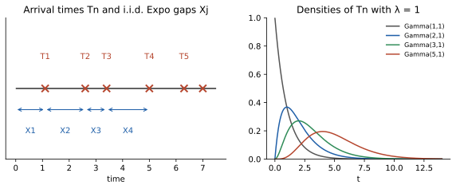
  <figcaption>Original figure for these notes, illustrating Blitzstein and Hwang, <em>Introduction to Probability</em>, Theorem 8.4.3. Arrival times are sums of i.i.d. Exponential gaps, so the $$n$$th arrival time is $$\operatorname{Gamma}(n,\lambda)$$.</figcaption>
</figure>

**An analogy.**

| Discrete time | Continuous time |
|---|---|
| Geometric: wait for the first success | Exponential: wait for the first arrival |
| Negative Binomial: sum of i.i.d. Geometrics | Gamma: sum of i.i.d. Exponentials |

The Exponential is the continuous analog of the Geometric, and the Gamma is the continuous analog of the Negative Binomial: how long to wait for $$n$$ "successes", here $$n$$ arrivals.

### Part 5 — Proof with MGFs

Sums of i.i.d. variables could be handled with repeated convolution integrals, but MGFs are much easier. Rescaling by $$\lambda$$ can be done at the end, so take $$\lambda=1$$.

**The sum of Exponentials.** In Lecture 18, the $$\operatorname{Expo}(1)$$ MGF was found to be $$\frac1{1-t}$$ for $$t<1$$. For independent variables, MGFs multiply, so

$$
M_{T_n}(t)=\left(\frac1{1-t}\right)^n,\qquad t<1.
$$

**The Gamma MGF.** Let $$Y\sim\operatorname{Gamma}(a,1)$$. By LOTUS,

$$
M_Y(t)=E(e^{tY})=\frac1{\Gamma(a)}\int_0^\infty e^{ty}y^ae^{-y}\frac{dy}y
=\frac1{\Gamma(a)}\int_0^\infty y^ae^{-(1-t)y}\frac{dy}y.
$$

For $$t<1$$, substitute $$x=(1-t)y$$. The limits stay $$0$$ to $$\infty$$, $$y^a=(1-t)^{-a}x^a$$, and $$\frac{dy}y=\frac{dx}x$$:

$$
M_Y(t)=(1-t)^{-a}\cdot\frac1{\Gamma(a)}\int_0^\infty x^ae^{-x}\frac{dx}x=\left(\frac1{1-t}\right)^a.
$$

With $$a=n$$, this matches the MGF of $$T_n$$. Since an MGF determines the distribution, $$T_n\sim\operatorname{Gamma}(n,1)$$. Dividing by $$\lambda$$ gives the general result. $$\blacksquare$$

The Gamma MGF calculation never used that $$a$$ is an integer: $$\left(\frac1{1-t}\right)^a$$ is the $$\operatorname{Gamma}(a,1)$$ MGF for every $$a>0$$. Only the sum-of-Exponentials story needs an integer.

**Core idea:** Recognizing an integral as a gamma function, after a change of variable, replaces integration by pattern matching.

### Part 6 — Gamma moments

Let $$X\sim\operatorname{Gamma}(a,1)$$ and let $$c$$ be any real number with $$a+c>0$$. By LOTUS,

$$
E(X^c)=\frac1{\Gamma(a)}\int_0^\infty x^cx^ae^{-x}\frac{dx}x=\frac1{\Gamma(a)}\int_0^\infty x^{a+c}e^{-x}\frac{dx}x.
$$

The last integral is $$\Gamma(a+c)$$, so

<div class="result-box" markdown="1">

$$
\boxed{E(X^c)=\frac{\Gamma(a+c)}{\Gamma(a)},\qquad a+c>0.}
$$

</div>

If $$a+c\le0$$, the moment does not exist.

**Mean and variance.** With $$c=1$$ and the recursion,

$$
E(X)=\frac{\Gamma(a+1)}{\Gamma(a)}=a,\qquad
E(X^2)=\frac{\Gamma(a+2)}{\Gamma(a)}=(a+1)a,
$$

so $$\operatorname{Var}(X)=a^2+a-a^2=a$$. For integer $$a$$, the mean also follows from linearity: a sum of $$a$$ i.i.d. $$\operatorname{Expo}(1)$$ variables has mean $$a$$.

Rescaling by $$1/\lambda$$ divides the mean by $$\lambda$$ and the variance by $$\lambda^2$$:

<div class="result-box" markdown="1">

$$
\boxed{Y\sim\operatorname{Gamma}(a,\lambda):\qquad E(Y)=\frac a\lambda,\qquad\operatorname{Var}(Y)=\frac a{\lambda^2}.}
$$

</div>

The equal mean and variance of $$\operatorname{Gamma}(a,1)$$ come from setting $$\lambda=1$$; unlike for the Poisson, they differ in general.

<div class="example-block" markdown="1">
<div class="ex-title">Waiting for the third email <span class="ex-pill pill-num">Worked example</span></div>

Emails arrive as a Poisson process at $$\lambda=2$$ per hour. The time of the third email is $$T_3\sim\operatorname{Gamma}(3,2)$$, so

$$
E(T_3)=\frac32\text{ hours},\qquad\operatorname{Var}(T_3)=\frac3{4}.
$$

**Supplementary connection.** Waiting more than one hour for the third email means at most two emails arrived in the first hour, and $$N_1\sim\operatorname{Pois}(2)$$:

$$
P(T_3>1)=P(N_1\le2)=e^{-2}\left(1+2+\frac{2^2}{2!}\right)=5e^{-2}\approx0.677.
$$

<div class="ex-lesson">Questions about arrival times can be turned into questions about counts: $$T_n>t$$ exactly when $$N_t<n$$.</div>
</div>

### Part 7 — Original practice questions

Try these before reading the answers.

1. Find $$\Gamma(5)$$ and $$\Gamma(7/2)$$.
2. Prove $$\Gamma(a+1)=a\Gamma(a)$$ by integration by parts.
3. Find the mean and variance of $$\operatorname{Gamma}(4,2)$$.
4. For $$X\sim\operatorname{Gamma}(a,1)$$ with $$a>1$$, find $$E(1/X)$$.
5. Let $$X\sim\operatorname{Gamma}(a,\lambda)$$ and $$Y\sim\operatorname{Gamma}(b,\lambda)$$ be independent. Use MGFs to find the distribution of $$X+Y$$.
6. Customers arrive as a Poisson process at 3 per minute. Find the distribution of the second arrival time and $$P(T_2\le1)$$.
7. Compare Stirling's approximation with $$5!$$.
8. Explain why $$\int_0^\infty x^ae^{-x}\frac{dx}x$$ diverges when $$a\le0$$.
9. Use the Gamma moment formula to find $$E(X^n)$$ for $$X\sim\operatorname{Expo}(1)$$, and compare with Lecture 18.

### Part 8 — Practice answers

#### 1. Values of the gamma function

$$\Gamma(5)=4!=24$$. $$\Gamma(7/2)=\frac52\cdot\frac32\cdot\frac12\sqrt\pi=\frac{15\sqrt\pi}8\approx3.323$$.

#### 2. The recursion

With $$u=x^a$$ and $$dv=e^{-x}dx$$, $$\Gamma(a+1)=\int_0^\infty x^ae^{-x}dx=\big[-x^ae^{-x}\big]_0^\infty+a\int_0^\infty x^{a-1}e^{-x}dx=0+a\Gamma(a)$$.

#### 3. A rescaled Gamma

Mean $$a/\lambda=4/2=2$$, variance $$a/\lambda^2=4/4=1$$.

#### 4. A negative moment

With $$c=-1$$, $$E(X^{-1})=\frac{\Gamma(a-1)}{\Gamma(a)}=\frac{\Gamma(a-1)}{(a-1)\Gamma(a-1)}=\frac1{a-1}$$. It requires $$a-1>0$$.

#### 5. Adding Gammas

The $$\operatorname{Gamma}(a,\lambda)$$ MGF is $$\left(\frac{\lambda}{\lambda-t}\right)^a$$ for $$t<\lambda$$, from rescaling. The product is $$\left(\frac\lambda{\lambda-t}\right)^{a+b}$$, so $$X+Y\sim\operatorname{Gamma}(a+b,\lambda)$$. For integers, this is $$a$$ gaps followed by $$b$$ more.

#### 6. The second customer

$$T_2\sim\operatorname{Gamma}(2,3)$$. The second customer arrives within a minute exactly when $$N_1\ge2$$, with $$N_1\sim\operatorname{Pois}(3)$$: $$P(T_2\le1)=1-e^{-3}(1+3)=1-4e^{-3}\approx0.801$$.

#### 7. Stirling for $$n=5$$

$$\sqrt{10\pi}(5/e)^5\approx118.0$$, against $$5!=120$$, a relative error under 2%.

#### 8. Divergence at 0

For $$a\le0$$ and $$0<x<1$$, the integrand is at least $$e^{-1}x^{a-1}\ge e^{-1}x^{-1}$$, and $$\int_0^1x^{-1}dx=\infty$$.

#### 9. Exponential moments

$$\operatorname{Expo}(1)=\operatorname{Gamma}(1,1)$$, so $$E(X^n)=\Gamma(n+1)/\Gamma(1)=n!$$, the same answer as reading off the geometric series in Lecture 18.

### Part 9 — Quick revision sheet

| Concept | Essential fact |
|---|---|
| Stirling | $$n!\approx\sqrt{2\pi n}(n/e)^n$$, with ratio tending to 1 |
| Gamma function | $$\Gamma(a)=\int_0^\infty x^ae^{-x}dx/x$$, $$a>0$$ |
| Recursion | $$\Gamma(a+1)=a\Gamma(a)$$ |
| Factorials | $$\Gamma(n)=(n-1)!$$ |
| Half | $$\Gamma(1/2)=\sqrt\pi$$ |
| $$\operatorname{Gamma}(a,1)$$ PDF | $$\frac1{\Gamma(a)}x^ae^{-x}\frac1x$$, $$x>0$$ |
| $$\operatorname{Gamma}(a,\lambda)$$ PDF | $$\frac1{\Gamma(a)}(\lambda y)^ae^{-\lambda y}\frac1y$$, $$y>0$$ |
| Exponential | $$\operatorname{Gamma}(1,\lambda)=\operatorname{Expo}(\lambda)$$ |
| Poisson process | $$N_t\sim\operatorname{Pois}(\lambda t)$$; disjoint intervals independent |
| Gaps | i.i.d. $$\operatorname{Expo}(\lambda)$$ |
| Arrival times | $$T_n\sim\operatorname{Gamma}(n,\lambda)$$ |
| MGF | $$\operatorname{Gamma}(a,1)$$: $$(1-t)^{-a}$$ for $$t<1$$ |
| Moments | $$E(X^c)=\Gamma(a+c)/\Gamma(a)$$ for $$\operatorname{Gamma}(a,1)$$ |
| Mean and variance | $$a/\lambda$$ and $$a/\lambda^2$$ |

### Term Glossary

<div class="glossary-entry" markdown="1">
<div class="gterm">Stirling's formula <span class="gcat cat-thm">Theorem</span></div>

The approximation $$n!\approx\sqrt{2\pi n}(n/e)^n$$, whose ratio to $$n!$$ tends to 1.

</div>

<div class="glossary-entry" markdown="1">
<div class="gterm">Gamma function <span class="gcat cat-defn">Definition</span></div>

$$\Gamma(a)=\int_0^\infty x^ae^{-x}\frac{dx}x$$ for $$a>0$$, extending the factorial through $$\Gamma(n)=(n-1)!$$.

</div>

<div class="glossary-entry" markdown="1">
<div class="gterm">Gamma distribution <span class="gcat cat-defn">Definition</span></div>

The continuous distribution on $$(0,\infty)$$ with PDF $$\frac1{\Gamma(a)}(\lambda y)^ae^{-\lambda y}\frac1y$$. For integer $$a$$, it is the distribution of a sum of $$a$$ i.i.d. $$\operatorname{Expo}(\lambda)$$ variables.

</div>

<div class="glossary-entry" markdown="1">
<div class="gterm">Poisson process <span class="gcat cat-defn">Definition</span></div>

A model of arrivals in time in which counts in an interval of length $$t$$ are $$\operatorname{Pois}(\lambda t)$$ and counts in disjoint intervals are independent.

</div>

<div class="glossary-entry" markdown="1">
<div class="gterm">Interarrival time <span class="gcat cat-defn">Definition</span></div>

The time between consecutive arrivals. In a Poisson process of rate $$\lambda$$, these are i.i.d. $$\operatorname{Expo}(\lambda)$$.

</div>

<div class="ref-tags">
  <span class="ref-tag">Statistics 110</span>
  <span class="ref-tag">Lecture 24</span>
  <span class="ref-tag">Stirling's formula</span>
  <span class="ref-tag">Gamma function</span>
  <span class="ref-tag">Gamma</span>
  <span class="ref-tag">Poisson process</span>
  <span class="ref-tag">MGF</span>
</div>

  </div>
</div>


## Lecture 25 - Order Statistics and Conditional Expectation

<div class="chapter-block">
  <button type="button" class="chapter-toggle" id="lecture-25-toggle" onclick="toggleLecture('lecture-25')" aria-expanded="true" aria-controls="lecture-25-body">
    <span class="chapter-toggle-left">
      <span class="chapter-badge">Lecture 25</span>
      <span>
        <span class="chapter-title">Lecture 25 - Order Statistics and Conditional Expectation</span>
        <span class="chapter-subtitle">The bank–post office story linking Beta and Gamma, the Beta normalizing constant and mean, order statistics and their distributions, and a first look at conditional expectation</span>
      </span>
    </span>
    <span class="chapter-arrow open" id="lecture-25-arrow" aria-hidden="true">▼</span>
  </button>
  <div class="chapter-body open" id="lecture-25-body" markdown="1">

<div class="note-abstract" markdown="1">

If $$X\sim\operatorname{Gamma}(a,\lambda)$$ and $$Y\sim\operatorname{Gamma}(b,\lambda)$$ are independent waiting times at a bank and a post office, then the total $$X+Y$$ and the fraction $$X/(X+Y)$$ spent at the bank are independent, with distributions $$\operatorname{Gamma}(a+b,\lambda)$$ and $$\operatorname{Beta}(a,b)$$. A Jacobian calculation proves this and, as a by-product, gives the Beta normalizing constant $$\frac{\Gamma(a+b)}{\Gamma(a)\Gamma(b)}$$. The same independence gives the Beta mean $$\frac a{a+b}$$ in one line. Order statistics, the sample sorted from smallest to largest, are dependent even for i.i.d. data; a Binomial argument gives the CDF of the $$j$$th one, and a picture gives its PDF. Uniform order statistics are Beta. Conditional expectation extends the law of total probability to averages, and the two-envelope paradox shows why it needs care.

</div>

### Notation at a Glance

<div class="notation-panel" markdown="1">

| Symbol | Meaning |
|---|---|
| $$X\sim\operatorname{Gamma}(a,\lambda)$$, $$Y\sim\operatorname{Gamma}(b,\lambda)$$ | Independent waits at the bank and the post office |
| $$T=X+Y$$ | Total waiting time |
| $$W=\dfrac X{X+Y}$$ | Fraction of the total spent at the bank |
| $$\beta(a,b)=\dfrac{\Gamma(a)\Gamma(b)}{\Gamma(a+b)}$$ | Beta function, in terms of gamma functions |
| $$X_{(1)}\le X_{(2)}\le\cdots\le X_{(n)}$$ | Order statistics: minimum to maximum |
| $$F$$, $$f$$ | Common CDF and PDF of i.i.d. continuous $$X_1,\ldots,X_n$$ |
| $$E(X\mid A)$$ | Expectation of $$X$$ computed with probabilities conditional on event $$A$$ |

</div>

### Learning objectives

After studying these notes, you should be able to:

- Use a Jacobian to find the joint distribution of the total and the fraction in the bank–post office story.
- Explain why the total and the fraction are independent, and derive the Beta normalizing constant.
- Find the Beta mean in two ways, and explain why $$E(X/(X+Y))=E(X)/E(X+Y)$$ holds here but not in general.
- Define order statistics and explain why they are dependent.
- Derive the CDF and PDF of the $$j$$th order statistic of i.i.d. continuous random variables.
- Identify Uniform order statistics as Beta random variables and use them to find expected values.
- State the conditional form of the law of total expectation and describe the two-envelope paradox.

### Part 1 — The bank–post office story

You wait $$X$$ minutes at the bank and then $$Y$$ minutes at the post office, with

$$
X\sim\operatorname{Gamma}(a,\lambda),\qquad Y\sim\operatorname{Gamma}(b,\lambda),\qquad X,Y\text{ independent}.
$$

For integer $$a$$, a natural interpretation is that $$a$$ people are ahead of you in line, each served in an independent $$\operatorname{Expo}(\lambda)$$ time. Consider

$$
T=X+Y\ \text{(total wait)},\qquad W=\frac X{X+Y}\ \text{(fraction at the bank)}.
$$

The marginal distribution of $$T$$ is already known: $$a$$ Exponential gaps plus $$b$$ more is $$a+b$$ gaps, so $$T\sim\operatorname{Gamma}(a+b,\lambda)$$, and MGFs give the same for non-integer parameters. Are $$T$$ and $$W$$ independent? The formula $$W=X/(X+Y)$$ contains $$T$$, which suggests dependence, but it is not obvious that knowing the total says anything about the fraction. A calculation settles it.

**Set $$\lambda=1$$.** Rescaling all times by $$1/\lambda$$ leaves $$W$$ unchanged and turns $$\operatorname{Gamma}(a+b,1)$$ into $$\operatorname{Gamma}(a+b,\lambda)$$, so nothing is lost.

**Invert the transformation.** With $$t=x+y$$ and $$w=x/(x+y)$$, we have $$w=x/t$$, so $$x=tw$$. Also $$1-w=y/t$$, so $$y=t(1-w)$$.

**The Jacobian.**

$$
\frac{\partial(x,y)}{\partial(t,w)}=
\begin{pmatrix}w&t\\1-w&-t\end{pmatrix},\qquad
\det=-tw-t(1-w)=-t,\qquad\lvert\det\rvert=t.
$$

**The joint PDF.** Independence gives $$f_{X,Y}(x,y)=\frac1{\Gamma(a)\Gamma(b)}x^ae^{-x}y^be^{-y}\frac1{xy}$$. Substitute $$x=tw$$, $$y=t(1-w)$$, $$x+y=t$$, and multiply by $$t$$:

$$
f_{T,W}(t,w)=\frac1{\Gamma(a)\Gamma(b)}\,w^{a-1}(1-w)^{b-1}\cdot t^{a+b}e^{-t}\frac1t,
\qquad t>0,\ 0<w<1.
$$

Multiplying and dividing by $$\Gamma(a+b)$$ to make the $$t$$ part a familiar density:

<div class="result-box" markdown="1">

$$
\boxed{f_{T,W}(t,w)=\left(\frac{\Gamma(a+b)}{\Gamma(a)\Gamma(b)}w^{a-1}(1-w)^{b-1}\right)\left(\frac1{\Gamma(a+b)}t^{a+b}e^{-t}\frac1t\right).}
$$

</div>

The joint PDF factors into a function of $$w$$ times a function of $$t$$ on a product region, so **$$T$$ and $$W$$ are independent**. The second factor is the $$\operatorname{Gamma}(a+b,1)$$ PDF. Integrating out $$t$$ removes it, since it integrates to 1, leaving the marginal PDF of $$W$$.

<div class="result-box" markdown="1">

$$
\boxed{T\sim\operatorname{Gamma}(a+b,\lambda),\qquad W\sim\operatorname{Beta}(a,b),\qquad T,W\text{ independent}.}
$$

</div>

**The Beta normalizing constant.** The marginal of $$W$$ must integrate to 1, so its constant is the Beta normalizing constant:

<div class="result-box" markdown="1">

$$
\boxed{\frac1{\beta(a,b)}=\frac{\Gamma(a+b)}{\Gamma(a)\Gamma(b)},\qquad\text{equivalently}\qquad\int_0^1x^{a-1}(1-x)^{b-1}\,dx=\frac{\Gamma(a)\Gamma(b)}{\Gamma(a+b)}.}
$$

</div>

For integers this agrees with Bayes’ billiards: $$\beta(k+1,n-k+1)=\frac{k!\,(n-k)!}{(n+1)!}$$. The constant came out of a different question, without directly attacking the Beta integral. This independence is special: it is a theorem, beyond these notes, that replacing the Gamma by other distributions breaks it.

<figure>
  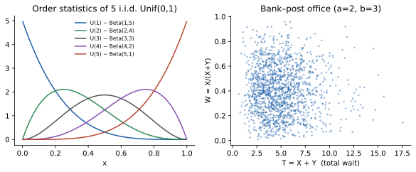
  <figcaption>Original figure for these notes, illustrating Blitzstein and Hwang, <em>Introduction to Probability</em>, Story 8.5.1 and Example 8.6.5. Right: in 1500 simulated pairs, the fraction spent at the bank shows no relationship with the total wait.</figcaption>
</figure>

### Part 2 — The Beta mean

Let $$W\sim\operatorname{Beta}(a,b)$$.

**Method 1: LOTUS.** Multiplying the density by $$w$$ raises $$a$$ by 1, leaving a Beta integral:

$$
E(W)=\frac{\beta(a+1,b)}{\beta(a,b)}=\frac{\Gamma(a+1)\Gamma(b)}{\Gamma(a+b+1)}\cdot\frac{\Gamma(a+b)}{\Gamma(a)\Gamma(b)}=\frac a{a+b}.
$$

Higher moments work the same way: $$E(W^c)$$ raises $$a$$ by $$c$$.

**Method 2: the bank–post office story.** The mean depends only on the distribution, so any construction of a $$\operatorname{Beta}(a,b)$$ variable may be used. Take $$W=X/(X+Y)$$ as in Part 1. Since $$W$$ and $$T=X+Y$$ are independent, they are uncorrelated, so $$E(WT)=E(W)E(T)$$. But $$WT=X$$, so

$$
E(X)=E(W)E(X+Y),\qquad\text{so}\qquad E(W)=\frac{E(X)}{E(X+Y)}=\frac a{a+b}.
$$

<div class="result-box" markdown="1">

$$
\boxed{W\sim\operatorname{Beta}(a,b):\qquad E(W)=\frac a{a+b}.}
$$

</div>

The variance follows from LOTUS in the same way: $$E(W^2)=\frac{a(a+1)}{(a+b)(a+b+1)}$$ and $$\operatorname{Var}(W)=\frac{ab}{(a+b)^2(a+b+1)}$$.

In the Beta–Binomial model of Lecture 23, the posterior mean is $$\frac{a+X}{a+b+n}$$. With $$a=b=1$$ and $$X=n$$, this is $$\frac{n+1}{n+2}$$, Laplace's rule of succession.

<div class="misconception-block" markdown="1">

**Incorrect:** $$E\left(\dfrac X{X+Y}\right)=\dfrac{E(X)}{E(X+Y)}$$ by linearity.

**Correction:** Linearity does not apply to ratios, and this equation is usually false. It holds for independent Gammas only because the fraction is independent of the total. For example, if $$X\sim\operatorname{Unif}(0,1)$$ and $$Y=1$$, then $$E\left(\frac X{X+1}\right)=1-\log2\approx0.307$$, but $$\frac{E(X)}{E(X+1)}=\frac13$$.

</div>

### Part 3 — Order statistics

<div class="example-block" markdown="1">
<div class="ex-title">Order statistics <span class="ex-pill pill-defn">Definition</span></div>

For random variables $$X_1,\ldots,X_n$$, the **order statistics** are the same values sorted in increasing order:

$$
X_{(1)}\le X_{(2)}\le\cdots\le X_{(n)}.
$$

</div>

So $$X_{(1)}=\min(X_1,\ldots,X_n)$$, $$X_{(n)}=\max(X_1,\ldots,X_n)$$, and $$X_{(j)}$$ is the $$j$$th smallest. Each $$X_{(j)}$$ is a random variable: for each outcome of the experiment, compute the values and sort them.

Many statistics are built from order statistics:

- The **median**: for odd $$n$$, $$X_{((n+1)/2)}$$. For even $$n$$, a common convention averages the two middle values.
- **Quantiles**, such as the value with about 75% of the observations below it.
- The **interquartile range**: the 75th percentile minus the 25th percentile.

**Why they are hard.** Even when $$X_1,\ldots,X_n$$ are i.i.d., the order statistics are dependent. The maximum is at least the minimum, so learning that the minimum is large forces the maximum to be large. In the same way, $$X_{(7)}\ge X_{(3)}$$ always. Order statistics are positively correlated.

**Ties.** For discrete variables, two observations can be equal, which complicates the ordering. For continuous variables, ties have probability 0. From here on, $$X_1,\ldots,X_n$$ are i.i.d. continuous with CDF $$F$$ and PDF $$f$$.

<div class="misconception-block" markdown="1">

**Incorrect:** The minimum and maximum of two i.i.d. variables are just $$X$$ and $$Y$$ under different names, so $$\operatorname{Cov}(\min,\max)=\operatorname{Cov}(X,Y)=0$$.

**Correction:** Which variable is the minimum changes from outcome to outcome. The minimum and maximum are new random variables, and they are positively correlated.

</div>

### Part 4 — The CDF and PDF of an order statistic

**The CDF.** Draw a number line and mark a point $$x$$. The event $$X_{(j)}\le x$$ means that the $$j$$th smallest value lies to the left of $$x$$. Then the $$j-1$$ smaller ones do too, and possibly more. In words:

$$
X_{(j)}\le x\quad\Longleftrightarrow\quad\text{at least }j\text{ of the }X_i\text{ are }\le x.
$$

Call $$X_i\le x$$ a success. The $$n$$ observations are independent, each succeeding with probability $$F(x)$$, so the number of successes is $$\operatorname{Bin}(n,F(x))$$. Adding the disjoint cases of exactly $$k$$ successes:

<div class="result-box" markdown="1">

$$
\boxed{P(X_{(j)}\le x)=\sum_{k=j}^n\binom nk F(x)^k\big(1-F(x)\big)^{n-k}.}
$$

</div>

**The PDF.** Differentiating this sum works but is messy. Think directly instead. $$f_{X_{(j)}}(x)\,dx$$ is approximately the probability that $$X_{(j)}$$ falls in a tiny interval of length $$dx$$ at $$x$$. For that to happen:

1. One observation lands in the tiny interval. There are $$n$$ choices for which one, and it lands there with probability about $$f(x)\,dx$$.
2. Of the remaining $$n-1$$ observations, exactly $$j-1$$ land to the left of $$x$$ and $$n-j$$ to the right. There are $$\binom{n-1}{j-1}$$ choices for which ones go left, and each such arrangement has probability $$F(x)^{j-1}(1-F(x))^{n-j}$$.

Multiplying and dropping $$dx$$ from both sides:

<div class="result-box" markdown="1">

$$
\boxed{f_{X_{(j)}}(x)=n\binom{n-1}{j-1}f(x)\,F(x)^{j-1}\big(1-F(x)\big)^{n-j}.}
$$

</div>

The formula combines the PDF, a power of the CDF, and a power of one minus the CDF. Joint PDFs of two order statistics, such as $$X_{(3)}$$ and $$X_{(7)}$$, can be found with the same picture using two tiny intervals.

### Part 5 — Uniform order statistics are Beta

<div class="example-block" markdown="1">
<div class="ex-title">Order statistics of Uniforms <span class="ex-pill pill-ex">Worked example</span></div>

Let $$U_1,\ldots,U_n$$ be i.i.d. $$\operatorname{Unif}(0,1)$$. Then $$f(x)=1$$ and $$F(x)=x$$ on $$(0,1)$$, so

$$
f_{U_{(j)}}(x)=n\binom{n-1}{j-1}x^{j-1}(1-x)^{n-j},\qquad0<x<1.
$$

This has the Beta shape with parameters $$j$$ and $$n-j+1$$, so

$$
\boxed{U_{(j)}\sim\operatorname{Beta}(j,\,n-j+1),\qquad E(U_{(j)})=\frac j{n+1}.}
$$

On average, the $$n$$ points split $$(0,1)$$ into $$n+1$$ pieces of equal expected length.

**A check with $$n=2$$.** The maximum is $$\operatorname{Beta}(2,1)$$ with mean $$2/3$$, and the minimum is $$\operatorname{Beta}(1,2)$$ with mean $$1/3$$. Since $$\lvert U_1-U_2\rvert=\max-\min$$, linearity gives

$$
E\lvert U_1-U_2\rvert=\frac23-\frac13=\frac13,
$$

matching the two-dimensional LOTUS calculation in Lecture 19. The maximum and minimum are dependent, but linearity holds regardless.

<div class="ex-lesson">Recognizing a Beta density gives the distribution and moments of every Uniform order statistic at once.</div>
</div>

### Part 6 — A first look at conditional expectation

The **conditional expectation** $$E(X\mid A)$$ of $$X$$ given an event $$A$$ is computed exactly like $$E(X)$$, but with conditional probabilities given $$A$$. In the discrete case, $$E(X\mid A)=\sum_xxP(X=x\mid A)$$.

Splitting each $$P(X=x)$$ by the law of total probability gives the analogous rule for expectations:

<div class="result-box" markdown="1">

$$
\boxed{E(X)=E(X\mid A)P(A)+E(X\mid A^c)P(A^c).}
$$

</div>

<div class="example-block" markdown="1">
<div class="ex-title">A die roll in two cases <span class="ex-pill pill-num">Worked example</span></div>

Roll a fair die. Given an even result, the values $$2,4,6$$ are equally likely, so $$E(X\mid\text{even})=4$$. Given an odd result, $$E(X\mid\text{odd})=3$$. Then

$$
E(X)=4\cdot\frac12+3\cdot\frac12=3.5.
$$

<div class="ex-lesson">The overall mean is a weighted average of the conditional means, weighted by the probabilities of the cases.</div>
</div>

**The two-envelope paradox.** Two identical-looking envelopes contain positive amounts of money, one exactly twice the other. You pick one at random and may switch. Suppose you open yours and find $100. The other holds $50 or $200, which seem equally likely, so switching seems to give an average of $125. The argument did not use the number 100: whatever amount $$x$$ is in your envelope, the other appears to average $$\frac12\cdot\frac x2+\frac12\cdot2x=\frac54x$$. Then you should switch without opening anything, and by the same reasoning switch back, forever. By symmetry, though, the two envelopes are equally good. Something in the switching argument is wrong; finding the flaw requires conditional expectation, developed in the next lecture.

### Part 7 — Original practice questions

Try these before reading the answers.

1. Find the normalizing constant of $$\operatorname{Beta}(3,5)$$.
2. Find the mean and variance of $$\operatorname{Beta}(3,5)$$.
3. Two people are ahead of you at the bank and three at the post office, all with i.i.d. $$\operatorname{Expo}(1)$$ service times. Find the probability that less than half of your total wait is spent at the bank.
4. For $$n$$ i.i.d. $$\operatorname{Unif}(0,1)$$ variables, find the expected minimum and expected maximum.
5. Find the probability that the median of five i.i.d. $$\operatorname{Unif}(0,1)$$ variables is below $$1/4$$.
6. Let $$X_1,\ldots,X_n$$ be i.i.d. $$\operatorname{Expo}(1)$$. Use the order statistic PDF to find the distribution of the minimum.
7. Use the CDF formula to show that $$P(X_{(n)}\le x)=F(x)^n$$, and explain it directly.
8. For a fair die, compute $$E(X)$$ by conditioning on whether $$X\le2$$.
9. Give an example where $$E\left(\frac X{X+Y}\right)\ne\frac{E(X)}{E(X+Y)}$$.

### Part 8 — Practice answers

#### 1. A Beta constant

$$\frac{\Gamma(8)}{\Gamma(3)\Gamma(5)}=\frac{7!}{2!\,4!}=\frac{5040}{48}=105$$. So the PDF is $$105x^2(1-x)^4$$.

#### 2. Beta mean and variance

$$E=\frac3{3+5}=\frac38$$. $$\operatorname{Var}=\frac{3\cdot5}{8^2\cdot9}=\frac{15}{576}=\frac5{192}$$.

#### 3. Bank and post office

$$X\sim\operatorname{Gamma}(2,1)$$ and $$Y\sim\operatorname{Gamma}(3,1)$$, so $$W\sim\operatorname{Beta}(2,3)$$ with PDF $$12w(1-w)^2$$. Then

$$
P(W<\tfrac12)=12\int_0^{1/2}(w-2w^2+w^3)\,dw=12\left(\frac18-\frac1{12}+\frac1{64}\right)=\frac{11}{16}.
$$

#### 4. Extreme Uniforms

$$U_{(1)}\sim\operatorname{Beta}(1,n)$$ with mean $$\frac1{n+1}$$, and $$U_{(n)}\sim\operatorname{Beta}(n,1)$$ with mean $$\frac n{n+1}$$.

#### 5. A median

The median is $$U_{(3)}\sim\operatorname{Beta}(3,3)$$ with PDF $$30x^2(1-x)^2$$. Integrating from 0 to $$1/4$$ gives $$30\left(\frac{x^3}3-\frac{x^4}2+\frac{x^5}5\right)\Big|_0^{1/4}=\frac{53}{512}\approx0.104$$.

#### 6. Minimum of Exponentials

With $$j=1$$: $$f(x)=n\,e^{-x}\left(e^{-x}\right)^{n-1}=ne^{-nx}$$, so the minimum is $$\operatorname{Expo}(n)$$.

#### 7. The maximum

With $$j=n$$, only the $$k=n$$ term remains: $$F(x)^n$$. Directly, the maximum is at most $$x$$ exactly when every observation is at most $$x$$, and independence multiplies the probabilities.

#### 8. Conditioning a die

$$E(X\mid X\le2)=1.5$$ with probability $$\frac13$$, and $$E(X\mid X>2)=4.5$$ with probability $$\frac23$$. So $$E(X)=1.5\cdot\frac13+4.5\cdot\frac23=3.5$$.

#### 9. A ratio

With $$X\sim\operatorname{Unif}(0,1)$$ and $$Y=1$$: $$E\left(\frac X{X+1}\right)=\int_0^1\left(1-\frac1{x+1}\right)dx=1-\log2\approx0.307$$, while $$\frac{E(X)}{E(X+1)}=\frac{1/2}{3/2}=\frac13$$.

### Part 9 — Quick revision sheet

| Concept | Essential fact |
|---|---|
| Bank–post office | $$X\sim\operatorname{Gamma}(a,\lambda)$$, $$Y\sim\operatorname{Gamma}(b,\lambda)$$ independent |
| Total and fraction | $$T\sim\operatorname{Gamma}(a+b,\lambda)$$, $$W\sim\operatorname{Beta}(a,b)$$, independent |
| Jacobian | $$x=tw$$, $$y=t(1-w)$$, $$\lvert\det\rvert=t$$ |
| Beta constant | $$\frac{\Gamma(a+b)}{\Gamma(a)\Gamma(b)}$$ |
| Beta mean | $$\frac a{a+b}$$, by LOTUS or by independence of $$W$$ and $$T$$ |
| Beta variance | $$\frac{ab}{(a+b)^2(a+b+1)}$$ |
| Ratio warning | $$E(X/(X+Y))=E(X)/E(X+Y)$$ only with special structure |
| Order statistics | Sorted values; dependent, positively correlated |
| CDF | $$P(X_{(j)}\le x)=\sum_{k=j}^n\binom nkF(x)^k(1-F(x))^{n-k}$$ |
| PDF | $$n\binom{n-1}{j-1}f(x)F(x)^{j-1}(1-F(x))^{n-j}$$ |
| Uniform case | $$U_{(j)}\sim\operatorname{Beta}(j,n-j+1)$$, mean $$\frac j{n+1}$$ |
| Conditional expectation | $$E(X)=E(X\mid A)P(A)+E(X\mid A^c)P(A^c)$$ |
| Two envelopes | A switching argument that conflicts with symmetry |

### Term Glossary

<div class="glossary-entry" markdown="1">
<div class="gterm">Bank–post office story <span class="gcat cat-prop">Story</span></div>

For independent $$\operatorname{Gamma}(a,\lambda)$$ and $$\operatorname{Gamma}(b,\lambda)$$ waiting times, the total is $$\operatorname{Gamma}(a+b,\lambda)$$, the fraction of the first is $$\operatorname{Beta}(a,b)$$, and the two are independent.

</div>

<div class="glossary-entry" markdown="1">
<div class="gterm">Order statistics <span class="gcat cat-defn">Definition</span></div>

The values of $$X_1,\ldots,X_n$$ sorted in increasing order, $$X_{(1)}\le\cdots\le X_{(n)}$$, from the minimum to the maximum.

</div>

<div class="glossary-entry" markdown="1">
<div class="gterm">Median <span class="gcat cat-meas">Measure</span></div>

The middle order statistic $$X_{((n+1)/2)}$$ for odd $$n$$; for even $$n$$, commonly the average of the two middle values.

</div>

<div class="glossary-entry" markdown="1">
<div class="gterm">Interquartile range <span class="gcat cat-meas">Measure</span></div>

The 75th percentile minus the 25th percentile, a measure of spread built from order statistics.

</div>

<div class="glossary-entry" markdown="1">
<div class="gterm">Conditional expectation given an event <span class="gcat cat-defn">Definition</span></div>

$$E(X\mid A)$$, the expectation of $$X$$ computed with probabilities conditional on $$A$$.

</div>

<div class="glossary-entry" markdown="1">
<div class="gterm">Two-envelope paradox <span class="gcat cat-defn">Misconception</span></div>

An argument that always switching between two symmetric envelopes increases the expected amount, contradicting symmetry.

</div>

<div class="ref-tags">
  <span class="ref-tag">Statistics 110</span>
  <span class="ref-tag">Lecture 25</span>
  <span class="ref-tag">Beta</span>
  <span class="ref-tag">Gamma</span>
  <span class="ref-tag">Bank–post office</span>
  <span class="ref-tag">Order statistics</span>
  <span class="ref-tag">Conditional expectation</span>
</div>

  </div>
</div>


## Lecture 26 - Conditional Expectation Continued

<div class="chapter-block">
  <button type="button" class="chapter-toggle" id="lecture-26-toggle" onclick="toggleLecture('lecture-26')" aria-expanded="true" aria-controls="lecture-26-body">
    <span class="chapter-toggle-left">
      <span class="chapter-badge">Lecture 26</span>
      <span>
        <span class="chapter-title">Lecture 26 - Conditional Expectation Continued</span>
        <span class="chapter-subtitle">Resolving the two-envelope paradox, waiting for HH versus HT, conditioning on a random variable, and a first statement of Adam's law</span>
      </span>
    </span>
    <span class="chapter-arrow open" id="lecture-26-arrow" aria-hidden="true">▼</span>
  </button>
  <div class="chapter-body open" id="lecture-26-body" markdown="1">

<div class="note-abstract" markdown="1">

The two-envelope paradox comes from a single conditioning error: plugging in the information $$Y=2X$$ and then forgetting that it was given. Conditioning on a pattern's first tosses shows that a fair coin takes 4 tosses on average to produce HT but 6 to produce HH, because HH overlaps with itself and HT does not. Conditional expectation given an event, $$E(Y\mid X=x)$$, is a number that depends on $$x$$; replacing $$x$$ by $$X$$ gives $$E(Y\mid X)$$, a random variable that is a function of $$X$$. For i.i.d. $$X$$ and $$Y$$, symmetry and linearity give $$E(X\mid X+Y)=\frac{X+Y}2$$. Adam's law, $$E(E(Y\mid X))=E(Y)$$, is the expectation form of the law of total probability.

</div>

### Notation at a Glance

<div class="notation-panel" markdown="1">

| Symbol | Meaning |
|---|---|
| $$E(Y\mid A)$$ | Expectation of $$Y$$ using conditional probabilities given event $$A$$ |
| $$g(x)=E(Y\mid X=x)$$ | Conditional expectation given the event $$X=x$$, a function of $$x$$ |
| $$E(Y\mid X)=g(X)$$ | Conditional expectation given the random variable $$X$$ |
| $$f_{Y\mid X}(y\mid x)$$ | Conditional PDF, $$f_{X,Y}(x,y)/f_X(x)$$ |
| $$W_{HT}$$, $$W_{HH}$$ | Number of tosses until the pattern HT or HH first appears |
| $$I$$ | Indicator that the second envelope holds the larger amount |

</div>

### Learning objectives

After studying these notes, you should be able to:

- Identify the flaw in the two-envelope argument and explain why the amount in an envelope and the indicator of the larger envelope are dependent.
- Compute the expected waiting time for HT by linearity and for HH by conditioning on the first tosses.
- Explain why symmetry between heads and tails does not make $$E(W_{HH})=E(W_{HT})$$.
- Distinguish $$E(Y\mid X=x)$$, a function of $$x$$, from $$E(Y\mid X)$$, a random variable.
- Compute conditional expectations using linearity, independence, and symmetry.
- State Adam's law.

### Part 1 — Resolving the two-envelope paradox

Two identical-looking envelopes hold amounts $$X$$ and $$Y$$, one twice the other. Two arguments conflict.

**Argument 1: symmetry.** Nothing distinguishes the envelopes, so $$E(Y)=E(X)$$.

**Argument 2: conditioning.** The other envelope holds either twice or half the amount in yours, apparently with probability $$\frac12$$ each:

$$
E(Y)=E(Y\mid Y=2X)\frac12+E\left(Y\mid Y=\tfrac X2\right)\frac12\overset{?}{=}E(2X)\frac12+E\left(\tfrac X2\right)\frac12=\frac54E(X).
$$

The two conclusions agree only if $$E(X)$$ is 0 or infinite. For positive amounts with a finite mean, one argument must be wrong, and symmetry is hard to dispute.

**The flaw.** The first line of Argument 2 is correct: it is the law of total probability in expectation form. The error is the next step. Substituting $$Y=2X$$ inside $$E(Y\mid Y=2X)$$ is fine, but the condition cannot then be dropped:

$$
E(Y\mid Y=2X)=E(2X\mid Y=2X),\qquad\text{which need not equal }E(2X).
$$

A condition can be removed only when what is inside is independent of the condition.

**Dependence.** Let $$I$$ indicate that $$Y=2X$$, that is, the second envelope is the larger. Symmetry forces $$E(2X\mid I=1)\ne E(2X)$$, so $$X$$ and $$I$$ are dependent: seeing the amount in your envelope carries information about whether it is the smaller one. That is surprising, since no amount, even a trillion dollars, seems large or small without knowing the scale. But if $$E(X)$$ is finite, the distribution of the amounts provides a scale, and the dependence is forced.

<div class="misconception-block" markdown="1">

**Incorrect:** Having substituted the given information, the condition can be crossed out.

**Correction:** Substituting is allowed; forgetting is not. $$E(Y\mid Y=2X)=E(2X\mid Y=2X)$$, and the condition may be dropped only if $$X$$ is independent of the event $$Y=2X$$, which is false here.

</div>

**A related surprise.** If the two envelopes simply hold different unknown positive amounts, with no doubling, there is a strategy that picks the larger one with probability strictly greater than $$\frac12$$. Generate your own random threshold $$T$$, for example $$T\sim\operatorname{Expo}(1)$$, open one envelope, and switch exactly when its amount is below $$T$$.

### Part 2 — Waiting for HH versus HT

Toss a fair coin repeatedly. Let $$W_{HT}$$ and $$W_{HH}$$ be the numbers of tosses, including the final two, until HT and HH first appear.

**Symmetry gives less than it seems.** Swapping the labels heads and tails shows $$E(W_{HH})=E(W_{TT})$$ and $$E(W_{HT})=E(W_{TH})$$. It says nothing about $$E(W_{HH})$$ versus $$E(W_{HT})$$, since that comparison would need heads and tails swapped in only one place.

**HT by linearity.** Wait for the first H; call that time $$W_1$$. After that H, the pattern is complete at the first T, since any further H's leave you still one T away. Call that additional wait $$W_2$$. Each wait counts tosses up to and including a success with probability $$\frac12$$, so $$W_j-1\sim\operatorname{Geom}(\tfrac12)$$ and $$E(W_j)=2$$. By linearity,

$$
E(W_{HT})=E(W_1)+E(W_2)=2+2=4.
$$

**HH by conditioning.** Here a T after the first H destroys the progress. Let $$\mu=E(W_{HH})$$ and condition on the first tosses:

- First toss T, probability $$\frac12$$: one toss wasted, and the problem restarts. Contribution $$1+\mu$$.
- First two tosses HH, probability $$\frac14$$: done in 2 tosses.
- First two tosses HT, probability $$\frac14$$: two tosses wasted, and the problem restarts. Contribution $$2+\mu$$.

$$
\mu=\frac12(1+\mu)+\frac14\cdot2+\frac14(2+\mu)\quad\Longrightarrow\quad\frac14\mu=\frac32\quad\Longrightarrow\quad\boxed{E(W_{HH})=6.}
$$

Check: $$\frac12(7)+\frac14(2)+\frac14(8)=3.5+0.5+2=6$$.

**Why the answers differ.** Any two fixed positions are equally likely to read HH or HT, each with probability $$\frac14$$, so in a long sequence the two patterns occur equally often on average. But HH overlaps with itself: a run HHHHH contains four HH's. HT cannot overlap with itself this way. So the HH occurrences come in clumps, and since the average number of occurrences is the same, the clumps must be farther apart, which makes the first one later on average. The same question about patterns, called motifs, arises in DNA sequences.

<figure>
  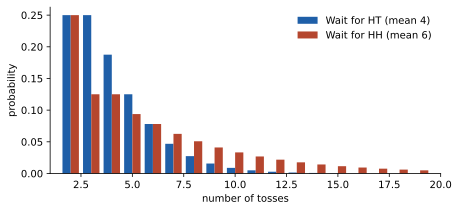
  <figcaption>Original figure for these notes, illustrating Blitzstein and Hwang, <em>Introduction to Probability</em>, Example 9.1.9. The HH waiting time has a heavier right tail, which raises its mean from 4 to 6.</figcaption>
</figure>

<div class="misconception-block" markdown="1">

**Incorrect:** HH and HT are equally likely in any two tosses, so they take equally long to appear.

**Correction:** Equal frequencies in the long run do not give equal first-appearance times. HH overlaps with itself, so its occurrences cluster, and a tail after an H wastes the progress made.

</div>

### Part 3 — Conditioning on a random variable

**Given an event.** $$E(Y\mid X=x)$$ is ordinary expectation computed with the conditional distribution given the event $$X=x$$:

$$
E(Y\mid X=x)=\sum_yy\,P(Y=y\mid X=x)\quad\text{(discrete)},\qquad
E(Y\mid X=x)=\int_{-\infty}^{\infty}y\,f_{Y\mid X}(y\mid x)\,dy\quad\text{(continuous)},
$$

where $$f_{Y\mid X}(y\mid x)=f_{X,Y}(x,y)/f_X(x)$$. The result is a number for each $$x$$: write $$g(x)=E(Y\mid X=x)$$. It cannot involve $$Y$$, which has been averaged over, nor $$X$$ as a random variable. If $$X$$ and $$Y$$ are independent, $$g(x)=E(Y)$$, a constant function.

<div class="example-block" markdown="1">
<div class="ex-title">Conditional expectation given a random variable <span class="ex-pill pill-defn">Definition</span></div>

With $$g(x)=E(Y\mid X=x)$$,

$$
\boxed{E(Y\mid X)=g(X).}
$$

</div>

First compute $$g$$ as a function of $$x$$, then replace $$x$$ by $$X$$. If $$g(x)=x^2$$, then $$E(Y\mid X)=X^2$$. So $$E(Y\mid X)$$ is a **random variable**, and a function of $$X$$.

**Interpretation.** $$E(Y\mid X)$$ is the best prediction of $$Y$$ when $$X$$ is treated as known, best in the sense of minimizing the expected squared error. Any problem written this way can be translated back to conditioning on $$X=x$$, which is the thing to do when the notation becomes confusing.

<div class="misconception-block" markdown="1">

**Incorrect:** Replace every $$x$$ in $$E(Y\mid X=x)$$ by $$X$$, giving $$E(Y\mid X=X)=E(Y)$$.

**Correction:** The substitution happens after $$g(x)$$ has been computed as a function. $$E(Y\mid X)$$ means $$g(X)$$, not the expectation given the trivially true event $$X=X$$.

</div>

### Part 4 — Examples with i.i.d. Poissons

Let $$X,Y$$ be i.i.d. $$\operatorname{Pois}(\lambda)$$. Conditional expectations are expectations, so linearity still holds.

**Example 1: $$E(X+Y\mid X)$$.** Treating $$X$$ as known:

$$
E(X+Y\mid X)=E(X\mid X)+E(Y\mid X)=X+E(Y)=X+\lambda.
$$

Two general facts were used: a known quantity predicts itself, $$E(h(X)\mid X)=h(X)$$ for any function $$h$$; and if $$Y$$ is independent of $$X$$, conditioning on $$X$$ does not change it, so $$E(Y\mid X)=E(Y)$$. Neither fact used the Poisson.

**Example 2: $$E(X\mid X+Y)$$.** There is no linearity rule for what follows the bar: this is not $$E(X\mid X)+E(X\mid Y)$$.

*Method 1: the conditional distribution.* Let $$T=X+Y\sim\operatorname{Pois}(2\lambda)$$. By Bayes' rule and independence,

$$
P(X=k\mid T=n)=\frac{P(Y=n-k)P(X=k)}{P(T=n)}
=\frac{\frac{e^{-\lambda}\lambda^{n-k}}{(n-k)!}\cdot\frac{e^{-\lambda}\lambda^k}{k!}}{\frac{e^{-2\lambda}(2\lambda)^n}{n!}}
=\binom nk\left(\frac12\right)^n.
$$

So $$X\mid T=n\sim\operatorname{Bin}(n,\tfrac12)$$, with mean $$\frac n2$$, and therefore $$E(X\mid T)=\frac T2$$.

*Method 2: symmetry.* Since $$X,Y$$ are i.i.d., $$E(X\mid X+Y)=E(Y\mid X+Y)$$. Adding and using linearity,

$$
2E(X\mid X+Y)=E(X+Y\mid X+Y)=X+Y,\qquad\boxed{E(X\mid X+Y)=\frac{X+Y}2.}
$$

This argument holds for any i.i.d. pair, not just Poissons. It also matches intuition: if the total of two i.i.d. quantities is 100, the best guess for each is 50.

### Part 5 — Adam's law

<div class="example-block" markdown="1">
<div class="ex-title">Adam's law (iterated expectation) <span class="ex-pill pill-thm">Theorem</span></div>

For any random variables $$X$$ and $$Y$$ with $$E\lvert Y\rvert<\infty$$,

$$
\boxed{E\big(E(Y\mid X)\big)=E(Y).}
$$

</div>

$$E(Y\mid X)$$ is a random variable, so it has an expectation, and that expectation is the unconditional mean. This is a compact form of the law of total probability: averaging the conditional means over the distribution of $$X$$ recovers the overall mean. The proof and many uses come in Lecture 27.

**Quick check.** In Example 2, $$E\left(\frac{X+Y}2\right)=\frac{2\lambda}2=\lambda=E(X)$$.

### Part 6 — Original practice questions

Try these before reading the answers.

1. Find the expected number of tosses of a fair coin until TH appears.
2. Find the expected number of tosses of a fair coin until HHH appears.
3. For a coin with heads probability $$p$$, find the expected number of tosses until HT.
4. Let $$X_1,\ldots,X_n$$ be i.i.d. with finite mean and $$S_n=X_1+\cdots+X_n$$. Find $$E(X_1\mid S_n)$$.
5. Let $$X\sim\operatorname{Unif}(0,1)$$ and, given $$X=x$$, let $$Y\sim\operatorname{Bin}(10,x)$$. Find $$E(Y\mid X)$$ and $$E(Y)$$.
6. Two fair dice are rolled. Let $$S$$ be the total and $$D$$ the first die. Find $$E(S\mid D)$$.
7. Let $$X,Y$$ be i.i.d. $$\operatorname{Expo}(\lambda)$$. Find $$E(\max(X,Y)\mid X+Y)$$ if it is known that $$E(\min(X,Y)\mid X+Y)=\frac{X+Y}4$$.
8. Explain why the two-envelope switching argument does not show that switching is beneficial.
9. Let $$X,Y$$ be i.i.d. $$\operatorname{Pois}(\lambda)$$. Find $$P(X=0\mid X+Y=3)$$.

### Part 7 — Practice answers

#### 1. Waiting for TH

By symmetry between heads and tails, $$E(W_{TH})=E(W_{HT})=4$$.

#### 2. Waiting for HHH

Condition on how the first run of H's ends. With $$\mu=E(W_{HHH})$$: a T first wastes 1 toss; HT wastes 2; HHT wastes 3; HHH finishes in 3.

$$
\mu=\frac12(1+\mu)+\frac14(2+\mu)+\frac18(3+\mu)+\frac18\cdot3\quad\Longrightarrow\quad\frac18\mu=\frac74,\quad\mu=14.
$$

#### 3. A biased coin

Wait for an H, then for a T: $$E(W_{HT})=\frac1p+\frac1{1-p}$$. For $$p=\frac12$$ this is 4.

#### 4. One term given the sum

By symmetry all $$E(X_j\mid S_n)$$ are equal, and they add to $$E(S_n\mid S_n)=S_n$$. So $$E(X_1\mid S_n)=\frac{S_n}n$$.

#### 5. A random success probability

Given $$X$$, $$Y$$ is Binomial with mean $$10X$$, so $$E(Y\mid X)=10X$$. By Adam's law, $$E(Y)=10E(X)=5$$.

#### 6. Total given the first die

$$E(S\mid D)=D+E(\text{second die})=D+3.5$$, using independence of the dice.

#### 7. Max given the sum

$$\max+\min=X+Y$$, so $$E(\max\mid X+Y)=(X+Y)-\frac{X+Y}4=\frac34(X+Y)$$.

#### 8. The switching argument

It replaces $$E(Y\mid Y=2X)$$ by $$E(2X)$$ and $$E(Y\mid Y=X/2)$$ by $$E(X/2)$$, dropping the conditions. They cannot be dropped because $$X$$ is not independent of which envelope is larger.

#### 9. A Binomial conditional

$$X\mid X+Y=3\sim\operatorname{Bin}(3,\tfrac12)$$, so $$P(X=0\mid X+Y=3)=\frac18$$.

### Part 8 — Quick revision sheet

| Concept | Essential fact |
|---|---|
| Two-envelope flaw | $$E(Y\mid Y=2X)=E(2X\mid Y=2X)\ne E(2X)$$ in general |
| Dropping a condition | Allowed only with independence |
| HT | $$E(W_{HT})=2+2=4$$ by linearity |
| HH | $$E(W_{HH})=6$$ by conditioning on the first tosses |
| Why they differ | HH overlaps with itself, so its occurrences clump |
| $$E(Y\mid X=x)$$ | A number for each $$x$$: $$g(x)$$ |
| $$E(Y\mid X)$$ | The random variable $$g(X)$$, a function of $$X$$ |
| Known quantities | $$E(h(X)\mid X)=h(X)$$ |
| Independence | $$E(Y\mid X)=E(Y)$$ |
| Poisson example | $$X\mid X+Y=n\sim\operatorname{Bin}(n,\frac12)$$ |
| Symmetry | i.i.d. $$X,Y$$: $$E(X\mid X+Y)=\frac{X+Y}2$$ |
| Adam's law | $$E(E(Y\mid X))=E(Y)$$ |

### Term Glossary

<div class="glossary-entry" markdown="1">
<div class="gterm">Two-envelope paradox <span class="gcat cat-defn">Misconception</span></div>

An argument that switching between two symmetric envelopes always raises the expected amount. Its flaw is dropping the condition $$Y=2X$$ after substituting it.

</div>

<div class="glossary-entry" markdown="1">
<div class="gterm">Conditional expectation given an event <span class="gcat cat-defn">Definition</span></div>

$$E(Y\mid X=x)$$, the expectation of $$Y$$ computed with the conditional distribution given $$X=x$$; a function of $$x$$.

</div>

<div class="glossary-entry" markdown="1">
<div class="gterm">Conditional expectation given a random variable <span class="gcat cat-defn">Definition</span></div>

$$E(Y\mid X)=g(X)$$, where $$g(x)=E(Y\mid X=x)$$. It is a random variable and the best prediction of $$Y$$ from $$X$$ in mean squared error.

</div>

<div class="glossary-entry" markdown="1">
<div class="gterm">Adam's law <span class="gcat cat-thm">Theorem</span></div>

$$E(E(Y\mid X))=E(Y)$$, also called iterated expectation or the law of total expectation.

</div>

<div class="glossary-entry" markdown="1">
<div class="gterm">Self-overlapping pattern <span class="gcat cat-prop">Property</span></div>

A pattern, such as HH, whose ending can begin another copy of itself. Its occurrences cluster, which lengthens the expected wait for the first one.

</div>

<div class="ref-tags">
  <span class="ref-tag">Statistics 110</span>
  <span class="ref-tag">Lecture 26</span>
  <span class="ref-tag">Two-envelope paradox</span>
  <span class="ref-tag">Coin patterns</span>
  <span class="ref-tag">Conditional expectation</span>
  <span class="ref-tag">Adam's law</span>
</div>

  </div>
</div>


## Lecture 27 - Conditional Expectation Given a Random Variable

<div class="chapter-block">
  <button type="button" class="chapter-toggle" id="lecture-27-toggle" onclick="toggleLecture('lecture-27')" aria-expanded="true" aria-controls="lecture-27-body">
    <span class="chapter-toggle-left">
      <span class="chapter-badge">Lecture 27</span>
      <span>
        <span class="chapter-title">Lecture 27 - Conditional Expectation Given a Random Variable</span>
        <span class="chapter-subtitle">Properties of conditional expectation, the projection picture, a proof of Adam's law, conditional variance, Eve's law, and a random sample from a random city</span>
      </span>
    </span>
    <span class="chapter-arrow open" id="lecture-27-arrow" aria-hidden="true">▼</span>
  </button>
  <div class="chapter-body open" id="lecture-27-body" markdown="1">

<div class="note-abstract" markdown="1">

Conditional expectation given a random variable obeys a short list of rules: take out what is known, drop what is independent, Adam's law $$E(E(Y\mid X))=E(Y)$$, and the residual $$Y-E(Y\mid X)$$ is uncorrelated with every function of $$X$$. Geometrically, $$E(Y\mid X)$$ is the projection of $$Y$$ onto the space of functions of $$X$$. Adam's law is proved by swapping the order of a double sum. Conditional variance is variance computed with everything given $$X$$, and Eve's law splits total variance into the average within-group variance plus the variance between group means: $$\operatorname{Var}(Y)=E(\operatorname{Var}(Y\mid X))+\operatorname{Var}(E(Y\mid X))$$. A random sample from a randomly chosen city shows both laws at work.

</div>

### Notation at a Glance

<div class="notation-panel" markdown="1">

| Symbol | Meaning |
|---|---|
| $$E(Y\mid X)$$ | Best prediction of $$Y$$ from $$X$$; a function of $$X$$ |
| $$h(X)$$ | Any function of $$X$$ |
| $$Y-E(Y\mid X)$$ | Residual: the prediction error |
| $$\operatorname{Var}(Y\mid X)$$ | Conditional variance, $$E\big((Y-E(Y\mid X))^2\mid X\big)$$ |
| $$Q\sim\operatorname{Beta}(a,b)$$ | Random proportion of infected people in a random city |
| $$X\mid Q\sim\operatorname{Bin}(n,Q)$$ | Number infected in a sample of $$n$$ from that city |

</div>

### Learning objectives

After studying these notes, you should be able to:

- Compute simple conditional expectations such as $$E(Z^2\mid Z)$$ and $$E(Z\mid Z^2)$$.
- Use taking out what's known, dropping what's independent, Adam's law, and the residual property.
- Describe $$E(Y\mid X)$$ as a projection onto functions of $$X$$.
- Prove Adam's law in the discrete case and derive the residual property from it.
- Define conditional variance and state Eve's law with its within-group and between-group interpretation.
- Use Adam's and Eve's laws to find the mean and variance of a hierarchical model.

### Part 1 — Two quick examples

**A Normal and its square.** Let $$Z\sim\mathcal N(0,1)$$ and $$Y=Z^2$$.

- $$E(Y\mid Z)=E(Z^2\mid Z)=Z^2=Y$$. Knowing $$Z$$ means knowing $$Z^2$$.
- $$E(Z\mid Y)=E(Z\mid Z^2)=0$$. Given $$Z^2=a$$, $$Z$$ is $$\sqrt a$$ or $$-\sqrt a$$, equally likely by symmetry, so the average is 0. Knowing $$Z^2$$ gives the size of $$Z$$ but not its sign.

So $$E(Z\mid Z^2)=E(Z)$$, even though $$Z$$ and $$Z^2$$ are dependent. A conditional expectation equal to the unconditional one does not imply independence.

<div class="example-block" markdown="1">
<div class="ex-title">Breaking a stick twice <span class="ex-pill pill-num">Worked example</span></div>

Break a stick of length 1 at a uniformly random point $$X\sim\operatorname{Unif}(0,1)$$, keep the left piece of length $$X$$, and break it at a uniform point $$Y$$:

$$
Y\mid X\sim\operatorname{Unif}(0,X).
$$

This is shorthand for: given $$X=x$$, $$Y\sim\operatorname{Unif}(0,x)$$. Then $$E(Y\mid X=x)=\frac x2$$, so $$E(Y\mid X)=\frac X2$$, a random variable. By Adam's law,

$$
E(Y)=E\left(\frac X2\right)=\frac14.
$$

<div class="ex-lesson">When a problem is built in stages, condition on the earlier stage: the conditional distribution is given, while the unconditional one is not.</div>
</div>

### Part 2 — Properties of conditional expectation

<div class="result-box" markdown="1">

1. **Taking out what's known:** $$E\big(h(X)Y\mid X\big)=h(X)\,E(Y\mid X)$$.
2. **Dropping what's independent:** if $$X$$ and $$Y$$ are independent, $$E(Y\mid X)=E(Y)$$.
3. **Adam's law:** $$E\big(E(Y\mid X)\big)=E(Y)$$.
4. **Residual property:** $$E\Big(\big(Y-E(Y\mid X)\big)h(X)\Big)=0$$ for every function $$h$$.

</div>

Linearity also holds: $$E(Y_1+Y_2\mid X)=E(Y_1\mid X)+E(Y_2\mid X)$$.

- **Property 1.** Given $$X$$, $$h(X)$$ is known, so it acts as a constant and comes out.
- **Property 2.** The conditional distribution of $$Y$$ given $$X$$ is the same as its unconditional distribution. The converse fails, as $$E(Z\mid Z^2)=0$$ shows.
- **Property 3.** Its main use is right to left: to find $$E(Y)$$, choose an $$X$$ that makes $$E(Y\mid X)$$ easy, then average. It generalizes the law of total probability.
- **Property 4.** $$E(Y\mid X)$$ is the prediction of $$Y$$ and $$Y-E(Y\mid X)$$ is the prediction error, called the **residual**. By Adam's law the residual has mean 0, so property 4 says the residual is **uncorrelated with every function of $$X$$**: no function of $$X$$ can predict the error.

**The projection picture.** For those who have seen linear algebra: treat random variables with finite variance as vectors, with inner product $$E(UV)$$. All functions of $$X$$ form a plane through the origin, containing the constants, $$X$$, $$X^2$$, $$e^X$$, and so on. Then $$E(Y\mid X)$$ is the **projection** of $$Y$$ onto that plane: the function of $$X$$ closest to $$Y$$. If $$Y$$ is already a function of $$X$$, it lies in the plane and projects to itself. The residual is the perpendicular from $$Y$$ down to the plane, and property 4 says exactly that it is perpendicular to the plane.

### Part 3 — Proofs

**Property 4 from Adam's law.** Expand by linearity:

$$
E\Big(\big(Y-E(Y\mid X)\big)h(X)\Big)=E\big(Yh(X)\big)-E\big(E(Y\mid X)h(X)\big).
$$

In the second term, put back what's known, $$E(Y\mid X)h(X)=E\big(Yh(X)\mid X\big)$$, then apply Adam's law: it equals $$E(Yh(X))$$. The difference is 0. $$\blacksquare$$

**Adam's law, discrete case.** Let $$g(x)=E(Y\mid X=x)$$, so $$E(Y\mid X)=g(X)$$. By LOTUS and the definition of $$g$$,

$$
E\big(g(X)\big)=\sum_xg(x)P(X=x)=\sum_x\sum_yy\,P(Y=y\mid X=x)P(X=x)=\sum_x\sum_yy\,P(X=x,Y=y).
$$

Swap the order of summation; $$y$$ does not depend on $$x$$ and comes out:

$$
\sum_yy\sum_xP(X=x,Y=y)=\sum_yy\,P(Y=y)=E(Y).
$$

Summing the joint PMF over $$x$$ gives the marginal of $$Y$$. The continuous case is the same with integrals. $$\blacksquare$$

### Part 4 — Conditional variance and Eve's law

<div class="example-block" markdown="1">
<div class="ex-title">Conditional variance <span class="ex-pill pill-defn">Definition</span></div>

$$
\boxed{\operatorname{Var}(Y\mid X)=E\Big(\big(Y-E(Y\mid X)\big)^2\ \Big|\ X\Big)=E(Y^2\mid X)-\big(E(Y\mid X)\big)^2.}
$$

</div>

Every expectation is given $$X$$, so $$\operatorname{Var}(Y\mid X)$$ is a function of $$X$$. Omitting the final "$$\mid X$$" in the first form would turn it into a number, which is wrong. The equality of the two forms follows from the properties above, just as for ordinary variance.

<div class="misconception-block" markdown="1">

**Incorrect:** $$\operatorname{Var}(Y)=\operatorname{Var}(Y\mid X)$$ averaged over $$X$$, that is, $$E(\operatorname{Var}(Y\mid X))$$.

**Correction:** That counts only the variability within each value of $$X$$. The variability of the conditional means, $$\operatorname{Var}(E(Y\mid X))$$, must be added. In the city model, the second term is most of the variance.

</div>

<div class="example-block" markdown="1">
<div class="ex-title">Eve's law <span class="ex-pill pill-thm">Theorem</span></div>

$$
\boxed{\operatorname{Var}(Y)=E\big(\operatorname{Var}(Y\mid X)\big)+\operatorname{Var}\big(E(Y\mid X)\big).}
$$

</div>

The name comes from the order of the operators, E V V E. Adam's law is E E.

**Interpretation.** Picture a population split into groups, with $$X$$ the group of a randomly chosen person and $$Y$$ their height. There are two sources of variability:

- **Within groups.** $$\operatorname{Var}(Y\mid X)$$ is the variance inside the person's group; $$E(\operatorname{Var}(Y\mid X))$$ averages it over groups.
- **Between groups.** $$E(Y\mid X)$$ replaces each person by their group's mean; $$\operatorname{Var}(E(Y\mid X))$$ measures how much the group means differ.

Eve's law says the total variance is simply the sum of the two.

**Proof.** Let $$g(X)=E(Y\mid X)$$. By Adam's law, $$E(g(X))=E(Y)$$ and

$$
E\big(\operatorname{Var}(Y\mid X)\big)=E\big(E(Y^2\mid X)-g(X)^2\big)=E(Y^2)-E\big(g(X)^2\big),
$$

$$
\operatorname{Var}\big(g(X)\big)=E\big(g(X)^2\big)-\big(E(Y)\big)^2.
$$

Adding gives $$E(Y^2)-(EY)^2=\operatorname{Var}(Y)$$. $$\blacksquare$$

<div class="example-block" markdown="1">
<div class="ex-title">The broken stick, continued <span class="ex-pill pill-num">Worked example</span></div>

With $$Y\mid X\sim\operatorname{Unif}(0,X)$$, the conditional mean is $$\frac X2$$ and the conditional variance is $$\frac{X^2}{12}$$. By Eve's law,

$$
\operatorname{Var}(Y)=E\left(\frac{X^2}{12}\right)+\operatorname{Var}\left(\frac X2\right)=\frac1{12}\cdot\frac13+\frac14\cdot\frac1{12}=\frac1{36}+\frac1{48}=\frac7{144}.
$$

Check directly: $$E(Y^2)=E\left(E(Y^2\mid X)\right)=E\left(\frac{X^2}3\right)=\frac19$$, and $$\frac19-\frac1{16}=\frac7{144}$$.

</div>

### Part 5 — A random sample from a random city

To study the prevalence of a disease in a state, choose a city at random, then test a random sample of $$n$$ people from that city. Let $$Q$$ be the true proportion infected in the chosen city. It is random, since cities differ. Let $$X$$ be the number infected in the sample. Model

$$
Q\sim\operatorname{Beta}(a,b),\qquad X\mid Q\sim\operatorname{Bin}(n,Q),
$$

with $$a,b$$ known. The Beta is flexible on $$(0,1)$$ and conjugate to the Binomial. The Binomial assumes sampling with replacement, or a sample small relative to the city.

**The mean, by Adam's law.**

$$
E(X)=E\big(E(X\mid Q)\big)=E(nQ)=\frac{na}{a+b}.
$$

**The variance, by Eve's law.** Given $$Q$$, $$X$$ is Binomial, so $$E(X\mid Q)=nQ$$ and $$\operatorname{Var}(X\mid Q)=nQ(1-Q)$$:

$$
\operatorname{Var}(X)=E\big(nQ(1-Q)\big)+\operatorname{Var}(nQ)=n\,E\big(Q(1-Q)\big)+n^2\operatorname{Var}(Q).
$$

The first term is the within-city variability and the second the between-city variability. Both Beta quantities follow from LOTUS, since multiplying by $$q(1-q)$$ keeps the Beta form:

$$
E\big(Q(1-Q)\big)=\frac{\Gamma(a+b)}{\Gamma(a)\Gamma(b)}\cdot\frac{\Gamma(a+1)\Gamma(b+1)}{\Gamma(a+b+2)}=\frac{ab}{(a+b)(a+b+1)},
\qquad
\operatorname{Var}(Q)=\frac{\mu(1-\mu)}{a+b+1},
$$

where $$\mu=\frac a{a+b}$$.

<div class="example-block" markdown="1">
<div class="ex-title">Numbers for the city model <span class="ex-pill pill-num">Worked example</span></div>

Take $$a=2$$, $$b=8$$, $$n=50$$, so $$\mu=0.2$$. Then $$E(X)=10$$, and

$$
\operatorname{Var}(X)=50\cdot\frac{16}{110}+2500\cdot\frac{0.16}{11}\approx7.27+36.36=43.6.
$$

A $$\operatorname{Bin}(50,0.2)$$ count would have variance 8. Almost all of the extra variance comes from the differences between cities.

<div class="ex-lesson">Ignoring the variation between groups can badly understate the variability of a count.</div>
</div>

### Part 6 — Original practice questions

Try these before reading the answers.

1. Let $$X\sim\operatorname{Unif}(-1,1)$$. Find $$E(X\mid X^2)$$ and $$E(X^2\mid X)$$.
2. In the broken-stick example, find $$E(Y\mid X)$$ and $$E(Y^2)$$ if the second break is made in the piece of length $$1-X$$ instead.
3. Show that $$E(Y-E(Y\mid X))=0$$.
4. Use property 4 to show that $$\operatorname{Cov}\big(E(Y\mid X),\,Y-E(Y\mid X)\big)=0$$.
5. Let $$N\sim\operatorname{Pois}(\lambda)$$ and, given $$N$$, let $$X\sim\operatorname{Bin}(N,p)$$. Find $$E(X)$$ and $$\operatorname{Var}(X)$$ with Adam's and Eve's laws.
6. Three groups of equal size have mean heights 160, 170, 180 cm and within-group variances 25, 36, 49 cm². Find the variance of a randomly chosen person's height.
7. In the city model with $$a=b=1$$, find $$E(X)$$ and $$\operatorname{Var}(X)$$ for $$n=10$$.
8. Show that if $$Y$$ is a function of $$X$$, then $$\operatorname{Var}(Y\mid X)=0$$ and Eve's law reduces to an identity.
9. Explain why $$E(Y\mid X)=E(Y)$$ does not imply that $$X$$ and $$Y$$ are independent.

### Part 7 — Practice answers

#### 1. Uniform and its square

By symmetry, given $$X^2=a$$, $$X=\pm\sqrt a$$ equally likely, so $$E(X\mid X^2)=0$$. And $$E(X^2\mid X)=X^2$$.

#### 2. Breaking the other piece

$$Y\mid X\sim\operatorname{Unif}(0,1-X)$$, so $$E(Y\mid X)=\frac{1-X}2$$ and $$E(Y)=\frac14$$. $$E(Y^2\mid X)=\frac{(1-X)^2}3$$, so $$E(Y^2)=\frac13\cdot\frac13=\frac19$$, the same as before by symmetry.

#### 3. Residual mean

By linearity and Adam's law, $$E(Y)-E(E(Y\mid X))=E(Y)-E(Y)=0$$.

#### 4. Prediction and error

The residual has mean 0, so the covariance is $$E\big(E(Y\mid X)\,(Y-E(Y\mid X))\big)$$, which is 0 by property 4 with $$h(X)=E(Y\mid X)$$.

#### 5. Thinning a Poisson

$$E(X\mid N)=Np$$ and $$\operatorname{Var}(X\mid N)=Np(1-p)$$. So $$E(X)=\lambda p$$ and $$\operatorname{Var}(X)=E(Np(1-p))+\operatorname{Var}(Np)=\lambda p(1-p)+\lambda p^2=\lambda p$$, consistent with $$X\sim\operatorname{Pois}(\lambda p)$$ from the chicken-egg story.

#### 6. Three groups

Within: $$\frac{25+36+49}3\approx36.7$$. Between: the means $$160,170,180$$ have variance $$\frac{100+0+100}3\approx66.7$$. Total $$\approx103.3$$ cm².

#### 7. A Uniform prior

$$\mu=\frac12$$, $$E(X)=5$$. $$E(Q(1-Q))=\frac1{2\cdot3}=\frac16$$ and $$\operatorname{Var}(Q)=\frac{1/4}3=\frac1{12}$$. So $$\operatorname{Var}(X)=\frac{10}6+\frac{100}{12}=10$$. In fact $$X$$ is uniform on $$\{0,\ldots,10\}$$, whose variance is $$\frac{11^2-1}{12}=10$$.

#### 8. A function of $$X$$

If $$Y=h(X)$$, then $$E(Y\mid X)=Y$$ and the residual is 0, so $$\operatorname{Var}(Y\mid X)=0$$. Eve's law becomes $$\operatorname{Var}(Y)=0+\operatorname{Var}(Y)$$.

#### 9. Mean independence is weaker

$$E(Z\mid Z^2)=0=E(Z)$$ for $$Z\sim\mathcal N(0,1)$$, yet $$Z^2$$ determines $$\lvert Z\rvert$$. Equal conditional means say nothing about the rest of the conditional distribution.

### Part 8 — Quick revision sheet

| Concept | Essential fact |
|---|---|
| Taking out what's known | $$E(h(X)Y\mid X)=h(X)E(Y\mid X)$$ |
| Dropping what's independent | $$X,Y$$ independent: $$E(Y\mid X)=E(Y)$$ |
| Adam's law | $$E(E(Y\mid X))=E(Y)$$ |
| Residual | $$Y-E(Y\mid X)$$ is uncorrelated with every $$h(X)$$ |
| Projection | $$E(Y\mid X)$$ is the closest function of $$X$$ to $$Y$$ |
| $$E(Z\mid Z^2)$$ | 0: magnitude known, sign not |
| Broken stick | $$E(Y)=\frac14$$, $$\operatorname{Var}(Y)=\frac7{144}$$ |
| Conditional variance | $$E(Y^2\mid X)-(E(Y\mid X))^2$$, a function of $$X$$ |
| Eve's law | $$\operatorname{Var}(Y)=E(\operatorname{Var}(Y\mid X))+\operatorname{Var}(E(Y\mid X))$$ |
| Within and between | Average within-group variance plus variance of group means |
| City model mean | $$\frac{na}{a+b}$$ |
| City model variance | $$nE(Q(1-Q))+n^2\operatorname{Var}(Q)$$ |

### Term Glossary

<div class="glossary-entry" markdown="1">
<div class="gterm">Taking out what's known <span class="gcat cat-prop">Property</span></div>

$$E(h(X)Y\mid X)=h(X)E(Y\mid X)$$: a function of the conditioning variable acts as a constant.

</div>

<div class="glossary-entry" markdown="1">
<div class="gterm">Residual <span class="gcat cat-defn">Definition</span></div>

$$Y-E(Y\mid X)$$, the error in predicting $$Y$$ by its conditional expectation. It has mean 0 and is uncorrelated with every function of $$X$$.

</div>

<div class="glossary-entry" markdown="1">
<div class="gterm">Conditional variance <span class="gcat cat-meas">Measure</span></div>

$$\operatorname{Var}(Y\mid X)=E((Y-E(Y\mid X))^2\mid X)$$, the variance of $$Y$$ computed with $$X$$ treated as known; a function of $$X$$.

</div>

<div class="glossary-entry" markdown="1">
<div class="gterm">Eve's law <span class="gcat cat-thm">Theorem</span></div>

$$\operatorname{Var}(Y)=E(\operatorname{Var}(Y\mid X))+\operatorname{Var}(E(Y\mid X))$$, also called the law of total variance.

</div>

<div class="glossary-entry" markdown="1">
<div class="gterm">Hierarchical model <span class="gcat cat-defn">Definition</span></div>

A model built in stages, such as a random city proportion $$Q$$ followed by a Binomial count given $$Q$$. Adam's and Eve's laws handle such models by conditioning on the first stage.

</div>

<div class="ref-tags">
  <span class="ref-tag">Statistics 110</span>
  <span class="ref-tag">Lecture 27</span>
  <span class="ref-tag">Conditional expectation</span>
  <span class="ref-tag">Adam's law</span>
  <span class="ref-tag">Eve's law</span>
  <span class="ref-tag">Projection</span>
  <span class="ref-tag">Beta-Binomial</span>
</div>

  </div>
</div>


## Lecture 28 - Inequalities

<div class="chapter-block">
  <button type="button" class="chapter-toggle" id="lecture-28-toggle" onclick="toggleLecture('lecture-28')" aria-expanded="true" aria-controls="lecture-28-body">
    <span class="chapter-toggle-left">
      <span class="chapter-badge">Lecture 28</span>
      <span>
        <span class="chapter-title">Lecture 28 - Inequalities</span>
        <span class="chapter-subtitle">The mean and variance of a random sum, then the Cauchy–Schwarz, Jensen, Markov, and Chebyshev inequalities</span>
      </span>
    </span>
    <span class="chapter-arrow open" id="lecture-28-arrow" aria-hidden="true">▼</span>
  </button>
  <div class="chapter-body open" id="lecture-28-body" markdown="1">

<div class="note-abstract" markdown="1">

A sum of a random number $$N$$ of independent terms with mean $$\mu$$ and variance $$\sigma^2$$, with $$N$$ independent of the terms, has mean $$\mu E(N)$$ and variance $$\sigma^2E(N)+\mu^2\operatorname{Var}(N)$$; conditioning on $$N$$ makes both easy. Inequalities give guaranteed bounds rather than approximations, which makes them valuable even when crude. Cauchy–Schwarz bounds $$\lvert E(XY)\rvert$$ by marginal second moments and is the statement that correlations lie in $$[-1,1]$$. Jensen says $$E(g(X))\ge g(E(X))$$ for convex $$g$$. Markov bounds a tail by the mean, and Chebyshev, which follows from Markov, bounds the chance of being far from the mean by the variance.

</div>

### Notation at a Glance

<div class="notation-panel" markdown="1">

| Symbol | Meaning |
|---|---|
| $$N$$ | Random number of terms, such as customers in a day |
| $$X_j$$ | Amount spent by customer $$j$$; mean $$\mu$$, variance $$\sigma^2$$ |
| $$X=\sum_{j=1}^NX_j$$ | Random sum: total spending |
| $$g$$ convex | $$g''\ge0$$ where it exists; chords lie above the graph |
| $$\mu=E(X)$$, $$\sigma=\operatorname{SD}(X)$$ | Mean and standard deviation |
| $$a>0$$, $$c>0$$ | Constants in tail bounds |

</div>

### Learning objectives

After studying these notes, you should be able to:

- Find the mean and variance of a random sum by conditioning on the number of terms.
- Distinguish an inequality, a guaranteed bound, from an approximation.
- State Cauchy–Schwarz and interpret it as the correlation bound.
- State and prove Jensen's inequality, and apply it to $$x^2$$, $$1/x$$, and $$\log x$$.
- Prove Markov's inequality with an indicator, and give its intuitive meaning.
- Derive Chebyshev's inequality from Markov's, and compare it with Normal probabilities.

### Part 1 — A random sum

A store has a random number $$N$$ of customers. Customer $$j$$ spends $$X_j$$, with $$E(X_j)=\mu$$ and $$\operatorname{Var}(X_j)=\sigma^2$$. Assume $$N,X_1,X_2,\ldots$$ are independent: customers do not influence one another, and how many come does not affect how much each spends. Find the mean and variance of the total

$$
X=\sum_{j=1}^NX_j.
$$

**A tempting error.** Linearity might suggest $$E(X)=N\mu$$. That is a category error: the left side is a number and the right side is a random variable. It does suggest the remedy, though: if $$N$$ were known, linearity would apply. So condition on $$N$$.

**The mean.** Given $$N=n$$, independence of $$N$$ and the $$X_j$$ lets the condition be dropped, and linearity gives $$E(X\mid N=n)=n\mu$$. So $$E(X\mid N)=\mu N$$, and by Adam's law

$$
\boxed{E(X)=\mu\,E(N).}
$$

Written out, this is the law of total probability in expectation form: $$E(X)=\sum_nE(X\mid N=n)P(N=n)=\mu\sum_nnP(N=n)$$.

**The variance.** Given $$N$$, the total is a sum of $$N$$ independent terms, so $$\operatorname{Var}(X\mid N)=N\sigma^2$$. By Eve's law,

$$
\operatorname{Var}(X)=E(N\sigma^2)+\operatorname{Var}(\mu N)=\boxed{\sigma^2E(N)+\mu^2\operatorname{Var}(N).}
$$

**Checks.** The mean, average customers times average spending, is intuitive. For units: $$N$$ is a count, $$\mu$$ is in dollars, and $$\sigma^2$$ in square dollars, so both terms of the variance are in square dollars, as they should be. The MGF of $$X$$ can be found the same way: given $$N=n$$, it is the $$n$$th power of the common MGF of the $$X_j$$, and averaging over $$N$$ gives the unconditional MGF.

<div class="example-block" markdown="1">
<div class="ex-title">A day at the store <span class="ex-pill pill-num">Worked example</span></div>

Suppose $$N\sim\operatorname{Pois}(20)$$, $$\mu=\$30$$, and $$\sigma=\$10$$. Then

$$
E(X)=30\cdot20=\$600,\qquad\operatorname{Var}(X)=100\cdot20+900\cdot20=20{,}000,\qquad\operatorname{SD}(X)\approx\$141.
$$

<div class="ex-lesson">Most of the variance, 18,000 of 20,000, comes from not knowing how many customers will arrive, not from how much each one spends.</div>
</div>

### Part 2 — Inequalities versus approximations

An approximation, such as the Poisson approximation, can be very useful, but "good" has no fixed meaning, and knowing exactly how close it is would amount to knowing the answer. An inequality is a theorem: if a probability is proved to be at most $$0.37$$, nothing more needs defending. A bound in one direction is not an estimate, though. A probability at most $$0.38$$ could be $$0.004$$. Bounds in both directions narrow down the answer. The value of these four inequalities lies in their simplicity and generality, not their sharpness.

### Part 3 — Cauchy–Schwarz

<div class="example-block" markdown="1">
<div class="ex-title">Cauchy–Schwarz inequality <span class="ex-pill pill-thm">Theorem</span></div>

For random variables $$X,Y$$ with finite variances,

$$
\boxed{\lvert E(XY)\rvert\le\sqrt{E(X^2)\,E(Y^2)}.}
$$

</div>

**Why it is useful.** $$E(XY)$$ depends on the joint distribution, through a two-dimensional LOTUS or a transformation. The bound needs only the marginal second moments. If $$X$$ and $$Y$$ are uncorrelated, $$E(XY)=E(X)E(Y)$$ exactly and the bound is not needed.

**Statistical meaning.** If $$X$$ and $$Y$$ have mean 0, then $$\operatorname{Corr}(X,Y)=\frac{E(XY)}{\sqrt{E(X^2)E(Y^2)}}$$, and Cauchy–Schwarz says exactly that $$\lvert\operatorname{Corr}(X,Y)\rvert\le1$$, which was proved in Lecture 21. In linear-algebra terms, $$E(XY)$$ plays the role of a dot product.

### Part 4 — Jensen's inequality

<div class="example-block" markdown="1">
<div class="ex-title">Jensen's inequality <span class="ex-pill pill-thm">Theorem</span></div>

If $$g$$ is convex, then

$$
\boxed{E\big(g(X)\big)\ge g\big(E(X)\big).}
$$

If $$h$$ is concave, the inequality reverses: $$E(h(X))\le h(E(X))$$.

</div>

**Convexity.** If $$g''$$ exists, $$g$$ is convex when $$g''(x)\ge0$$. In general, $$g$$ is convex when every chord between two points of its graph lies on or above the graph, so $$\lvert x\rvert$$, with its corner at 0, is convex too. A function $$h$$ is concave when $$-h$$ is convex, which is why the inequality flips.

**Remembering the direction.** Use $$g(x)=x^2$$: Jensen gives $$E(X^2)\ge(EX)^2$$, which is known because variance is nonnegative.

**Examples**, for $$X>0$$:

| Function | Second derivative | Conclusion |
|---|---|---|
| $$1/x$$ | $$2/x^3>0$$, convex | $$E(1/X)\ge1/E(X)$$ |
| $$\log x$$ | $$-1/x^2<0$$, concave | $$E(\log X)\le\log E(X)$$ |

**Proof.** Let $$\mu=E(X)$$. A convex function lies above its tangent line at any point. Take the line $$a+bx$$ touching the graph at $$(\mu,g(\mu))$$, so $$g(x)\ge a+bx$$ for every $$x$$ and $$a+b\mu=g(\mu)$$. This holds for every value of $$X$$, so $$g(X)\ge a+bX$$ always, and taking expectations,

$$
E\big(g(X)\big)\ge a+bE(X)=a+b\mu=g(\mu)=g\big(E(X)\big).\qquad\blacksquare
$$

For strictly convex $$g$$, such as $$x^2$$, equality holds only when $$X$$ is constant.

<div class="misconception-block" markdown="1">

**Incorrect:** $$E(g(X))=g(E(X))$$, moving the expectation inside the function.

**Correction:** That is true for linear $$g$$ only. For convex $$g$$ the left side is larger, as in $$E(2^X)\ge2^{E(X)}$$ for the St. Petersburg game.

</div>

### Part 5 — Markov's inequality

<div class="example-block" markdown="1">
<div class="ex-title">Markov's inequality <span class="ex-pill pill-thm">Theorem</span></div>

For any random variable $$X$$ and constant $$a>0$$,

$$
\boxed{P\big(\lvert X\rvert\ge a\big)\le\frac{E\lvert X\rvert}{a}.}
$$

</div>

**Proof.** Let $$I$$ indicate the event $$\lvert X\rvert\ge a$$. Then

$$
aI\le\lvert X\rvert\quad\text{always}.
$$

If $$I=0$$, this says $$0\le\lvert X\rvert$$. If $$I=1$$, it says $$a\le\lvert X\rvert$$, which is exactly what $$I=1$$ means. Taking expectations and using the fundamental bridge, $$aP(\lvert X\rvert\ge a)\le E\lvert X\rvert$$. $$\blacksquare$$

The bound can be useless, for example larger than 1, or infinite if $$E\lvert X\rvert=\infty$$, but it is always true.

**Intuition with ages.** In a group of 100 people, can 95% be younger than the average age? Yes: one extremely old person can pull the mean above almost everyone. Can more than half be older than twice the average age? No: those people alone would already push the total, and so the mean, above its actual value. Likewise at most a third can be older than three times the average. For a nonnegative quantity, Markov's inequality makes this precise: $$P(X\ge c\,E(X))\le\frac1c$$.

### Part 6 — Chebyshev's inequality

<div class="example-block" markdown="1">
<div class="ex-title">Chebyshev's inequality <span class="ex-pill pill-thm">Theorem</span></div>

If $$X$$ has mean $$\mu$$ and variance $$\sigma^2$$, then for $$a>0$$ and $$c>0$$,

$$
\boxed{P\big(\lvert X-\mu\rvert\ge a\big)\le\frac{\sigma^2}{a^2},\qquad P\big(\lvert X-\mu\rvert\ge c\sigma\big)\le\frac1{c^2}.}
$$

</div>

**Proof.** Square both sides of the inequality inside the event, then apply Markov to the nonnegative variable $$(X-\mu)^2$$:

$$
P\big(\lvert X-\mu\rvert\ge a\big)=P\big((X-\mu)^2\ge a^2\big)\le\frac{E(X-\mu)^2}{a^2}=\frac{\sigma^2}{a^2}.
$$

The second form takes $$a=c\sigma$$. $$\blacksquare$$

Chebyshev was Markov's doctoral advisor; Chebyshev's inequality follows almost immediately from Markov's.

**Crude but universal.** Chebyshev guarantees that any distribution with finite variance has at most a $$\frac14$$ chance of falling two or more standard deviations from its mean. For a Normal the true chance is about $$0.05$$, by the 68-95-99.7% rule. Chebyshev is weaker but needs no assumption about the shape.

<div class="example-block" markdown="1">
<div class="ex-title">Bounding a tail three ways <span class="ex-pill pill-num">Worked example</span></div>

Let $$X\sim\operatorname{Expo}(1)$$, so $$\mu=\sigma=1$$. Bound $$P(X\ge3)$$.

- **Markov:** $$P(X\ge3)\le\frac13\approx0.333$$.
- **Chebyshev:** $$P(X\ge3)\le P(\lvert X-1\rvert\ge2)\le\frac14=0.25$$.
- **Exact:** $$P(X\ge3)=e^{-3}\approx0.050$$.

<div class="ex-lesson">Using more information, the variance as well as the mean, gives a tighter bound, but general bounds can still be far from the truth.</div>
</div>

### Part 7 — Original practice questions

Try these before reading the answers.

1. Customers arrive with $$N\sim\operatorname{Pois}(\lambda)$$ and each spends an independent $$\operatorname{Expo}(1/\theta)$$ amount, with mean $$\theta$$. Find the mean and variance of the total.
2. If $$N$$ is a constant $$n$$, check that the random-sum formulas reduce to the familiar ones.
3. Use Cauchy–Schwarz to show $$(E\lvert X\rvert)^2\le E(X^2)$$.
4. Use Jensen to compare $$E(e^X)$$ with $$e^{E(X)}$$, and $$E(\sqrt X)$$ with $$\sqrt{E(X)}$$ for $$X\ge0$$.
5. Let $$X\sim\operatorname{Unif}(1,3)$$. Compute $$E(1/X)$$ and check Jensen against $$1/E(X)$$.
6. The average salary at a company is \$50,000. What can be said about the fraction of employees earning at least \$200,000?
7. A random variable has mean 10 and standard deviation 2. Give a lower bound on $$P(6<X<14)$$.
8. Show that Markov's inequality is an equality for a random variable equal to 0 or $$a$$.
9. Let $$X\sim\operatorname{Bin}(100,\tfrac12)$$. Use Chebyshev to bound $$P(\lvert X-50\rvert\ge10)$$.

### Part 8 — Practice answers

#### 1. Poisson number of Exponential purchases

$$E(X)=\theta\lambda$$. With $$\sigma^2=\theta^2$$ and $$\operatorname{Var}(N)=\lambda$$: $$\operatorname{Var}(X)=\theta^2\lambda+\theta^2\lambda=2\lambda\theta^2$$.

#### 2. A fixed number of terms

With $$E(N)=n$$ and $$\operatorname{Var}(N)=0$$: mean $$n\mu$$ and variance $$n\sigma^2$$, as for a sum of $$n$$ independent terms.

#### 3. First and second moments

Apply Cauchy–Schwarz to $$\lvert X\rvert$$ and the constant 1: $$E\lvert X\rvert\le\sqrt{E(X^2)\cdot1}$$. Squaring gives the result.

#### 4. Two directions

$$e^x$$ is convex, so $$E(e^X)\ge e^{E(X)}$$. $$\sqrt x$$ is concave, so $$E(\sqrt X)\le\sqrt{E(X)}$$.

#### 5. A reciprocal

$$E(1/X)=\frac12\int_1^3\frac{dx}x=\frac{\log3}2\approx0.549$$, and $$1/E(X)=\frac12$$. Indeed $$0.549\ge0.5$$.

#### 6. Salaries

Salaries are nonnegative, so by Markov at most $$\frac{50{,}000}{200{,}000}=\frac14$$ of employees earn at least \$200,000.

#### 7. Two standard deviations

$$P(\lvert X-10\rvert\ge4)\le\frac{4}{16}=\frac14$$, so $$P(6<X<14)\ge\frac34$$.

#### 8. The sharp case

If $$P(X=a)=q$$ and $$P(X=0)=1-q$$, then $$P(X\ge a)=q$$ and $$E(X)/a=q$$. Markov's bound cannot be improved in general.

#### 9. Coin flips

$$\operatorname{Var}(X)=25$$, so $$P(\lvert X-50\rvert\ge10)\le\frac{25}{100}=\frac14$$. The true value is about $$0.057$$.

### Part 9 — Quick revision sheet

| Concept | Essential fact |
|---|---|
| Random sum mean | $$E\left(\sum_{j=1}^NX_j\right)=\mu E(N)$$ |
| Random sum variance | $$\sigma^2E(N)+\mu^2\operatorname{Var}(N)$$ |
| Category error | $$E(X)=N\mu$$ mixes a number with a random variable |
| Inequality vs approximation | A bound is a theorem; an approximation needs a notion of "close" |
| Cauchy–Schwarz | $$\lvert E(XY)\rvert\le\sqrt{E(X^2)E(Y^2)}$$; correlation in $$[-1,1]$$ |
| Jensen | Convex $$g$$: $$E(g(X))\ge g(E(X))$$; concave reverses |
| Direction check | $$E(X^2)\ge(EX)^2$$ |
| Markov | $$P(\lvert X\rvert\ge a)\le E\lvert X\rvert/a$$ |
| Markov intuition | At most $$1/c$$ of a nonnegative population exceeds $$c$$ times the mean |
| Chebyshev | $$P(\lvert X-\mu\rvert\ge c\sigma)\le1/c^2$$ |
| Two SDs | Chebyshev $$\le0.25$$; Normal about $$0.05$$ |

### Term Glossary

<div class="glossary-entry" markdown="1">
<div class="gterm">Random sum <span class="gcat cat-defn">Definition</span></div>

A sum $$\sum_{j=1}^NX_j$$ whose number of terms $$N$$ is itself random.

</div>

<div class="glossary-entry" markdown="1">
<div class="gterm">Convex function <span class="gcat cat-defn">Definition</span></div>

A function whose chords lie on or above its graph; equivalently $$g''\ge0$$ when the second derivative exists.

</div>

<div class="glossary-entry" markdown="1">
<div class="gterm">Cauchy–Schwarz inequality <span class="gcat cat-thm">Theorem</span></div>

$$\lvert E(XY)\rvert\le\sqrt{E(X^2)E(Y^2)}$$.

</div>

<div class="glossary-entry" markdown="1">
<div class="gterm">Jensen's inequality <span class="gcat cat-thm">Theorem</span></div>

$$E(g(X))\ge g(E(X))$$ for convex $$g$$, and the reverse for concave functions.

</div>

<div class="glossary-entry" markdown="1">
<div class="gterm">Markov's inequality <span class="gcat cat-thm">Theorem</span></div>

$$P(\lvert X\rvert\ge a)\le E\lvert X\rvert/a$$ for any $$a>0$$.

</div>

<div class="glossary-entry" markdown="1">
<div class="gterm">Chebyshev's inequality <span class="gcat cat-thm">Theorem</span></div>

$$P(\lvert X-\mu\rvert\ge a)\le\sigma^2/a^2$$, Markov's inequality applied to $$(X-\mu)^2$$.

</div>

<div class="ref-tags">
  <span class="ref-tag">Statistics 110</span>
  <span class="ref-tag">Lecture 28</span>
  <span class="ref-tag">Random sums</span>
  <span class="ref-tag">Cauchy–Schwarz</span>
  <span class="ref-tag">Jensen</span>
  <span class="ref-tag">Markov</span>
  <span class="ref-tag">Chebyshev</span>
</div>

  </div>
</div>


## Lecture 29 - Law of Large Numbers and Central Limit Theorem

<div class="chapter-block">
  <button type="button" class="chapter-toggle" id="lecture-29-toggle" onclick="toggleLecture('lecture-29')" aria-expanded="true" aria-controls="lecture-29-body">
    <span class="chapter-toggle-left">
      <span class="chapter-badge">Lecture 29</span>
      <span>
        <span class="chapter-title">Lecture 29 - Law of Large Numbers and Central Limit Theorem</span>
        <span class="chapter-subtitle">The sample mean, the strong and weak laws of large numbers, the central limit theorem with an MGF proof, and the Normal approximation to the Binomial</span>
      </span>
    </span>
    <span class="chapter-arrow open" id="lecture-29-arrow" aria-hidden="true">▼</span>
  </button>
  <div class="chapter-body open" id="lecture-29-body" markdown="1">

<div class="note-abstract" markdown="1">

For i.i.d. random variables with mean $$\mu$$ and variance $$\sigma^2$$, the two most famous theorems in probability describe the sample mean $$\bar X_n$$. The law of large numbers says $$\bar X_n\to\mu$$ with probability 1; the weak version follows in one line from Chebyshev. It works by swamping, not by compensating for past luck. The central limit theorem says $$\sqrt n(\bar X_n-\mu)/\sigma$$ converges in distribution to $$\mathcal N(0,1)$$, whatever the shape of the original distribution: $$\sqrt n$$ is exactly the scaling that neither kills nor blows up the error. An MGF calculation with two applications of L'Hôpital's rule proves it. As a consequence a Binomial is approximately Normal, best when $$p$$ is near $$\frac12$$, with a continuity correction for discrete values.

</div>

### Notation at a Glance

<div class="notation-panel" markdown="1">

| Symbol | Meaning |
|---|---|
| $$X_1,X_2,\ldots$$ | i.i.d. with mean $$\mu$$ and variance $$\sigma^2<\infty$$ |
| $$\bar X_n=\frac1n\sum_{j=1}^nX_j$$ | Sample mean of the first $$n$$ |
| $$S_n=\sum_{j=1}^nX_j$$ | Sum of the first $$n$$ |
| $$\xrightarrow{\ d\ }$$ | Convergence in distribution: CDFs converge |
| $$\Phi$$ | Standard Normal CDF |
| $$M(t)$$ | Common MGF of the $$X_j$$ |

</div>

### Learning objectives

After studying these notes, you should be able to:

- State the strong and weak laws of large numbers and explain what "with probability 1" means.
- Explain why the law of large numbers does not support the gambler's fallacy.
- Prove the weak law of large numbers with Chebyshev's inequality.
- State the central limit theorem for the sample mean and for the sum, and explain the $$\sqrt n$$ scaling.
- Prove the central limit theorem with MGFs.
- Approximate Binomial probabilities with the Normal, compare with the Poisson approximation, and apply the continuity correction.

### Part 1 — The sample mean

Let $$X_1,X_2,\ldots$$ be i.i.d. with mean $$\mu$$ and variance $$\sigma^2$$, both finite. Observed values become data; with a sample of size $$n$$, the natural summary is the **sample mean**

$$
\bar X_n=\frac{X_1+\cdots+X_n}n.
$$

It is a random variable, while $$\mu$$ is a constant. By linearity and independence,

$$
E(\bar X_n)=\mu,\qquad\operatorname{Var}(\bar X_n)=\frac{n\sigma^2}{n^2}=\frac{\sigma^2}n.
$$

Both theorems in this lecture describe $$\bar X_n$$ as $$n$$ grows.

### Part 2 — The law of large numbers

<div class="example-block" markdown="1">
<div class="ex-title">Strong law of large numbers <span class="ex-pill pill-thm">Theorem</span></div>

$$
\boxed{\bar X_n\to\mu\quad\text{as }n\to\infty,\text{ with probability }1.}
$$

</div>

**Meaning.** Evaluated at an outcome of the experiment, the random variables $$\bar X_1,\bar X_2,\ldots$$ become an ordinary sequence of numbers. The theorem says that, except on an event of probability 0, that sequence converges to $$\mu$$.

**Coin tossing.** With $$X_j\sim\operatorname{Bern}(p)$$, $$\bar X_n$$ is the proportion of heads in $$n$$ tosses, and it converges to $$p$$. A million tosses of a fair coin will not give exactly 500,000 heads, but the proportion approaches $$\frac12$$. Mathematically, HHHH… forever is a possible sequence, which is why the theorem says "with probability 1". Without this result, there would be no justification for estimating an unknown $$p$$ by a long-run proportion.

**Swamping, not compensation.** After ten losses in a row, the gambler's fallacy says a win is "due". The coin has no memory: the next toss is still fair. The law of large numbers works because any finite run of bad luck, a hundred or a million tosses, is swamped by the infinite future, not because later tosses correct it.

**Not a sentence of mediocrity.** The theorem assumes i.i.d. observations whose distribution does not change. Someone who trains and improves does not have an i.i.d. sequence of performances. The theorem is what makes learning from data possible: as the sample size grows, the sample mean converges to the truth.

<div class="example-block" markdown="1">
<div class="ex-title">Weak law of large numbers <span class="ex-pill pill-thm">Theorem</span></div>

For every $$c>0$$,

$$
\boxed{P\big(\lvert\bar X_n-\mu\rvert>c\big)\to0\quad\text{as }n\to\infty.}
$$

</div>

Take $$c$$ small, such as 0.001: for large $$n$$, it is very unlikely that the sample mean is more than 0.001 from $$\mu$$. This is **convergence in probability**. It does not by itself give the pointwise convergence of the strong law, but the intuition is the same.

**Proof.** By Chebyshev's inequality,

$$
P\big(\lvert\bar X_n-\mu\rvert>c\big)\le\frac{\operatorname{Var}(\bar X_n)}{c^2}=\frac{\sigma^2}{nc^2}\to0.\qquad\blacksquare
$$

### Part 3 — The central limit theorem

The law of large numbers says $$\bar X_n-\mu\to0$$, but not how fast, nor what the distribution of $$\bar X_n$$ looks like. To study the rate, multiply by a power of $$n$$:

- With a large power, $$n^a(\bar X_n-\mu)$$ blows up.
- With a small positive power, it still goes to 0.
- At $$a=\frac12$$, it converges to a genuine distribution.

<div class="example-block" markdown="1">
<div class="ex-title">Central limit theorem <span class="ex-pill pill-thm">Theorem</span></div>

As $$n\to\infty$$,

$$
\boxed{\sqrt n\,\frac{\bar X_n-\mu}{\sigma}\xrightarrow{\ d\ }\mathcal N(0,1),\qquad\text{equivalently}\qquad\frac{S_n-n\mu}{\sqrt n\,\sigma}\xrightarrow{\ d\ }\mathcal N(0,1).}
$$

</div>

**Convergence in distribution** means the CDFs converge: the CDF of the left side tends to $$\Phi$$ at every point. Unlike the law of large numbers, this is a statement about distributions, not about the random variables converging.

**The two forms** are the same standardization. $$S_n$$ has mean $$n\mu$$ and variance $$n\sigma^2$$, so subtracting $$n\mu$$ (centering) and dividing by $$\sqrt n\sigma$$ gives mean 0 and variance 1; dividing numerator and denominator by $$n$$ gives the sample-mean form.

**Why it is remarkable.** The $$X_j$$ can be discrete or continuous, symmetric or skewed, nice or ugly; only a finite variance is assumed. Their standardized sum always ends up with the same bell-shaped curve. This is a main reason the Normal distribution is so important, and why Normal approximations for averages are used everywhere: for large $$n$$, $$\bar X_n$$ is approximately $$\mathcal N(\mu,\sigma^2/n)$$.

<figure>
  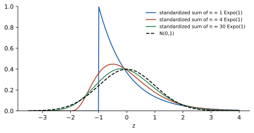
  <figcaption>Original figure for these notes, illustrating Blitzstein and Hwang, <em>Introduction to Probability</em>, Theorem 10.3.1. A sum of Exponentials is Gamma, so these curves are exact standardized Gamma densities. Even from a very skewed start, the shape approaches the Normal.</figcaption>
</figure>

### Part 4 — Proof with MGFs

The theorem holds whenever the variance is finite. Assume in addition that the MGF $$M(t)$$ of the $$X_j$$ exists, which makes the proof short. The strategy: if MGFs converge to an MGF, the distributions converge to that distribution.

**Simplify.** Standardizing each term separately, $$Y_j=(X_j-\mu)/\sigma$$, gives the same quantity, so assume $$\mu=0$$ and $$\sigma=1$$. Then the goal is to show that $$S_n/\sqrt n$$ has MGF tending to $$e^{t^2/2}$$, the $$\mathcal N(0,1)$$ MGF.

**The MGF of $$S_n/\sqrt n$$.** By independence the expectation of the product splits, and the terms are identical:

$$
E\left(e^{tS_n/\sqrt n}\right)=E\left(e^{tX_1/\sqrt n}\right)\cdots E\left(e^{tX_n/\sqrt n}\right)=M\left(\frac t{\sqrt n}\right)^n.
$$

**Take logs.** As $$n\to\infty$$, $$M(t/\sqrt n)\to M(0)=1$$, so this has the indeterminate form $$1^\infty$$. Its log is $$n\log M(t/\sqrt n)=\frac{\log M(t/\sqrt n)}{1/n}$$, of the form $$\frac00$$. To avoid differentiating with respect to an integer, let $$y=1/\sqrt n$$, a real variable tending to 0:

$$
\lim_{y\to0}\frac{\log M(yt)}{y^2}.
$$

**Facts about $$M$$.** $$M(0)=1$$, $$M'(0)=E(X)=0$$, and $$M''(0)=E(X^2)=1$$.

**L'Hôpital twice.**

$$
\lim_{y\to0}\frac{\log M(yt)}{y^2}=\lim_{y\to0}\frac{tM'(yt)}{2yM(yt)}=\frac t2\lim_{y\to0}\frac{M'(yt)}{y}=\frac t2\lim_{y\to0}tM''(yt)=\frac{t^2}2.
$$

After the first step it is still $$\frac00$$, since $$M'(0)=0$$, and the factor $$M(yt)\to1$$ drops out. Exponentiating, the MGF tends to $$e^{t^2/2}$$. $$\blacksquare$$

### Part 5 — The Normal approximation to the Binomial

Historically the first central limit theorem was for the Binomial. Let $$X\sim\operatorname{Bin}(n,p)$$. Write $$X=X_1+\cdots+X_n$$ with $$X_j$$ i.i.d. $$\operatorname{Bern}(p)$$, a sum of i.i.d. terms. Standardize with mean $$np$$ and standard deviation $$\sqrt{npq}$$, $$q=1-p$$, and apply the CLT:

<div class="result-box" markdown="1">

$$
\boxed{P(a\le X\le b)=P\left(\frac{a-np}{\sqrt{npq}}\le\frac{X-np}{\sqrt{npq}}\le\frac{b-np}{\sqrt{npq}}\right)\approx\Phi\left(\frac{b-np}{\sqrt{npq}}\right)-\Phi\left(\frac{a-np}{\sqrt{npq}}\right).}
$$

</div>

How large $$n$$ must be has no single answer: a common rule of thumb is about 30, and for the Binomial, $$np$$ and $$n(1-p)$$ should both be reasonably large.

**Normal versus Poisson.**

| | Poisson approximation | Normal approximation |
|---|---|---|
| Regime | $$n$$ large, $$p$$ small, $$\lambda=np$$ moderate | $$n$$ large, $$p$$ not too close to 0 or 1 |
| Works best | Many rare events | $$p$$ near $$\frac12$$, where the Binomial is nearly symmetric |

The CLT holds for any fixed $$p$$, but if $$p=0.001$$ the Binomial is very skewed and convergence is slow. The two regimes meet: a Poisson with a large mean is itself approximately Normal.

**Continuity correction.** A continuous approximation gives $$P(X=a)\approx0$$ and ignores whether endpoints are included. Since $$X$$ is an integer, $$\{X=a\}=\{a-\frac12<X<a+\frac12\}$$, and approximating this interval instead gives a useful answer. In general, widen each end by $$\frac12$$:

$$
P(a\le X\le b)\approx\Phi\left(\frac{b+\frac12-np}{\sqrt{npq}}\right)-\Phi\left(\frac{a-\frac12-np}{\sqrt{npq}}\right).
$$

<div class="example-block" markdown="1">
<div class="ex-title">One hundred fair coin tosses <span class="ex-pill pill-num">Worked example</span></div>

Let $$X\sim\operatorname{Bin}(100,\tfrac12)$$, so $$np=50$$ and $$\sqrt{npq}=5$$. Find $$P(40\le X\le60)$$.

- **Without correction:** $$\Phi(2)-\Phi(-2)\approx0.9545$$.
- **With correction:** $$\Phi(2.1)-\Phi(-2.1)\approx0.9643$$.
- **Exact:** $$0.9648$$.

For a single value, $$P(X=50)\approx\Phi(0.1)-\Phi(-0.1)\approx0.0797$$, against the exact $$\binom{100}{50}2^{-100}\approx0.0796$$.

<div class="ex-lesson">The continuity correction treats each integer as an interval of width 1, which matters most for narrow ranges and single values.</div>
</div>

### Part 6 — Original practice questions

Try these before reading the answers.

1. Let $$X_j$$ be i.i.d. $$\operatorname{Unif}(0,1)$$. To what does $$\bar X_n$$ converge, and what is its approximate distribution for large $$n$$?
2. Use Chebyshev to find $$n$$ such that the proportion of heads in $$n$$ fair tosses is within 0.05 of $$\frac12$$ with probability at least 0.95.
3. Use the CLT to answer question 2 approximately.
4. A die is rolled 600 times. Approximate the probability that the total exceeds 2150.
5. Let $$X\sim\operatorname{Pois}(100)$$. Approximate $$P(X\ge115)$$ with a continuity correction.
6. Explain why $$n^{1/4}(\bar X_n-\mu)\to0$$ while $$n(\bar X_n-\mu)$$ does not settle down.
7. After 10 tails in a row with a fair coin, is the 11th toss more likely to be heads? Reconcile your answer with the law of large numbers.
8. Why can the CLT not apply to i.i.d. Cauchy variables?
9. Let $$X\sim\operatorname{Bin}(1000,0.002)$$. Which approximation, Normal or Poisson, is more appropriate?

### Part 7 — Practice answers

#### 1. Uniform averages

By the law of large numbers $$\bar X_n\to\frac12$$. By the CLT, $$\bar X_n$$ is approximately $$\mathcal N\left(\frac12,\frac1{12n}\right)$$.

#### 2. A Chebyshev sample size

$$\operatorname{Var}(\bar X_n)=\frac1{4n}$$, so $$P(\lvert\bar X_n-\frac12\rvert\ge0.05)\le\frac{1/(4n)}{0.0025}=\frac{100}n$$. This is at most 0.05 when $$n\ge2000$$.

#### 3. A CLT sample size

Need $$0.05\ge1.96\cdot\frac1{2\sqrt n}$$, so $$\sqrt n\ge19.6$$ and $$n\ge385$$. The CLT, using the shape, needs far fewer tosses than Chebyshev's guarantee.

#### 4. Dice total

Each roll has mean 3.5 and variance $$35/12$$. The total has mean 2100 and standard deviation $$\sqrt{600\cdot35/12}\approx41.8$$. $$P(S>2150)\approx1-\Phi\left(\frac{50}{41.8}\right)\approx1-\Phi(1.20)\approx0.12$$.

#### 5. A Poisson with a large mean

A $$\operatorname{Pois}(100)$$ is a sum of 100 i.i.d. $$\operatorname{Pois}(1)$$, so it is approximately $$\mathcal N(100,100)$$. $$P(X\ge115)\approx1-\Phi\left(\frac{114.5-100}{10}\right)=1-\Phi(1.45)\approx0.074$$.

#### 6. The right scaling

$$n^{1/4}(\bar X_n-\mu)=n^{-1/4}\cdot\sqrt n(\bar X_n-\mu)$$, and the second factor is approximately $$\mathcal N(0,\sigma^2)$$, so the product goes to 0. With $$n=\sqrt n\cdot\sqrt n$$, the extra $$\sqrt n$$ makes the spread grow without bound.

#### 7. The gambler's fallacy

No: the coin is memoryless, and the probability is still $$\frac12$$. The law of large numbers holds because the first 10 tosses are swamped by infinitely many later ones, not because heads become more likely.

#### 8. No finite variance

The CLT requires a finite variance, and the Cauchy has no mean at all. The average of i.i.d. Cauchy variables is again Cauchy, so it never becomes Normal.

#### 9. Rare events

$$np=2$$ is small, and $$p$$ is tiny, so the Binomial is very skewed. The Poisson approximation $$\operatorname{Pois}(2)$$ is appropriate.

### Part 8 — Quick revision sheet

| Concept | Essential fact |
|---|---|
| Sample mean | $$E(\bar X_n)=\mu$$, $$\operatorname{Var}(\bar X_n)=\sigma^2/n$$ |
| Strong LLN | $$\bar X_n\to\mu$$ with probability 1 |
| Weak LLN | $$P(\lvert\bar X_n-\mu\rvert>c)\to0$$; one line from Chebyshev |
| Swamping | Past luck is not corrected, only outweighed |
| CLT, mean form | $$\sqrt n(\bar X_n-\mu)/\sigma\xrightarrow{d}\mathcal N(0,1)$$ |
| CLT, sum form | $$(S_n-n\mu)/(\sqrt n\sigma)\xrightarrow{d}\mathcal N(0,1)$$ |
| Scaling | $$\sqrt n$$: larger powers blow up, smaller ones go to 0 |
| Assumption | Finite variance; any shape |
| Proof | $$M(t/\sqrt n)^n$$, take logs, L'Hôpital twice, limit $$t^2/2$$ |
| Binomial | $$\approx\mathcal N(np,npq)$$; best for $$p$$ near $$\frac12$$ |
| Poisson regime | $$n$$ large, $$p$$ small |
| Continuity correction | $$P(X=a)=P(a-\frac12<X<a+\frac12)$$ |

### Term Glossary

<div class="glossary-entry" markdown="1">
<div class="gterm">Sample mean <span class="gcat cat-meas">Measure</span></div>

$$\bar X_n=\frac1n\sum_{j=1}^nX_j$$, a random variable with mean $$\mu$$ and variance $$\sigma^2/n$$ for i.i.d. data.

</div>

<div class="glossary-entry" markdown="1">
<div class="gterm">Law of large numbers <span class="gcat cat-thm">Theorem</span></div>

For i.i.d. variables with finite mean, the sample mean converges to the true mean: with probability 1 (strong law) or in probability (weak law).

</div>

<div class="glossary-entry" markdown="1">
<div class="gterm">Convergence in distribution <span class="gcat cat-defn">Definition</span></div>

A sequence of random variables converges in distribution when their CDFs converge to a limiting CDF.

</div>

<div class="glossary-entry" markdown="1">
<div class="gterm">Central limit theorem <span class="gcat cat-thm">Theorem</span></div>

For i.i.d. variables with finite variance, the standardized sum or sample mean converges in distribution to $$\mathcal N(0,1)$$.

</div>

<div class="glossary-entry" markdown="1">
<div class="gterm">Continuity correction <span class="gcat cat-prop">Technique</span></div>

Replacing each integer value $$a$$ of a discrete variable by the interval $$(a-\frac12,a+\frac12)$$ before using a continuous approximation.

</div>

<div class="glossary-entry" markdown="1">
<div class="gterm">Gambler's fallacy <span class="gcat cat-defn">Misconception</span></div>

The belief that independent trials compensate for past outcomes, so that a win becomes "due" after losses.

</div>

<div class="ref-tags">
  <span class="ref-tag">Statistics 110</span>
  <span class="ref-tag">Lecture 29</span>
  <span class="ref-tag">Law of large numbers</span>
  <span class="ref-tag">Central limit theorem</span>
  <span class="ref-tag">Normal approximation</span>
  <span class="ref-tag">Continuity correction</span>
</div>

  </div>
</div>


## Lecture 30 - Chi-Square, Student-t, and Multivariate Normal

<div class="chapter-block">
  <button type="button" class="chapter-toggle" id="lecture-30-toggle" onclick="toggleLecture('lecture-30')" aria-expanded="true" aria-controls="lecture-30-body">
    <span class="chapter-toggle-left">
      <span class="chapter-badge">Lecture 30</span>
      <span>
        <span class="chapter-title">Lecture 30 - Chi-Square, Student-t, and Multivariate Normal</span>
        <span class="chapter-subtitle">Distributions built from Normals: the Chi-Square as a Gamma, the Student-t and its heavy tails, and the Multivariate Normal with its MGF and the uncorrelated-implies-independent property</span>
      </span>
    </span>
    <span class="chapter-arrow open" id="lecture-30-arrow" aria-hidden="true">▼</span>
  </button>
  <div class="chapter-body open" id="lecture-30-body" markdown="1">

<div class="note-abstract" markdown="1">

The last named distributions are all built from Normals. A sum of $$n$$ squared i.i.d. standard Normals is Chi-Square with $$n$$ degrees of freedom, which is the same as $$\operatorname{Gamma}(n/2,1/2)$$. A standard Normal divided by the square root of an independent Chi-Square over its degrees of freedom is Student-t. The t is symmetric, has heavier tails than the Normal, reduces to the Cauchy for one degree of freedom, and approaches the Normal as the degrees of freedom grow, by the law of large numbers. A random vector is Multivariate Normal when every linear combination of its components is Normal. Its MGF follows from the one-dimensional Normal MGF, and within a Multivariate Normal, uncorrelated components are independent.

</div>

### Notation at a Glance

<div class="notation-panel" markdown="1">

| Symbol | Meaning |
|---|---|
| $$Z,Z_1,Z_2,\ldots$$ | i.i.d. $$\mathcal N(0,1)$$ |
| $$V\sim\chi^2_n$$ | $$Z_1^2+\cdots+Z_n^2$$, Chi-Square with $$n$$ degrees of freedom |
| $$T\sim t_n$$ | $$Z\big/\sqrt{V/n}$$ with $$Z$$ independent of $$V\sim\chi^2_n$$ |
| $$\mathbf X=(X_1,\ldots,X_k)$$ | Random vector |
| $$\mathbf t'\mathbf X=t_1X_1+\cdots+t_kX_k$$ | Linear combination of the components |
| $$\mu_j=E(X_j)$$ | Mean of component $$j$$ |
| MVN | Multivariate Normal |

</div>

### Learning objectives

After studying these notes, you should be able to:

- Define the Chi-Square distribution and identify it as a Gamma distribution.
- Define the Student-t distribution and derive its symmetry, its mean, and its relation to the Cauchy.
- Explain why $$t_n$$ approaches $$\mathcal N(0,1)$$ as $$n\to\infty$$.
- Find even Normal moments through the Chi-Square and Gamma.
- Define the Multivariate Normal through linear combinations, with an example and a non-example.
- Derive the MVN joint MGF and use the fact that uncorrelated components of an MVN are independent.

### Part 1 — The Chi-Square distribution

<div class="example-block" markdown="1">
<div class="ex-title">Chi-Square distribution <span class="ex-pill pill-defn">Definition</span></div>

If $$Z_1,\ldots,Z_n$$ are i.i.d. $$\mathcal N(0,1)$$, then

$$
V=Z_1^2+\cdots+Z_n^2\sim\chi^2_n,
$$

the **Chi-Square distribution** with $$n$$ **degrees of freedom**.

</div>

Sums of squares appear throughout statistics, which is why the Chi-Square, and tests based on it, are used so widely.

**A Gamma in disguise.** For one degree of freedom, a change of variables shows

$$
\chi^2_1=\operatorname{Gamma}\left(\tfrac12,\tfrac12\right).
$$

Since $$z^2$$ is not one-to-one, the derivation goes through the CDF. Lecture 22 found the density $$\frac1{\sqrt{2\pi y}}e^{-y/2}$$ for $$y>0$$, which is the $$\operatorname{Gamma}(\frac12,\frac12)$$ density since $$\Gamma(\frac12)=\sqrt\pi$$. Adding $$n$$ independent Gammas with the same rate adds their first parameters, so

<div class="result-box" markdown="1">

$$
\boxed{\chi^2_n=\operatorname{Gamma}\left(\tfrac n2,\tfrac12\right),\qquad E(V)=n,\qquad\operatorname{Var}(V)=2n.}
$$

</div>

So the Chi-Square is a special Gamma with its own name, and everything known about the Gamma applies.

**Even Normal moments, again.** Since $$Z^2\sim\operatorname{Gamma}(\frac12,\frac12)$$, the Gamma moment formula, rescaled, gives

$$
E(Z^{2n})=E\big((Z^2)^n\big)=2^n\frac{\Gamma(n+\frac12)}{\Gamma(\frac12)}=1\cdot3\cdot5\cdots(2n-1),
$$

matching the MGF result from Lecture 18: $$E(Z^2)=1$$, $$E(Z^4)=3$$, $$E(Z^6)=15$$.

### Part 2 — The Student-t distribution

The t distribution was introduced in 1908 by William Gosset, a statistician working for the Guinness brewery, who published as "Student", reportedly because Guinness did not want competitors to know it employed a statistician.

<div class="example-block" markdown="1">
<div class="ex-title">Student-t distribution <span class="ex-pill pill-defn">Definition</span></div>

If $$Z\sim\mathcal N(0,1)$$ and $$V\sim\chi^2_n$$ are independent, then

$$
\boxed{T=\frac Z{\sqrt{V/n}}\sim t_n,}
$$

the **Student-t distribution** with $$n$$ degrees of freedom.

</div>

The PDF can be found with a Jacobian, but the properties below follow directly from the definition.

**Properties.**

1. **Symmetric.** $$-Z$$ is also $$\mathcal N(0,1)$$ and is still independent of $$V$$, so $$-T$$ has the same distribution as $$T$$.
2. **One degree of freedom is Cauchy.** With $$n=1$$, $$T=Z/\lvert Z_1\rvert$$. By symmetry the absolute value does not change the distribution, so $$t_1$$ is the ratio of two i.i.d. standard Normals: the Cauchy. In particular $$t_1$$ has no mean.
3. **Mean 0 for $$n\ge2$$.** By independence, $$E(T)=E(Z)\,E\left(\frac1{\sqrt{V/n}}\right)=0$$, provided the second factor is finite, which it is for $$n\ge2$$. For $$n=1$$ that factor is infinite, and "infinity times 0" is not 0.
4. **Limited moments.** $$t_n$$ has moments only of order less than $$n$$: $$t_1$$ has no mean, $$t_2$$ no variance, and so on. It has no MGF. Moments that exist come from Normal moments times moments of a power of a Gamma, by independence.
5. **Heavier tails than the Normal.** Extreme values are relatively more likely, especially for small $$n$$. The Cauchy density decays like $$1/x^2$$, while the Normal decays like $$e^{-x^2/2}$$.

<figure>
  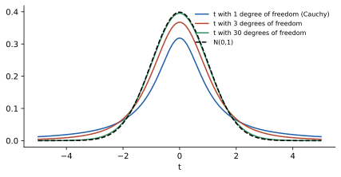
  <figcaption>Original figure for these notes, illustrating Blitzstein and Hwang, <em>Introduction to Probability</em>, Definition 10.4.4 and Theorem 10.4.5. Small degrees of freedom give heavy tails; large degrees of freedom give nearly a Normal.</figcaption>
</figure>

**Approaching the Normal.** Construct $$T_n=Z\big/\sqrt{V_n/n}$$ with $$V_n=Z_1^2+\cdots+Z_n^2$$, using the same $$Z$$ and the same sequence $$Z_1,Z_2,\ldots$$ for every $$n$$; this is allowed, since only the distribution of $$T_n$$ matters. Now $$V_n/n$$ is the sample mean of i.i.d. $$Z_j^2$$, each with mean 1, so by the law of large numbers $$V_n/n\to1$$ with probability 1, and so does its square root. Hence $$T_n\to Z$$ with probability 1, and

$$
\boxed{t_n\xrightarrow{\ d\ }\mathcal N(0,1)\quad\text{as }n\to\infty.}
$$

For large degrees of freedom, around 30 or more, the t looks very much like a standard Normal.

### Part 3 — The Multivariate Normal

The Multinomial is the most important discrete multivariate distribution; the Multivariate Normal is the most important continuous one. Independent Normals stacked into a vector are easy. The interesting case allows correlation.

<div class="example-block" markdown="1">
<div class="ex-title">Multivariate Normal distribution <span class="ex-pill pill-defn">Definition</span></div>

A random vector $$\mathbf X=(X_1,\ldots,X_k)$$ is **Multivariate Normal** if every linear combination

$$
t_1X_1+\cdots+t_kX_k
$$

has a Normal distribution, for every choice of constants $$t_1,\ldots,t_k$$. A constant counts as a Normal with variance 0. For $$k=2$$ it is called **Bivariate Normal**.

</div>

The definition reduces a vector question back to the one-dimensional Normal.

<div class="example-block" markdown="1">
<div class="ex-title">An example and a non-example <span class="ex-pill pill-ex">Worked example</span></div>

**Example.** Let $$Z,W$$ be i.i.d. $$\mathcal N(0,1)$$. Then $$(Z+2W,\ 3Z+5W)$$ is Bivariate Normal: for any $$s,t$$,

$$
s(Z+2W)+t(3Z+5W)=(s+3t)Z+(2s+5t)W,
$$

a sum of independent Normals, hence Normal. More generally, any vector of linear combinations of i.i.d. Normals is MVN.

**Non-example.** Let $$Z\sim\mathcal N(0,1)$$ and let $$S$$ be a random sign, $$\pm1$$ with probability $$\frac12$$ each, independent of $$Z$$. Then $$SZ\sim\mathcal N(0,1)$$ by symmetry, so both $$Z$$ and $$SZ$$ are Normal. But $$(Z,SZ)$$ is not Bivariate Normal: the combination $$Z+SZ$$ equals 0 with probability $$\frac12$$, which no Normal does.

<div class="ex-lesson">Components that are each Normal do not make a vector Multivariate Normal. Every linear combination must be Normal.</div>
</div>

**The joint MGF.** For a random vector, the MGF uses one argument per component:

$$
M(\mathbf t)=E\left(e^{\mathbf t'\mathbf X}\right)=E\left(e^{t_1X_1+\cdots+t_kX_k}\right).
$$

If $$\mathbf X$$ is MVN, the exponent $$W=\mathbf t'\mathbf X$$ is Normal. A Normal $$W$$ has $$E(e^W)=e^{E(W)+\frac12\operatorname{Var}(W)}$$, from the univariate MGF $$E(e^{sW})=e^{s\mu+\frac12s^2\sigma^2}$$ at $$s=1$$. So

<div class="result-box" markdown="1">

$$
\boxed{M(\mathbf t)=\exp\left(t_1\mu_1+\cdots+t_k\mu_k+\tfrac12\operatorname{Var}(t_1X_1+\cdots+t_kX_k)\right),}
$$

</div>

where the variance expands into variances and covariances by bilinearity. The joint MGF determines the joint distribution, so an MVN is determined by its means, variances, and covariances.

### Part 4 — Uncorrelated implies independent within an MVN

<div class="example-block" markdown="1">
<div class="ex-title">Uncorrelated components of an MVN <span class="ex-pill pill-thm">Theorem</span></div>

Split a Multivariate Normal vector as $$\mathbf X=(\mathbf X_1,\mathbf X_2)$$. If every component of $$\mathbf X_1$$ is uncorrelated with every component of $$\mathbf X_2$$, then $$\mathbf X_1$$ and $$\mathbf X_2$$ are independent.

</div>

In general, independent implies uncorrelated but not conversely. Within an MVN the converse also holds; it can be proved by factoring the joint MGF. The non-example shows why the MVN assumption matters: $$Z$$ and $$SZ$$ are uncorrelated, since $$E(SZ^2)=E(S)E(Z^2)=0$$, but clearly dependent.

<div class="example-block" markdown="1">
<div class="ex-title">Sum and difference of i.i.d. Normals <span class="ex-pill pill-ex">Worked example</span></div>

Let $$X,Y$$ be i.i.d. $$\mathcal N(0,1)$$. The pair $$(X+Y,\ X-Y)$$ is Bivariate Normal, since any combination of them is a combination of $$X$$ and $$Y$$. Their covariance is

$$
\operatorname{Cov}(X+Y,X-Y)=\operatorname{Var}(X)-\operatorname{Cov}(X,Y)+\operatorname{Cov}(Y,X)-\operatorname{Var}(Y)=1-1=0.
$$

So $$X+Y$$ and $$X-Y$$ are independent. This is special to the Normal: if i.i.d. $$X,Y$$ have independent sum and difference, they must be Normal, a much harder theorem.

<div class="ex-lesson">Inside an MVN, checking independence reduces to computing covariances.</div>
</div>

<div class="misconception-block" markdown="1">

**Incorrect:** Two Normal random variables with zero correlation are independent.

**Correction:** This needs them to be jointly Bivariate Normal. $$Z$$ and $$SZ$$ are each Normal and uncorrelated, but dependent.

</div>

### Part 5 — Original practice questions

Try these before reading the answers.

1. Find the mean and variance of $$\chi^2_n$$ from its Gamma form.
2. Let $$Z_1,Z_2$$ be i.i.d. $$\mathcal N(0,1)$$. Show that $$Z_1^2+Z_2^2\sim\operatorname{Expo}(\frac12)$$.
3. Use the Chi-Square to compute $$E(Z^6)$$.
4. If $$T\sim t_n$$, express $$T^2$$ as a ratio of two independent Chi-Square variables, each divided by its degrees of freedom.
5. For $$T\sim t_n$$ with $$n>2$$, find $$\operatorname{Var}(T)$$ using $$E(1/V)=\frac1{n-2}$$ for $$V\sim\chi^2_n$$.
6. Let $$Z,W$$ be i.i.d. $$\mathcal N(0,1)$$. Is $$(Z,\ Z+W,\ Z-2W)$$ Multivariate Normal? Find $$\operatorname{Cov}(Z+W,\,Z-2W)$$.
7. In question 6, find $$a$$ so that $$Z+W$$ and $$Z+aW$$ are independent.
8. Write down the joint MGF of $$(X+Y,X-Y)$$ for i.i.d. $$\mathcal N(0,1)$$ $$X,Y$$, and use it to confirm independence.
9. Explain why $$t_1$$ has no mean but $$t_3$$ does.

### Part 6 — Practice answers

#### 1. Chi-Square moments

$$\operatorname{Gamma}(a,\lambda)$$ has mean $$a/\lambda$$ and variance $$a/\lambda^2$$. With $$a=\frac n2$$, $$\lambda=\frac12$$: mean $$n$$, variance $$2n$$.

#### 2. Two degrees of freedom

$$\chi^2_2=\operatorname{Gamma}(1,\tfrac12)=\operatorname{Expo}(\tfrac12)$$.

#### 3. A sixth moment

$$E(Z^6)=E((Z^2)^3)$$. For $$Y\sim\operatorname{Gamma}(\frac12,\frac12)$$, $$E(Y^3)=2^3\frac{\Gamma(\frac72)}{\Gamma(\frac12)}=8\cdot\frac52\cdot\frac32\cdot\frac12=15$$.

#### 4. The square of a t

$$T^2=\frac{Z^2/1}{V/n}$$, a ratio of a $$\chi^2_1$$ over 1 and an independent $$\chi^2_n$$ over $$n$$. Such a ratio has an F distribution, here with $$(1,n)$$ degrees of freedom (supplementary; the F is not covered in this course).

#### 5. Variance of a t

$$E(T)=0$$, so $$\operatorname{Var}(T)=E(T^2)=E(Z^2)\,E\left(\frac nV\right)=\frac n{n-2}$$. It exceeds 1, reflecting the heavier tails.

#### 6. A three-dimensional MVN

Yes: every linear combination of the three is a linear combination of the independent $$Z,W$$. $$\operatorname{Cov}(Z+W,Z-2W)=1-2=-1$$.

#### 7. Choosing independence

$$\operatorname{Cov}(Z+W,Z+aW)=1+a=0$$ when $$a=-1$$. The pair is MVN, so $$Z+W$$ and $$Z-W$$ are then independent.

#### 8. MGF factorization

$$t_1(X+Y)+t_2(X-Y)$$ has mean 0 and variance $$(t_1+t_2)^2+(t_1-t_2)^2=2t_1^2+2t_2^2$$. So $$M(t_1,t_2)=e^{t_1^2}e^{t_2^2}$$, a product of two $$\mathcal N(0,2)$$ MGFs: the components are independent.

#### 9. Existence of the mean

$$t_1$$ is Cauchy, and $$E\lvert T\rvert=\infty$$. For $$t_3$$, $$E\left(1/\sqrt{V/3}\right)<\infty$$, so $$E(T)=E(Z)E\left(1/\sqrt{V/3}\right)=0$$.

### Part 7 — Quick revision sheet

| Concept | Essential fact |
|---|---|
| Chi-Square | $$\chi^2_n=Z_1^2+\cdots+Z_n^2$$ |
| Gamma form | $$\chi^2_n=\operatorname{Gamma}(n/2,1/2)$$; mean $$n$$, variance $$2n$$ |
| One degree | $$\chi^2_1=\operatorname{Gamma}(\frac12,\frac12)$$ |
| Student-t | $$T=Z/\sqrt{V/n}$$, $$Z$$ independent of $$V\sim\chi^2_n$$ |
| Symmetry | $$-T$$ has the same distribution as $$T$$ |
| $$t_1$$ | Cauchy; no mean |
| Mean | 0 for $$n\ge2$$ |
| Tails | Heavier than Normal; moments only below order $$n$$ |
| Limit | $$t_n\to\mathcal N(0,1)$$ by the law of large numbers |
| MVN | Every linear combination is Normal |
| Non-example | $$(Z,SZ)$$: each Normal, not jointly |
| MVN MGF | $$\exp(\sum t_j\mu_j+\frac12\operatorname{Var}(\sum t_jX_j))$$ |
| Independence | Within an MVN, uncorrelated implies independent |
| Sum and difference | i.i.d. Normals: $$X+Y$$ and $$X-Y$$ independent |

### Term Glossary

<div class="glossary-entry" markdown="1">
<div class="gterm">Chi-Square distribution <span class="gcat cat-defn">Definition</span></div>

The distribution of a sum of $$n$$ squared i.i.d. standard Normals, equal to $$\operatorname{Gamma}(n/2,1/2)$$.

</div>

<div class="glossary-entry" markdown="1">
<div class="gterm">Degrees of freedom <span class="gcat cat-notn">Notation</span></div>

The parameter $$n$$ of the Chi-Square and Student-t: the number of squared standard Normals in the Chi-Square.

</div>

<div class="glossary-entry" markdown="1">
<div class="gterm">Student-t distribution <span class="gcat cat-defn">Definition</span></div>

The distribution of $$Z/\sqrt{V/n}$$ with $$Z\sim\mathcal N(0,1)$$ independent of $$V\sim\chi^2_n$$; symmetric and heavy-tailed, approaching $$\mathcal N(0,1)$$ as $$n$$ grows.

</div>

<div class="glossary-entry" markdown="1">
<div class="gterm">Multivariate Normal distribution <span class="gcat cat-defn">Definition</span></div>

The distribution of a random vector every linear combination of whose components is Normal.

</div>

<div class="glossary-entry" markdown="1">
<div class="gterm">Joint MGF <span class="gcat cat-notn">Notation</span></div>

$$M(\mathbf t)=E(e^{t_1X_1+\cdots+t_kX_k})$$, which determines the joint distribution of a random vector.

</div>

<div class="ref-tags">
  <span class="ref-tag">Statistics 110</span>
  <span class="ref-tag">Lecture 30</span>
  <span class="ref-tag">Chi-Square</span>
  <span class="ref-tag">Student-t</span>
  <span class="ref-tag">Multivariate Normal</span>
  <span class="ref-tag">Joint MGF</span>
</div>

  </div>
</div>


## Lecture 31 - Markov Chains

<div class="chapter-block">
  <button type="button" class="chapter-toggle" id="lecture-31-toggle" onclick="toggleLecture('lecture-31')" aria-expanded="true" aria-controls="lecture-31-body">
    <span class="chapter-toggle-left">
      <span class="chapter-badge">Lecture 31</span>
      <span>
        <span class="chapter-title">Lecture 31 - Markov Chains</span>
        <span class="chapter-subtitle">Stochastic processes, the Markov property, transition matrices, multi-step probabilities as matrix powers, and the definition of a stationary distribution</span>
      </span>
    </span>
    <span class="chapter-arrow open" id="lecture-31-arrow" aria-hidden="true">▼</span>
  </button>
  <div class="chapter-body open" id="lecture-31-body" markdown="1">

<div class="note-abstract" markdown="1">

A Markov chain is a sequence of random states, one step beyond i.i.d.: the next state may depend on the current state, but given the present, the past is irrelevant. Past and future are conditionally independent given the present. A homogeneous chain on finitely many states is described by a transition matrix $$Q$$ whose $$(i,j)$$ entry is the probability of moving from $$i$$ to $$j$$, with each row summing to 1. If the current distribution is the row vector $$\mathbf s$$, then the distribution $$m$$ steps later is $$\mathbf sQ^m$$, and the $$m$$-step transition probabilities are the entries of $$Q^m$$. A distribution with $$\mathbf sQ=\mathbf s$$ is stationary: a chain that starts there stays there.

</div>

### Notation at a Glance

<div class="notation-panel" markdown="1">

| Symbol | Meaning |
|---|---|
| $$X_0,X_1,X_2,\ldots$$ | State of the chain at times $$0,1,2,\ldots$$ |
| $$\{1,\ldots,M\}$$ | Finite state space |
| $$q_{ij}=P(X_{n+1}=j\mid X_n=i)$$ | Transition probability from $$i$$ to $$j$$ |
| $$Q=(q_{ij})$$ | $$M\times M$$ transition matrix; rows sum to 1 |
| $$\mathbf s=(s_1,\ldots,s_M)$$ | Distribution of a state, written as a row vector |
| $$Q^m$$ | $$m$$-step transition matrix |

</div>

### Learning objectives

After studying these notes, you should be able to:

- Describe a stochastic process and where Markov chains sit between i.i.d. sequences and general dependence.
- State the Markov property as conditional independence of past and future given the present.
- Draw a chain as a diagram and write its transition matrix.
- Show that the distribution one step later is $$\mathbf sQ$$ and that $$m$$-step probabilities are entries of $$Q^m$$.
- Define a stationary distribution and state the questions it raises.
- Describe the two main uses of Markov chains, modeling and Markov chain Monte Carlo, and Markov's original motivation.

### Part 1 — Stochastic processes and the Markov property

A **stochastic process** is a collection of random variables evolving over time, such as $$X_0,X_1,X_2,\ldots$$, where $$X_n$$ is the state of a system at time $$n$$. If the $$X_n$$ are i.i.d., the process restarts afresh at each step. If they may depend on each other in arbitrary ways, the process can be hopelessly complicated. Markov chains are a compromise, one step beyond i.i.d.

Here time is discrete and the states form a finite set, numbered $$1,\ldots,M$$ by convention. Continuous time and continuous or infinite state spaces lead to other processes, studied in a course on stochastic processes.

<div class="example-block" markdown="1">
<div class="ex-title">Markov chain <span class="ex-pill pill-defn">Definition</span></div>

$$X_0,X_1,X_2,\ldots$$ is a **Markov chain** if, for all $$n$$ and all states,

$$
\boxed{P(X_{n+1}=j\mid X_n=i,X_{n-1}=i_{n-1},\ldots,X_0=i_0)=P(X_{n+1}=j\mid X_n=i).}
$$

It is **homogeneous** when this probability does not depend on $$n$$; call it $$q_{ij}$$. All chains in these notes are homogeneous.

</div>

**Interpretation.** Think of $$X_n$$ as now, $$X_{n+1}$$ as tomorrow, and $$X_0,\ldots,X_{n-1}$$ as the past. To predict the future, only the current state matters, not the path that led to it. In the language used throughout the course: **past and future are conditionally independent given the present**. They need not be independent: without knowing $$X_n$$, the past can still help predict $$X_{n+1}$$, and $$X_{n-1}$$ cannot be discarded.

Whether a real system, such as the weather or a stock price, is Markov is an empirical question. The assumption is less restrictive than it looks: a chain whose next state depends on the last two states can be rewritten as an ordinary Markov chain on pairs of states.

### Part 2 — Diagrams and the transition matrix

A chain can be drawn as states joined by arrows labeled with transition probabilities. A particle wanders from state to state, following arrows.

<figure>
  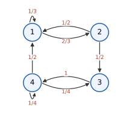
  <figcaption>Original figure for these notes, illustrating Blitzstein and Hwang, <em>Introduction to Probability</em>, Definitions 11.1.1–11.1.2. The four-state chain used throughout this lecture.</figcaption>
</figure>

<div class="example-block" markdown="1">
<div class="ex-title">Transition matrix <span class="ex-pill pill-defn">Definition</span></div>

The **transition matrix** is $$Q=(q_{ij})$$, where row $$i$$ lists the probabilities of moving from state $$i$$ to each state. For the chain in the figure,

$$
Q=\begin{pmatrix}
1/3&2/3&0&0\\
1/2&0&1/2&0\\
0&0&0&1\\
1/2&0&1/4&1/4
\end{pmatrix}.
$$

</div>

Each row sums to 1, since from state $$i$$ the chain must go somewhere; columns need not. Conversely, any square matrix with nonnegative entries and row sums 1 is a valid transition matrix. Some books use the transpose, with columns summing to 1.

<div class="misconception-block" markdown="1">

**Incorrect:** In a Markov chain, the future is independent of the past.

**Correction:** The future is independent of the past only **given the present**. Unconditionally, the past carries information about the present state and hence about the future.

</div>

### Part 3 — Distributions over time: powers of $$Q$$

**One step.** Suppose $$X_n$$ has PMF $$\mathbf s$$, written as a $$1\times M$$ row vector: $$s_i=P(X_n=i)$$. By the law of total probability, conditioning on the current state,

$$
P(X_{n+1}=j)=\sum_iP(X_{n+1}=j\mid X_n=i)P(X_n=i)=\sum_is_iq_{ij}.
$$

That sum is the $$j$$th entry of the matrix product $$\mathbf sQ$$: a row of $$\mathbf s$$ dotted with column $$j$$ of $$Q$$.

<div class="result-box" markdown="1">

$$
\boxed{\text{distribution of }X_{n+1}=\mathbf sQ,\qquad\text{distribution of }X_{n+m}=\mathbf sQ^m.}
$$

</div>

Each step forward in time multiplies on the right by $$Q$$.

**Two steps.** Condition on the missing middle state, then use the Markov property to drop $$X_n$$ from the first factor:

$$
P(X_{n+2}=j\mid X_n=i)=\sum_kP(X_{n+2}=j\mid X_{n+1}=k)P(X_{n+1}=k\mid X_n=i)=\sum_kq_{ik}q_{kj},
$$

the $$(i,j)$$ entry of $$Q^2$$. Repeating the argument,

<div class="result-box" markdown="1">

$$
\boxed{P(X_{n+m}=j\mid X_n=i)=\big(Q^m\big)_{ij}.}
$$

</div>

Powers of a single matrix give every multi-step transition probability.

<div class="example-block" markdown="1">
<div class="ex-title">Two steps in the four-state chain <span class="ex-pill pill-num">Worked example</span></div>

From state 1, what is the chance of being at state 3 two steps later? The paths are $$1\to2\to3$$, with probability $$\frac23\cdot\frac12=\frac13$$, and no others, since from state 1 the chain goes to 1 or 2 and only state 2 leads to 3. So $$(Q^2)_{13}=\frac13$$.

Row 1 of $$Q^2$$ is $$\left(\frac49,\frac29,\frac13,0\right)$$: state 4 cannot be reached from state 1 in two steps.

<div class="ex-lesson">Entries of $$Q^m$$ add up the probabilities of all paths of length $$m$$ between two states.</div>
</div>

### Part 4 — Stationary distributions

<div class="example-block" markdown="1">
<div class="ex-title">Stationary distribution <span class="ex-pill pill-defn">Definition</span></div>

A probability row vector $$\mathbf s$$, with nonnegative entries summing to 1, is a **stationary distribution** for the chain if

$$
\boxed{\mathbf sQ=\mathbf s.}
$$

</div>

**Why "stationary".** If $$X_n$$ has distribution $$\mathbf s$$, then so does $$X_{n+1}$$, since $$\mathbf sQ=\mathbf s$$, and so does every later state. A chain started at its stationary distribution keeps that distribution forever. For readers who know linear algebra, $$\mathbf s$$ is a left eigenvector of $$Q$$ with eigenvalue 1, or equivalently an eigenvector of $$Q'$$.

<div class="example-block" markdown="1">
<div class="ex-title">Solving for the four-state chain <span class="ex-pill pill-num">Worked example</span></div>

Write $$\mathbf s=(s_1,s_2,s_3,s_4)$$. The column equations of $$\mathbf sQ=\mathbf s$$ are

$$
s_2=\tfrac23s_1,\qquad s_3=\tfrac12s_2+\tfrac14s_4,\qquad s_4=s_3+\tfrac14s_4,
$$

with the first column redundant. The last equation gives $$s_3=\frac34s_4$$. Substituting into the middle one, $$\frac34s_4=\frac12s_2+\frac14s_4$$, so $$s_2=s_4$$. With $$s_2=\frac23s_1$$, all are multiples of $$s_1$$: $$\mathbf s\propto(1,\frac23,\frac12,\frac23)\propto(6,4,3,4)$$. Normalizing,

$$
\mathbf s=\left(\frac6{17},\frac4{17},\frac3{17},\frac4{17}\right).
$$

Check the first column: $$\frac6{17}\cdot\frac13+\frac4{17}\cdot\frac12+\frac4{17}\cdot\frac12=\frac6{17}$$.

<div class="ex-lesson">For a small chain, solve the linear equations and normalize. For large chains, Lecture 32 gives better routes.</div>
</div>

**Questions to answer.** Does a stationary distribution exist, as a vector with nonnegative entries? Is it unique? Does the chain converge to it, so that it describes long-run behavior? And how can it be computed efficiently? Solving $$\mathbf sQ=\mathbf s$$ directly is a linear system, which can be enormous. Lecture 32 answers these questions.

### Part 5 — Uses and origins

**Two kinds of use.**

1. **Modeling.** Treat a real system, in the physical, biological, or social sciences, as a Markov chain, exactly or approximately.
2. **Markov chain Monte Carlo (MCMC).** Build your own chain on a computer, designed so that it converges to a distribution you want to study but cannot compute directly. Run it for a long time and use its states as approximate draws from that distribution. Since you constructed the chain, whether it is "really" Markov is not in question. MCMC has transformed scientific computing and is used in almost every field.

**Markov's motivation.** Markov introduced chains around 1906. The law of large numbers had recently been proved for i.i.d. variables, and some argued that because human behavior is not i.i.d., free will escapes it. Markov answered by going one step beyond i.i.d.: he proved a law of large numbers for chains, showing that independence is not necessary. His first example was a chain on two states, vowel and consonant, estimated from the letters of a Russian novel.

### Part 6 — Original practice questions

Try these before reading the answers.

1. Is a sequence of i.i.d. random variables on $$\{1,\ldots,M\}$$ a Markov chain? What is its transition matrix?
2. Explain in words why the Markov property does not make $$X_{n+1}$$ independent of $$X_{n-1}$$.
3. Weather is sunny or rainy. A sunny day is followed by a sunny day with probability 0.8, and a rainy day by a rainy day with probability 0.6. Write the transition matrix.
4. In question 3, if today is sunny, find the probability of rain two days from now.
5. Find the stationary distribution of the weather chain.
6. A chain starts in state 1 of the four-state chain. Find the distribution of $$X_1$$ and $$X_2$$.
7. Check that $$\mathbf s=(\frac12,\frac12)$$ is stationary for $$Q=\begin{pmatrix}0&1\\1&0\end{pmatrix}$$, and describe how the chain moves.
8. For the two-state chain $$Q=\begin{pmatrix}1-a&a\\b&1-b\end{pmatrix}$$ with $$a+b>0$$, find the stationary distribution.
9. Show that if $$\mathbf s$$ is stationary then $$\mathbf sQ^m=\mathbf s$$ for every $$m$$.

### Part 7 — Practice answers

#### 1. i.i.d. as a special case

Yes. If each $$X_n$$ has PMF $$\mathbf p$$, the future ignores the present too, and every row of $$Q$$ equals $$\mathbf p$$.

#### 2. Conditional, not unconditional

The past affects the present, which affects the future. Without knowing $$X_n$$, the value of $$X_{n-1}$$ is informative about $$X_n$$ and hence about $$X_{n+1}$$. Only once $$X_n$$ is known does $$X_{n-1}$$ become irrelevant.

#### 3. Weather matrix

With states sunny, rainy: $$Q=\begin{pmatrix}0.8&0.2\\0.4&0.6\end{pmatrix}$$.

#### 4. Two days ahead

$$(Q^2)_{SR}=0.8\cdot0.2+0.2\cdot0.6=0.28$$.

#### 5. Weather in the long run

$$s_S=0.8s_S+0.4s_R$$ gives $$0.2s_S=0.4s_R$$, so $$s_S=2s_R$$ and $$\mathbf s=(\frac23,\frac13)$$.

#### 6. Starting at state 1

$$X_1$$: row 1 of $$Q$$, $$(\frac13,\frac23,0,0)$$. $$X_2$$: row 1 of $$Q^2$$, $$(\frac49,\frac29,\frac13,0)$$.

#### 7. A flip-flop chain

$$(\frac12,\frac12)Q=(\frac12,\frac12)$$. The chain alternates deterministically between the two states. It has a stationary distribution, but started at state 1 its distribution does not converge.

#### 8. General two-state chain

Balance between the states: $$s_1a=s_2b$$. So $$\mathbf s=\left(\frac b{a+b},\frac a{a+b}\right)$$. Question 5 is the case $$a=0.2$$, $$b=0.4$$.

#### 9. Stationary forever

By induction, $$\mathbf sQ^m=(\mathbf sQ)Q^{m-1}=\mathbf sQ^{m-1}=\cdots=\mathbf s$$.

### Part 8 — Quick revision sheet

| Concept | Essential fact |
|---|---|
| Stochastic process | Random variables evolving over time |
| Markov property | Given the present, the past is irrelevant to the future |
| Conditional independence | Past and future are conditionally independent given the present |
| Homogeneous | $$q_{ij}$$ does not depend on time |
| Transition matrix | $$Q=(q_{ij})$$; nonnegative, rows sum to 1 |
| One step | Distribution $$\mathbf s\mapsto\mathbf sQ$$ |
| $$m$$ steps | $$\mathbf sQ^m$$; $$P(X_{n+m}=j\mid X_n=i)=(Q^m)_{ij}$$ |
| Stationary | $$\mathbf sQ=\mathbf s$$, $$\mathbf s$$ a probability vector |
| Four-state example | $$\mathbf s=(6,4,3,4)/17$$ |
| Open questions | Existence, uniqueness, convergence, computation |
| Uses | Modeling and Markov chain Monte Carlo |
| Origin | Markov, about 1906: a law of large numbers beyond i.i.d. |

### Term Glossary

<div class="glossary-entry" markdown="1">
<div class="gterm">Stochastic process <span class="gcat cat-defn">Definition</span></div>

A collection of random variables indexed by time, describing a system that evolves randomly.

</div>

<div class="glossary-entry" markdown="1">
<div class="gterm">Markov property <span class="gcat cat-prop">Property</span></div>

The future is conditionally independent of the past given the present state.

</div>

<div class="glossary-entry" markdown="1">
<div class="gterm">Transition matrix <span class="gcat cat-defn">Definition</span></div>

The matrix $$Q$$ of one-step transition probabilities $$q_{ij}=P(X_{n+1}=j\mid X_n=i)$$, with rows summing to 1.

</div>

<div class="glossary-entry" markdown="1">
<div class="gterm">Stationary distribution <span class="gcat cat-defn">Definition</span></div>

A probability row vector $$\mathbf s$$ with $$\mathbf sQ=\mathbf s$$, preserved by every step of the chain.

</div>

<div class="glossary-entry" markdown="1">
<div class="gterm">Markov chain Monte Carlo <span class="gcat cat-defn">Definition</span></div>

Computing with a purpose-built Markov chain that converges to a target distribution, using its long-run states as approximate draws.

</div>

<div class="ref-tags">
  <span class="ref-tag">Statistics 110</span>
  <span class="ref-tag">Lecture 31</span>
  <span class="ref-tag">Markov chains</span>
  <span class="ref-tag">Transition matrix</span>
  <span class="ref-tag">Stationary distribution</span>
  <span class="ref-tag">MCMC</span>
</div>

  </div>
</div>


## Lecture 32 - Markov Chains Continued

<div class="chapter-block">
  <button type="button" class="chapter-toggle" id="lecture-32-toggle" onclick="toggleLecture('lecture-32')" aria-expanded="true" aria-controls="lecture-32-body">
    <span class="chapter-toggle-left">
      <span class="chapter-badge">Lecture 32</span>
      <span>
        <span class="chapter-title">Lecture 32 - Markov Chains Continued</span>
        <span class="chapter-subtitle">Irreducible, recurrent, transient, and periodic behavior; existence, uniqueness, and convergence of the stationary distribution; reversibility; and random walk on an undirected network</span>
      </span>
    </span>
    <span class="chapter-arrow open" id="lecture-32-arrow" aria-hidden="true">▼</span>
  </button>
  <div class="chapter-body open" id="lecture-32-body" markdown="1">

<div class="note-abstract" markdown="1">

A chain is irreducible if every state can be reached from every other. A state is recurrent if the chain, started there, returns with probability 1, and transient otherwise; absorbing states trap the chain, and periodic chains cycle. For an irreducible chain on finitely many states, a stationary distribution exists, is unique, and satisfies $$s_i=1/r_i$$, where $$r_i$$ is the expected return time to $$i$$. If some power of $$Q$$ has all positive entries, the chain converges to it from any start. Computing it can still be hard. Reversible chains, those with $$s_iq_{ij}=s_jq_{ji}$$ for all $$i,j$$, make it easy, since such an $$\mathbf s$$ is automatically stationary. For a random walk on an undirected network, the stationary probability of each node is proportional to its degree.

</div>

### Notation at a Glance

<div class="notation-panel" markdown="1">

| Symbol | Meaning |
|---|---|
| $$Q=(q_{ij})$$ | Transition matrix |
| $$\mathbf s$$ | Stationary distribution, $$\mathbf sQ=\mathbf s$$ |
| $$r_i$$ | Expected number of steps to return to $$i$$, starting from $$i$$ |
| $$\mathbf t$$ | Any initial distribution |
| $$s_iq_{ij}=s_jq_{ji}$$ | Reversibility condition, also called detailed balance |
| $$d_i$$ | Degree of node $$i$$: the number of edges at $$i$$ |

</div>

### Learning objectives

After studying these notes, you should be able to:

- Classify chains as irreducible or reducible, and states as recurrent, transient, or absorbing.
- Recognize periodic behavior and explain why it must be ruled out for convergence.
- State the existence, uniqueness, return-time, and convergence results for stationary distributions.
- Define reversibility and prove that it implies stationarity.
- Find the stationary distribution of a random walk on an undirected network.

### Part 1 — Classifying chains and states

Four small chains show the main behaviors. In each, from a state the chain follows one of its outgoing arrows.

| Chain | Picture | Behavior |
|---|---|---|
| A | States 1, 2, 3; arrows $$1\to1$$, $$1\to2$$, $$2\to3$$, $$3\to1$$, $$3\to2$$, $$3\to3$$ | Every state reachable from every other |
| B | Two copies of chain A on $$\{1,2,3\}$$ and $$\{4,5,6\}$$, with no arrows between them | Two separate worlds |
| C | States $$0,1,2,3$$; from 1 or 2 step left or right; 0 and 3 lead only to themselves | Trapped at an end |
| D | $$1\to2\to3\to1$$ with probability 1 | Cycles like a clock |

<div class="example-block" markdown="1">
<div class="ex-title">Irreducible, recurrent, transient <span class="ex-pill pill-defn">Definition</span></div>

- A chain is **irreducible** if for any states $$i,j$$ it is possible, with positive probability, to get from $$i$$ to $$j$$ in some finite number of steps. Otherwise it is **reducible**.
- A state $$i$$ is **recurrent** if, starting from $$i$$, the chain returns to $$i$$ with probability 1. Otherwise it is **transient**.
- A state is **absorbing** if the chain, once there, stays there forever.

</div>

**The four chains.**

- **A** is irreducible, and all its states are recurrent.
- **B** is reducible: you can never move between the two groups. It is really two separate chains, which can be studied one at a time; this is why irreducible chains are the main case. All its states are still recurrent: started at state 4, the chain stays in $$\{4,5,6\}$$ and keeps returning.
- **C** is reducible, and is the gambler's ruin drawn as a chain. States 0 and 3 are absorbing, hence recurrent. States 1 and 2 are transient: eventually the chain hits an end and never comes back.
- **D** is irreducible and recurrent but **periodic**: started at 1, it is at state 3 exactly at times that are multiples of 3.

**Recurrence repeats.** If a state is recurrent, the chain returns with probability 1; after returning, by the Markov property, the same holds again. So it returns infinitely often. A transient state is visited only finitely many times.

**Anything possible eventually happens.** In a finite irreducible chain, every state is recurrent: however unlikely a return is on any one excursion, it has positive probability, so it eventually happens.

**A transient example.** Add one arrow $$3\to6$$ to chain B. Then states 1, 2, 3 become transient: the chain may wander among them for a long time, but once it crosses to 6 it can never return.

### Part 2 — The main theorem on stationary distributions

<div class="example-block" markdown="1">
<div class="ex-title">Stationary distributions of irreducible chains <span class="ex-pill pill-thm">Theorem</span></div>

Let $$X_0,X_1,\ldots$$ be an irreducible Markov chain on finitely many states, with transition matrix $$Q$$.

1. **Existence.** A stationary distribution $$\mathbf s$$ exists.
2. **Uniqueness.** It is unique.
3. **Return times.** $$\boxed{s_i=\dfrac1{r_i}}$$, where $$r_i$$ is the expected number of steps to return to $$i$$, starting from $$i$$.
4. **Convergence.** If, in addition, $$Q^m$$ has all entries positive for some $$m$$, then for any initial distribution $$\mathbf t$$,

$$
\mathbf tQ^n\to\mathbf s\quad\text{as }n\to\infty;\qquad\text{equivalently}\quad P(X_n=i)\to s_i.
$$

</div>

The proofs need more linear algebra than these notes cover, but the meaning is clear.

- $$s_i$$ is the **long-run fraction of time** spent at state $$i$$. If the chain spends a tenth of its time at $$i$$, it takes on average 10 steps to return to $$i$$, which is the return-time formula. The inverse relation makes sense; that it is exact is a theorem.
- The positivity condition rules out periodic behavior. In chain D, the powers of $$Q$$ shift their zeros around forever and never become all positive. Positivity of some $$Q^m$$ also implies irreducibility.
- Hence the other names for $$\mathbf s$$: steady state, equilibrium, long-run distribution.

The theorem does not say how to compute $$\mathbf s$$. Solving $$\mathbf sQ=\mathbf s$$ can be a huge computation, and the return-time formula needs $$r_i$$, which is just as hard.

### Part 3 — Reversible chains

<div class="example-block" markdown="1">
<div class="ex-title">Reversibility <span class="ex-pill pill-defn">Definition</span></div>

A chain with transition matrix $$Q$$ is **reversible** if there is a probability vector $$\mathbf s$$ such that

$$
\boxed{s_iq_{ij}=s_jq_{ji}\quad\text{for all states }i,j.}
$$

</div>

**Intuition.** $$s_iq_{ij}$$ is the long-run rate of moves from $$i$$ to $$j$$. Reversibility says each pair of states exchanges probability equally in both directions. If a chain started at $$\mathbf s$$ were filmed and the film played backward, no one could tell the direction of time. In physics this condition is called **detailed balance**.

<div class="example-block" markdown="1">
<div class="ex-title">Reversible implies stationary <span class="ex-pill pill-thm">Theorem</span></div>

If $$s_iq_{ij}=s_jq_{ji}$$ for all $$i,j$$, then $$\mathbf s$$ is stationary.

</div>

**Proof.** Sum both sides over $$i$$:

$$
\sum_is_iq_{ij}=\sum_is_jq_{ji}=s_j\sum_iq_{ji}=s_j,
$$

since row $$j$$ of $$Q$$ sums to 1. The left side is the $$j$$th entry of $$\mathbf sQ$$, so $$\mathbf sQ=\mathbf s$$. $$\blacksquare$$

Finding an $$\mathbf s$$ that satisfies the reversibility equations takes insight rather than routine elimination, but when it can be done, no matrix equations need solving, and the answer often works for chains of any size.

### Part 4 — Random walk on an undirected network

An **undirected network** has nodes joined by edges that work in both directions. A **random walk** on it moves, at each step, along one of the edges at the current node, chosen uniformly at random. Assume the network is connected, so the walk is irreducible, and has no loops from a node to itself. Let $$d_i$$ be the **degree** of node $$i$$, the number of edges at $$i$$.

**Claim.** $$d_iq_{ij}=d_jq_{ji}$$ for all $$i,j$$.

- If $$i=j$$, both sides are equal trivially.
- If $$i$$ and $$j$$ are not joined, both sides are 0. Here the undirected assumption matters: $$q_{ij}=0$$ exactly when $$q_{ji}=0$$.
- If they are joined, $$q_{ij}=1/d_i$$ and $$q_{ji}=1/d_j$$, so both sides equal 1.

Normalizing gives a reversible, hence stationary, distribution:

<div class="result-box" markdown="1">

$$
\boxed{s_i=\frac{d_i}{\sum_jd_j}.}
$$

</div>

The walk spends time at each node in proportion to the node's number of connections. The argument works for a network with four nodes or four billion.

<div class="example-block" markdown="1">
<div class="ex-title">A four-node network <span class="ex-pill pill-num">Worked example</span></div>

Nodes 1, 2, 3, 4 with edges $$\{1,2\}$$, $$\{1,3\}$$, $$\{2,3\}$$, $$\{3,4\}$$. The degrees are $$d=(2,2,3,1)$$, summing to 8, so

$$
\mathbf s=\left(\frac28,\frac28,\frac38,\frac18\right).
$$

The expected return time to node 4 is $$r_4=1/s_4=8$$ steps.

<div class="ex-lesson">For a random walk on an undirected network, read off the degrees and normalize; no matrix is needed.</div>
</div>

<div class="misconception-block" markdown="1">

**Incorrect:** Every Markov chain is reversible with respect to its stationary distribution.

**Correction:** Every irreducible finite chain has a stationary distribution, but most chains are not reversible. Chain D, the clock, has stationary distribution $$(\frac13,\frac13,\frac13)$$, yet $$s_1q_{12}=\frac13$$ while $$s_2q_{21}=0$$. Run backward, the clock would visibly turn the other way.

</div>

### Part 5 — Original practice questions

Try these before reading the answers.

1. Classify the states of the gambler's ruin chain on $$\{0,1,\ldots,N\}$$.
2. Explain why a finite irreducible chain cannot have a transient state.
3. For chain D, the three-state clock, find the stationary distribution and the expected return time to each state. Does $$\mathbf tQ^n$$ converge from $$\mathbf t=(1,0,0)$$?
4. Show that the two-state chain $$Q=\begin{pmatrix}1-a&a\\b&1-b\end{pmatrix}$$ is reversible, and use that to find $$\mathbf s$$.
5. A random walk on a star network has one center joined to $$k$$ outer nodes. Find the stationary distribution and the expected return time to the center.
6. A random walk moves on the corners of a square, to either neighbor with probability $$\frac12$$. Find $$\mathbf s$$. Does the chain converge to it from a fixed start?
7. Find the expected return time to a corner of a $$3\times3$$ grid of nodes, with edges between horizontal and vertical neighbors.
8. Show that if $$Q$$ is symmetric, $$q_{ij}=q_{ji}$$, then the uniform distribution is stationary.
9. Explain why a chain with two absorbing states does not have a unique stationary distribution.

### Part 6 — Practice answers

#### 1. Gambler's ruin

States 0 and $$N$$ are absorbing, hence recurrent. States $$1,\ldots,N-1$$ are transient, since with positive probability the chain is absorbed and never returns. The chain is reducible.

#### 2. No transient states

In a finite chain some state is visited infinitely often. By irreducibility, every state can be reached from it with positive probability, and repeated chances make each state visited infinitely often. So all states are recurrent.

#### 3. The clock

$$\mathbf s=(\frac13,\frac13,\frac13)$$, and each return takes exactly 3 steps, matching $$1/s_i=3$$. From $$(1,0,0)$$, $$\mathbf tQ^n$$ cycles through $$(1,0,0)$$, $$(0,1,0)$$, $$(0,0,1)$$ and does not converge; no power of $$Q$$ is all positive.

#### 4. Two states

The only condition with $$i\ne j$$ is $$s_1a=s_2b$$. With $$s_1+s_2=1$$: $$\mathbf s=\left(\frac b{a+b},\frac a{a+b}\right)$$. Every two-state chain is reversible.

#### 5. A star

The center has degree $$k$$ and each outer node degree 1, total $$2k$$. So $$s_{\text{center}}=\frac12$$, each outer node has $$\frac1{2k}$$, and the expected return time to the center is 2, as it must be: every walk alternates between center and outside.

#### 6. A square

All degrees are 2, so $$\mathbf s=(\frac14,\frac14,\frac14,\frac14)$$. The walk alternates between the two pairs of opposite corners, so it is periodic and does not converge from a fixed start.

#### 7. A grid

Degrees: 4 corners of degree 2, 4 edge midpoints of degree 3, 1 center of degree 4; total $$8+12+4=24$$. A corner has $$s=\frac2{24}=\frac1{12}$$, so the expected return time is 12.

#### 8. Symmetric matrices

With $$s_i=\frac1M$$ for all $$i$$, $$s_iq_{ij}=\frac{q_{ij}}M=\frac{q_{ji}}M=s_jq_{ji}$$. So the uniform distribution is reversible, hence stationary.

#### 9. Two traps

The chain is reducible. Point mass at either absorbing state is stationary, and so is any mixture of the two; uniqueness requires irreducibility.

### Part 7 — Quick revision sheet

| Concept | Essential fact |
|---|---|
| Irreducible | Every state reachable from every state |
| Recurrent | Return with probability 1, hence infinitely often |
| Transient | Positive probability of never returning |
| Absorbing | Once entered, never left |
| Periodic | Cycles deterministically in time; blocks convergence |
| Finite irreducible | All states recurrent |
| Existence and uniqueness | Finite irreducible chains have exactly one stationary $$\mathbf s$$ |
| Return time | $$s_i=1/r_i$$ |
| Convergence | If some $$Q^m>0$$: $$\mathbf tQ^n\to\mathbf s$$ for every start |
| Interpretation | $$s_i$$ is the long-run fraction of time at $$i$$ |
| Reversible | $$s_iq_{ij}=s_jq_{ji}$$ for all $$i,j$$ |
| Reversible implies stationary | Sum over $$i$$ |
| Undirected network | $$s_i\propto d_i$$ |

### Term Glossary

<div class="glossary-entry" markdown="1">
<div class="gterm">Irreducible chain <span class="gcat cat-defn">Definition</span></div>

A chain in which every state can be reached from every other state with positive probability in some number of steps.

</div>

<div class="glossary-entry" markdown="1">
<div class="gterm">Recurrent and transient states <span class="gcat cat-defn">Definition</span></div>

A state is recurrent if the chain started there returns with probability 1, and transient otherwise.

</div>

<div class="glossary-entry" markdown="1">
<div class="gterm">Absorbing state <span class="gcat cat-defn">Definition</span></div>

A state with $$q_{ii}=1$$, which the chain never leaves once it arrives.

</div>

<div class="glossary-entry" markdown="1">
<div class="gterm">Periodic chain <span class="gcat cat-defn">Definition</span></div>

A chain whose returns to a state can occur only at multiples of some integer greater than 1, preventing convergence of its distribution.

</div>

<div class="glossary-entry" markdown="1">
<div class="gterm">Reversibility <span class="gcat cat-prop">Property</span></div>

The condition $$s_iq_{ij}=s_jq_{ji}$$ for all $$i,j$$, also called detailed balance; it implies that $$\mathbf s$$ is stationary.

</div>

<div class="glossary-entry" markdown="1">
<div class="gterm">Degree <span class="gcat cat-meas">Measure</span></div>

The number of edges at a node of a network. A random walk on an undirected network has stationary probabilities proportional to degree.

</div>

<div class="ref-tags">
  <span class="ref-tag">Statistics 110</span>
  <span class="ref-tag">Lecture 32</span>
  <span class="ref-tag">Markov chains</span>
  <span class="ref-tag">Recurrence</span>
  <span class="ref-tag">Stationary distribution</span>
  <span class="ref-tag">Reversibility</span>
  <span class="ref-tag">Random walk</span>
</div>

  </div>
</div>


## Lecture 33 - Markov Chains Continued Further

<div class="chapter-block">
  <button type="button" class="chapter-toggle" id="lecture-33-toggle" onclick="toggleLecture('lecture-33')" aria-expanded="true" aria-controls="lecture-33-body">
    <span class="chapter-toggle-left">
      <span class="chapter-badge">Lecture 33</span>
      <span>
        <span class="chapter-title">Lecture 33 - Markov Chains Continued Further</span>
        <span class="chapter-subtitle">Random walks on weighted undirected networks, why every reversible chain is one, and Google PageRank as the stationary distribution of a non-reversible chain</span>
      </span>
    </span>
    <span class="chapter-arrow open" id="lecture-33-arrow" aria-hidden="true">▼</span>
  </button>
  <div class="chapter-body open" id="lecture-33-body" markdown="1">

<div class="note-abstract" markdown="1">

Put symmetric weights $$w_{ij}=w_{ji}$$ on the edges of an undirected network and move from $$i$$ to $$j$$ with probability proportional to $$w_{ij}$$. This weighted random walk is reversible, and its stationary probability at $$i$$ is proportional to the total weight $$\sum_kw_{ik}$$ at $$i$$, the weighted degree. Conversely, every reversible chain is such a walk, with $$w_{ij}=s_iq_{ij}$$. Google PageRank is a non-reversible example: a page's importance is the stationary probability of a random web surfer who follows links, jumps to a random page from pages without links, and with probability 0.15 teleports to a random page at each step. Teleportation makes the chain irreducible with all transition probabilities positive, so PageRank exists, is unique, and can be computed by running the chain, using the sparsity of the link matrix.

</div>

### Notation at a Glance

<div class="notation-panel" markdown="1">

| Symbol | Meaning |
|---|---|
| $$w_{ij}=w_{ji}\ge0$$ | Edge weight; 0 when there is no edge |
| $$\sum_kw_{ik}$$ | Weighted degree of node $$i$$ |
| $$Q$$ | Link-following matrix of the web |
| $$J$$ | $$M\times M$$ matrix of all 1's |
| $$G=\alpha Q+(1-\alpha)J/M$$ | Google matrix, with $$\alpha=0.85$$ originally |
| $$\mathbf s$$ | PageRank vector: stationary distribution of $$G$$ |

</div>

### Learning objectives

After studying these notes, you should be able to:

- Find the stationary distribution of a random walk on a weighted undirected network.
- Show that every reversible chain is a weighted random walk on an undirected network.
- Explain the idea behind PageRank and write it as a stationary-distribution equation.
- Explain why teleportation is added and what it guarantees.
- Describe how PageRank is computed by running the chain, and why sparsity makes that feasible.

### Part 1 — Weighted undirected networks

Start with an undirected network, possibly with loops, and put a weight $$w_{ij}\ge0$$ on each edge, with $$w_{ij}=0$$ when there is no edge. Because edges work in both directions,

$$
w_{ij}=w_{ji}.
$$

The **weighted random walk** moves from $$i$$ to $$j$$ with probability proportional to $$w_{ij}$$:

$$
q_{ij}=\frac{w_{ij}}{\sum_kw_{ik}},
$$

assuming every node has some positive weight. With all weights equal to 1, this is the unweighted walk of Lecture 32, where $$\sum_kw_{ik}=d_i$$. A loop at a node counts once toward that node's degree.

**Reversibility.** Multiply $$q_{ij}$$ by its denominator and use symmetry:

$$
\left(\sum_kw_{ik}\right)q_{ij}=w_{ij}=w_{ji}=\left(\sum_kw_{jk}\right)q_{ji}.
$$

This is the reversibility condition with $$s_i$$ proportional to the weighted degree:

<div class="result-box" markdown="1">

$$
\boxed{s_i=\frac{\sum_kw_{ik}}{\sum_j\sum_kw_{jk}}.}
$$

</div>

<div class="example-block" markdown="1">
<div class="ex-title">A weighted triangle <span class="ex-pill pill-num">Worked example</span></div>

Nodes 1, 2, 3 with $$w_{12}=1$$, $$w_{13}=2$$, $$w_{23}=3$$. The weighted degrees are $$1+2=3$$, $$1+3=4$$, and $$2+3=5$$, totaling 12, so

$$
\mathbf s=\left(\frac3{12},\frac4{12},\frac5{12}\right).
$$

Check one reversibility equation: $$s_1q_{13}=\frac3{12}\cdot\frac23=\frac16$$ and $$s_3q_{31}=\frac5{12}\cdot\frac25=\frac16$$.

</div>

### Part 2 — Every reversible chain is a weighted walk

<div class="example-block" markdown="1">
<div class="ex-title">Representation of reversible chains <span class="ex-pill pill-thm">Theorem</span></div>

Any reversible Markov chain is a random walk on some weighted undirected network.

</div>

**Proof.** Let the chain have transition matrix $$Q$$ and satisfy $$s_iq_{ij}=s_jq_{ji}$$, with all $$s_i>0$$; states with $$s_i=0$$ can be removed. Use the states as nodes and define

$$
w_{ij}=s_iq_{ij}.
$$

By reversibility, $$w_{ij}=s_jq_{ji}=w_{ji}$$, so the weights are symmetric. The weighted walk on this network moves from $$i$$ to $$j$$ with probability

$$
\frac{w_{ij}}{\sum_kw_{ik}}=\frac{s_iq_{ij}}{s_i\sum_kq_{ik}}=\frac{q_{ij}}1=q_{ij},
$$

since row $$i$$ of $$Q$$ sums to 1. This is exactly the original chain. $$\blacksquare$$

So weighted random walks on undirected networks are, in a sense, the entire theory of reversible chains. The difficulty for a given chain is finding the $$s_i$$ in the first place. Non-reversible chains correspond to directed networks, where weights may differ in the two directions, and are much harder.

### Part 3 — PageRank: the idea

A search engine must order the pages that match a query: with millions of matches, which comes first? Early approaches used human curation, or counted how often a page used the query word, which is easy to abuse and a poor measure of quality. Later engines used the link structure: a page is important if many pages link to it. That too can be gamed, with thousands of dummy pages, and a link from an unimportant page should count for little.

The insight of PageRank, from Sergey Brin and Larry Page in 1998: **a page is important if important pages link to it.** That definition looks circular, but it is an equation. Let $$s_j$$ be the score of page $$j$$. Page $$i$$ divides its score equally among its outgoing links, since a page that links to a thousand others recommends each one less. So

$$
s_j=\sum_is_iq_{ij},\qquad q_{ij}=\frac1{\#\text{links on page }i}\ \text{if }i\text{ links to }j.
$$

A page with no links would make its row of $$Q$$ all zeros; replace that row by $$1/M$$ in every entry, as if the page linked to everything.

<div class="example-block" markdown="1">
<div class="ex-title">A four-page web <span class="ex-pill pill-ex">Worked example</span></div>

Page 1 links to 2 and 3; page 2 links to 1 and 3; page 3 links to 4; page 4 has no links. Then

$$
Q=\begin{pmatrix}
0&1/2&1/2&0\\
1/2&0&1/2&0\\
0&0&0&1\\
1/4&1/4&1/4&1/4
\end{pmatrix}.
$$

</div>

**The random surfer.** $$Q$$ is the transition matrix of a person surfing the web at random: on each page, click a random link; on a page with no links, open a random page. The score equation $$\mathbf s=\mathbf sQ$$ says that $$\mathbf s$$, once normalized, is the **stationary distribution** of this chain. A page's importance is the long-run fraction of time the random surfer spends there.

For the four-page web, solving $$\mathbf sQ=\mathbf s$$ gives $$\mathbf s=\left(\frac2{11},\frac2{11},\frac3{11},\frac4{11}\right)$$. Page 4 ranks highest: everything reaching page 3 flows on to it.

This chain is **not reversible**: page 3 links to 4, and page 4 sends only a quarter of its weight back. So the stationary distribution cannot be read off as in Part 1.

<div class="misconception-block" markdown="1">

**Incorrect:** PageRank ranks pages by how many links point to them.

**Correction:** Each incoming link is weighted by the score of the page it comes from, divided among that page's outgoing links. Page 4 has a single incoming link but ranks highest, because page 3 passes it all of its score.

</div>

<figure>
  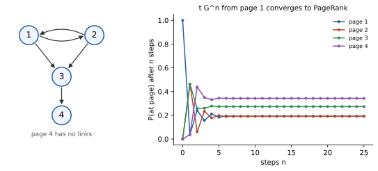
  <figcaption>Original figure for these notes, illustrating Blitzstein and Hwang, <em>Introduction to Probability</em>, Section 11.4. Running the Google chain from a fixed start converges quickly to the PageRank vector.</figcaption>
</figure>

### Part 4 — The Google matrix and teleportation

On the real web it is unclear whether every page can be reached from every other by following links, and convergence could be slow. Brin and Page's paper used instead

<div class="result-box" markdown="1">

$$
\boxed{G=\alpha Q+(1-\alpha)\frac JM,}
$$

</div>

where $$J$$ is the matrix of all 1's, $$M$$ the number of pages, and $$0<\alpha<1$$; the original paper suggested $$\alpha=0.85$$. $$J/M$$ is itself a valid transition matrix: jump to a uniformly random page.

**Interpretation.** At each step the surfer flips a coin: with probability $$\alpha$$, follow the link structure, using $$Q$$; with probability $$1-\alpha$$, **teleport** to a uniformly random page.

**Why teleport.** Every entry of $$G$$ is at least $$(1-\alpha)/M>0$$. Though tiny when $$M$$ is in the billions, it is positive. So $$G$$ is irreducible with $$G^1$$ all positive, and the main theorem of Lecture 32 applies: the stationary distribution, the **PageRank** vector, exists, is unique, and the chain converges to it from any start. The chain is still not reversible.

For the four-page web with $$\alpha=0.85$$, the PageRank vector is approximately $$(0.192,\,0.192,\,0.273,\,0.343)$$. Teleportation pulls the scores slightly toward uniform.

### Part 5 — Computing PageRank by running the chain

Solving $$\mathbf sG=\mathbf s$$ by Gaussian elimination takes on the order of $$M^3$$ operations. With $$M=10^{10}$$ pages, that is about $$10^{30}$$, impossible even on fast computers. Instead, use convergence: start from any initial distribution $$\mathbf t$$, such as uniform or all mass on page 1, and compute

$$
\mathbf tG,\quad\mathbf tG^2,\quad\mathbf tG^3,\ \ldots,
$$

each from the previous by one multiplication, until the vector stops changing.

**Each step is cheap.**

$$
\mathbf tG=\alpha\,\mathbf tQ+(1-\alpha)\frac{\mathbf tJ}M.
$$

- **$$\mathbf tQ$$:** $$Q$$ is enormous but **sparse**: a typical page has a handful of links, so almost all entries are 0. Storing and multiplying only the nonzero entries is fast, given good data structures.
- **$$\mathbf tJ$$:** each entry is the sum of the entries of $$\mathbf t$$, which is 1. So $$\mathbf tJ$$ is the vector of all 1's, and $$\mathbf tJ/M$$ is the uniform vector, at no cost.

How many steps are needed is a hard question for a chain this large; in practice the iteration runs until the vector appears to have stabilized, which gives an approximate PageRank.

**Core idea:** The Markov chain view gives PageRank both its meaning, the long-run time a random surfer spends on each page, and a practical way to compute it, by simulating the chain's distribution forward.

### Part 6 — Original practice questions

Try these before reading the answers.

1. A weighted network has nodes 1, 2, 3, 4 in a path with $$w_{12}=1$$, $$w_{23}=2$$, $$w_{34}=1$$. Find the stationary distribution of the weighted walk.
2. Add a loop of weight 2 at node 1 in question 1. Find the new stationary distribution.
3. Find weights that represent the two-state chain $$Q=\begin{pmatrix}1-a&a\\b&1-b\end{pmatrix}$$ as a weighted walk.
4. Verify that $$\mathbf s=(\frac2{11},\frac2{11},\frac3{11},\frac4{11})$$ is stationary for the four-page $$Q$$.
5. Write the second row of the Google matrix $$G$$ for the four-page web with $$\alpha=0.85$$.
6. Explain why $$J/M$$ is a valid transition matrix, and why $$\mathbf tJ/M$$ is uniform for any probability vector $$\mathbf t$$.
7. What happens to PageRank as $$\alpha\to0$$? As $$\alpha\to1$$?
8. Why does PageRank resist inflating a page's score with many dummy pages linking to it?
9. Show that the PageRank chain on the four-page web is not reversible.

### Part 7 — Practice answers

#### 1. A weighted path

Weighted degrees: $$1,\ 3,\ 3,\ 1$$, total 8. $$\mathbf s=(\frac18,\frac38,\frac38,\frac18)$$.

#### 2. Adding a loop

Node 1's weighted degree becomes 3, total 10: $$\mathbf s=(\frac3{10},\frac3{10},\frac3{10},\frac1{10})$$.

#### 3. Two states as a network

With $$\mathbf s=(\frac b{a+b},\frac a{a+b})$$: $$w_{11}=s_1(1-a)$$, $$w_{22}=s_2(1-b)$$, and $$w_{12}=w_{21}=\frac{ab}{a+b}$$.

#### 4. Checking PageRank without teleportation

Column 1: $$\frac2{11}\cdot\frac12+\frac4{11}\cdot\frac14=\frac2{11}$$. Column 2: the same, $$\frac2{11}$$. Column 3: $$\frac2{11}\cdot\frac12+\frac2{11}\cdot\frac12+\frac4{11}\cdot\frac14=\frac3{11}$$. Column 4: $$\frac3{11}+\frac4{11}\cdot\frac14=\frac4{11}$$.

#### 5. A row of $$G$$

$$0.85\,(\frac12,0,\frac12,0)+0.0375\,(1,1,1,1)=(0.4625,\ 0.0375,\ 0.4625,\ 0.0375)$$.

#### 6. Uniform teleportation

Every entry of $$J/M$$ is $$\frac1M\ge0$$ and each row sums to 1. The $$j$$th entry of $$\mathbf tJ$$ is $$\sum_it_i=1$$, so $$\mathbf tJ/M=(\frac1M,\ldots,\frac1M)$$.

#### 7. The teleportation weight

As $$\alpha\to0$$, the surfer always teleports and PageRank becomes uniform, ignoring links. As $$\alpha\to1$$, it approaches the stationary distribution of $$Q$$ alone, which may fail to exist uniquely or converge slowly on the real web.

#### 8. Dummy pages

Dummy pages that nobody links to receive little PageRank themselves, roughly only the teleportation share, so their recommendations carry little weight.

#### 9. Not reversible

Under $$G$$, $$s_3g_{34}$$ involves $$g_{34}=0.85+0.0375=0.8875$$, while $$s_4g_{43}=s_4\cdot0.25$$. With $$s_3\approx0.273$$ and $$s_4\approx0.343$$: $$0.242\ne0.086$$.

### Part 8 — Quick revision sheet

| Concept | Essential fact |
|---|---|
| Weighted walk | $$q_{ij}=w_{ij}/\sum_kw_{ik}$$, with $$w_{ij}=w_{ji}$$ |
| Stationary | $$s_i\propto\sum_kw_{ik}$$ |
| Unweighted case | $$s_i\propto d_i$$ |
| Reversible chains | All are weighted walks, with $$w_{ij}=s_iq_{ij}$$ |
| PageRank idea | Important pages are linked to by important pages |
| Score equation | $$\mathbf s=\mathbf sQ$$: stationary distribution of the random surfer |
| Dangling page | Row replaced by $$1/M$$ |
| Google matrix | $$G=\alpha Q+(1-\alpha)J/M$$, $$\alpha=0.85$$ |
| Teleportation | Makes every entry positive: existence, uniqueness, convergence |
| Not reversible | Links are one-way |
| Computation | Iterate $$\mathbf t\mapsto\mathbf tG$$; $$Q$$ sparse, $$\mathbf tJ$$ trivial |
| Four-page example | About $$(0.19,0.19,0.27,0.34)$$ |

### Term Glossary

<div class="glossary-entry" markdown="1">
<div class="gterm">Weighted random walk <span class="gcat cat-defn">Definition</span></div>

A walk on a network with symmetric edge weights that moves along each edge with probability proportional to its weight.

</div>

<div class="glossary-entry" markdown="1">
<div class="gterm">Weighted degree <span class="gcat cat-meas">Measure</span></div>

The total weight $$\sum_kw_{ik}$$ of the edges at node $$i$$; the stationary probability of a weighted walk is proportional to it.

</div>

<div class="glossary-entry" markdown="1">
<div class="gterm">PageRank <span class="gcat cat-defn">Definition</span></div>

The stationary distribution of the Google chain, used to rank web pages by the long-run fraction of time a random surfer spends on them.

</div>

<div class="glossary-entry" markdown="1">
<div class="gterm">Teleportation <span class="gcat cat-defn">Definition</span></div>

Jumping to a uniformly random page, with probability $$1-\alpha$$ at each step, which makes the Google chain irreducible with all transition probabilities positive.

</div>

<div class="glossary-entry" markdown="1">
<div class="gterm">Sparse matrix <span class="gcat cat-defn">Definition</span></div>

A matrix with mostly zero entries, such as the web's link matrix, which can be stored and multiplied efficiently.

</div>

<div class="ref-tags">
  <span class="ref-tag">Statistics 110</span>
  <span class="ref-tag">Lecture 33</span>
  <span class="ref-tag">Weighted networks</span>
  <span class="ref-tag">Reversibility</span>
  <span class="ref-tag">PageRank</span>
  <span class="ref-tag">Markov chains</span>
</div>

  </div>
</div>


## Lecture 34 - A Look Ahead

<div class="chapter-block">
  <button type="button" class="chapter-toggle" id="lecture-34-toggle" onclick="toggleLecture('lecture-34')" aria-expanded="true" aria-controls="lecture-34-body">
    <span class="chapter-toggle-left">
      <span class="chapter-badge">Lecture 34</span>
      <span>
        <span class="chapter-title">Lecture 34 - A Look Ahead</span>
        <span class="chapter-subtitle">Ten central ideas of the course, the regression slope from Adam's law, the Horvitz–Thompson estimator, and Basu's elephant</span>
      </span>
    </span>
    <span class="chapter-arrow open" id="lecture-34-arrow" aria-hidden="true">▼</span>
  </button>
  <div class="chapter-body open" id="lecture-34-body" markdown="1">

<div class="note-abstract" markdown="1">

Ten ideas carry most of the course: conditioning, symmetry, random variables and their distributions, stories, linearity, indicator random variables, LOTUS, the law of large numbers, the central limit theorem, and Markov chains. They group into three themes: how to think about randomness, how to compute expectations, and long-run behavior. Two applications show the tools beyond probability. In linear regression $$Y=\beta_0+\beta_1X+\varepsilon$$ with $$E(\varepsilon\mid X)=0$$, taking covariances and using Adam's law gives the slope $$\beta_1=\operatorname{Cov}(X,Y)/\operatorname{Var}(X)$$. In survey sampling, dividing each observation by its probability of being sampled gives the unbiased Horvitz–Thompson estimator of a population total, proved with indicators and linearity. Basu's elephant shows that unbiasedness alone does not make an estimator good.

</div>

### Notation at a Glance

<div class="notation-panel" markdown="1">

| Symbol | Meaning |
|---|---|
| $$Y=\beta_0+\beta_1X+\varepsilon$$ | Simple linear regression model |
| $$\beta_0,\beta_1$$ | Unknown intercept and slope |
| $$\varepsilon$$ | Error term, with $$E(\varepsilon\mid X)=0$$ |
| $$y_1,\ldots,y_N$$ | Fixed values for a finite population of size $$N$$ |
| $$p_j$$ | Known probability that unit $$j$$ is included in the sample |
| $$I_j$$ | Indicator that unit $$j$$ is in the sample |
| $$\hat\tau$$ | Horvitz–Thompson estimator of $$\tau=\sum_jy_j$$ |

</div>

### Learning objectives

After studying these notes, you should be able to:

- List the ten central ideas of the course and group them by theme.
- Derive the population regression slope from covariance properties and Adam's law.
- Explain the difference between probability and statistical inference.
- Define the Horvitz–Thompson estimator and prove that it is unbiased.
- Use Basu's elephant to explain why unbiasedness is not enough.

### Part 1 — Ten central ideas

| Theme | Idea | What it does |
|---|---|---|
| Thinking about randomness | 1. Conditioning | Conditional probability and expectation, Bayes' rule, conditional independence, Markov chains |
| | 2. Symmetry | Collapses long calculations to one line, but must actually be present |
| | 3. Random variables and their distributions | The objects of study, kept distinct from each other |
| | 4. Stories | Explain why the named distributions matter and how they connect |
| Computing expectations | 5. Linearity | Holds with or without independence |
| | 6. Indicator random variables | Turn counts into sums and expectations into probabilities |
| | 7. LOTUS | Expectations of functions without finding their distributions |
| Long-run behavior | 8. Law of large numbers | Sample means converge to the true mean |
| | 9. Central limit theorem | Standardized sums become Normal |
| | 10. Markov chains | Long-run behavior one step beyond i.i.d. |

Expectations reach beyond averages: variances, covariances, and probabilities (by the fundamental bridge) are all expectations.

**Probability and inference.** Probability starts from a model, such as $$\operatorname{Pois}(\lambda)$$ with $$\lambda$$ known, and asks what data are likely. **Statistical inference** goes the other way: from observed data, estimate unknown parameters or predict future data. Inference needs probability for both its language and its theorems.

### Part 2 — The regression slope from Adam's law

Simple linear regression models how $$X$$ predicts $$Y$$:

$$
Y=\beta_0+\beta_1X+\varepsilon,\qquad E(\varepsilon\mid X)=0.
$$

The error $$\varepsilon$$ is often assumed Normal, but only the conditional mean assumption is needed here: no value of $$X$$ makes the errors systematically positive or negative.

**Step 1: the error has mean 0.** By Adam's law, $$E(\varepsilon)=E\big(E(\varepsilon\mid X)\big)=0$$.

**Step 2: the error is uncorrelated with $$X$$.** Since $$E(\varepsilon)=0$$, $$\operatorname{Cov}(\varepsilon,X)=E(\varepsilon X)$$. Condition on $$X$$ and take out what's known:

$$
E(\varepsilon X)=E\big(E(\varepsilon X\mid X)\big)=E\big(X\,E(\varepsilon\mid X)\big)=E(X\cdot0)=0.
$$

**Step 3: take the covariance of both sides with $$X$$.** The constant drops out, and by bilinearity,

$$
\operatorname{Cov}(Y,X)=\beta_1\operatorname{Var}(X)+\operatorname{Cov}(\varepsilon,X)=\beta_1\operatorname{Var}(X).
$$

<div class="result-box" markdown="1">

$$
\boxed{\beta_1=\frac{\operatorname{Cov}(X,Y)}{\operatorname{Var}(X)},\qquad\beta_0=E(Y)-\beta_1E(X).}
$$

</div>

The intercept follows by taking expectations of both sides of the model. These are the population versions. The familiar sample formulas, with sums of $$(x_i-\bar x)(y_i-\bar y)$$, estimate them, and much of regression and econometrics rests on conditional expectation, Adam's law, and Eve's law, often viewed geometrically as projection.

### Part 3 — Survey sampling and the Horvitz–Thompson estimator

A finite population has $$N$$ units, such as people, each with a fixed but unknown value $$y_j$$: a height, an income, an opinion. Here the $$y_j$$ are constants, not random. The goal is the total $$\tau=\sum_{j=1}^Ny_j$$, or equivalently the mean $$\tau/N$$.

A sample of size $$n$$ is drawn by some scheme in which unit $$j$$ is included with known probability $$p_j>0$$. In a simple random sample all $$p_j$$ are equal, but in practice some people are easier to reach than others. The randomness comes only from the sampling. Let $$I_j$$ indicate that unit $$j$$ is in the sample.

<div class="example-block" markdown="1">
<div class="ex-title">Horvitz–Thompson estimator <span class="ex-pill pill-defn">Definition</span></div>

Divide each sampled value by its inclusion probability and add:

$$
\boxed{\hat\tau=\sum_{j\in\text{sample}}\frac{y_j}{p_j}=\sum_{j=1}^N\frac{y_j}{p_j}I_j.}
$$

</div>

If the sampled values are 5, 10, and 15 with inclusion probabilities $$a$$, $$b$$, $$c$$, the estimate is $$\frac5a+\frac{10}b+\frac{15}c$$.

**Unbiasedness.** Written over the sample, the denominators are random, since which units appear is random. Written with indicators over the whole population, the denominators are constants, and linearity with the fundamental bridge finishes the proof:

$$
E(\hat\tau)=\sum_{j=1}^N\frac{y_j}{p_j}E(I_j)=\sum_{j=1}^N\frac{y_j}{p_j}p_j=\sum_{j=1}^Ny_j=\tau.\qquad\blacksquare
$$

This idea, also called **inverse probability weighting**, is used very widely. A unit that was unlikely to be sampled stands in for many similar units, so its value is weighted up.

### Part 4 — Basu's elephant: unbiased is not enough

A circus owner wants the total weight of 50 elephants. Weighing elephants is hard, so he proposes to weigh one typical elephant, Stampy, and multiply by 50. A statistician objects that this is biased and insists on the Horvitz–Thompson estimator. The owner wants to weigh Stampy, and the method allows any positive inclusion probabilities, so they choose Stampy with probability $$0.99$$ and each of the other 49 elephants with probability $$\frac{0.01}{49}=\frac1{4900}$$.

They draw Stampy, as expected. The Horvitz–Thompson estimate is

$$
\hat\tau=\frac{\text{Stampy's weight}}{0.99}\approx1.01\times\text{Stampy's weight},
$$

about the weight of a single elephant, as an estimate for fifty. Had another elephant been drawn, the estimate would have been 4900 times its weight. Averaged over the sampling, the estimator is unbiased, yet in every outcome it is absurd.

<div class="misconception-block" markdown="1">

**Incorrect:** An unbiased estimator is a good estimator.

**Correction:** Unbiasedness is about the average over hypothetical repetitions. An estimator can be unbiased and still be wildly wrong every time, with enormous variance. What makes an estimator good, and how frequentist and Bayesian approaches answer that, are central questions of statistical inference.

</div>

### Part 5 — Original practice questions

Try these before reading the answers.

1. In the regression model, show that $$\beta_0=E(Y)-\beta_1E(X)$$.
2. If $$\operatorname{Var}(X)=4$$, $$\operatorname{Var}(Y)=9$$, and $$\operatorname{Corr}(X,Y)=0.5$$, find the regression slope of $$Y$$ on $$X$$.
3. Show that $$\beta_1=\operatorname{Corr}(X,Y)\dfrac{\operatorname{SD}(Y)}{\operatorname{SD}(X)}$$.
4. Use Eve's law to show $$\operatorname{Var}(Y)=\beta_1^2\operatorname{Var}(X)+E(\operatorname{Var}(\varepsilon\mid X))$$ in the regression model.
5. In a simple random sample of $$n$$ from $$N$$, every $$p_j=n/N$$. Write the Horvitz–Thompson estimator of the total and of the mean.
6. A population has values $$y=(2,4,6)$$. One unit is sampled, unit $$j$$ with probability $$p=(0.5,0.3,0.2)$$. List the possible estimates and verify unbiasedness.
7. In question 6, find the variance of $$\hat\tau$$, and compare with sampling uniformly.
8. In Basu's elephant, suppose every elephant weighs exactly $$w$$. Find the possible estimates and their probabilities, and check that the mean is $$50w$$.
9. Which of the ten central ideas are used in the Horvitz–Thompson proof?

### Part 6 — Practice answers

#### 1. The intercept

Take expectations: $$E(Y)=\beta_0+\beta_1E(X)+E(\varepsilon)$$, and $$E(\varepsilon)=0$$.

#### 2. A slope

$$\operatorname{Cov}(X,Y)=0.5\cdot2\cdot3=3$$, so $$\beta_1=\frac34$$.

#### 3. Slope and correlation

$$\beta_1=\frac{\operatorname{Corr}(X,Y)\operatorname{SD}(X)\operatorname{SD}(Y)}{\operatorname{SD}(X)^2}=\operatorname{Corr}(X,Y)\frac{\operatorname{SD}(Y)}{\operatorname{SD}(X)}$$.

#### 4. Decomposing the variance

$$E(Y\mid X)=\beta_0+\beta_1X$$ and $$\operatorname{Var}(Y\mid X)=\operatorname{Var}(\varepsilon\mid X)$$. Eve's law gives $$\operatorname{Var}(Y)=E(\operatorname{Var}(\varepsilon\mid X))+\beta_1^2\operatorname{Var}(X)$$: unexplained plus explained variance.

#### 5. Equal probabilities

$$\hat\tau=\frac Nn\sum_{j\in\text{sample}}y_j$$, and dividing by $$N$$ gives the sample mean.

#### 6. One draw

Estimates: $$\frac2{0.5}=4$$, $$\frac4{0.3}\approx13.33$$, $$\frac6{0.2}=30$$. Mean: $$0.5(4)+0.3(13.33)+0.2(30)=2+4+6=12=\tau$$.

#### 7. Variance depends on the design

$$E(\hat\tau^2)=0.5(16)+0.3(177.8)+0.2(900)\approx241.3$$, so $$\operatorname{Var}\approx241.3-144=97.3$$. With uniform $$p_j=\frac13$$, the estimates are $$6,12,18$$, with variance $$24$$. Probabilities that ran opposite to the sizes of the $$y_j$$ made the estimator much worse.

#### 8. Identical elephants

With probability 0.99 the estimate is $$w/0.99$$; with probability 0.01 it is $$4900w$$. Mean $$=w+49w=50w$$. Unbiased, but the estimate is either about $$w$$ or $$4900w$$, never close to $$50w$$.

#### 9. Ideas at work

Indicator random variables, linearity, and the fundamental bridge, which connects expectations of indicators to probabilities.

### Part 7 — Quick revision sheet

| Concept | Essential fact |
|---|---|
| Ten ideas | Conditioning, symmetry, random variables and distributions, stories, linearity, indicators, LOTUS, LLN, CLT, Markov chains |
| Three themes | Randomness; computing expectations; long-run behavior |
| Inference | From data to unknown parameters and predictions |
| Regression model | $$Y=\beta_0+\beta_1X+\varepsilon$$, $$E(\varepsilon\mid X)=0$$ |
| Key step | $$\operatorname{Cov}(\varepsilon,X)=E(X\,E(\varepsilon\mid X))=0$$ |
| Slope | $$\beta_1=\operatorname{Cov}(X,Y)/\operatorname{Var}(X)$$ |
| Intercept | $$\beta_0=E(Y)-\beta_1E(X)$$ |
| Horvitz–Thompson | $$\hat\tau=\sum y_j/p_j$$ over the sample |
| Unbiasedness proof | Rewrite with indicators; linearity; $$E(I_j)=p_j$$ |
| Basu's elephant | Unbiased yet absurd; unbiasedness is not enough |

### Term Glossary

<div class="glossary-entry" markdown="1">
<div class="gterm">Statistical inference <span class="gcat cat-defn">Definition</span></div>

Using observed data to estimate unknown parameters or predict future observations, the reverse direction from probability.

</div>

<div class="glossary-entry" markdown="1">
<div class="gterm">Linear regression <span class="gcat cat-defn">Definition</span></div>

A model $$Y=\beta_0+\beta_1X+\varepsilon$$ with $$E(\varepsilon\mid X)=0$$, so that $$E(Y\mid X)$$ is linear in $$X$$.

</div>

<div class="glossary-entry" markdown="1">
<div class="gterm">Unbiased estimator <span class="gcat cat-defn">Definition</span></div>

An estimator whose expected value equals the quantity it estimates.

</div>

<div class="glossary-entry" markdown="1">
<div class="gterm">Horvitz–Thompson estimator <span class="gcat cat-defn">Definition</span></div>

The estimator $$\sum y_j/p_j$$ of a population total, summing each sampled value divided by its inclusion probability; also called inverse probability weighting.

</div>

<div class="glossary-entry" markdown="1">
<div class="gterm">Basu's elephant <span class="gcat cat-defn">Misconception</span></div>

A story showing that an unbiased estimator can give absurd estimates in every outcome, so unbiasedness alone does not make an estimator good.

</div>

<div class="ref-tags">
  <span class="ref-tag">Statistics 110</span>
  <span class="ref-tag">Lecture 34</span>
  <span class="ref-tag">Course summary</span>
  <span class="ref-tag">Regression</span>
  <span class="ref-tag">Survey sampling</span>
  <span class="ref-tag">Horvitz–Thompson</span>
  <span class="ref-tag">Unbiasedness</span>
</div>

  </div>
</div>
